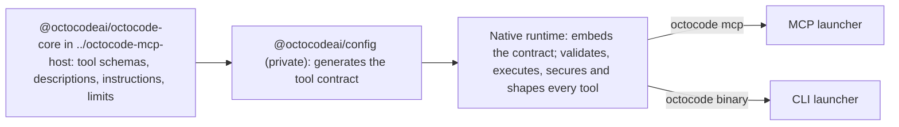
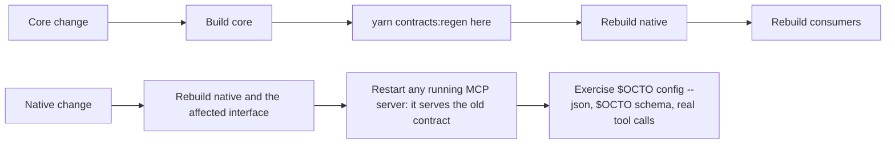

# AGENTS.md — Octocode monorepo

Octocode gives AI agents and developers evidence-first code research: search, exact reads, AST
and LSP navigation, GitHub history, and package lookup over local code, GitHub, and package
registries. One Rust engine runs every tool; an MCP server and the `octocode` CLI expose it.
Editor and agent integrations (VS Code, Claude Code, Codex) install and configure it.

Each package's `README.md`, `ARCHITECTURE.md` and `docs/` own its details;
[docs/README.md](docs/README.md) indexes the user docs, one owner doc per topic. Load the
[octocode-dev skill](skills-dev/octocode-dev/SKILL.md) before development work: it owns the task
runner, tool audits and the developer docs
([development](skills-dev/octocode-dev/docs/DEVELOPMENT.md),
[release](skills-dev/octocode-dev/docs/RELEASE.md),
[tool quality](skills-dev/octocode-dev/docs/TOOL_QUALITY.md),
[config changes](skills-dev/octocode-dev/docs/ADDING_CONFIG.md),
[scraping scripts](skills-dev/octocode-dev/docs/SCRAPING_MAINTENANCE.md)). Load any other local skill that
fits the task (e.g. `rust-best-practices`). Edit source docs, never build copies or generated ones.

## How it fits together



The MCP launcher, CLI launcher and VS Code extension are thin adapters with no tool logic.

## Working rules

- Understand the change and its context first, including every layer above that it touches.
- Write clean code with clean architecture, and never break the layering: schemas and
  descriptions go in core, implementation goes here.
- The CLI stays aligned with the MCP tools: same tools, fields and behavior.
- No rigid implementations and no handpicked solutions: solve the general case instead of
  special-casing inputs, names or test fixtures.
- No legacy paths, compatibility shims or extra complexity unless the task asks for them.
- No aliases or duplication in any layer: one name and one source for each tool, field, setting
  and piece of logic.
- Don't run `git commit` (a background process runs `git add -A` and a person owns commits) or
  `git stash` (it hides other sessions' work; compare with `git show <rev>:<path>`).
- Communicate in known protocols: issues and tasks in 5W2H, results BLUF with claim–evidence,
  blockers as SBAR, delegation as a task contract with a Definition of Done. Separate facts,
  assumptions and unknowns; never present a guess as a fact. The rest, rated by fit:
  [protocol catalog](skills/octocode-agentic-prompts/references/protocols.md#catalog).

## Packages

| Path | npm name | What it is |
|---|---|---|
| `packages/octocode-native` | `@octocodeai/octocode-native` (private) | The Rust engine: every tool, the native `octocode` binary (CLI commands and the stdio MCP server, `octocode mcp`). One published platform package per `bin/platform.cjs` entry under `npm/<platform>` carries the binaries |
| `packages/octocode-mcp` | `octocode-mcp` | Thin launcher (`npx octocode-mcp`): runs `octocode mcp` from the native binary over the same stdio; native serves both MCP protocol eras |
| `packages/octocode` | `octocode` | Node CLI launcher (`npx octocode`): forwards unchanged arguments and stdio to the native binary; native owns all commands |
| `packages/octocode-config` | `@octocodeai/config` (private) | The only tool-contract generator, plus configuration loading (home, `.env`, `.octocoderc`). Bundled into the MCP server and CLI |
| `packages/octocode-vscode` | `octocode-mcp-vscode` | VS Code extension: GitHub sign-in, token sync, MCP install across editors. Runs no research tools |
| `packages/octocode-claude-plugin` | `@octocodeai/claude-plugin` | Claude Code plugin: MCP launch config, public skills, onboarding |
| `packages/octocode-codex-plugin` | `@octocodeai/codex-plugin` | Codex plugin: MCP launch config, public skills, onboarding |
| `packages/octocode-agents-communication` | `@octocodeai/octocode-agents-communication` | MCP server and CLI for cross-agent coordination: session identity, path leases, messages |
| `packages/octocode-chrome-devtools` | `@octocodeai/octocode-chrome-devtools` | Chrome DevTools MCP server and CLI for live-browser work |
| `packages/octocode-mcp-cli` | `octocode-mcp-cli` (private) | Library that maps MCP tools and instructions to a Zod CLI and back |
| `packages/octocode-benchmark` | `@octocodeai/octocode-benchmark` (private) | Research benchmark: Octocode MCP versions against other tools, blind-judged, measured in characters and time |

Package versions are independent; the release line is listed under Release.

## Other folders

- `skills/`: public Agent Skills (`octocode skill install`); `skills-beta/`: tested, unpublished
  skills; `skills-dev/`: skills for working on this repo. `.agents/skills/` entries are symlinks
  to those folders: edit the canonical folder.
- `.claude-plugin/`, `.agents/plugins/`: plugin marketplace entries. `releases/`: packed plugin
  archives. `packages/octocode-benchmark/local/e2e/`: end-to-end suites against the built MCP server and CLI.
  `test-utils/`: shared test helpers. `assets/`: images. `MANIFEST.md`: the
  research-driven-development vision.

## Setup, run, develop

Prerequisites: Node `^24.15.0`, Yarn 4.9.1 (`corepack enable`), and Rust 1.99.1 (pinned by
`packages/octocode-native/rust-toolchain.toml`). Contract changes also need the sibling checkout
`../octocode-mcp-host` and `cargo install cargo-typify --version 0.8.0 --locked`.

```bash
DEV='node skills-dev/octocode-dev/scripts/dev.mjs'   # repo tasks; $DEV --help lists them
OCTO='node packages/octocode/out/octocode.js'        # the local CLI
corepack enable
$DEV setup && yarn install       # local resolutions: workspace packages, sibling core
$DEV build:dev                   # local build; native targets this machine only
$OCTO auth status                # GitHub tools need a token: `auth login` or `gh auth login`
$OCTO schema [<tool> --view query]
$OCTO <tool> '{"queries":[…]}'
$DEV verify                      # dedupe, docs, and each package's verify
```

For local development, checks and tests, build only the current host's native binary
(on macOS, only the current Mac architecture) and the affected launchers. Use `build:dev`;
when release-mode behavior matters, the native package's `build` also targets only the host.
Reserve `--all`, `build:all` and `build:publish` for explicitly requested release or
cross-platform work.

Without `setup`, `@octocodeai/octocode-core` resolves from npm at the version pinned in
`packages/octocode-config/package.json`. The local MCP server is the stdio command
`node packages/octocode-mcp/dist/index.js`. End-to-end suites:
`node packages/octocode-benchmark/local/e2e/harness/run-all.mjs`. CI runs `$DEV lint:ci`, `$DEV typecheck:ci` and `$DEV test:ci` (which starts with the skill checks; run `$DEV skills:check` after editing anything under `skills/`).

Change rules:



- Core pipeline details: [contract pipeline](skills-dev/octocode-dev/docs/DEVELOPMENT.md#contract-pipeline).
  Declare and implement each new field in
  `packages/octocode-native/crates/runtime/src/contracts/field-effect-coverage.json`.
- Don't hand-edit `packages/octocode-config/contract/` or `toolTypes.generated.ts`, and don't
  hand-write wire types (Zod/TypeScript copies or serde query/result structs).
- The binary embeds the contract it serves, so a stale one means regenerate and rebuild native;
  there is no runtime override.
- Configuration flows through `@octocodeai/config`; don't duplicate home, env or dotenv handling.
- Never lower coverage floors.

## Tool output keeps all the evidence

Tool results never drop or truncate evidence to save bytes. A large result returns a complete
page plus an executable `next.*` continuation that reaches every remaining row, line, file or
patch exactly once, and says so explicitly when a limit is terminal. Size reductions may only
remove duplication or metadata that carries no evidence. A silent gap is a correctness bug.
Details: [tool quality](skills-dev/octocode-dev/docs/TOOL_QUALITY.md).

## Use Octocode on this repo

Dogfood the local CLI, MCP server and skills, and turn what you learn into improvements. Prefer
them over shell reads: `localSearch` instead of `rg`/`grep`, `localFetch` instead of `cat`/`sed`,
`structureSearch` instead of `ls`/`find`, and `astSearch`/`lspSearch` for symbols. Follow every
`next.*` page or name what stays unread; `hints.*` are optional leads. Graph and AST edges are
candidates: confirm callers with `lspSearch` before claiming code is unused. When a tool has a bad
default, a misleading hint or a missing continuation, report it to the user in 5W2H instead of working around it silently; write "unknown" for any
slot you have not verified.

## Release

Publishing is owner-triggered and never runs from CI or an agent session. One release line ships
at one version: the native platform packages, `octocode-mcp` and `octocode`. Core publishes first at its own version; the Claude and Codex plugins, Homebrew
formula and VS Code extension follow. Agents-communication and Chrome DevTools
packages have their own cadence. Details: [release guide](skills-dev/octocode-dev/docs/RELEASE.md).

## Environment

Use `npx -y` to avoid prompts. Bound slow calls with a deadline; on macOS use `gtimeout` or
`perl -e 'alarm N; exec @ARGV' -- cmd`.
