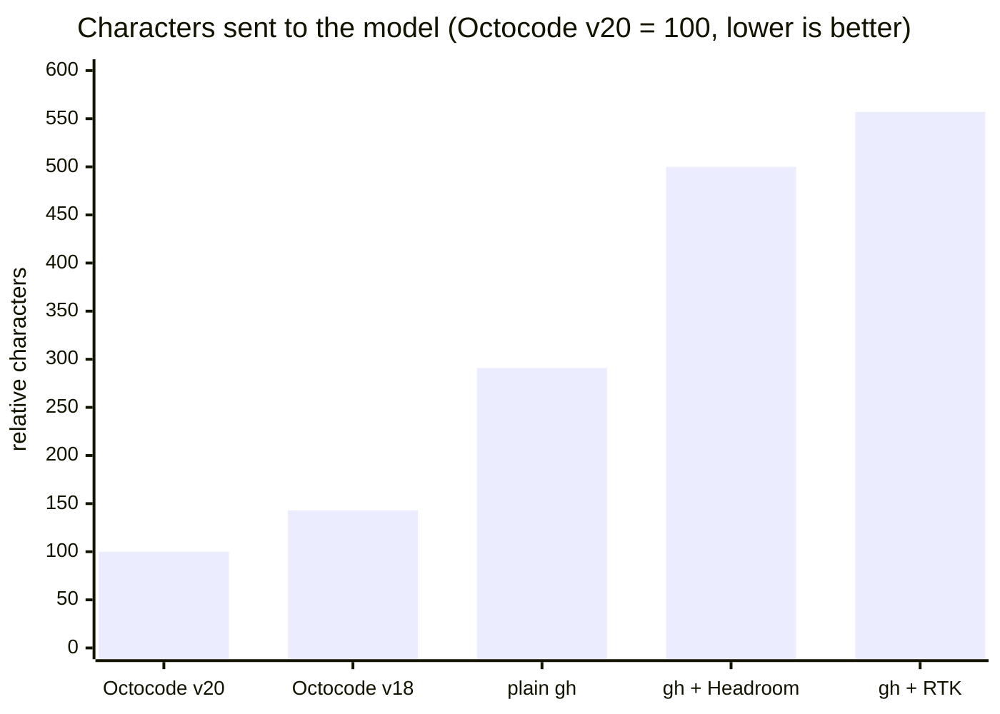

# Octocode: an agentic toolkit for software engineering

<div align="center">
  

  [](https://github.com/modelcontextprotocol/servers)
  [](https://deepwiki.com/bgauryy/octocode)
  [](https://glama.ai/mcp/servers/bgauryy/octocode)

  [](https://octocode.ai)
  [](https://www.youtube.com/@Octocode-ai)

</div>

**Evidence-first code research for AI agents and developers.**

Octocode gives Cursor, Claude, VS Code, Codex, Pi, and any MCP client deep, cited access to local code, GitHub, and package registries: search, exact reads, AST and LSP navigation, pull request history, and package lookup. One Rust engine, two interfaces: an MCP server and the `npx octocode` CLI.

## Why Octocode

- **Evidence, not guesses:** every answer cites exact files and lines.
- **Research loop:** orient → search → read exact evidence → prove identity with LSP.
- **Lean context:** reads return only the lines you need ([benchmarks](#benchmarks)).
- **Filter evidence:** optional `classification` selects relevant search hits or passages; `clasify` answers typed questions about unread source, then the agent verifies the source.
- **Keep researching:** required continuations reach the remaining evidence; related calls offer useful next steps.
- **Secure by default:** read-only research, secrets redacted, path guardrails.
- **Free and open source** under the MIT license.

The idea and the research loop: [The Octocode protocol](https://github.com/bgauryy/octocode/blob/main/docs/OCTOCODE_PROTOCOL.md) · [The manifest](https://github.com/bgauryy/octocode/blob/main/MANIFEST.md).

---

## Quick start

The npm/npx launchers require Node.js 22+. The standalone native `octocode`
binary does not require Node.js. Optional skill scripts can have their own
dependencies; follow the relevant skill's setup instructions.

### 1. Sign in to GitHub

Public repositories and local code work without signing in. For private repositories and higher rate limits, use **either** CLI:

```bash
gh auth login                    # GitHub CLI: if you are already signed in, Octocode uses it automatically
npx octocode auth login          # or the Octocode CLI: one-time browser sign-in
```

Check with `npx octocode auth status`. Tokens, GitHub Enterprise, and npm registries: [AUTHENTICATION.md](https://github.com/bgauryy/octocode/blob/main/docs/AUTHENTICATION.md).

### 2. Add Octocode to your agent

Add it to any MCP client:

```json
{
  "octocode": {
    "command": "npx",
    "type": "stdio",
    "args": ["-y", "octocode-mcp@latest"]
  }
}
```

- **Claude Code:** `claude mcp add octocode --scope user -- npx -y octocode-mcp@latest`
- **Any client:** `npx octocode install` lets you pick the client, then writes its config (`--ide <id>` skips the picker; `--list` shows ids).
- **Setup details:** [MCP guide](https://github.com/bgauryy/octocode/blob/main/docs/OCTOCODE_MCP.md).
- **One click:** [](https://cursor.com/en/install-mcp?name=octocode&config=eyJjb21tYW5kIjoibnB4IiwidHlwZSI6InN0ZGlvIiwiYXJncyI6WyIteSIsIm9jdG9jb2RlLW1jcEBsYXRlc3QiXX0=) [](https://insiders.vscode.dev/redirect/mcp/install?name=octocode&config=%7B%22command%22%3A%22npx%22%2C%22type%22%3A%22stdio%22%2C%22args%22%3A%5B%22-y%22%2C%22octocode-mcp%40latest%22%5D%7D)

<details>
<summary>More one-click installs</summary>

[](https://insiders.vscode.dev/redirect/mcp/install?name=octocode&config=%7B%22command%22%3A%22npx%22%2C%22type%22%3A%22stdio%22%2C%22args%22%3A%5B%22-y%22%2C%22octocode-mcp%40latest%22%5D%7D&quality=insiders)
[](windsurf://mcp/install?name=octocode&config=%7B%22command%22%3A%22npx%22%2C%22type%22%3A%22stdio%22%2C%22args%22%3A%5B%22-y%22%2C%22octocode-mcp%40latest%22%5D%7D)
[](https://kiro.dev/launch/mcp/add?name=octocode&config=%7B%22command%22%3A%22npx%22%2C%22type%22%3A%22stdio%22%2C%22args%22%3A%5B%22-y%22%2C%22octocode-mcp%40latest%22%5D%7D)
[](https://goose-docs.ai/extension?cmd=npx&arg=-y&arg=octocode-mcp%40latest&id=octocode&name=octocode&description=Evidence-first%20code%20research%20for%20AI%20agents)
[](https://lmstudio.ai/install-mcp?name=octocode&config=eyJjb21tYW5kIjoibnB4IiwidHlwZSI6InN0ZGlvIiwiYXJncyI6WyIteSIsIm9jdG9jb2RlLW1jcEBsYXRlc3QiXX0=)

</details>

### 3. Or use the CLI

No MCP client? Run `npx octocode`. Your agent reads the tool list it prints and calls each tool as a command ([CLI guide](https://github.com/bgauryy/octocode/blob/main/docs/OCTOCODE_CLI.md)).

### Other hosts

- **VS Code:** the [Octocode MCP](https://marketplace.visualstudio.com/items?itemName=bgauryy.octocode-mcp-vscode) extension signs in to GitHub and sets up MCP.
- **Pi skills:** `npx octocode skill install octocode-research --platform pi --global`.
- **Claude Code and Codex plugins:** coming soon ([Claude Code](https://github.com/bgauryy/octocode/blob/main/packages/octocode-claude-plugin/README.md), [Codex](https://github.com/bgauryy/octocode/blob/main/packages/octocode-codex-plugin/README.md)).

---

## Benchmarks

**TL;DR:** on 30 GitHub research questions, Octocode v20 is the most correct setup measured (9.57 out of 10). It sends the model 29% fewer characters than v18 and 3–6× fewer than the `gh` CLI setups. In a working session it is about 2× faster per call than v18.



| Setup | Characters vs Octocode v20 | Correctness (of 10) |
|---|---:|---:|
| **Octocode v20** | **1.0×** | **9.57** |
| Octocode v18 | 1.4× | 9.26 |
| plain `gh` | 2.9× | 9.28 |
| `gh` + RTK | 5.6× | 9.40 |
| `gh` + Headroom | 5.0× | 8.66 |

Every answer was scored by a blind judge against the source, and correctness was decided before cost.
- **v20:** October 2026, 1 pass.
- **v18 and the `gh` setups:** August 2026, 3 passes.

Full results, the speed comparison and the evaluation: [benchmark README](https://github.com/bgauryy/octocode/blob/main/packages/octocode-benchmark/README.md) · [benchmark method](https://github.com/bgauryy/octocode/blob/main/packages/octocode-benchmark/docs/method.md).

---

## Tools

**16 tools.** The default configuration exposes 12 tools over MCP and 16 in the CLI. All CLI tools stay available as MCP catalog settings change. MCP has separate opt-ins for graph tools, cloning, and classification. See the [CLI/MCP availability matrix](https://github.com/bgauryy/octocode/blob/main/docs/CONFIGURATION.md#tool-availability-cli-and-mcp) for defaults and setup. Provider credentials and language servers are checked when a call needs them.

Every tool runs from the CLI with the same JSON input as MCP: `npx octocode <tool> '{"queries":[…]}'`. Use `npx octocode schema <tool>` to inspect its fields. Resume an issued continuation by passing its `{ "cursor": "…" }` input unchanged.

| You want to | Tool | CLI input |
|---|---|---|
| See a project's folders and find files | `structureSearch` | `octocode structureSearch '{"queries":[{"operation":"tree","path":"src","maxDepth":3}]}'` |
| Search local code for text | `localSearch` | `octocode localSearch '{"queries":[{"matchString":["registerHandler"],"path":"src","contextLines":{"before":2,"after":2}}]}'` |
| Find functions, classes, and code patterns | `astSearch` | `octocode astSearch '{"queries":[{"operation":"match","path":"src","parser":"typescript","rule":{"pattern":"function $F($$$A) { $$$B }"}}]}'` |
| Read exact lines | `localFetch` | `octocode localFetch '{"queries":[{"path":"src/index.ts","ranges":[{"startLine":1,"endLine":40}]}]}'` |
| Find a symbol's definition, references, and callers | `lspSearch` | `octocode lspSearch '{"queries":[{"operation":"references","path":"src/index.ts","line":10,"symbolName":"run"}]}'` |
| Find a GitHub repository | `ghSearchRepo` | `octocode ghSearchRepo '{"queries":[{"operation":"search","keywords":["fuzzy finder"],"filters":{"language":"Rust"}}]}'` |
| Search code across GitHub | `ghSearchCode` | `octocode ghSearchCode '{"queries":[{"keywords":["SearcherBuilder"],"owner":"BurntSushi","repo":"ripgrep"}]}'` |
| Browse a repository at any branch or tag | `ghStructure` | `octocode ghStructure '{"queries":[{"operation":"tree","path":"crates","owner":"BurntSushi","repo":"ripgrep"}]}'` |
| Read a file from GitHub | `ghGetFileContent` | `octocode ghGetFileContent '{"queries":[{"owner":"BurntSushi","repo":"ripgrep","path":"crates/searcher/src/lib.rs","ranges":[{"startLine":1,"endLine":40}]}]}'` |
| Find pull requests, issues, and commits | `ghSearchHistory` | `octocode ghSearchHistory '{"queries":[{"operation":"pullRequest","keywords":["mmap"],"owner":"BurntSushi","repo":"ripgrep"}]}'` |
| Read a pull request, issue, or commit | `ghGetHistoryItem` | `octocode ghGetHistoryItem '{"queries":[{"operation":"pullRequest","number":2000,"owner":"BurntSushi","repo":"ripgrep"}]}'` |
| Check package versions and dependencies | `artifactSearch` | `octocode artifactSearch '{"queries":[{"operation":"resolve","packageName":"zod","ecosystem":"npm"}]}'` |
| Answer typed questions about evidence | `clasify` | `octocode clasify '{"queries":[{"operation":"evaluate","content":"The timeout defaults to 30 seconds.","questions":{"timeout":{"type":"noul","instructions":"Does this define a default timeout?"}}}]}'` |
| Clone a repository for deep local work | `ghCloneRepo` | `octocode ghCloneRepo '{"queries":[{"owner":"BurntSushi","repo":"ripgrep","paths":["crates/globset"]}]}'` |
| Build a reusable syntax graph | `graphBuild` | `octocode graphBuild '{"queries":[{"path":"src"}]}'` |
| Explore dependencies, calls and cycles | `graphQuery` | `octocode graphQuery '{"queries":[{"operation":"hubs","path":"src"}]}'` |

Full reference: [Tools](https://github.com/bgauryy/octocode/blob/main/docs/OCTOCODE_TOOLS.md) · [clasify guide](https://github.com/bgauryy/octocode/blob/main/docs/OCTOCODE_CLASIFY.md).

---

## CLI

| Command | What it does |
|---|---|
| `npx octocode` | lists the tools for your agent |
| `npx octocode auth login` | signs in to GitHub |
| `npx octocode install` | adds Octocode to your editor or agent |
| `npx octocode skill install octocode-research` | adds the research skill to your agent |
| `npx octocode config` | shows your settings |

Full guide: [CLI](https://github.com/bgauryy/octocode/blob/main/docs/OCTOCODE_CLI.md).

---

## Configuration

Start with [CONFIGURATION.md](https://github.com/bgauryy/octocode/blob/main/docs/CONFIGURATION.md): CLI/MCP availability, optional features, settings files, precedence, storage, and the complete generated settings reference.

Run `npx -y octocode config view` to edit settings, keys, and MCP client entries. The CLI keeps all tool commands available; MCP catalog settings choose what an agent sees. Both interfaces enforce filesystem policy and execution requirements.

---

## Security

- Research tools are read-only and never run shell strings.
- Text evidence is scanned for secrets before it reaches the model; explicitly selected images retain their original bytes.
- Local reads stay inside the workspace and `ALLOWED_PATHS`; secret files such as `.env` are blocked.
- `classification` and `clasify` send sanitized evidence to the classification provider, only when its key is set.

Details: [SECURITY.md](https://github.com/bgauryy/octocode/blob/main/docs/SECURITY.md).

---

## Skills

Install with `npx octocode skill install <name>` ([all skills](https://github.com/bgauryy/octocode/blob/main/skills/README.md)), or browse [skills.sh/bgauryy/octocode-mcp](https://www.skills.sh/bgauryy/octocode-mcp).

| Skill | Use it for |
|---|---|
| ⭐ [octocode-research](https://github.com/bgauryy/octocode/tree/main/skills/octocode-research) | evidence-first research, review, and debugging |
| [octocode-architect](https://github.com/bgauryy/octocode/tree/main/skills/octocode-architect) | architecture and dependency review |
| [octocode-brainstorming](https://github.com/bgauryy/octocode/tree/main/skills/octocode-brainstorming) | weighing an idea or decision from several sides |
| [octocode-rfc-generator](https://github.com/bgauryy/octocode/tree/main/skills/octocode-rfc-generator) | RFCs and execution plans |
| [octocode-documentation](https://github.com/bgauryy/octocode/tree/main/skills/octocode-documentation) | READMEs, API docs, ADRs |
| [octocode-roast](https://github.com/bgauryy/octocode/tree/main/skills/octocode-roast) | blunt, evidence-backed code critique |
| [octocode-clean-agentic-code](https://github.com/bgauryy/octocode/tree/main/skills/octocode-clean-agentic-code) | behavior-preserving cleanup |
| [octocode-eval-benchmark](https://github.com/bgauryy/octocode/tree/main/skills/octocode-eval-benchmark) | evals and honest benchmarks |
| [octocode-agentic-prompts](https://github.com/bgauryy/octocode/tree/main/skills/octocode-agentic-prompts) | better prompts and tool schemas |
| [octocode-scraping](https://github.com/bgauryy/octocode/tree/main/skills/octocode-scraping) | page extraction and crawling |
| [octocode-chrome-devtools](https://github.com/bgauryy/octocode/tree/main/skills/octocode-chrome-devtools) | browser evidence: network, console, storage |
| [octocode-skills](https://github.com/bgauryy/octocode/tree/main/skills/octocode-skills) | creating and maintaining skills |
| [octocode-agents-communication](https://github.com/bgauryy/octocode/tree/main/skills/octocode-agents-communication) | coordinating several agents |
| [octocode-graph-view](https://github.com/bgauryy/octocode/tree/main/skills/octocode-graph-view) | mapping files, imports and calls with verified graph evidence |

Unpublished: the repository skills in [`skills-dev/`](https://github.com/bgauryy/octocode/tree/main/skills-dev).

---

## Packages

| Package | What it is |
|---|---|
| [`octocode`](https://github.com/bgauryy/octocode/tree/main/packages/octocode) | the CLI |
| [`octocode-mcp`](https://github.com/bgauryy/octocode/tree/main/packages/octocode-mcp) | the MCP server |
| [`octocode-mcp-vscode`](https://github.com/bgauryy/octocode/tree/main/packages/octocode-vscode) | VS Code extension |
| [`@octocodeai/claude-plugin`](https://github.com/bgauryy/octocode/tree/main/packages/octocode-claude-plugin), [`@octocodeai/codex-plugin`](https://github.com/bgauryy/octocode/tree/main/packages/octocode-codex-plugin) | Claude Code and Codex plugins (coming soon) |
| [`@octocodeai/octocode-native`](https://github.com/bgauryy/octocode/tree/main/packages/octocode-native) | the Rust engine behind both interfaces |
| [`@octocodeai/config`](https://github.com/bgauryy/octocode/tree/main/packages/octocode-config) | configuration and tool contracts |
| [`@octocodeai/octocode-agents-communication`](https://github.com/bgauryy/octocode/tree/main/packages/octocode-agents-communication) | agent coordination |
| [`@octocodeai/octocode-chrome-devtools`](https://github.com/bgauryy/octocode/tree/main/packages/octocode-chrome-devtools) | Chrome DevTools MCP server and CLI |
| [`octocode-benchmark`](https://github.com/bgauryy/octocode/tree/main/packages/octocode-benchmark), [`octocode-mcp-cli`](https://github.com/bgauryy/octocode/tree/main/packages/octocode-mcp-cli) | benchmark and internal tooling (private) |

How the pieces fit: [DEVELOPMENT.md](https://github.com/bgauryy/octocode/blob/main/skills-dev/octocode-dev/docs/DEVELOPMENT.md).

---

## Documentation

All docs: [documentation hub](https://github.com/bgauryy/octocode/blob/main/docs/README.md).

| Topic | Docs |
|---|---|
| Concepts | [Protocol](https://github.com/bgauryy/octocode/blob/main/docs/OCTOCODE_PROTOCOL.md) · [Manifest](https://github.com/bgauryy/octocode/blob/main/MANIFEST.md) · [Workflows](https://github.com/bgauryy/octocode/blob/main/docs/OCTOCODE_WORKFLOWS.md) |
| Interfaces | [MCP](https://github.com/bgauryy/octocode/blob/main/docs/OCTOCODE_MCP.md) · [CLI](https://github.com/bgauryy/octocode/blob/main/docs/OCTOCODE_CLI.md) |
| Tools | [Tool reference](https://github.com/bgauryy/octocode/blob/main/docs/OCTOCODE_TOOLS.md) · [Data contract](https://github.com/bgauryy/octocode/blob/main/docs/TOOL_DATA_CONTRACT.md) · [clasify](https://github.com/bgauryy/octocode/blob/main/docs/OCTOCODE_CLASIFY.md) |
| Setup | [Configuration and all settings](https://github.com/bgauryy/octocode/blob/main/docs/CONFIGURATION.md) · [Authentication](https://github.com/bgauryy/octocode/blob/main/docs/AUTHENTICATION.md) · [Security](https://github.com/bgauryy/octocode/blob/main/docs/SECURITY.md) |
| Engine | [Languages](https://github.com/bgauryy/octocode/blob/main/packages/octocode-native/docs/engine/SUPPORTED_LANGUAGES_AND_FEATURES.md) · [Language servers](https://github.com/bgauryy/octocode/blob/main/packages/octocode-native/docs/engine/LSP_SERVER_LIFECYCLE.md) · [Code graph](https://github.com/bgauryy/octocode/blob/main/packages/octocode-native/docs/engine/CODE_GRAPH.md) |
| Results | [Benchmark](https://github.com/bgauryy/octocode/blob/main/packages/octocode-benchmark/README.md) |
| Contributing | [AGENTS.md](https://github.com/bgauryy/octocode/blob/main/AGENTS.md) · [Development](https://github.com/bgauryy/octocode/blob/main/skills-dev/octocode-dev/docs/DEVELOPMENT.md) · [Release](https://github.com/bgauryy/octocode/blob/main/skills-dev/octocode-dev/docs/RELEASE.md) |
| Legal | [Privacy](https://github.com/bgauryy/octocode/blob/main/PRIVACY.md) · [Terms](https://github.com/bgauryy/octocode/blob/main/TERMS.md) · [MIT license](https://github.com/bgauryy/octocode/blob/main/LICENSE) |

---

## Troubleshooting

| Problem | Fix |
|---|---|
| GitHub auth fails | `npx octocode auth status`, then `npx octocode auth login --refresh` |
| MCP cannot reach GitHub | run `npx octocode auth login` (or `gh auth login`) once, then restart the MCP server |
| Path is outside allowed roots | add the directory to `ALLOWED_PATHS` |
| Node.js errors | use Node.js 22+ for the npm/npx launchers, or run the standalone native binary without Node.js |

More fixes: [authentication](https://github.com/bgauryy/octocode/blob/main/docs/AUTHENTICATION.md#troubleshooting) · [configuration](https://github.com/bgauryy/octocode/blob/main/docs/CONFIGURATION.md#troubleshooting).
