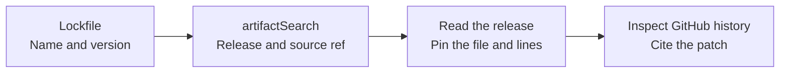

# Octocode

<div align="center">
  

  [](https://github.com/modelcontextprotocol/servers)
  [](https://deepwiki.com/bgauryy/octocode)
  [](https://glama.ai/mcp/servers/bgauryy/octocode)

  [](https://octocode.ai)
  [](https://www.youtube.com/@Octocode-ai)

</div>

Give your coding agent access to local files, GitHub repositories and package registries. It can find a symbol, read the lines that define it, trace a change through a pull request, or check the source of a dependency at the version you use.

## Install

The npm launchers require Node.js 22 or later. Prebuilt binaries cover macOS on Apple Silicon or Intel, Linux on x64 or ARM64 (glibc, or musl such as Alpine), and Windows on x64 or ARM64. The standalone `octocode` binary runs without Node.js. [Native installation](packages/octocode-native/README.md#install)

| Interface | Start here | Check that it works |
|---|---|---|
| MCP in your agent | Run `npx -y octocode install` to choose a client, or `npx -y octocode install --ide cursor` for Cursor. Restart the client. | Open a project with a README and ask “Use Octocode to read the first line of README.md.” |
| CLI in a terminal or script | Run `npx -y octocode --help` from the project directory. | Run the same read from the terminal using the example below. |

```bash
npx -y octocode localFetch '{"queries":[{"path":"README.md","ranges":[{"startLine":1,"endLine":1}]}]}'
```

For GitHub code search or private repositories, sign in on the machine that runs Octocode. Run `npx -y octocode auth login`, open the displayed URL, enter the device code, then run `npx -y octocode auth status`. Octocode can also use an existing GitHub CLI login or a token from your environment. [GitHub authentication and token precedence](docs/AUTHENTICATION.md)

[](https://cursor.com/en/install-mcp?name=octocode&config=eyJjb21tYW5kIjoibnB4IiwidHlwZSI6InN0ZGlvIiwiYXJncyI6WyIteSIsIm9jdG9jb2RlLW1jcEBsYXRlc3QiXX0=) [](https://insiders.vscode.dev/redirect/mcp/install?name=octocode&config=%7B%22command%22%3A%22npx%22%2C%22type%22%3A%22stdio%22%2C%22args%22%3A%5B%22-y%22%2C%22octocode-mcp%40latest%22%5D%7D)

<details>
<summary>More one-click installs</summary>

[](https://insiders.vscode.dev/redirect/mcp/install?name=octocode&config=%7B%22command%22%3A%22npx%22%2C%22type%22%3A%22stdio%22%2C%22args%22%3A%5B%22-y%22%2C%22octocode-mcp%40latest%22%5D%7D&quality=insiders)
[](windsurf://mcp/install?name=octocode&config=%7B%22command%22%3A%22npx%22%2C%22type%22%3A%22stdio%22%2C%22args%22%3A%5B%22-y%22%2C%22octocode-mcp%40latest%22%5D%7D)
[](https://kiro.dev/launch/mcp/add?name=octocode&config=%7B%22command%22%3A%22npx%22%2C%22type%22%3A%22stdio%22%2C%22args%22%3A%5B%22-y%22%2C%22octocode-mcp%40latest%22%5D%7D)
[](https://goose-docs.ai/extension?cmd=npx&arg=-y&arg=octocode-mcp%40latest&id=octocode&name=octocode&description=Evidence-first%20code%20research%20for%20AI%20agents)
[](https://lmstudio.ai/install-mcp?name=octocode&config=eyJjb21tYW5kIjoibnB4IiwidHlwZSI6InN0ZGlvIiwiYXJncyI6WyIteSIsIm9jdG9jb2RlLW1jcEBsYXRlc3QiXX0=)

</details>

## Tools

**17 tools.** With default settings you get 12 tools over MCP and 16 in the CLI. Both interfaces accept the same tool names and JSON inputs. Your MCP client lists its enabled tools. In the CLI, run `octocode schema` for the catalog and `octocode schema <tool> --view variants` for examples.

| Where the answer lives | What the agent can do |
|---|---|
| [Local code](docs/OCTOCODE_TOOLS.md#local-code-tools-reference) | Find files with `structureSearch`, find text with `localSearch`, match syntax with `astSearch`, read lines with `localFetch`, and trace a symbol with `lspSearch`. Build and query a dependency graph with `graphBuild` and `graphQuery`. |
| [GitHub](docs/OCTOCODE_TOOLS.md#github-tools-reference) | Find repositories and code with `ghSearchRepo` and `ghSearchCode`. Browse a revision with `ghStructure` and read it with `ghGetFileContent`. Find changes with `ghSearchHistory`, inspect them with `ghGetHistoryItem`, or get a local checkout with `ghCloneRepo`. |
| [Packages](docs/OCTOCODE_TOOLS.md#package-and-advisory-tools) | Resolve a package version, dependencies and upstream source with `artifactSearch`. Look up known advisories and affected versions with `securityCheck`. |
| [Classification](docs/OCTOCODE_CLASIFY.md) | Ask typed questions about unread sources with `clasify`, or add `classification` to a supported search or read to select results. Both require a provider key. |

## How an agent uses Octocode

Ask **“Which change introduced this behavior in the version we depend on?”**



GitHub code search uses the default-branch index. An agent checking an older release can browse its tree directly and pin its read to the returned commit. [More agent workflows](docs/OCTOCODE_PROTOCOL.md)

## Configuration

Start with `npx -y octocode config list` to inspect effective settings, defaults and sources. On a terminal with a display, `npx -y octocode config` opens the local settings page. Restart the MCP server after changing its settings.

| To enable | Setting |
|---|---|
| Graph tools in MCP | `local.beta=true` |
| Repository cloning in MCP | `tools.enableClone=true` |
| Advisory lookups in MCP | `tools.enableSecurityCheck=true` |
| Classification on either interface | Set `OCTOCODE_CLASSIFICATION_API` with `octocode config set OCTOCODE_CLASSIFICATION_API --stdin`. |

Local search and reads work with the defaults. GitHub permissions, path policy and storage mode still apply when you enable a tool. [All settings, defaults and scopes](docs/CONFIGURATION.md)

## Security

Local tools enforce workspace and path rules and redact recognized secrets from text. GitHub and registry tools contact their respective services. Classification sends selected evidence to the configured provider, including images when you supply them. Check the data sent, storage and trust settings before opening a sensitive project. [Security](docs/SECURITY.md) · [Storage and cache controls](docs/STORAGE_AND_LIMITS.md) · [Privacy](PRIVACY.md)

## Skills

Install a guided workflow for an agent that supports skills. For example, `npx -y octocode skill install octocode-research --platform codex --project-dir .` installs the research skill for this project. Other skills cover pull request review, test plans, architecture, documentation and graph exploration. [Skill catalog](skills/README.md)

## Benchmarks

On 30 GitHub research questions, the v20 CLI used about 34% as many characters as plain `gh` (geometric mean). The runs used different dates and judges. On 30 local questions Octocode scored 10.0/10 against 9.6 for a lean shell, while the shell used fewer characters. The benchmark guide includes the tasks, versions, comparisons and method. [Benchmark results](packages/octocode-benchmark/README.md)

## Documentation

[User guides and reference](docs/README.md) · [CLI](docs/OCTOCODE_CLI.md) · [MCP client setup](docs/OCTOCODE_MCP.md) · [Tool catalog](docs/OCTOCODE_TOOLS.md) · [Language support](packages/octocode-native/docs/engine/SUPPORTED_LANGUAGES_AND_FEATURES.md)

[VS Code extension](packages/octocode-vscode/README.md) · [Claude Code plugin](packages/octocode-claude-plugin/README.md) · [Codex plugin](packages/octocode-codex-plugin/README.md) · [Contributing](AGENTS.md) · [MIT license](LICENSE)
