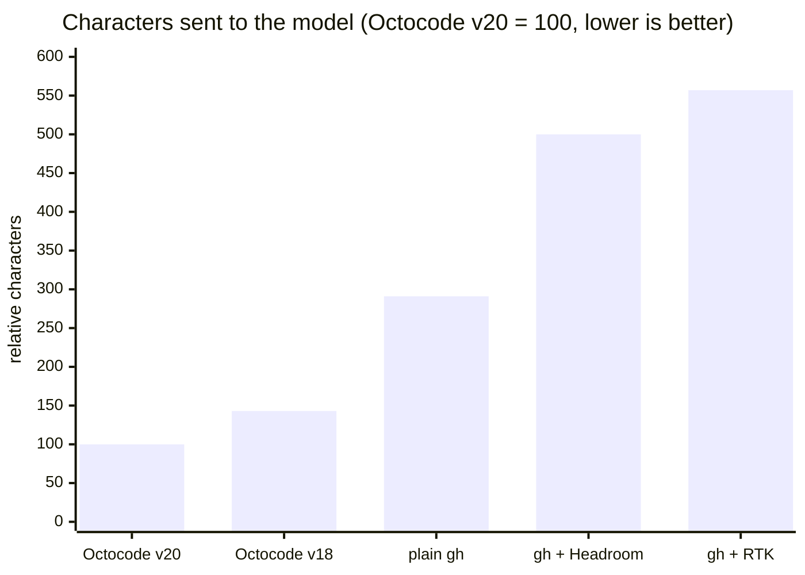

# Octocode: evidence-first code research for AI agents

<div align="center">
  

  [](https://github.com/modelcontextprotocol/servers)
  [](https://deepwiki.com/bgauryy/octocode)
  [](https://glama.ai/mcp/servers/bgauryy/octocode)

  [](https://octocode.ai)
  [](https://www.youtube.com/@Octocode-ai)

</div>

Octocode gives your AI agent cited access to local code, GitHub and package registries: search, exact reads, AST and LSP navigation, pull request history and package lookup. One Rust engine runs every tool, through an MCP server and the `octocode` CLI. It is read-only by default, redacts secrets, and is free and open source under the MIT license.

**[Install](#install)** · **[Benchmarks](#benchmarks)** · **[Tools](#tools)** · **[Interfaces](#interfaces)** · **[Configuration](#configuration)** · **[Security](#security)** · **[Skills](#skills)** · **[Docs](#documentation)**

## Why Octocode

- **Answers an agent can back up.** Every read returns exact files and lines, and every GitHub claim can pin a commit. The agent quotes evidence rather than recalling it.
- **Less to read.** Reads return the lines you ask for, not whole files, and results stay small until you ask for more. [Measured below](#benchmarks).
- **No evidence lost to size.** Long results page losslessly, and a continuation reaches every remaining row.
- **Names resolved, not guessed.** LSP proves what a symbol is and who calls it; text search only finds spelling.
- **Questions over files you have not read.** `clasify` answers typed questions about unread sources, so the agent reads only what matters.

The idea behind it: [the Octocode protocol](https://github.com/bgauryy/octocode/blob/main/docs/OCTOCODE_PROTOCOL.md) · [the manifest](https://github.com/bgauryy/octocode/blob/main/MANIFEST.md).

---

## Install

Local code and public repositories need no account or key. The `npx` commands need Node.js 22+. npm also installs the prebuilt native `octocode` binary, which runs without Node.js.

**1. Add Octocode to your agent.** Pick your client from a list, or name it:

```bash
npx octocode install                # choose a client from a list
npx octocode install --ide cursor   # or name it; --list shows every id
```

Clients: `cursor`, `claude-code`, `claude-desktop`, `vscode-cline`, `vscode-roo`, `vscode-continue`, `windsurf`, `zed`, `trae`, `kiro`, `antigravity`, `gemini-cli`, `opencode`, `codex`.

Or add it by hand to your client's MCP config (`~/.cursor/mcp.json` for Cursor):

```json
{
  "mcpServers": {
    "octocode": {
      "command": "npx",
      "type": "stdio",
      "args": ["-y", "octocode-mcp@latest"]
    }
  }
}
```

One click: [](https://cursor.com/en/install-mcp?name=octocode&config=eyJjb21tYW5kIjoibnB4IiwidHlwZSI6InN0ZGlvIiwiYXJncyI6WyIteSIsIm9jdG9jb2RlLW1jcEBsYXRlc3QiXX0=) [](https://insiders.vscode.dev/redirect/mcp/install?name=octocode&config=%7B%22command%22%3A%22npx%22%2C%22type%22%3A%22stdio%22%2C%22args%22%3A%5B%22-y%22%2C%22octocode-mcp%40latest%22%5D%7D)

<details>
<summary>More one-click installs</summary>

[](https://insiders.vscode.dev/redirect/mcp/install?name=octocode&config=%7B%22command%22%3A%22npx%22%2C%22type%22%3A%22stdio%22%2C%22args%22%3A%5B%22-y%22%2C%22octocode-mcp%40latest%22%5D%7D&quality=insiders)
[](windsurf://mcp/install?name=octocode&config=%7B%22command%22%3A%22npx%22%2C%22type%22%3A%22stdio%22%2C%22args%22%3A%5B%22-y%22%2C%22octocode-mcp%40latest%22%5D%7D)
[](https://kiro.dev/launch/mcp/add?name=octocode&config=%7B%22command%22%3A%22npx%22%2C%22type%22%3A%22stdio%22%2C%22args%22%3A%5B%22-y%22%2C%22octocode-mcp%40latest%22%5D%7D)
[](https://goose-docs.ai/extension?cmd=npx&arg=-y&arg=octocode-mcp%40latest&id=octocode&name=octocode&description=Evidence-first%20code%20research%20for%20AI%20agents)
[](https://lmstudio.ai/install-mcp?name=octocode&config=eyJjb21tYW5kIjoibnB4IiwidHlwZSI6InN0ZGlvIiwiYXJncyI6WyIteSIsIm9jdG9jb2RlLW1jcEBsYXRlc3QiXX0=)

</details>

Restart your client, then check it by asking your agent to read one line of a local file.

**2. Sign in to GitHub** for private repositories and higher rate limits. If you already use the GitHub CLI, Octocode picks that up.

```bash
gh auth login               # GitHub CLI
npx octocode auth login     # or Octocode's own one-time browser sign-in
npx octocode auth status    # check
```

**3. Add keys only if you want what they unlock**, such as `clasify` or web search. See [Keys and providers](#keys-and-providers).

New to this? The [`octocode-get-started`](https://github.com/bgauryy/octocode/tree/main/skills/octocode-get-started) skill walks an agent through setup. Tokens, GitHub Enterprise and npm registries: [authentication](https://github.com/bgauryy/octocode/blob/main/docs/AUTHENTICATION.md).

---

## Benchmarks

| Compared with | Result | The catch |
|---|---|---|
| [GitHub CLI](#github-research-octocode-vs-gh) on 30 GitHub questions | Close on correctness (9.57 of 10 vs 9.28 for plain `gh`), with 2.9–5.6× fewer characters | The `gh` answers are stored from an earlier campaign, with a different judge |
| [A lean shell](#local-code-octocode-vs-a-shell) on 30 local questions | More correct (10.0 vs 9.6), same speed | The shell used 19% fewer characters |
| [Reading the files](#unread-sources-clasify) when using `clasify` | On large unread sources, the main agent reads 73–98% fewer tokens | No gain on small files, a loss when file names suffice, more total tokens across several files, and agents don't reach for it unprompted |
| [Registry APIs and `npm view`](#packages-artifactsearch-vs-registry-clients) for a package lookup | 120–600× smaller than the full JSON | `npm view` with named fields is 1.4–5× smaller, on npm only |
| [Octocode v18](#speed-v20-vs-v18) | v20 is 1.5–2.3× faster per typical task in a session | Total time gained 1.0–1.9×, some calls got slower, and a cold call is 1.3–2.0× slower |

How to read these:

- **Correctness comes first.** A judge who cannot see which tool wrote an answer scores it from 0 to 10 against the source, and a wrong answer never wins on size.
- **Characters** are what reached the model, counted from call logs.
- **"×" figures** are geometric means of per-question or per-task ratios, so they differ from a ratio of medians or totals.
- **The questions are our own**, and the raw campaign files stay local rather than in this repository.
- **Versions:** v18 and 19.1.0 are earlier releases, and v20 figures come from the build of each run's date. `ghCloneRepo` and the graph tools have no comparison yet.

### GitHub research: Octocode vs `gh`

Same 30 questions, one fresh agent per question. Octocode v20 ran through its CLI.



| Setup | Correctness (of 10) | Characters vs v20 (95% CI) | v20 leaner on | Median characters |
|---|---:|---:|---:|---:|
| **Octocode v20** | **9.57** | **1.0×** | — | **13,872** |
| Octocode v18 | 9.26 | 1.43× (1.21–1.70) | 23 of 30 | 16,233 |
| plain `gh` | 9.28 | 2.91× (1.78–4.69) | 22 of 30 | 37,560 |
| `gh` + [RTK](https://github.com/rtk-ai/rtk) | 9.40 | 5.57× (3.33–9.57) | 24 of 30 | 68,395 |
| `gh` + Headroom | 8.66 | 5.00× (2.72–9.62) | 24 of 30 | 72,681 |

The gap is mostly reads: `gh` has no line-range read, so it fetches whole files.

**Limits:** v20 is one pass from October 2026 with an Opus 5.5 judge. The others are three passes from August 2026 with a gpt-5.5 judge, and their answers were reused rather than rerun. Treat the correctness scores as close and the character gap as the finding; exact sizes need a same-day rerun.

### Local code: Octocode vs a shell

30 questions on pinned repositories, one fresh agent per question, on a pre-release v20 build over MCP (October 2026, one pass, gpt-5.5 judge). The shell had `rg`, `grep`, `find`, `sed -n`, `git` and `ast-grep`.

| | Octocode | Lean shell | Octocode 19.1.0 |
|---|---:|---:|---:|
| Correctness (of 10) | **10.0** | 9.60 | 9.63 |
| Median characters per question | 3,839 | **3,339** | 9,261 |
| Characters vs Octocode (95% CI) | 1× | **0.81×** (0.68–0.96) | 2.32× (2.01–2.69) |
| Median seconds per question | 7.0 | 7.3 | 10.4 |
| Time vs Octocode (95% CI) | 1× | 1.01× (0.93–1.09) | 1.67× (1.50–1.89) |

Each pair was judged separately: Octocode's 10.0 is from the pair against the shell, and it scored 9.93 against 19.1.0.

Octocode was more correct on 8 questions and the shell on none (p = 0.01). Every shell loss was a precision miss: agents reading with `sed -n` get no line numbers and miscounted. A shell is still the leaner choice for one-line idioms such as the first line of every file, and on the basic and edge-case questions overall (0.70× and 0.53×). On advanced and workflow questions the two were level.

### Unread sources: `clasify`

`clasify` answers typed questions about a source so the main agent never reads the body. It is powered by [Jev](https://docs.typesafe.ai/introduction) and needs a key. Single runs from November 2026, in main-agent tokens:

| Task | Without | With | Main agent saves | Provider tokens |
|---|---:|---:|---:|---:|
| One named fact in an unread 33 KB doc | 8.4k | 0.15k | **98%** | 8.1k |
| Map 3 questions across 30 GitHub files | 98.6k | 15.6k | **84%** | 134k |
| 3 questions over 100 Java files, all hit lines | 26.8k | 4.1k | **85%** | 131k |
| Map 3 questions across 100 Java files | 137.8k | 36.8k | **73%** | 156k |
| A literal in one small file | 0.09k | 0.07k | 0.02k | 3.2k |
| When file names alone answer it | 2.2k | 4.1k | **costs 1.9k more** | 131k |

**What it saves is the main agent's context, not total tokens.** Count the provider's tokens too and one fact costs about the same, while every multi-file task costs more in total.

**When it does not pay:** the answer has a fixed spelling, the source is small, or you need counts or proof of absence. A "no" clears nothing: it caught only 16 of 30 contradictions between documents and 5 of 18 log-order facts, with no false positives. In 70 agent runs where it was only offered, agents never called it and saved nothing (1.01× and 1.04× the characters of runs without it), so ask for it directly. [Full tables](https://github.com/bgauryy/octocode/blob/main/docs/OCTOCODE_CLASIFY.md#benchmarks-main-agent-tokens-with-and-without-jev).

### Packages: `artifactSearch` vs registry clients

Characters for one lookup of the latest version, repository and dependencies (November 2026, one run):

| Package | `artifactSearch` | Registry's full JSON | `npm view <pkg> version repository.url gitHead dependencies --json` |
|---|---:|---:|---:|
| `zod` (npm) | 731 | 89,723 | **147** |
| `typescript` (npm) | 1,637 | 318,171 | **1,198** |
| `react` (npm) | 686 | 337,209 | **145** |
| `requests` (PyPI) | **695** | 192,961 | — |
| `serde` (crates.io) | **732** | 440,993 | — |

If you know the fields and the registry, `npm view` is smaller. `artifactSearch` gives one call across eight registries (npm, PyPI, crates.io, Maven, NuGet, Go, Packagist, RubyGems) with no fields to know, and its result includes ready calls for reading the package's source. Size only: answer quality was not judged here.

### Speed: v20 vs v18

Fresh CLI process per call, 7 tasks per group, 5 repetitions each with a different query, October 2026. *Warm* is a session after its first call, when the CLI reuses a background server. *Cold* is a single call with nothing running.

| Group | Total ms: v18 | v20 warm | v20 cold | Typical task, warm | Total time, warm | Typical task, cold |
|---|---:|---:|---:|---:|---:|---:|
| GitHub tools | 5,774 | **4,135** | 7,485 | **2.01× faster** | 1.40× faster | 1.3× slower |
| Local tools, tokio | 1,378 | **710** | 2,823 | **2.30× faster** | 1.94× faster | 2.0× slower |
| Local tools, 19k-file TypeScript repo | 2,668 | **2,645** | 4,868 | **1.51× faster** | 1.01× faster | 1.9× slower |

Typical is the geometric mean of the seven tasks' own ratios, and total is the sum of their medians. They differ because the gains are uneven:

- **The GitHub gain is mostly two tasks:** file outline (13×) and package lookup (8×), which include v20's response cache.
- **Slower even when warm:** GitHub repo lookup (805 → 1,296 ms), GitHub repo tree (515 → 870 ms), and AST search on the 19k-file repo (621 → 1,156 ms). That AST result is why its total barely moved.
- **Cold start is the regression to fix:** a one-off call on one small file takes about 300 ms, against 160 ms for v18.

Method and how to run your own: [benchmark guide](https://github.com/bgauryy/octocode/blob/main/packages/octocode-benchmark/README.md) · [method](https://github.com/bgauryy/octocode/blob/main/packages/octocode-benchmark/docs/method.md).

---

## Tools

**16 tools.** The default configuration exposes 12 tools over MCP and 16 in the CLI. These add the other four to MCP ([details](https://github.com/bgauryy/octocode/blob/main/docs/CONFIGURATION.md#tool-availability-cli-and-mcp)):

```bash
npx octocode config set local.beta true                 # graphBuild, graphQuery
npx octocode config set tools.enableClone true          # ghCloneRepo
npx octocode config set OCTOCODE_CLASSIFICATION_API --stdin   # clasify; paste the key, then Ctrl-D
```

Every tool takes the same JSON in both interfaces. `npx octocode schema <tool>` shows its fields. Long results come with a cursor to pass back unchanged: `octocode <tool> '{"cursor":"…"}'`.

**Local code**

| You want to | Tool | CLI |
|---|---|---|
| See folders, find files by name, size or date | `structureSearch` | `octocode structureSearch '{"queries":[{"operation":"tree","path":"src","maxDepth":3}]}'` |
| Search for text | `localSearch` | `octocode localSearch '{"queries":[{"matchString":["registerHandler"],"path":"src","contextLines":{"before":2,"after":2}}]}'` |
| Find code by shape: functions, classes, patterns | `astSearch` | `octocode astSearch '{"queries":[{"operation":"match","path":"src","parser":"typescript","rule":{"pattern":"function $F($$$A) { $$$B }"}}]}'` |
| Read exact lines | `localFetch` | `octocode localFetch '{"queries":[{"path":"src/index.ts","ranges":[{"startLine":1,"endLine":40}]}]}'` |
| Find a symbol's definition, references or callers | `lspSearch` | `octocode lspSearch '{"queries":[{"operation":"callers","path":"src/index.ts","line":10,"symbolName":"run"}]}'` |

**GitHub**

| You want to | Tool | CLI |
|---|---|---|
| Find a repository | `ghSearchRepo` | `octocode ghSearchRepo '{"queries":[{"operation":"search","keywords":["fuzzy finder"],"filters":{"language":"Rust"}}]}'` |
| Search code | `ghSearchCode` | `octocode ghSearchCode '{"queries":[{"keywords":["SearcherBuilder"],"owner":"BurntSushi","repo":"ripgrep"}]}'` |
| Browse a repository at any branch or tag | `ghStructure` | `octocode ghStructure '{"queries":[{"operation":"tree","path":"crates","owner":"BurntSushi","repo":"ripgrep"}]}'` |
| Read a file | `ghGetFileContent` | `octocode ghGetFileContent '{"queries":[{"owner":"BurntSushi","repo":"ripgrep","path":"crates/searcher/src/lib.rs","ranges":[{"startLine":1,"endLine":40}]}]}'` |
| Find pull requests, issues and commits | `ghSearchHistory` | `octocode ghSearchHistory '{"queries":[{"operation":"pullRequest","keywords":["mmap"],"owner":"BurntSushi","repo":"ripgrep"}]}'` |
| Read one pull request, issue or commit | `ghGetHistoryItem` | `octocode ghGetHistoryItem '{"queries":[{"operation":"pullRequest","number":2000,"owner":"BurntSushi","repo":"ripgrep"}]}'` |
| Clone for deep local work *(MCP opt-in)* | `ghCloneRepo` | `octocode ghCloneRepo '{"queries":[{"owner":"BurntSushi","repo":"ripgrep","paths":["crates/globset"]}]}'` |

**Packages, judgment and graphs**

| You want to | Tool | CLI |
|---|---|---|
| Check versions, dependencies and source for a package | `artifactSearch` | `octocode artifactSearch '{"queries":[{"operation":"resolve","packageName":"zod","ecosystem":"npm"}]}'` |
| Ask typed questions about unread evidence, such as `noul` for a yes/no probability *(needs a key)* | `clasify` | `octocode clasify '{"queries":[{"operation":"evaluate","content":"The timeout defaults to 30 seconds.","questions":{"timeout":{"type":"noul","instructions":"Does this define a default timeout?"}}}]}'` |
| Build a reusable code graph *(MCP opt-in)* | `graphBuild` | `octocode graphBuild '{"queries":[{"path":"src"}]}'` |
| Query dependencies, calls and cycles *(MCP opt-in)* | `graphQuery` | `octocode graphQuery '{"queries":[{"operation":"hubs","path":"src"}]}'` |

**Languages:** AST search has 13 grammars for 12 languages: C, C++, CUDA, Assembly, C#, Go, Java, Python, Rust, Scala, JavaScript and TypeScript, where TSX is its own grammar. LSP needs that language's server, and `octocode lsp-server` installs the ones it can. [Full matrix, including each language's server](https://github.com/bgauryy/octocode/blob/main/packages/octocode-native/docs/engine/SUPPORTED_LANGUAGES_AND_FEATURES.md).

Reference: [every tool's fields](https://github.com/bgauryy/octocode/blob/main/docs/OCTOCODE_TOOLS.md) · [which tool when](https://github.com/bgauryy/octocode/blob/main/skills/octocode-research/references/tool-flow.md) · [`clasify` guide](https://github.com/bgauryy/octocode/blob/main/docs/OCTOCODE_CLASIFY.md).

---

## Interfaces

| Interface | Use it when | Start |
|---|---|---|
| **MCP server** | Your agent speaks MCP | `npx -y octocode-mcp@latest` · [MCP guide](https://github.com/bgauryy/octocode/blob/main/docs/OCTOCODE_MCP.md) |
| **CLI** | No MCP client, scripts, or an agent that runs commands | `npx octocode` lists the tools · [CLI guide](https://github.com/bgauryy/octocode/blob/main/docs/OCTOCODE_CLI.md) |
| **Skills** | You want a guided workflow on top of the tools | [Skills](#skills) |
| **VS Code extension** | You want GitHub sign-in and MCP setup in the editor | [Octocode MCP](https://marketplace.visualstudio.com/items?itemName=bgauryy.octocode-mcp-vscode) |
| **Claude Code and Codex plugins** | Coming soon | [Claude Code](https://github.com/bgauryy/octocode/blob/main/packages/octocode-claude-plugin/README.md) · [Codex](https://github.com/bgauryy/octocode/blob/main/packages/octocode-codex-plugin/README.md) |

| Command | What it does |
|---|---|
| `octocode` | Lists the tools for your agent |
| `octocode <tool> '{"queries":[…]}'` | Runs a tool and prints text; `--json` for JSON |
| `octocode schema <tool>` | Shows a tool's fields; `--view variants` for operations and an example |
| `octocode install` | Adds Octocode to a client; `--list`, `--ide <id>`, `--remove` |
| `octocode auth login` · `status` · `logout` | Manages GitHub sign-in |
| `octocode config` | Opens the settings page; `list`, `get`, `set`, `check`, `unset` in the terminal |
| `octocode skill install <name>` | Installs a skill; `skill list` shows them all |
| `octocode lsp-server` | Manages language servers: `list`, `install`, `status`, `uninstall`, `clean` |
| `octocode cache clear` | Clears retained work, keeping clones and graphs |

---

## Configuration

Everything has a default, and local tools need nothing set. Run `npx octocode config` for a private local page with every key, setting and environment variable, or `npx octocode config list` for the same in the terminal.

For each value, the first of these wins: shell or MCP `env` block, workspace `.octocode/.env`, `~/.octocode/.env`, workspace `.octocode/.octocoderc`, `~/.octocode/.octocoderc`, then the default.

### Keys and providers

| To use | Set | Default |
|---|---|---|
| GitHub tools | `npx octocode auth login`, or `GH_TOKEN` / `GITHUB_TOKEN` | none |
| `clasify`, and the `classification` field on searches and reads | `OCTOCODE_CLASSIFICATION_API`, a key from [Jev](https://docs.typesafe.ai/introduction) | unset (off) |
| A proxy or gateway for classification | `OCTOCODE_CLASSIFICATION_API_HOST` (setting `classification.apiHost`), home only | `https://api.typesafe.ai` |
| Web search in `octocode-brainstorming` | `TAVILY_API_KEY`, `EXA_API_KEY` or `SERPER_API_KEY` | unset |
| Page scraping in `octocode-scraping` | `SCRAPING_ANT` | unset |
| Local paths outside the workspace | `ALLOWED_PATHS`, comma-separated (setting `local.allowedPaths`) | none |

```bash
npx octocode config set TAVILY_API_KEY --stdin    # paste the key, then Ctrl-D; saved to ~/.octocode/.env, never printed back
npx octocode config check TAVILY_API_KEY          # exit 0 set, 1 unset
npx octocode config set classification.apiHost https://gateway.example.com
npx octocode config set ALLOWED_PATHS /path/to/other/repo
```

Every setting has one name for `.octocoderc` and one for the environment, and `config set` takes either. Keys are stored as plain text in `.env`, readable only by you. A home-only value cannot be set from a repository's files, so a checked-out repo cannot redirect your key.

[All settings and defaults](https://github.com/bgauryy/octocode/blob/main/docs/CONFIGURATION.md#all-settings-and-defaults) · [configuration guide](https://github.com/bgauryy/octocode/blob/main/docs/CONFIGURATION.md) · [home folder, storage and limits](https://github.com/bgauryy/octocode/blob/main/docs/STORAGE_AND_LIMITS.md).

---

## Security

- **Read-only research.** Tools never run shell strings. `ghCloneRepo`, an opt-in, writes only to the Octocode home.
- **Secrets redacted.** Text evidence is scanned before it reaches the model. Explicitly selected images keep their original bytes.
- **Local reads stay inside.** Only the workspace and `ALLOWED_PATHS` are readable, and secret files such as `.env` are blocked.
- **What leaves your machine.** GitHub and registry tools call those services. `clasify` and `classification` send sanitized evidence to the classification provider, only when a key is set. Skills using a web-search or scraping key send their queries to that service. Octocode collects no remote usage events.

[Security model](https://github.com/bgauryy/octocode/blob/main/docs/SECURITY.md) · [privacy](https://github.com/bgauryy/octocode/blob/main/PRIVACY.md).

---

## Skills

Skills guide an agent through a whole task using the tools. Install one with `npx octocode skill install <name>`, or browse [skills.sh/bgauryy/octocode-mcp](https://www.skills.sh/bgauryy/octocode-mcp). [All skills](https://github.com/bgauryy/octocode/blob/main/skills/README.md).

| Skill | Use it for |
|---|---|
| [octocode-get-started](https://github.com/bgauryy/octocode/tree/main/skills/octocode-get-started) | Setup, keys and a first task |
| ⭐ [octocode-research](https://github.com/bgauryy/octocode/blob/main/skills/octocode-research/SKILL.md) | Evidence-first research and debugging |
| [octocode-pr-review](https://github.com/bgauryy/octocode/blob/main/skills/octocode-pr-review/SKILL.md) | PR and diff review with a merge verdict |
| [octocode-architect](https://github.com/bgauryy/octocode/tree/main/skills/octocode-architect) | Architecture and dependency review |
| [octocode-graph-view](https://github.com/bgauryy/octocode/tree/main/skills/octocode-graph-view) | Mapping files, imports and calls |
| [octocode-brainstorming](https://github.com/bgauryy/octocode/tree/main/skills/octocode-brainstorming) | Weighing an idea with checked sources |
| [octocode-rfc-generator](https://github.com/bgauryy/octocode/blob/main/skills/octocode-rfc-generator/SKILL.md) | RFCs and execution plans |
| [octocode-documentation](https://github.com/bgauryy/octocode/blob/main/skills/octocode-documentation/SKILL.md) | READMEs, guides and ADRs |
| [octocode-roast](https://github.com/bgauryy/octocode/tree/main/skills/octocode-roast) | Blunt, evidence-backed critique |
| [octocode-clean-agentic-code](https://github.com/bgauryy/octocode/blob/main/skills/octocode-clean-agentic-code/SKILL.md) | Behavior-preserving cleanup |
| [octocode-eval-benchmark](https://github.com/bgauryy/octocode/blob/main/skills/octocode-eval-benchmark/SKILL.md) | Evals and honest benchmarks |
| [octocode-agentic-prompts](https://github.com/bgauryy/octocode/blob/main/skills/octocode-agentic-prompts/SKILL.md) | Prompts and tool schemas |
| [octocode-scraping](https://github.com/bgauryy/octocode/tree/main/skills/octocode-scraping) | Page extraction and crawling |
| [octocode-chrome-devtools](https://github.com/bgauryy/octocode/tree/main/skills/octocode-chrome-devtools) | Live browser evidence |
| [octocode-skills](https://github.com/bgauryy/octocode/tree/main/skills/octocode-skills) | Creating and maintaining skills |
| [octocode-agents-communication](https://github.com/bgauryy/octocode/tree/main/skills/octocode-agents-communication) | Coordinating several agents |
| [octocode-workflows](https://github.com/bgauryy/octocode/tree/main/skills/octocode-workflows) | Multi-actor workflows |

---

## Packages

| Package | What it is |
|---|---|
| [`octocode`](https://github.com/bgauryy/octocode/tree/main/packages/octocode) | The CLI |
| [`octocode-mcp`](https://github.com/bgauryy/octocode/tree/main/packages/octocode-mcp) | The MCP server |
| [`@octocodeai/octocode-native`](https://github.com/bgauryy/octocode/tree/main/packages/octocode-native) | The Rust engine behind both |
| [`octocode-mcp-vscode`](https://github.com/bgauryy/octocode/tree/main/packages/octocode-vscode) | VS Code extension |
| [`@octocodeai/claude-plugin`](https://github.com/bgauryy/octocode/tree/main/packages/octocode-claude-plugin), [`@octocodeai/codex-plugin`](https://github.com/bgauryy/octocode/tree/main/packages/octocode-codex-plugin) | Claude Code and Codex plugins (coming soon) |
| [`@octocodeai/octocode-agents-communication`](https://github.com/bgauryy/octocode/tree/main/packages/octocode-agents-communication) | Agent coordination |
| [`@octocodeai/octocode-chrome-devtools`](https://github.com/bgauryy/octocode/tree/main/packages/octocode-chrome-devtools) | Chrome DevTools MCP server and CLI |
| [`@octocodeai/config`](https://github.com/bgauryy/octocode/tree/main/packages/octocode-config) | The one source of configuration and tool contracts (private) |
| [`octocode-benchmark`](https://github.com/bgauryy/octocode/tree/main/packages/octocode-benchmark), [`octocode-mcp-cli`](https://github.com/bgauryy/octocode/tree/main/packages/octocode-mcp-cli) | Benchmark and internal tooling (private) |

---

## Documentation

[Documentation hub](https://github.com/bgauryy/octocode/blob/main/docs/README.md).

| Topic | Docs |
|---|---|
| Concepts | [Protocol](https://github.com/bgauryy/octocode/blob/main/docs/OCTOCODE_PROTOCOL.md) · [Manifest](https://github.com/bgauryy/octocode/blob/main/MANIFEST.md) · [Which tool when](https://github.com/bgauryy/octocode/blob/main/skills/octocode-research/references/tool-flow.md) |
| Interfaces | [MCP](https://github.com/bgauryy/octocode/blob/main/docs/OCTOCODE_MCP.md) · [CLI](https://github.com/bgauryy/octocode/blob/main/docs/OCTOCODE_CLI.md) |
| Tools | [Tool reference](https://github.com/bgauryy/octocode/blob/main/docs/OCTOCODE_TOOLS.md) · [Data contract](https://github.com/bgauryy/octocode/blob/main/docs/TOOL_DATA_CONTRACT.md) · [`clasify`](https://github.com/bgauryy/octocode/blob/main/docs/OCTOCODE_CLASIFY.md) |
| Setup | [Configuration](https://github.com/bgauryy/octocode/blob/main/docs/CONFIGURATION.md) · [Authentication](https://github.com/bgauryy/octocode/blob/main/docs/AUTHENTICATION.md) · [Storage and limits](https://github.com/bgauryy/octocode/blob/main/docs/STORAGE_AND_LIMITS.md) · [Security](https://github.com/bgauryy/octocode/blob/main/docs/SECURITY.md) |
| Engine | [Languages](https://github.com/bgauryy/octocode/blob/main/packages/octocode-native/docs/engine/SUPPORTED_LANGUAGES_AND_FEATURES.md) · [Language servers](https://github.com/bgauryy/octocode/blob/main/packages/octocode-native/docs/engine/LSP_SERVER_LIFECYCLE.md) · [Code graph](https://github.com/bgauryy/octocode/blob/main/packages/octocode-native/docs/engine/CODE_GRAPH.md) |
| Results | [Benchmark guide](https://github.com/bgauryy/octocode/blob/main/packages/octocode-benchmark/README.md) |
| Contributing | [AGENTS.md](https://github.com/bgauryy/octocode/blob/main/AGENTS.md) · [Development](https://github.com/bgauryy/octocode/blob/main/skills-dev/octocode-dev/docs/DEVELOPMENT.md) · [Release](https://github.com/bgauryy/octocode/blob/main/skills-dev/octocode-dev/docs/RELEASE.md) |
| Legal | [Privacy](https://github.com/bgauryy/octocode/blob/main/PRIVACY.md) · [Terms](https://github.com/bgauryy/octocode/blob/main/TERMS.md) · [MIT license](https://github.com/bgauryy/octocode/blob/main/LICENSE) |

---

## Troubleshooting

| Problem | Fix |
|---|---|
| GitHub auth fails | `npx octocode auth status`, then `npx octocode auth login --refresh` |
| MCP cannot reach GitHub | Run `npx octocode auth login` or `gh auth login` once, then restart the MCP server |
| A setting or key has no effect | Restart the MCP server, then `npx octocode config list` shows the value and where it came from |
| A tool is missing from MCP | Check its [opt-in](https://github.com/bgauryy/octocode/blob/main/docs/CONFIGURATION.md#tool-availability-cli-and-mcp); the CLI always lists all 16 |
| Path is outside allowed roots | `npx octocode config set ALLOWED_PATHS /that/path`, then restart the MCP server |
| Node.js errors | Use Node.js 22+ for `npx` |

More fixes: [authentication](https://github.com/bgauryy/octocode/blob/main/docs/AUTHENTICATION.md#troubleshooting) · [configuration](https://github.com/bgauryy/octocode/blob/main/docs/CONFIGURATION.md#troubleshooting).
