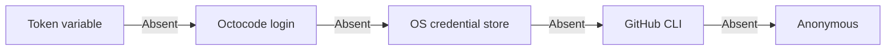

# Authentication

## OAuth device login

From an interactive terminal, start GitHub login, open the URL Octocode prints, and enter the one-time code. Review the requested `repo`, `read:org` and `gist` scopes before approving. The CLI stores the login for that host. The MCP server can use it from the same Octocode home.

```bash
npx -y octocode auth login
npx -y octocode auth status --json
```

Look for `verification: "verified"`, the expected `username` and `hostname`, and `tokenSource: "octocode-storage"`. If you already use GitHub CLI, `gh auth login` also works. To save a personal token locally, use `npx -y octocode config set GH_TOKEN --stdin`. In CI, pass a secret as `GH_TOKEN` or `GITHUB_TOKEN` to the process.

## GitHub token resolution

For each tool call, Octocode selects a credential for the configured GitHub host. Rows within the call share the selection. New calls pick up changes to stored logins.



| `tokenSource` in `auth status` | Where the credential comes from |
|---|---|
| `env` | Octocode checks the process (including MCP client `env`), then the workspace `.octocode/.env`, then the home `.env`. At the first source with a nonblank token, `GH_TOKEN` wins over `GITHUB_TOKEN`. GitHub tokens have no `.octocoderc` setting. |
| `octocode-storage` | `auth login` saves one encrypted entry per host in `<OCTOCODE_HOME>/credentials.json`. Protect that file and its sibling `.key` together. [Credential storage](SECURITY.md#github-credentials) |
| `platform` | An existing login in the OS credential store when Octocode has no readable home login for the host. |
| `gh-cli` | `gh auth token --hostname <host>` reads the host's GitHub CLI login. Octocode clears token variables for this subprocess. |
| `none` | No credential selected. Public endpoints that allow anonymous reads have lower rate limits. Private repositories and code search require authentication. [GitHub search requirements](https://docs.github.com/en/rest/search/search#rate-limit) |

For example, a shell `GITHUB_TOKEN` wins over a workspace `GH_TOKEN`. If GitHub rejects the explicit environment token, fix or remove it to switch accounts. If GitHub rejects a stored or `gh` token, later calls skip that credential, and later rows of the same call select again.

### Refresh

Octocode refreshes a stored expiring access token when a request falls within five minutes of its expiry. To refresh manually, run `npx -y octocode auth login --refresh`. If the refresh token expired, start a new device login. Octocode treats environment tokens as supplied.

### Status and logout

| Goal | Command | What to expect |
|---|---|---|
| Verify the active credential | `npx -y octocode auth status --json` | Reports host, account, source and verification. Available quota buckets include remaining requests and reset times. |
| Switch stored accounts | `npx -y octocode auth login --force` | Replaces the saved login after successful approval. An environment token still takes priority. |
| Remove the host's saved login | `npx -y octocode auth logout` | Clears the Octocode and OS entries for the configured host. Manage environment tokens and `gh` logins at their source. |

`verification` is `verified` if GitHub accepts the token, `invalid` for a 401, `unverified` when GitHub could not confirm it, or `none` without a token. Both `verified` and `unverified` have `authenticated: true`. Check `verification` when testing that a login works.

## GitHub Enterprise

Set the enterprise API root in the process or home configuration. For device login or refresh, supply the client ID of an OAuth app registered on that host. The built-in client is for `github.com`.

```bash
export GITHUB_API_URL="https://github.example.com/api/v3"
export OCTOCODE_GITHUB_CLIENT_ID="your-enterprise-oauth-client-id"
npx -y octocode auth login
npx -y octocode auth status --json
```

For token-based access, set the same API root and supply a token for that host. `auth login --hostname <host>` overrides the hostname for one login. Set `GITHUB_API_URL` or home `github.apiUrl` so later requests, status, and logout target that host.

## MCP clients and the VS Code extension

Put a token in the MCP server's process environment or let it use the host's Octocode or `gh` login. Restart MCP after changing its environment or `.env`. The VS Code extension signs in through the editor and writes `GH_TOKEN` to the MCP configurations it manages. [MCP setup](OCTOCODE_MCP.md)

## Classification key (`clasify`)

Classification is off by default. Set a Jev key in your Octocode home to enable `clasify` in the CLI and MCP. Supply the key on standard input and restart MCP. [Get a key](https://docs.typesafe.ai/introduction)

```bash
npx -y octocode config set OCTOCODE_CLASSIFICATION_API --stdin
npx -y octocode config check OCTOCODE_CLASSIFICATION_API
```

A nonblank key enables discovery. A provider call verifies access. The key can also come from the process environment or home `classification.api`. A blank process variable explicitly disables classification. [Classification guide](OCTOCODE_CLASIFY.md) · [Change the provider host](CONFIGURATION.md#change-the-classification-host)

## npm registry credentials

For `artifactSearch`, select `ecosystem: "npm"` and set `registryUrl` for a custom registry. The default is `https://registry.npmjs.org/`. Put the registry's credential in your **user npmrc**, selected by `NPM_CONFIG_USERCONFIG`, then `npm_config_userconfig`, then `~/.npmrc`.

```ini
//registry.example.com/npm/:_authToken=${NPM_TOKEN}
```

Set `NPM_TOKEN` in the environment for this example; if a referenced variable is unset, that entry is ignored. The longest matching host, port and path prefix wins. `:_authToken` supplies Bearer auth and `:_auth` supplies Basic auth. Octocode sends credentials over HTTPS or loopback HTTP. A private, loopback or link-local registry also needs `network.allowPrivateRegistry: true` in trusted configuration. [Configuration](CONFIGURATION.md#all-settings-and-defaults)

## Troubleshooting

| Symptom | Next step |
|---|---|
| A new login appears to have no effect | If `tokenSource` is `env`, replace or remove the winning variable. Otherwise check the host and the Octocode home of the process making the call. |
| 401 or `verification: "invalid"` | Replace an environment token at its source, renew a saved login with `auth login --force`, or sign in again through `gh`, according to `tokenSource`. |
| Device login requires a terminal | Run the login interactively or pass a token through the CI secret store. |
| An enterprise request goes to github.com | Set `GITHUB_API_URL` in the process or home configuration. Workspace files cannot select the credential host. |
| A private npm lookup fails | Check the query's registry URL against the user npmrc scope and confirm any referenced token variable is set. |
