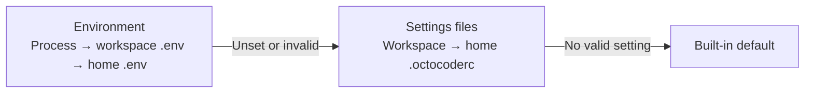

# Octocode configuration

Local tools work with the defaults. Run these commands from the directory where your agent starts Octocode to see which settings apply.

```bash
npx -y octocode config list                 # effective values, sources and defaults
npx -y octocode config get local.beta --json
npx -y octocode config --json               # files, loaded keys and diagnostics
```

On an interactive terminal, `npx -y octocode config` opens the settings page. [All settings and defaults](#all-settings-and-defaults)

## Where every value comes from



Workspace files live in `<working-directory>/.octocode/`. Octocode looks in that directory only. Home files live in `~/.octocode/` by default. Set `OCTOCODE_HOME` in the process environment to move them, or run `npx -y octocode config home` to print the path.

For each variable, a nonblank process value wins, followed by an allowed workspace `.env` value, then the home `.env`. A nonblank invalid value masks lower `.env` entries for that variable. For a setting, Octocode then tries the `.octocoderc` files and the default. A blank **process** `OCTOCODE_CLASSIFICATION_API` explicitly turns classification off.

Workspace files can change only the values in the **Workspace may set** column below. Some switches allow a workspace to narrow access, such as `local.enabled: false`. Restart the MCP server after changing configuration. A new CLI invocation reads the current configuration.

## Set a value

| Scope | Where to set it | Example |
|---|---|---|
| One shell command | Process environment | `OCTOCODE_STORAGE_MODE=memory npx -y octocode config get storage.mode` (POSIX shell) |
| One MCP server | Server entry's `env` object | `"env": {"OCTOCODE_BETA": "true"}` |
| Your projects | Home `.env` or `.octocoderc` | `npx -y octocode config set local.beta true` |
| One project | Workspace `.env` or `.octocoderc` | `{"tools":{"disabled":["ghSearchHistory"]}}` in `.octocoderc` |

`config set` accepts a dotted setting name or an environment variable and writes its variable to the **home `.env`**. `config unset` removes that home assignment. Edit a workspace file or `.octocoderc` directly to change that source.

```bash
npx -y octocode config set OCTOCODE_CLASSIFICATION_API --stdin
npx -y octocode config check OCTOCODE_CLASSIFICATION_API
npx -y octocode config unset local.beta
```

Supply a key through standard input to keep it out of command history. `config check` exits 0 for an explicit value and 1 when unset. Keep `.env` files containing credentials out of version control.

Use `KEY=VALUE` lines in `.env`. Environment booleans accept `true`, `false`, `1` or `0`. Lists use commas. In `.octocoderc`, use JSON booleans and arrays. Comments and trailing commas are accepted. Each field resolves independently and the winning array replaces the whole list. Path settings accept absolute or home-relative paths.

```jsonc
// ~/.octocode/.octocoderc
{
  "local": { "beta": true, "allowedPaths": ["~/other-repo"] },
  "tools": { "enableClone": true }
}
```

**Language servers** use a separate `lsp-servers.json` under the Octocode home. For example, if `tsgo` is installed, this entry routes TypeScript files to it. Inspect the route with `npx -y octocode lsp-server status path/to/file.ts`. Add `--live` to start the server and check initialization.

```json
{"languageServers":{".ts":{"command":"tsgo","args":["--lsp","-stdio"],"languageId":"typescript"}}}
```

Any extension can be routed this way. For a language whose project file Octocode does not know, `rootMarkers` lists the file or directory names that mark its project. The server starts at the nearest folder above the file that holds one, without leaving the repository:

```json
{"languageServers":{".swift":{"command":"sourcekit-lsp","languageId":"swift","rootMarkers":["Package.swift"]}}}
```

### Change the classification host

Jev uses `https://api.typesafe.ai` by default. To use a compatible gateway, set its API root in the process environment or home configuration. The host receives the key and the selected evidence. Use HTTPS with no path, or HTTP on loopback. [Classification egress](SECURITY.md#classification-egress)

```bash
npx -y octocode config set classification.apiHost https://gateway.example.com
```

## GitHub token resolution

Run `npx -y octocode auth status --json` to check the host, account and winning credential source. The CLI and MCP share host-scoped credential discovery. [Log in and check token precedence](AUTHENTICATION.md#github-token-resolution)

## Tool availability CLI and MCP

The CLI has 16 tools by default. MCP starts with 12. The table shows what changes the catalogs. [Tool descriptions and examples](OCTOCODE_TOOLS.md)

| Tools | MCP default | How to enable or restrict them |
|---|---|---|
| Six GitHub search and read tools, `artifactSearch` | On | Use `tools.enabled` or `tools.disabled` to limit discovery. |
| `localSearch`, `localFetch`, `structureSearch`, `astSearch`, `lspSearch` | On | `local.enabled: false` hides all local tools, including graphs. |
| `graphBuild`, `graphQuery` | Off | Set `local.beta: true` with local tools enabled. |
| `ghCloneRepo` | Off | Set `tools.enableClone: true`. Cloning needs persistent storage on both interfaces. |
| `securityCheck` | Off | Set `tools.enableSecurityCheck: true`. A call can send package or commit identifiers to OSV. [Request details](OCTOCODE_TOOLS.md#securitycheck) |
| `clasify` and inline `classification` | Off | A nonblank classification key adds them to both interfaces. [Classification guide](OCTOCODE_CLASIFY.md) |

`tools.enabled` is an MCP allowlist. `tools.disabled` removes tools even when they appear on that list. An allowlisted tool still needs its opt-in. CLI tools use the same path, storage and credential restrictions when called.

## All settings and defaults

Use the dotted name in `.octocoderc`, or the variable name in a permitted environment source. A dash marks an environment-only option. **Sensitive** means configuration output hides the value. For timeouts, page sizes and storage lifetimes, see [storage and limits](STORAGE_AND_LIMITS.md).

<!-- settings-table:start (generated from the config contract; do not edit) -->

| `.octocoderc` setting | Environment variable | Type | Default | Sensitive | Workspace may set | What it does |
|---|---|---|---|---|---|---|
| `github.apiUrl` | `GITHUB_API_URL` | url | `https://api.github.com` | no | no | GitHub REST API root. GitHub Enterprise commonly uses /api/v3. |
| `local.enabled` | `OCTOCODE_ENABLE_LOCAL` | boolean | `true` | no | only `false` | Expose local filesystem tools through MCP. CLI tools remain available; path and content security apply on both surfaces. |
| `local.beta` | `OCTOCODE_BETA` | boolean | `false` | no | no | Expose graphBuild and graphQuery through MCP. CLI tools remain available without this opt-in. Restart MCP after changing this setting. |
| `local.allowedPaths` | `ALLOWED_PATHS` | list | `[]` | no | no | Extra absolute or home-relative roots added to the allowed roots (workspace root and OCTOCODE_HOME). The environment value is a comma-separated list. |
| `local.workspaceRoot` | `WORKSPACE_ROOT` | path | `the working directory` | no | no | Optional absolute or home-relative workspace root. |
| `local.graphHome` | `OCTOCODE_GRAPH_HOME` | path | `<workspace>/.octocode/graph` | no | no | Directory in which graphBuild keeps its snapshots, in place of the workspace's .octocode/graph, shared by every workspace: a build then writes nothing in the repository and may scan any allowed directory, such as a ghCloneRepo checkout. Octocode creates the directory if needed and writes only in its own octocode-graph folder there, never reading or removing anything else; the setting grants local tools no read access to it. A build of a path that contains it is refused. Home-only, so a repository cannot choose where Octocode writes. |
| `tools.enabled` | `TOOLS_TO_RUN` | list | `unset (every tool)` | no | yes | Strict MCP tool allowlist; other MCP prerequisites still apply. The CLI ignores this list. |
| `tools.disabled` | `DISABLE_TOOLS` | list | `unset (none)` | no | yes | Tools removed from MCP discovery and admission. The CLI ignores this list. |
| `tools.enableClone` | `OCTOCODE_ENABLE_CLONE` | boolean | `false` | no | only `false` | Expose ghCloneRepo through MCP. CLI remains available. Clone execution requires persistent storage on both surfaces. Restart MCP after changing this setting. |
| `tools.enableSecurityCheck` | `OCTOCODE_SECURITY_CHECKS` | boolean | `false` | no | only `false` | Expose securityCheck through MCP: it asks OSV (api.osv.dev, operated by Google) about packages, sending each public package name and version it checks. Off, MCP leaves it out and sends nothing. The CLI always offers it, and a CLI call sends the package name to OSV only when you run it. Restart MCP after changing this setting. Home-only, so a repository can turn it off for MCP but cannot turn it on. |
| `network.allowPrivateRegistry` | `OCTOCODE_ALLOW_PRIVATE_REGISTRY` | boolean | `false` | no | no | Allow private, loopback, or link-local artifact registries. Security-sensitive SSRF escape hatch; opt in only for trusted enterprise registries. |
| `lsp.autoInstall` | `OCTOCODE_LSP_AUTO_INSTALL` | prompt \| off \| auto | `prompt` | no | no | Whether `octocode lsp-server install` may download a managed language server: prompt (ask), off, or auto. |
| `lsp.trustProjectConfig` | `OCTOCODE_TRUST_PROJECT_LSP_CONFIG` | boolean | `false` | no | no | Trust a project .octocode/lsp-servers.json. Security-sensitive: a trusted project config can launch server binaries. |
| `lsp.trustFetchedCode` | `OCTOCODE_LSP_TRUST_FETCHED_CODE` | boolean | `false` | no | only `false` | Let lspSearch start language servers on code Octocode fetched: ghCloneRepo and ghStructure materialize checkouts and URL captures under its home. Off by default, because a language server can run code from the repository it opens; text, AST and graph tools read that code without running anything. Security-sensitive: turning it on lets a repository you fetched run code on this machine when lspSearch opens it. Home-only, so a repository cannot turn it on. |
| `lsp.allowBuildScripts` | `OCTOCODE_LSP_ALLOW_BUILD_SCRIPTS` | boolean | `false` | no | only `false` | Let lspSearch run a Rust workspace's Cargo build scripts and procedural macros when a query's rustContext sets buildScripts or procMacros. Off by default: they are repository code, so such a query is refused (errorCode policy) and the default rust-analyzer, which runs none, answers every other query. Security-sensitive: turning it on lets any lspSearch call, in any client mode, run the build scripts and proc macros of the workspace it names. Home-only, so a repository cannot turn it on. |
| `lsp.prewarm` | `OCTOCODE_LSP_PREWARM` | targeted \| all \| off | `targeted` | no | yes | Language-server prewarm: targeted warms the server of an lspSearch call the response offers; all also warms files named by reads or searches and, at MCP initialize, the workspace's top three languages; off disables prewarm. Starts index a whole project: targeted avoids unrelated server starts, but a lookup without an earlier candidate can take seconds. |
| `output.redactEmails` | `OCTOCODE_REDACT_EMAILS` | boolean | `false` | no | only `true` | Mask email addresses such as GitHub commit authors. |
| `output.redactUuid` | `OCTOCODE_REDACT_UUID` | boolean | `false` | no | only `true` | Mask UUIDs (8-4-4-4-12 hexadecimal) in every tool result. Off by default: a UUID is an identifier, not a secret. |
| `security.credentialFiles` | `OCTOCODE_CREDENTIAL_FILES` | withhold \| allow | `withhold` | no | only `withhold` | Whether local read and search tools may read the known credential files (.env and .env.*, credentials.json, .netrc, .npmrc, id_rsa*, *.pem and the like): withhold them, or allow them in the workspace and allowed paths so results match ripgrep. Known secret formats stay redacted. Credential directories such as .ssh, .aws and .git, the Octocode home, and known credential files directly in your home or in its dot directories (~/.npmrc, ~/.codex/auth.json) stay withheld; every other file, such as ~/.zshrc or a shell history, follows the allowed roots like any file. Graph snapshots, clasify and classification never read these files, and allow keeps saved local results in memory, so a cursor ends with its process. Security-sensitive: redaction recognizes known secret formats only, so a secret in no known format can appear in results. Home-only, so a repository cannot turn it on. |
| `storage.mode` | `OCTOCODE_STORAGE_MODE` | persistent \| memory | `persistent` | no | only `memory` | Persistent saves continuation state and provider answers to disk; memory retains them only in the current runtime. Fresh local requests reuse only in-memory results keyed by the content they read; GitHub and registry answers repeat as their origin allows. Explicit graph snapshots are outputs; interrupted extraction checkpoints follow this setting. |
| `classification.api` | `OCTOCODE_CLASSIFICATION_API` | key | `unset (classification off)`; [get a key](https://docs.typesafe.ai/introduction) | yes | no | Classification provider API key. A nonblank value exposes clasify and read-tool classifiers in MCP and the CLI; without one, a CLI clasify call answers where to get a key. Discovery makes no provider request. Credential values are omitted from resolved configuration and diagnostics. Home-only, so a repository cannot turn classification on or send your evidence under its own provider account. |
| `classification.apiHost` | `OCTOCODE_CLASSIFICATION_API_HOST` | url | `https://api.typesafe.ai` | no | no | Classification provider API root, for a proxy, gateway or compatible provider that serves the same API. Calls require HTTPS except on loopback, and an API root with no path. Home-only, so a repository cannot redirect your key. |
| `classification.model` | `OCTOCODE_CLASSIFICATION_MODEL` | string | `jev-latest` | no | yes | Classification model for read-tool classifiers and clasify; a clasify row's model overrides it. Pin an exact model (for example jev-1.13.0) for reproducible results; an alias can change between fresh evaluations. |
| — | `TAVILY_API_KEY` | key | `unset`; [get a key](https://app.tavily.com/) | yes | yes | Tavily search API credential used by the octocode-brainstorming skill. |
| — | `EXA_API_KEY` | key | `unset`; [get a key](https://dashboard.exa.ai/) | yes | yes | Exa search API credential used by the octocode-brainstorming skill. |
| — | `SERPER_API_KEY` | key | `unset`; [get a key](https://serper.dev/) | yes | yes | Serper search API credential used by the octocode-brainstorming skill. |
| — | `TAVILY_BASE_URL` | url | `https://api.tavily.com` | no | no | Tavily API root; receives TAVILY_API_KEY. Home-only, so a repository cannot redirect your key. |
| — | `EXA_BASE_URL` | url | `https://api.exa.ai` | no | no | Exa API root; receives EXA_API_KEY. Home-only, so a repository cannot redirect your key. |
| — | `SERPER_BASE_URL` | url | `https://google.serper.dev` | no | no | Serper API root; receives SERPER_API_KEY. Home-only, so a repository cannot redirect your key. |
| — | `GH_TOKEN` | key | `unset (octocode auth login also works)` | yes | yes | GitHub CLI token |
| — | `GITHUB_TOKEN` | key | `unset (octocode auth login also works)` | yes | yes | GitHub Actions token |
| — | `SCRAPING_ANT` | key | `unset`; [get a key](https://app.scrapingant.com/) | yes | yes | ScrapingAnt API credential used by the octocode-scraping skill. |
| — | `HTTPS_PROXY` | url | `unset` | yes | no | Proxy for HTTPS requests and clone git. Shell, CI or MCP env block only. |
| — | `HTTP_PROXY` | url | `unset` | yes | no | Proxy for HTTP requests and clone git. Shell, CI or MCP env block only. |
| — | `ALL_PROXY` | url | `unset` | yes | no | Proxy for every protocol. Shell, CI or MCP env block only. |
| — | `NO_PROXY` | string | `unset` | no | no | Hosts that skip the proxy. Shell, CI or MCP env block only. |
| — | `SSL_CERT_FILE` | path | `the OS trust store` | no | no | Extra PEM certificates for native HTTP clients and clone git. Shell, CI or MCP env block only. |
| — | `SSL_CERT_DIR` | path | `the OS trust store` | no | no | Directories of extra PEM certificates. Shell, CI or MCP env block only. |
| — | `OCTOCODE_GITHUB_CLIENT_ID` | string | `the built-in GitHub app` | no | no | GitHub OAuth client override, for GitHub Enterprise. |
| — | `OCTOCODE_HOME` | path | `~/.octocode` | no | no | Overrides the Octocode configuration directory (default: <os-home>/.octocode) |

<!-- settings-table:end -->

## Proxies and certificates

Set proxy and certificate variables in the shell, CI or the MCP client's `env` block. `SSL_CERT_FILE` and `SSL_CERT_DIR` add PEM certificates to the OS trust store. Clone git also accepts `GIT_SSL_CAINFO`, `GIT_SSL_CAPATH` and `CURL_CA_BUNDLE`. These have no Octocode override by default.

Bootstrap variables such as `PATH`, `HOME`, `SHELL`, `USER`, `LOGNAME`, `PWD`, `TMPDIR`, `NODE_OPTIONS` and `PYTHON` come from the process. For Rust dependency-graph analysis, `OCTOCODE_CARGO` selects a Cargo executable in the process or home environment. The default is `cargo` on `PATH`.

## Troubleshooting

| Symptom | What to check |
|---|---|
| A setting appears to have no effect | Run `config get <setting> --json` in the same working directory. Check its source, then restart MCP if its configuration changed. |
| A file or key was skipped | Run `config --json`. Check `diagnostics` for invalid files or values, `skippedProtected` for restricted keys and `skippedExisting` for variables already supplied. |
| A tool is missing or MCP starts with no tools | Check its opt-in, the allowlist, and the disabled list. [Tool availability](#tool-availability-cli-and-mcp) |
| GitHub chooses the wrong account | Inspect `auth status --json`. [Authentication troubleshooting](AUTHENTICATION.md#troubleshooting) |
| Classification fails | Check the provider key, API root and the error returned by the call. [Classification guide](OCTOCODE_CLASIFY.md) |
