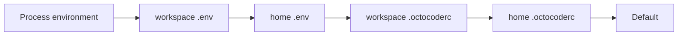

# Octocode configuration

All Octocode configuration comes from two things: **environment variables** and **`.octocoderc` files**. The CLI, MCP server, VS Code extension and skills read them the same way. Everything has a default, and local tools need nothing set.

```bash
npx octocode config        # settings page: keys, settings, agents
npx octocode config list   # the same in the terminal: value, source, default
```

## Where every value comes from

For each value separately, the first valid source wins:



| Source | Where | Reach | Use it for |
|---|---|---:|---|
| Process environment | Your shell, CI, or an MCP client's `env` block | One process | One-off overrides, CI, one client |
| Workspace `.env` | `<project>/.octocode/.env` | One project | Project keys |
| Home `.env` | `~/.octocode/.env` | Every project | **Your keys** |
| Workspace `.octocoderc` | `<project>/.octocode/.octocoderc` | One project | Project settings to share |
| Home `.octocoderc` | `~/.octocode/.octocoderc` | Every project | **Your settings** |

- **`.env` files fill in the process environment.** They never replace a variable the process already has, so an MCP `env` block beats every file.
- **Any environment value beats both `.octocoderc` files.** A setting has two spellings, such as `local.beta` in `.octocoderc` and `OCTOCODE_BETA` in the environment. Keys and proxies exist only as variables.
- **Blank, `null` and invalid values fall through** to the next source. One exception: a blank `OCTOCODE_CLASSIFICATION_API` turns classification off.
- **A workspace cannot set a home-only value**, so a checked-out repository gains no power over your machine. The value is skipped and reported. [The table](#all-settings-and-defaults) marks each one.
- **Only the process environment can set** `PATH`, `HOME`, `TMPDIR`, `NODE_OPTIONS`, `PYTHON`, `OCTOCODE_HOME`, and the proxy and certificate variables.
- **`<project>` is the working directory**, with no search of parent folders. `OCTOCODE_HOME` moves the home.
- **When it reloads:** the CLI reads everything on every call. The MCP server reads at start, so restart it after a change.

## Set a value

```bash
npx octocode config set TAVILY_API_KEY --stdin    # paste, then Ctrl-D; never printed back
npx octocode config set local.beta true           # a setting path or its variable
npx octocode config get local.beta --json         # value, source, path and default
npx octocode config check TAVILY_API_KEY          # exit 0 set, 1 unset
npx octocode config unset local.beta              # back to the next source
```

`config set` always writes the home `.env`, readable only by you. Edit the other files by hand or on the settings page.

**`.octocoderc`** is JSON with comments and trailing commas. Set only what you change. A workspace value replaces only that field, and arrays replace rather than concatenate. Paths must be absolute or start with `~`.

```jsonc
// ~/.octocode/.octocoderc
{
  "local": { "beta": true, "allowedPaths": ["~/other-repo"] },
  "tools": { "enableClone": true }
}
```

**`.env`** is plain `KEY=VALUE` lines, stored as plain text. Keep it out of version control.

```bash
# ~/.octocode/.env
GH_TOKEN=ghp_example
OCTOCODE_CLASSIFICATION_API=classification_key_example
TAVILY_API_KEY=tvly-example
```

**MCP `env` block** applies to that one server process:

```json
{"mcpServers":{"octocode":{"command":"npx","args":["-y","octocode-mcp@latest"],"env":{"OCTOCODE_BETA":"true"}}}}
```

**Language servers** are set in `~/.octocode/lsp-servers.json`, which maps an extension to a server: `{"languageServers":{".ts":{"command":"tsgo","args":["--lsp","-stdio"],"languageId":"typescript"}}}`.

### Change the classification host

Octocode uses Jev at `https://api.typesafe.ai`. To route through a gateway:

```bash
npx octocode config set classification.apiHost https://gateway.example.com
```

The host receives your key and the [evidence sent for classification](SECURITY.md#classification-egress), so use one you trust. It must serve the same API from an HTTPS root with no path (HTTP only on loopback). It is home-only, so a repository cannot redirect your key.

## GitHub token resolution

Each GitHub request uses the first credential found for its host:

| # | Source | `tokenSource` in `auth status` |
|---:|---|---|
| 1 | A token variable, found in the process environment, then workspace `.env`, then home `.env` | `env` |
| 2 | `npx octocode auth login`: encrypted `~/.octocode/credentials.json` | `octocode-storage` |
| 3 | An older login in the OS credential store (Keychain, Secret Service, Credential Manager) | `platform` |
| 4 | `gh auth token --hostname <host>` | `gh-cli` |
| — | None: public requests run unauthenticated at GitHub's lower rate limit | none |

- **Source beats name.** Any process variable beats every `.env` file, and a workspace token beats a home token. Within one source, `GH_TOKEN` beats `GITHUB_TOKEN`.
- **The token goes only to your configured host.** `GITHUB_API_URL` is home-only, so a repository's `.env` cannot send a token elsewhere.
- **`.octocoderc` never holds a token.** Logins are never per workspace; for another account in one project, put a token in that project's `.octocode/.env`.
- **A variable blocks a new login.** `auth login` warns when a token variable is set, because that variable keeps winning until you unset it.
- **Expired or rejected tokens move on.** A stored token that expires within 5 minutes is refreshed first. If refresh fails, or GitHub rejects a stored or `gh` token, the next source applies.
- **Changes apply within 60 seconds.** The chosen credential is remembered per host for that long.

Check it with `npx octocode auth status --json`. Login, refresh and GitHub Enterprise: [authentication](AUTHENTICATION.md).

## Tool availability: CLI and MCP

The CLI always has all 16 tools. MCP starts with 12 and adds the rest when you opt in. These choices never relax file, credential or network protections.

| Tools | In MCP | Needs when called |
|---|---|---|
| Six GitHub search and read tools, `artifactSearch` | On | GitHub access where the endpoint requires it |
| `localSearch`, `localFetch`, `structureSearch`, `astSearch`, `lspSearch` | On; `local.enabled: false` hides them | Authorized paths; `lspSearch` also needs a language server |
| `graphBuild`, `graphQuery` | `local.beta: true` | Authorized paths |
| `clasify` | A classification key | A working key |
| `ghCloneRepo` | `tools.enableClone: true` | Git, repository access, persistent storage |

`tools.enabled` is a strict allowlist and `tools.disabled` removes names from it. Neither bypasses an opt-in above.

## All settings and defaults

**Sensitive** values are masked in all output. A value a **workspace** may not set is home-only. Limits such as timeouts and page sizes are [fixed](STORAGE_AND_LIMITS.md#fixed-internal-limits), not settings.

<!-- settings-table:start (generated from the config contract; do not edit) -->

| `.octocoderc` setting | Environment variable | Type | Default | Sensitive | Workspace may set | What it does |
|---|---|---|---|---|---|---|
| `github.apiUrl` | `GITHUB_API_URL` | url | `https://api.github.com` | no | no | GitHub REST API root. GitHub Enterprise commonly uses /api/v3. |
| `local.enabled` | `OCTOCODE_ENABLE_LOCAL` | boolean | `true` | no | only `false` | Expose local filesystem tools through MCP. CLI tools remain available; path and content security apply on both surfaces. |
| `local.beta` | `OCTOCODE_BETA` | boolean | `false` | no | no | Expose graphBuild and graphQuery through MCP. CLI tools remain available without this opt-in. Restart MCP after changing this setting. |
| `local.allowedPaths` | `ALLOWED_PATHS` | list | `[]` | no | no | Extra absolute or home-relative roots added to the allowed roots (workspace root and OCTOCODE_HOME). The environment value is a comma-separated list. |
| `local.workspaceRoot` | `WORKSPACE_ROOT` | path | `the working directory` | no | no | Optional absolute or home-relative workspace root. |
| `tools.enabled` | `TOOLS_TO_RUN` | list | `unset (every tool)` | no | yes | Strict MCP tool allowlist; other MCP prerequisites still apply. CLI exposes every tool in the build. |
| `tools.disabled` | `DISABLE_TOOLS` | list | `unset (none)` | no | yes | Tools removed from MCP discovery and admission. CLI exposes every tool in the build. |
| `tools.enableClone` | `OCTOCODE_ENABLE_CLONE` | boolean | `false` | no | only `false` | Expose ghCloneRepo through MCP. CLI remains available. Clone execution requires persistent storage on both surfaces. Restart MCP after changing this setting. |
| `network.allowPrivateRegistry` | `OCTOCODE_ALLOW_PRIVATE_REGISTRY` | boolean | `false` | no | no | Allow private, loopback, or link-local artifact registries. Security-sensitive SSRF escape hatch; opt in only for trusted enterprise registries. |
| `lsp.autoInstall` | `OCTOCODE_LSP_AUTO_INSTALL` | prompt \| off \| auto | `prompt` | no | no | Whether `octocode lsp-server install` may download a managed language server: prompt (ask), off, or auto. |
| `lsp.trustProjectConfig` | `OCTOCODE_TRUST_PROJECT_LSP_CONFIG` | boolean | `false` | no | no | Trust a project .octocode/lsp-servers.json. Security-sensitive: a trusted project config can launch server binaries. |
| `lsp.prewarm` | `OCTOCODE_LSP_PREWARM` | targeted \| all \| off | `targeted` | no | yes | Language-server prewarm: targeted starts the server an offered lspSearch call names once the session has run an lspSearch; all warms it from the start, also warms the file a read or search names and, at MCP initialize, the workspace's top three languages; off disables it. Each start indexes a whole project, so a first lspSearch under targeted can take seconds in exchange for no server in a session that never calls one. |
| `output.redactEmails` | `OCTOCODE_REDACT_EMAILS` | boolean | `false` | no | only `true` | Mask email addresses such as GitHub commit authors. |
| `storage.mode` | `OCTOCODE_STORAGE_MODE` | persistent \| memory | `persistent` | no | only `memory` | Persistent saves continuation state and provider answers to disk; memory retains them only in the current runtime. Fresh local requests recompute results; GitHub and registry answers repeat as their origin allows. Explicit graph snapshots are outputs; interrupted extraction checkpoints follow this setting. |
| `classification.api` | `OCTOCODE_CLASSIFICATION_API` | key | `unset (classification off)`; [get a key](https://docs.typesafe.ai/introduction) | yes | yes | Classification provider API key. A nonblank value exposes clasify and read-tool classifiers in MCP; CLI always exposes clasify and checks the key when invoked. Discovery makes no provider request. Credential values are omitted from resolved configuration and diagnostics. |
| `classification.apiHost` | `OCTOCODE_CLASSIFICATION_API_HOST` | url | `https://api.typesafe.ai` | no | no | Classification provider API root, for a proxy, gateway or compatible provider that serves the same API. Calls require HTTPS except on loopback, and an API root with no path. Home-only, so a repository cannot redirect your key. |
| `classification.model` | `OCTOCODE_CLASSIFICATION_MODEL` | string | `jev-latest` | no | yes | Classification model for read-tool classifiers and clasify; a clasify row's model overrides it. Pin an exact model (for example jev-1.13.0) for reproducible results; an alias can change between fresh evaluations. |
| — | `TAVILY_API_KEY` | key | `unset`; [get a key](https://app.tavily.com/) | yes | yes | Tavily search API credential used by the octocode-brainstorming skill. |
| — | `EXA_API_KEY` | key | `unset`; [get a key](https://dashboard.exa.ai/) | yes | yes | Exa search API credential used by the octocode-brainstorming skill. |
| — | `SERPER_API_KEY` | key | `unset`; [get a key](https://serper.dev/) | yes | yes | Serper search API credential used by the octocode-brainstorming skill. |
| — | `TAVILY_BASE_URL` | url | `https://api.tavily.com` | no | no | Tavily API root; receives TAVILY_API_KEY. Home-only, so a repository cannot redirect your key. |
| — | `EXA_BASE_URL` | url | `https://api.exa.ai` | no | no | Exa API root; receives EXA_API_KEY. Home-only, so a repository cannot redirect your key. |
| — | `SERPER_BASE_URL` | url | `https://google.serper.dev` | no | no | Serper API root; receives SERPER_API_KEY. Home-only, so a repository cannot redirect your key. |
| — | `GH_TOKEN` | key | `unset (octocode auth login also works)` | yes | yes | GitHub CLI token |
| — | `GITHUB_TOKEN` | key | `unset (octocode auth login also works)` | yes | yes | GitHub Actions token |
| — | `SCRAPING_ANT` | key | `unset`; [get a key](https://app.scrapingant.com/) | yes | yes | ScrapingAnt API credential used by the octocode-scraping skill. |
| — | `HTTPS_PROXY` | url | `unset` | yes | no | Proxy for HTTPS requests and clone git. Shell, CI or MCP env block only. |
| — | `HTTP_PROXY` | url | `unset` | yes | no | Proxy for HTTP requests and clone git. Shell, CI or MCP env block only. |
| — | `ALL_PROXY` | url | `unset` | yes | no | Proxy for every protocol. Shell, CI or MCP env block only. |
| — | `NO_PROXY` | string | `unset` | no | no | Hosts that skip the proxy. Shell, CI or MCP env block only. |
| — | `SSL_CERT_FILE` | path | `the OS trust store` | no | no | Extra PEM certificates for native HTTP clients and clone git. Shell, CI or MCP env block only. |
| — | `SSL_CERT_DIR` | path | `the OS trust store` | no | no | Directories of extra PEM certificates. Shell, CI or MCP env block only. |
| — | `OCTOCODE_GITHUB_CLIENT_ID` | string | `the built-in GitHub app` | no | no | GitHub OAuth client override, for GitHub Enterprise. |
| — | `OCTOCODE_HOME` | path | `~/.octocode` | no | no | Overrides the Octocode configuration directory (default: <os-home>/.octocode) |

<!-- settings-table:end -->

## Proxies and certificates

Set these in the process environment; a `.env` file cannot. Octocode's HTTP clients honor `SSL_CERT_FILE` and `SSL_CERT_DIR`, which add to the OS trust store with verification left on. `ghCloneRepo` runs git without your git config, keeping `PATH`, the proxy variables in either case, and CA bundles, including `GIT_SSL_CAINFO`, `GIT_SSL_CAPATH` and `CURL_CA_BUNDLE`.

## Troubleshooting

Start with `npx octocode config list` and `npx octocode config --json`, which lists files, skipped keys and warnings. A bad value is skipped and reported on stderr, never with the value itself.

| Problem | Fix |
|---|---|
| A setting has no effect | Restart the MCP server, then check `config get <setting> --json` to see which source won |
| A `.env` key is ignored | It's home-only in a workspace file, or the process already sets it: `config --json` → `skippedProtected` |
| A file is ignored | It's unreadable or invalid JSON; the other sources still apply |
| A tool is missing from MCP | Check [availability](#tool-availability-cli-and-mcp), `tools.enabled` and `tools.disabled`, then restart |
| `No native tools are available` at MCP start | Your settings disabled every tool |
| Token or login problems | [Authentication troubleshooting](AUTHENTICATION.md#troubleshooting) |
| `clasify` returns `invalidClassificationConfiguration` | The host isn't an HTTPS API root: remove any path |
| `clasify` returns `classificationQuotaExhausted` | The provider account has no credit; add credit and rerun |
| `clasify` returns `classificationRateLimited` | Wait for the reported time; agents sharing a key share its limit |
| A skill's web search is unavailable | Set a web-search key; there is no keyless fallback |
