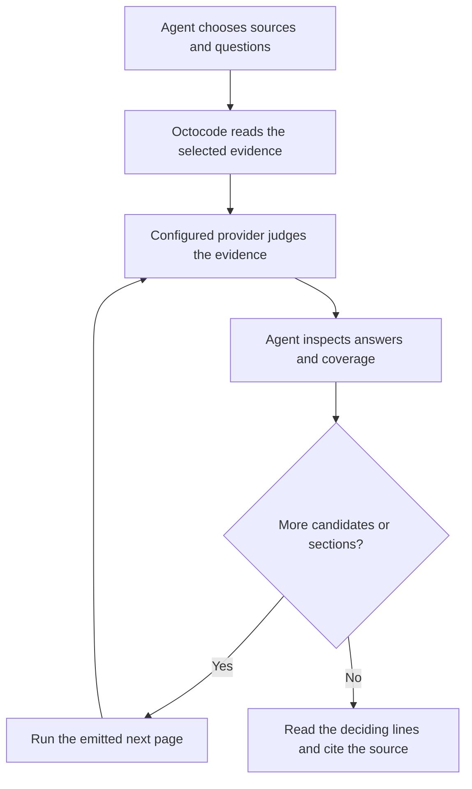

# Classify unread sources with Jev

Use `clasify` to find which passages in a large file or collection deserve a closer read. The agent asks a focused question, gets a typed answer, then opens the source lines before citing them. Use ordinary search for a known spelling, `lspSearch` for symbol identity, and unfiltered evidence for counts or absence.

## Quick start

1. Get a provider key and save it with `octocode config set OCTOCODE_CLASSIFICATION_API --stdin`. Paste the key and finish input (Ctrl-D in a POSIX shell). Restart an open MCP server after changing the key. [Classification key setup](AUTHENTICATION.md#classification-key-clasify)
2. Run `octocode schema clasify --view variants` to check availability without contacting the provider.
3. From a project with a `README.md`, ask a question about that file. The CLI command below makes a provider request. An MCP agent can call `clasify` with the same JSON.

```bash
octocode clasify '{
  "queries": [{
    "operation": "evaluate",
    "source": {"tool": "localFetch", "query": {"path": "README.md"}},
    "questions": {
      "tests": {"type": "noul", "instructions": "Does the README give a shell command for running the test suite?"}
    }
  }]
}'
```

In `answers`, find your question key (`tests`). Its `noul` value is the model's probability of “yes.” Follow the emitted `next.read` to check the command in context. For a short source it opens the whole selection. For a sectioned source it can open just the deciding lines.

## Choose a route

| What the agent has | What to send | What comes back |
|---|---|---|
| Too many search hits or rows | Add `classification.predicates` to a supported search, listing or read | Selected evidence plus a `selection` receipt counting the rest. [Supported tools](OCTOCODE_TOOLS.md#context-selection) |
| One unread file or public HTTPS page | `evaluate` with `source` pointing to `localFetch`, `ghGetFileContent`, or `{"url":"https://…"}` | Answers and a read of the captured source. Local and GitHub readers accept line `ranges`. |
| Search hits, paths, history items or packages | `evaluate` with `source: {tool, query}`. Use the named tool's own query fields. | Answers for each listed row under `units`. `next.nextPage` judges the next source page. A path or commit title can only answer questions about that text. |
| Several unread files | `evaluate` with named `resources`, including local globs | An answer set for each file |
| A question whose answer could be anywhere in several files | `sections` with named `resources` and `questions` | Sections with line ranges, answers, and coverage for each resource |
| Text or JSON already in hand | `evaluate` with literal `content`. For an array, set `perItem: true` to judge each item separately. | Answers for the whole input, or `units` keyed by array index. A path inside `content` is literal text. |
| A screenshot or chart | `evaluate` with PNG/JPEG `assets` and `content` naming each asset key. Ask about presence before requesting a `box`. | Typed answers and image coordinates. `box` gives edges from 0 to 1 on the judged image. `sourceBox`, when available, maps them to the original. |

### What every call does



Octocode sends the selected text, questions, optional task `context`, and any explicitly referenced images to the configured provider. Local path rules, GitHub authorization and URL policy apply before capture. Octocode screens text for recognized secrets and withholds credential-named files from classification. Image pixels and metadata receive no text redaction. Large images may be resized and small ones padded. The provider sees only what the request carries. [Classification egress](SECURITY.md#classification-egress)

### Questions

| Type | How to ask | How to read the answer |
|---|---|---|
| `noul` | Ask one observable yes/no question. Name the action and object, such as “Does this command run the unit tests?” | Probability of yes, from 0 to 1. A low answer can miss a real match. |
| `choice` | Name two or more labels in `criteria`. Include an `unknown` label when the source may omit the fact. | A label. The detailed view adds probabilities and confidence, which measures how concentrated the distribution is. |
| `score` | Supply 2–10 ordered levels in `criteria`, starting at level 0. | Expected level, which can be fractional |
| `box` | Name the visible target in one image. Use a vision-capable provider model. | Coordinates on the image. Inspect the original to verify the location. |

### Filter search hits

From a project containing `README.md`, this search asks the provider to judge each match in its surrounding lines. A direct file read is cheaper for a small result. Add the filter when the same search across a larger scope produces too many hits to read.

```bash
octocode localSearch '{
  "queries": [{
    "path": "README.md",
    "matchString": ["test"],
    "contextLines": {"before": 2, "after": 2},
    "classification": {"predicates": ["Does this passage give a command to run the test suite?"]}
  }]
}'
```

By default, `localSearch` supplies the hit line with zero surrounding lines. Set `contextLines` when a predicate depends on nearby text. The receipt counts selected, excluded, related, and unknown candidates across the walk. Keep the latest totals. `next.nextCandidatePage` judges remaining or retryable candidates. `next.unfilteredUnknown` opens undecided evidence. Use `next.unfiltered` for an exact count or an absence claim. If an inline provider call fails, inspect the warning and returned unfiltered evidence or retry route.

<a id="clasify-sections-map-questions-across-many-files"></a>

### Map questions across files

This example scans Markdown files under `docs/` in the current project. Narrow the glob to the files relevant to your question to control provider usage.

```bash
octocode clasify '{
  "queries": [{
    "operation": "sections",
    "resources": {"guides": {"tool": "localFetch", "query": {"path": "docs/*.md"}}},
    "questions": {
      "login": {"type": "noul", "instructions": "Does this passage give a command to sign in to GitHub?"}
    }
  }]
}'
```

Read each resource's `coverage` and `sections[].target.lines`. The detailed view includes the captured `sourceDigest` where returned, plus section names, context, and individual answer states. Coverage is cumulative. Errors, unsupported cells, and unassessed cells leave a gap in what the agent checked. [How to follow continuations](TOOL_DATA_CONTRACT.md#executable-continuations)

| Returned call | When to run it | Provider work |
|---|---|---|
| `responsePagination.next` | More of the current response remains. Finish these pages first. | Replays the response |
| `next.nextPage` | Another batch of sections is waiting | Judges newly reached sections |
| `next.read` | Verify the lines of sections that answered yes. A resource's own `read` opens its captured source. | Reads evidence |
| `next.quiet` | Inspect sections held back because every answer was a `noul` below 0.3. The final batch offers this when available. | Replays saved answers |
| `next.details` | Inspect the detailed view of a saved sections page | Replays saved answers |

A text source that exceeds the provider window can also be judged section by section during `evaluate`. The combined answer uses the highest `noul` or `score`, or the most confident `choice` other than `unknown`. Read relevant sections together for event order, contradictions, or claims about every code path. An isolated section only covers the text it received.

## Availability

| Setting or request field | Default | Effect |
|---|---|---|
| `classification.api` / `OCTOCODE_CLASSIFICATION_API` | Unset | A nonblank key enables `clasify` and inline `classification` on both interfaces, subject to MCP tool filters. A blank process variable disables both. |
| `classification.apiHost` | `https://api.typesafe.ai` | Provider API root. Only trusted configuration can set it. HTTPS is required except on loopback. [Configure another host](CONFIGURATION.md#change-the-classification-host) |
| `classification.model` | `jev-latest` | A `clasify` row's `model` overrides the configured model. `{"queries":[{"operation":"models"}]}` asks the provider which models it serves. |
| `longContext` | Retry with the long window after a provider refusal | `true` requests the long window up front. `false` keeps the standard window. An admitted longer request can cost more provider tokens. |
| `view` | `summary` | Request `details` on the first evaluation for distributions, model and available provenance. Repeating an evaluation to switch views makes a fresh provider request. |

Fresh judgments consume provider tokens even when Octocode already has the file. A fresh `evaluate` or `sections` request starts again. Saved pages replay their answers. Repeating an inline candidate-page cursor can replay it with `calls: 0` while the same runtime retains it. Eviction or a new process can require new inference.

Section plans and their saved response pages expire after 30 minutes of inactivity. With `storage.mode: "memory"`, use a running MCP server for a section plan. A one-shot CLI process can judge local or GitHub text and supply a fresh read under `related[]`. URL and image capture require persistent storage. [Storage modes](STORAGE_AND_LIMITS.md#cache-storage-and-lifecycle)

## Recovery

| What you see | What to do |
|---|---|
| `missingConfiguration` or missing discovery fields | Set the key in trusted configuration, check any blank process override, and restart MCP. |
| `invalidInput` | Inspect `octocode schema clasify --view query`. An evaluation takes exactly one of `source`, `resources`, or `content`. Both `evaluate` and `sections` need questions. |
| `classificationContextEmpty`, refused source, or expired plan | Check the source with its reader. Start a fresh request after expiry. |
| `classificationContextTooLarge` or `classificationStateTooLarge` | Use narrower line ranges or a `sections` call, if offered. Literal content and image rows can receive a size refusal. |
| Provider error after capture | Inspect the error, then use the returned source read when available. |

## Limits

| Input | Limit |
|---|---|
| `clasify` batch | Up to five query rows |
| Jev `choice` | 2–255 labels |
| PNG or JPEG | Up to 8,192 pixels per source side, 16 MiB per image and 32 MiB total. The provider request must also fit its 32 MiB encoded body limit. Octocode fits the judged image to 280–1,568 pixels per side. |
| Jev context | 32,000 tokens per question and 64,000 per standard request. The long window allows 262,000 tokens. |

For batch sizing and concurrency, see [fixed internal limits](STORAGE_AND_LIMITS.md#fixed-internal-limits).

## Benchmarks

### Main-agent tokens with and without Jev

These historical single runs on November 3, 2026 estimated main-agent tokens from response characters divided by four. Jev tokens came from provider usage. The comparison measured returned context, with no end-to-end latency or price measurement.

| Task | Baseline main-agent tokens | With Jev | Jev tokens |
|---|---:|---:|---:|
| Find one named fact in a 33 KB document | 8.4k, full read | 0.15k, `evaluate` | 8.1k |
| Filter three questions over 28 local guides | 6.8k, exact search hits | 4.0k, inline selection | 23k |
| Filter three questions over 30 Vite files | 4.7k, GitHub search | 2.4k, inline selection | 12k |
| Filter three questions over 100 Java files | 26.8k, exact hits, or 2.2k for filenames alone | 4.1k, inline selection | 131k |
| Locate passages across 30 Vite files | 98.6k, read every file | 15.6k, `sections` | 134k |
| Locate passages across 100 Java files | 137.8k, read every file | 36.8k, `sections` | 156k |
| Check one literal in a small file | 0.09k, direct read | 0.07k, `evaluate` | 3.2k |

The Java corpus had 26 known matching files. Section assessment found 25 with two extra candidates. Filtering just the search hits found 14. Exact filename search used the least context when only filenames were needed.

### What the model found

| Historical check | Observed result |
|---|---|
| Relations between passages, November 5, 2026 | Named events and conflicting values scored 26/26. A generic contradiction question missed two of eight cases. |
| 77,296-character Rust file, November 11, 2026 | Jev 1.14 answered three of three questions in one request, taking 0.62 seconds and 18,254 input tokens. |
| 294 KB synthetic Rust file, November 11, 2026 | A sectioned evaluation located three planted facts in 17 sections. One section identified the storage backend and 16 abstained. The 18 requests used 96,647 input tokens. |
| Text and images with known answers, date unrecorded | The model matched 83/90 text answers and 73/77 image answers. A high score can still accompany an incorrect answer. |

[Documentation hub](README.md)
