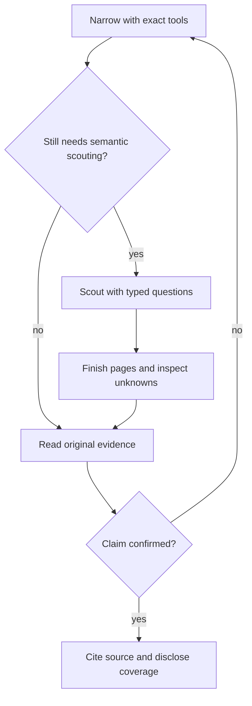
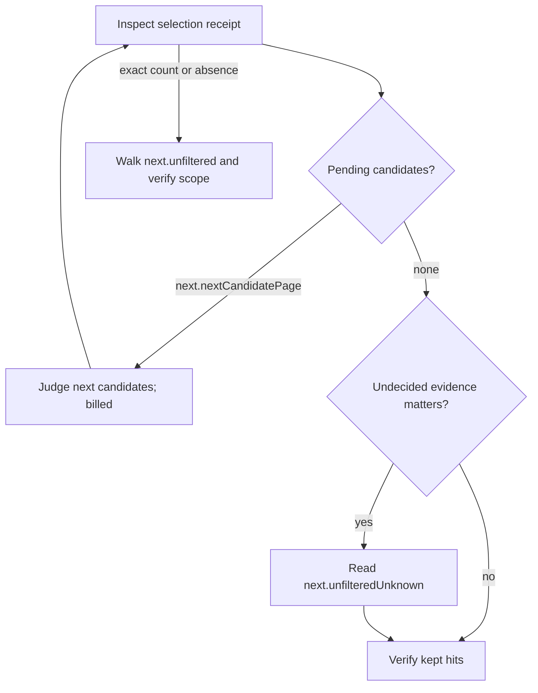
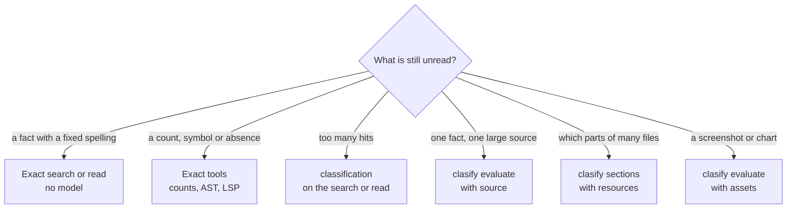
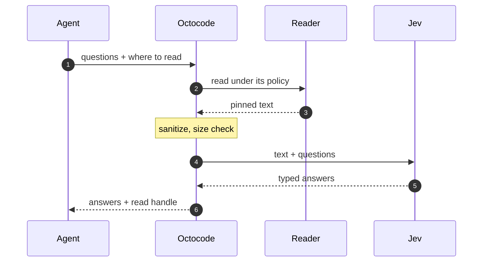
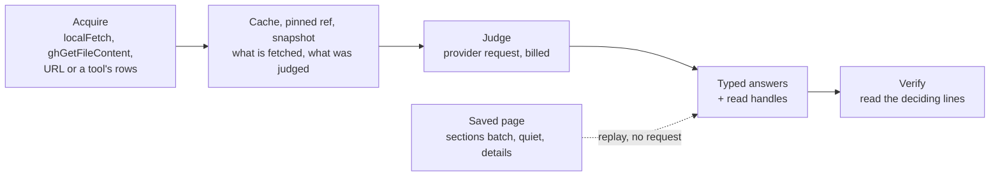
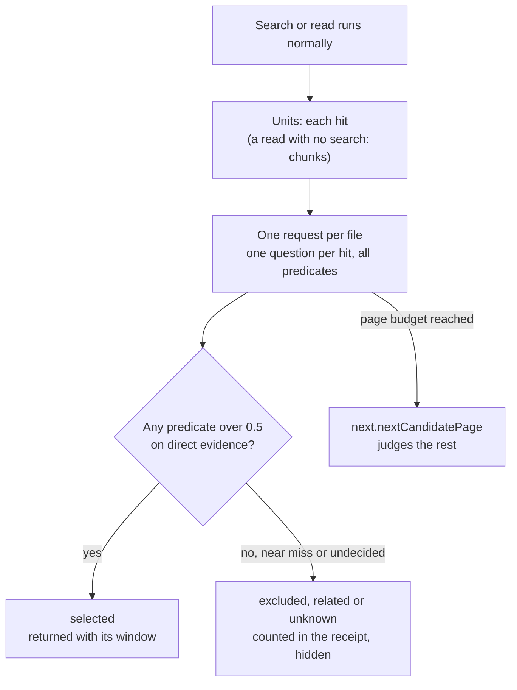
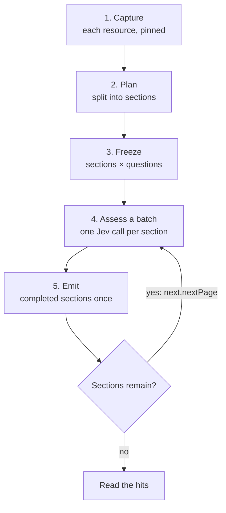
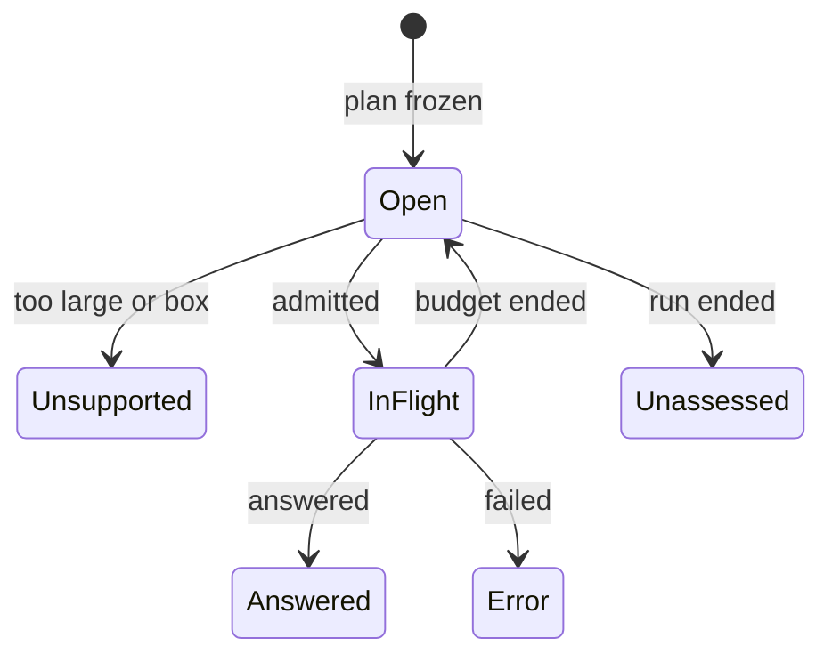
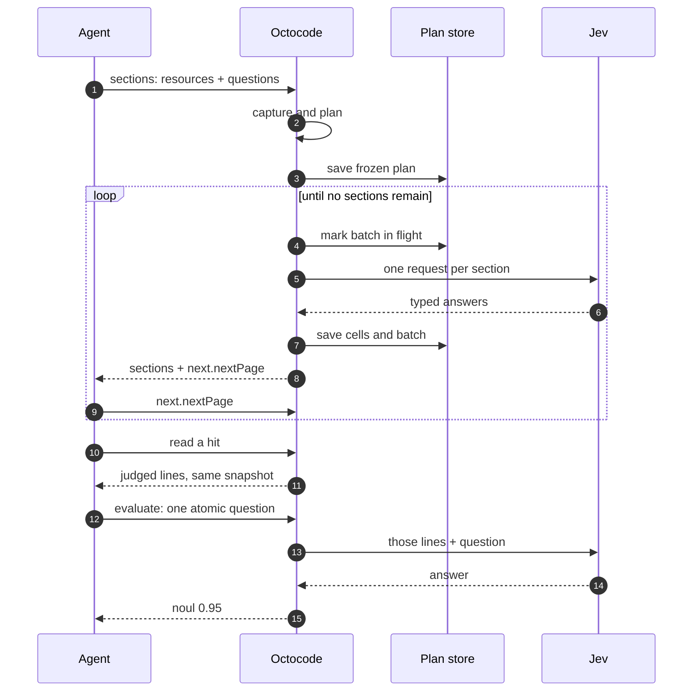

# Research with Jev: classification in Octocode

Jev is TypeSafe's decision model behind Octocode's classification. Octocode uses it to scout
unread evidence: ask focused questions, identify candidates, then read the original source to
verify them. Answers are typed: a yes/no probability, a choice, a score or an image box.
`clasify` returns answers and read routes; inline `classification` returns selected source rows.
Jev spends provider tokens reading the evidence; the main agent can receive less text.

Runs on 2026-11-03 reported 98% less main-agent context for one fact in a 33 KB doc, and 73–84%
less when mapping questions across 30–100 files versus reading every file. These are
character-based token estimates, not measured total cost or end-to-end task savings. Recall
varied by route; every measurement, with its dataset, date, correctness, latency and provider
tokens, is under [Benchmarks](#benchmarks).

> [!TIP]
> Search for spelling, ask Jev for meaning, and read the lines before you cite them.

There are two ways in:

| Entry point | What it does | Use it when |
|---|---|---|
| `classification` on a search, read or listing tool ([which tools](OCTOCODE_TOOLS.md#context-selection)) | Filters the hits or lines a search or read found, before the agent sees them | A search returns too many hits and no term or path splits them |
| The `clasify` tool | Answers typed questions about content, an unread source, images, or every section of many files | You need a named fact from a large unread source, or which parts of many files answer your questions |

## Quick start

1. Configure the classification key, and optionally [another host](CONFIGURATION.md#change-the-classification-host): [Authentication](AUTHENTICATION.md#classification-key-clasify).
2. Ask one exact question about a file you have not read:

   ```bash
   octocode clasify '{"queries":[{"operation":"evaluate","source":{"tool":"ghGetFileContent","query":{"owner":"vitejs","repo":"vite","path":"packages/vite/src/node/server/middlewares/hostCheck.ts","ref":"b3cb0575aff63004a71301a1ec798aeea2aa05d7"}},"questions":{"host":{"type":"noul","instructions":"Does this code reject an incoming request whose Host header is not in an allowed-hosts list?"}}}]}'
   ```

3. Read the answer (`noul` is P(yes)). To check a yes, run the `sections` call it offers in
   `related[]`, then read the lines it names. `next.read` re-reads the whole file.

The MCP server takes the same requests as the CLI.

## The research loop

Search first when spelling, paths or code shape can narrow the evidence. Scout by meaning when
that leaves substantial unread material. A positive answer identifies a candidate; a negative
answer does not clear the source.



- **Find:** narrow by path, glob or term first. The model is for meaning, not spelling.
- **Judge:** ask one exact fact per question. An unknown answer is not a "no".
- **Read:** a Jev answer is a candidate. Read its lines before you rely on it or quote it.

### Scouting: choose what the agent will read

| What you hold | Scout | Verify / recover |
|---|---|---|
| Many search hits; the distinction is semantic | Add `classification.predicates` to the search or read | Read kept hits; finish `next.nextCandidatePage`, then inspect `next.unfilteredUnknown` if present |
| Paths, commits, comments or packages to triage | `clasify evaluate` with `source: {tool, query}` | Read identified rows through returned calls; `next.nextPage` covers more source rows |
| One large unread file, web page or saved command log | `clasify evaluate` with a source locator and atomic questions | Use `next.read`; use the offered `sections` call when a narrower read is needed |
| Candidate files, but the relevant region is unknown | `clasify sections` with named resources | Finish `next.nextPage`; read `target.lines`; inspect `next.quiet` when low answers could change the claim |
| A screenshot | `evaluate` with `assets` and `content` naming each asset | Ask presence before `box`; inspect the original image; use DOM measurements for exact geometry |

`structureSearch` classification judges paths, not file contents. Likewise, a commit title,
search snippet or comment cannot establish behavior outside the text actually judged. Scout
those rows to locate files or patches, then read them before making a behavioral claim.



Finish `responsePagination.next` before tool-level continuations. Copy emitted calls unchanged;
coverage counts are cumulative, so retain the latest receipt rather than summing receipts.
Completing assessment accounts for all candidates; it does not guarantee classification recall.
Cross-file relations, control-flow paths and whole-source claims need the relevant regions read
together: see [what an answer from sections cannot show](#what-an-answer-from-sections-cannot-show).

## Choose a route

Pick the route by what is still unread:



| Route | You send | You get back |
|---|---|---|
| `classification` | A normal search or read plus `predicates` | Only the hits Jev selected, and a receipt counting the rest |
| `clasify evaluate` | One `source` (or literal `content`) and questions | One typed answer per question and a `next.read` handle |
| `clasify sections` | Named `resources` and questions | Per file: each section's lines and answers, plus coverage |
| `clasify evaluate` with `assets` | PNG or JPEG images, `content` and questions | Typed answers; `box` gives a region of the image |

Counts and sizes for each route are under [Limits](#limits).

## How it works

### What every call does

For source-backed `evaluate`, the agent sends questions and a locator; Octocode captures the
source and sends it to the provider. The answer omits the body, which a subsequent read can
retrieve. Literal `content` is supplied by the agent; inline classification returns kept text.



- **The reader** is the same one a normal call uses: `localFetch` for local files,
  `ghGetFileContent` for GitHub (pinned to the resolved commit), or an HTTPS `url`. Path, auth
  and network policies apply before anything reaches Jev.
- **Oversized sources are judged in sections.** Octocode never judges a silently clipped prefix.
  The provider's window decides: Octocode sends the default window and asks for the long-context
  one only after a refusal. A text source that still does not fit is cut into sections, every
  question is asked on every section, and the row holds one answer per question with `lines` of the
  deciding section: `noul` and `score` take the highest section, `choice` the label of the most
  confident section that did not choose `unknown` (a section without the evidence abstains, so many
  of them never outvote the one that holds it; `unknown` only when every section chose it, with no
  lines to read). Each label's share of the sections is its probability. `coverage` counts the sections,
  `next.read` reads the deciding lines, and the `sections` call in `related[]` lists every
  section's own answer. Literal `content` and image rows are not cut: they keep the refusal. What
  such an answer cannot show is [below](#what-an-answer-from-sections-cannot-show).
- **Jev sees only** the captured text, your questions and `context`. It has no conversation
  history and no sibling answers, so each question must stand alone.
- **No answer cache across requests.** Each fresh request is judged and billed again, so an
  edited file never gets an old answer. Saved result pages and `sections` continuations replay
  with no new inference. Identical evaluations inside one request are sent once. One exception:
  a repeated `next.nextCandidatePage` cursor replays the page it judged, kept in memory only (not
  on disk) while the runtime lives and is used; the replay's receipt shows `calls: 0` and keeps
  the models and `remainingInputTokensEstimate`. An edited source refuses the cursor as stale.
  Eviction, close, or a new process (a CLI call without the daemon) judges it again and bills it.
- **Questions over one source share one provider request when they fit it;** otherwise each
  question is its own request carrying the whole source, and each is billed.
- **Provider failures keep the evidence.** When capture succeeded, the read handle still works.

### Reading versus judging

Reading a source and judging it are separate steps with separate costs. GitHub cache reuse,
pinned refs and local snapshots apply to reading: they decide what is fetched and which bytes
were judged. They never answer a question. Every fresh judgment is a provider request, billed
even when the read came from a cache.



| What repeats | Reading | Judging |
|---|---|---|
| A fresh `evaluate`, same source | The reader's own cache rules apply ([cache storage](STORAGE_AND_LIMITS.md#cache-storage-and-lifecycle)); a commit-pinned GitHub read sends nothing | Billed again: there is no answer cache, so an edited file never gets an old answer |
| The first `sections` batch, `next.nextPage` | Captured once into the frozen plan | Billed for the sections of that batch |
| A saved `sections` page, `next.quiet`, `next.details` | None | Free: replayed from the saved page |
| A repeated `next.nextCandidatePage` cursor | None | Free while the runtime that judged it lives; a new process bills it again |
| `next.read`, `resources.<key>.read` | A pinned read of the judged snapshot or commit | None |

### What an answer from sections cannot show

A source over one window, and a `sections` row, are judged one section at a time. A section sees
its own lines (and, for `sections`, the context before it), never the rest of the source. So:

- `noul` and `score` report the highest section; `choice` reports the most confident label
  besides `unknown`. The answer says that one section looks like a match. It is not a statement
  about the whole source.
- It cannot establish **absence**: a low answer in every section is not proof that the fact is
  missing, and `unknown` is not "no".
- It cannot establish a **contradiction** between two passages, or the **order** of events, when
  the passages fall in different sections: no section sees both.
- It cannot give a **whole-file guarantee** ("every path releases the lock", "no handler logs
  the token").

For those claims, examine the relevant sections together: run the `sections` call in
`related[]` (or `operation: "sections"`) to list every section's answer, then read the deciding
lines of each candidate section, or ask one atomic `evaluate` question over a `ranges` read that
holds all of them.

### Questions

Questions are keyed under `questions`. Every question is asked of every unit Jev judges.

| Type | Ask | Answer |
|---|---|---|
| `noul` | A yes/no fact | `noul`: P(yes), 0 to 1 |
| `choice` | Pick one of the keyed options in `criteria` | `choice`, `probabilities`, `confidence` |
| `score` | A level on the scale listed in `criteria`, level 0 first | `score` (the expected level, may be fractional), `probabilities`, `legend` |
| `box` | Where something is in an image (needs `assets`) | `box` edges as 0–1 fractions of the judged image; `sourceBox` on the original when it was fitted |

`confidence` measures how concentrated an answer is, not whether it is correct.

### Write atomic questions

An atomic question names one observable fact that a line of source can confirm. Vague questions
can produce confident wrong answers; low probabilities also missed real relational defects in
the [measured runs](#accuracy-against-known-answers).

| Instead of | Ask |
|---|---|
| "Any security bug here?" | "Does this code serve a file that lies outside the allowed filesystem roots?" |
| "Is the host handled?" | "Does this code reject a request whose Host header is not in an allowed-hosts list?" |
| "After 2027?" | "Is the year 2028 or later?" |
| "How many retries are there?" | Nothing: count with `localSearch` or a script |

- Write each question to stand alone; Jev does not see your other questions or answers.
- Say what does not count: "assigns a timeout, not one it forwards".
- Give `choice` an `unknown` option and a near-miss option, so Jev is not forced to guess.
- Treat answers between 0.3 and 0.7 as unsure.

### classification: filter hits before you see them

Add a `classification` object to a search or read. The tool runs normally, then Jev decides
which units reach you.



**The hit is the unit.** Each hit gets its own verdict: context lines inform it but never pass it, so
a kept hit's window can show lines that did not pass, and `matchedLines` names the kept hits. The
hits of one file share one provider request, so the state is sent once, with the question text every
hit shares; each hit's question carries only its line and the predicate, and a hit line is sent once
unless it is also a neighbour's context. On the frozen fixtures this judged every hit right at
context 0, ±2 and ±3, at about a third of the tokens of one call per hit.
A read with no search has no hit to ask about: it is judged in chunks (declarations or line windows),
each kept whole. `selection.unit` says which.

The receipt (`selection`) counts every unit of the walk: each candidate page adds its verdicts to
the pages before it, so the last one holds the whole tally. `status` is `complete` once every unit
was judged, with unsure answers counted in `unknownItems`, and `partial` while some wait for
`next.nextCandidatePage` or got no answer; the warning says which of the unknown units are not
judged yet. Continuations reach the rest:

| Continuation | Use it when |
|---|---|
| `next.nextCandidatePage` | More units remain to judge; `selection.usage.remainingInputTokensEstimate` prices them at this page's rate |
| `next.unfilteredUnknown` | The units Jev could not decide might change your claim. A search reads the files holding them, a read the exact lines |
| `next.unfiltered` | You need the whole view, unjudged, for a count or an absence claim |

A provider that cannot answer (slow, overloaded, unreachable) never hides what the search found: the
hits come back unjudged with a warning naming the cause. If only some requests failed, the page
keeps the verdicts it got and `next.nextCandidatePage` judges the failed hits again.

> [!IMPORTANT]
> Jev judges each hit and its `contextLines`, not the whole file. If the property you ask about
> lies outside that window, widen `contextLines` or use `clasify sections`. A filtered list does
> not prove that something is absent.

### clasify evaluate: one source, many questions

`evaluate` takes exactly one of `source`, `content` or `resources`:

- `source` names a reader query (`localFetch`, `ghGetFileContent`) or an HTTPS `url`; Octocode
  reads it for you. Use it for anything you have not read. It can also name a search, listing or
  history tool, whose rows are judged one by one (below).
- `content` is literal text or JSON you supply. Paths or URLs inside it are data and are not
  fetched.
- `resources` names several text sources (a `localFetch` path may be a glob); each file gets its
  own answer set.

Jev judges the captured text against every question. The result holds `answers.<key>`, `usage`,
`next.read` and `readChars`. `next.read` is not a span: it re-reads the whole judged selection at its
pinned snapshot or commit, and `readChars` says how many characters that is. To check a yes for less,
run the `sections` call in `related[]`: the same question, with `target.lines` per section. A
`sections` batch then offers `next.read` (and `read2`, … for more resources): one pinned read of exactly
the lines of the sections that said yes to a `noul` question, adjacent ones merged, never the whole
source. Or read other lines with `ranges` at the same path and ref, or use `matchString` if the answer
has a term. A section is a share (a quarter) of the section grain, so even a short file splits into
sections an answer can point into.

**Views.** A row answers in `view: "summary"` by default: each answer's value (`noul`, `choice`,
`score`, `box`), the `lines` of the deciding section where there is one, `coverage`, the tokens and
the ready calls. `view: "details"` is the whole row: it adds `probabilities`, `confidence`, `legend`,
the answering `model`, a request count of one, image provenance (a summary keeps only the pixel sizes
a `box` maps to), a section's `id`, `kind`, `name`, `context` and byte range, the `status` wrapper of
each answered cell, and quiet units. A summary only removes; a `details` continuation stays in
`details`. An `evaluate` row bills again when re-run in another view, so ask for `details` up front
when you need the distribution; a saved `sections` page replays in either view without inference.

**A source over every window** is judged in sections within the same row: one answer per question
with the deciding section's `lines`, and `coverage`. A size the provider refused for a model is
remembered for the life of the process, so the next source at least that large goes straight to its
sections instead of being uploaded whole to be refused again; `longContext: false` does the same
without the long window.

**A tool's rows as the source.** `source: {tool, query}` over `localSearch`, `structureSearch`,
`astSearch`, `lspSearch`, `ghSearchCode`, `ghSearchRepo`, `ghSearchHistory`, `ghGetHistoryItem` or
`artifactSearch` runs that tool's query for you and judges each row of its page as one unit: a hit, a
listed path, a commit, a pull request, a comment, a changed file, a package. `query` is that tool's
own query row: a row that tool would refuse is refused at admission with its message. `units` holds the
answers keyed by the unit's identity (`path:line`, number, id, name), never the rows' text; a summary
holds back units whose every `noul` answer is under 0.3 and counts them in `coverage.quiet`.
`coverage.totalUnits` is one page of the tool; `next.nextPage` judges the tool's next page. Each unit
is one provider request. `classification` on the tool itself is the other route: it returns the kept
rows themselves.

**A list in hand.** A `content` array is one source, judged whole; with `perItem: true` each item is
one unit, answered under `units` by its index. An array has no item cap: its serialized length bounds
it.

### clasify sections: map questions across many files

`sections` takes named resources and your questions, and tells you which regions of which files
answer each question.



1. **Capture.** Each resource is read by its own reader and pinned. A source repeated across
   resources is read once.
2. **Plan.** Code is split at declaration edges, so whole functions, classes and methods stay
   together; other text is split into size-bounded chunks at line breaks. Each section keeps its
   preceding context lines.
3. **Freeze.** The plan becomes a matrix: one row per section, one column per question. Each
   cell is one answer slot. The plan is saved before any Jev call.
4. **Assess.** One Jev request per section answers all of its open questions. Sections in a batch
   run concurrently, admitted by a character budget.
5. **Emit.** Completed sections are returned once, with each resource's coverage and
   `next.nextPage` while work remains. Shown sections rank by their highest `noul` answer; a
   section whose every answer is a `noul` below 0.3 is held back as quiet (see below).

Each cell moves through these states:



| Transition | When |
|---|---|
| Open → Unsupported | The section exceeds the model's input limit, or the question is `box` (text sections have no image) |
| Open → InFlight | The batch's character budget admits the section |
| InFlight → Answered | Jev returned a typed answer |
| InFlight → Error | The provider failed, a different model answered, or the process stopped with the outcome unknown |
| InFlight → Open | The call's deadline passed before the request was sent; a later batch retries it |
| Open → Unassessed | The run ended with work left; `terminalReason` says why |

Coverage counts these states per resource (`answered`, `error`, `unsupported`, `unassessed`),
plus `totalSections` and `remainingSections`. An absent count is 0.

`coverage.quiet` is not a cell state: it counts the completed sections held back from
`sections[]` because every answer is a `noul` below 0.3. A section with an error, unsupported or
unassessed cell, an unsure answer (0.3-0.7) or another question type is always shown. The count is
cumulative, so it can appear on any batch; the last batch's `next.quiet` lists every quiet section
once, from the saved plan, with no Jev call (`replayed: true`, zero usage). If that plan cannot be
kept, the last batch shows the quiet sections instead and offers no `next.quiet`. Quiet is a low
answer, not absence: read the section before you rely on it.

> [!IMPORTANT]
> `unassessed` and `error` cells were not judged: they are not a "no". A section hit is a
> candidate, because sections are judged with preceding context: read its `target.lines`
> before you cite it.

What comes back for each resource:

```text
resources.<key>
├─ status, snapshot           what was read, pinned (`source` on a cursor page, or when it changed)
├─ read                       a handle that reads the file at that snapshot
├─ coverage                   cell counts (cumulative, never add them up)
│  └─ quiet                   sections held back: every answer a noul below 0.3
└─ sections[]                 shown sections, highest noul answer first
   ├─ id, kind, name, target.lines, context
   └─ answers.<question> {status, answer}
next
├─ nextPage                   the next batch, while sections remain
├─ read, read2, …             pinned reads of the yes-sections' lines
└─ quiet                      last batch only: every quiet section, replayed unbilled
```

- Each completed section appears exactly once: on a batch, or through `next.quiet`. A later
  batch repeats a resource only when it gains sections or its coverage changes, so keep each
  resource's last reported row.
- A resource that cannot be read or judged says so; Octocode never invents answers for it.

### State: where the data lives

One `sections` request from start to the final atomic follow-up:



| State | Where | How long | Holds |
|---|---|---|---|
| Capture pool | RAM | One call | The sanitized text of each captured source |
| Plan store | RAM, plus disk with persistent storage | 30 minutes after its last use | Section text, the cell matrix, rows in flight, every emitted batch |
| Saved result pages | The page store | The same 30 minutes for `clasify` | Emitted pages and read handles, replayed with no inference |
| Saved candidate pages | RAM only | Idle retention of continuations, lost on close or a new process | The page a `nextCandidatePage` cursor judged, replayed with no provider call |
| Agent context | The main agent | The conversation | Answers, coverage and read handles only |

- If a process stops while rows are in flight, the next continuation reports those cells as
  errors with an unknown provider outcome. It does not send them again.
- An answer from a different model than the one the plan started with is refused.
- With `storage.mode: "memory"`, a one-shot CLI call keeps nothing for a later call. A section
  plan returns `classificationContextUnavailable` before reading sources or calling the provider.
  A `localFetch` or `ghGetFileContent` source evaluation still answers; its read is a fresh call
  in `related[]` (a GitHub read stays at the captured commit, a local read rereads the path),
  not a `next.read` handle. Literal content works too. URL and image captures need persistent
  storage. Use persistent storage or a running MCP server for section plans. A source larger
  than one response pages its read in `related[]`; run that read with `storage.mode`
  `persistent`, or in one running MCP server.

## Examples

Every GitHub source below is public and pinned, so these commands run as written.

### Filter search hits

```bash
octocode localSearch '{"queries":[{"path":"src","matchString":["cache"],"contextLines":{"before":3,"after":3},"classification":{"predicates":["Does this implement credential invalidation?"],"context":"Trace credential rotation through the cache."}}]}'
```

The same `classification` object works on every tool listed in [Context selection](OCTOCODE_TOOLS.md#context-selection).
Predicates are independent questions; `context` tells Jev what the research is for.

### Ask about one unread file

```bash
octocode clasify '{"queries":[{"operation":"evaluate","source":{"tool":"ghGetFileContent","query":{"owner":"vitejs","repo":"vite","path":"packages/vite/src/node/server/middlewares/hostCheck.ts","ref":"b3cb0575aff63004a71301a1ec798aeea2aa05d7"}},"questions":{"host":{"type":"noul","instructions":"Does this code reject an incoming request whose Host header is not in an allowed-hosts list?"},"status":{"type":"choice","instructions":"Which HTTP status does a rejected request get?","criteria":{"400":"400 Bad Request","403":"403 Forbidden","404":"404 Not Found","unknown":"The code does not say"}}}}]}'
```

The agent receives about 330 characters instead of the file:

```text
model: jev-1.14.0
answers:
  host: type noul noul 0.86
  status:
    type: choice
    choice: unknown
    confidence: 0.79
    probabilities: 400 0.04 403 0.12 404 0.0 unknown 0.84
usage: inputTokens 1082 outputTokens 71
next.read: (a ghGetFileContent cursor call for the judged file)
```

`unknown` is right: the file hands rejection to a helper and sets no status itself. For a local
file, use `"source":{"tool":"localFetch","query":{"path":"src/cache.ts"}}`; for a web page, an
HTTPS `url`.

### Map questions across files

```bash
octocode clasify '{"queries":[{"operation":"sections","resources":{"hostCheck":{"tool":"ghGetFileContent","query":{"owner":"vitejs","repo":"vite","path":"packages/vite/src/node/server/middlewares/hostCheck.ts","ref":"b3cb0575aff63004a71301a1ec798aeea2aa05d7"}},"ws":{"tool":"ghGetFileContent","query":{"owner":"vitejs","repo":"vite","path":"packages/vite/src/node/server/ws.ts","ref":"b3cb0575aff63004a71301a1ec798aeea2aa05d7"}}},"questions":{"host":{"type":"noul","instructions":"Does this code reject or allow an incoming request based on its Host header or an allowed-hosts list?"},"fsdeny":{"type":"noul","instructions":"Does this code refuse to serve a file that lies outside the allowed filesystem roots (an fs allow or deny list)?"},"port":{"type":"noul","instructions":"Does this code pick another port when the requested port is already in use?"}}}]}'
```

The filled matrix, one row per section, P(yes) per question:

| Resource | Section | Lines | `host` | `fsdeny` | `port` |
|---|---|---|---|---|---|
| `hostCheck` | s0 | 1–62 | **0.95** | 0.07 | 0.02 |
| `ws` | s0 | 1–217 | **0.96** | 0.08 | 0.12 |
| `ws` | s1 | 217–374 | **0.94** | 0.07 | 0.05 |
| `ws` | s2 | 374–473 | 0.06 | 0.08 | 0.05 |

Probabilities shift by about 0.01 between runs on average, up to 0.08 on answers already unsure. Read the high-scoring sections with each
resource's `read` handle, and follow `next.nextPage` unchanged until no resource reports
`remainingSections`.

### Ask one atomic follow-up

A section hit says where to look. A follow-up asks one exact fact about just those lines, here
lines 46–62 of `hostCheck.ts`:

```bash
octocode clasify '{"queries":[{"operation":"evaluate","source":{"tool":"ghGetFileContent","query":{"owner":"vitejs","repo":"vite","path":"packages/vite/src/node/server/middlewares/hostCheck.ts","ref":"b3cb0575aff63004a71301a1ec798aeea2aa05d7","ranges":[{"startLine":46,"endLine":62}]}},"questions":{"preview":{"type":"noul","instructions":"Does the rejection message name preview.allowedHosts when the server runs in preview mode?"}}}]}'
```

```text
model: jev-1.14.0
answers:
  preview: type noul noul 0.95
usage: inputTokens 588 outputTokens 20
```

Line 55 confirms it: the option name is built from `isPreview ? 'preview' : 'server'`.

### Ask about an image

An image asset is a source reference, not binary data from the host: put it under `assets`, never
in `source`. The `assets` field description in `octocode schema clasify` owns the admission
rules (formats, sizes, citing each key, one image per flaw check). Jev receives the admitted PNG
or JPEG bytes; the result carries dimensions, format, a snapshot and an inspection path for the
captured bytes. Local path policy and HTTPS network policy apply before inference, and retained
image evidence needs persistent storage.

Images outside the model's window are fitted before judging: a side above 1568 scales the whole
image down, then a side below 280 is centered on a transparent canvas. `box` edges are fractions
of that judged image (`assets.<key>.path`). When the image was fitted (`sourceWidth` is present)
and the question's image is identifiable, the box answer also has `sourceBox`: the same box as
fractions of the original `sourceWidth` x `sourceHeight`, clamped to 0–1. The image is the row's
only asset, else the one asset key the question cites; a question citing none or several gets no
`sourceBox`.

## Benchmarks

Every measurement names its dataset and date, and reports correctness (planted or known facts
found), recall where it was measured, latency and total cost. Total cost is provider tokens in
and out, as each result reports them in `usage`: Octocode prints no price. Single runs show a
direction, not a verdict. Runs of other tools (the
[research benchmark](../packages/octocode-benchmark/README.md)) use other datasets and metrics,
so they stay there and are not compared here.

| Section | Dataset | Date |
|---|---|---|
| [Main-agent tokens with and without Jev](#main-agent-tokens-with-and-without-jev) | Local docs, Java files, Vite server files | 2026-11-03 |
| [One source, images and edges](#one-source-images-and-edges) | This repository's files, synthetic logs and images | 2026-11-11 |
| [Oversized sources, views and units](#oversized-sources-views-and-units) | A 294 KB synthetic Rust file with planted facts; this repository's source | 2026-11-11 |
| [Accuracy against known answers](#accuracy-against-known-answers) | Image, text, sections, large-source and relation sets | Not recorded; relations 2026-11-05 |
| [Checked and not checked](#checked-and-not-checked) | All of the above | 2026-11-11 |

### Main-agent tokens with and without Jev

Each benchmark asks the same questions with and without Jev and counts the exact characters the
main agent receives. Tokens are characters ÷ 4. Jev tokens are the provider tokens each result
reports in `usage`.

> [!NOTE]
> Single runs on 2026-11-03. Local corpora: 28 Markdown docs (198 KB) and 100 Elasticsearch
> `*Processor.java` files (497 KB). GitHub corpus: 30 files under
> `vitejs/vite@b3cb057/packages/vite/src/node/server` (316 KB). Latency was not recorded.

#### Tokens per task

| Task | Without Jev | With Jev | Main agent saves | Jev tokens |
|---|---|---|---|---|
| One named fact in an unread 33 KB doc | Read the doc: 8.4k | `clasify evaluate`: 0.15k | **8.3k (98%)** | 8.1k |
| 3 questions over 28 local docs | Exact search: 6.8k | `classification`: 4.0k | **2.8k (41%)** | 23k |
| 3 questions over 30 GitHub files | `ghSearchCode`: 4.7k | `classification`: 2.4k | **2.3k (48%)** | 12k |
| 3 questions over 100 Java files, all hit lines | Exact search: 26.8k | `classification`: 4.1k | **22.7k (85%)** | 131k |
| Same, when file names are enough | `view:"files"`: 2.2k | `classification`: 4.1k | −1.9k (costs more) | 131k |
| Map 3 questions across 30 GitHub files | Read every file: 98.6k | `clasify sections`: 15.6k | **83k (84%)** | 134k |
| Map 3 questions across 100 Java files | Read every file: 137.8k | `clasify sections`: 36.8k | **101k (73%)** | 156k |
| A literal in one small file | Exact read: 0.09k | `clasify`: 0.07k | about 0 | 3.2k |

#### Every route on the same three corpora

Main-agent tokens; the smallest per corpus is in bold.

| Corpus | Read every file | Exact search | `classification` | `clasify sections` |
|---|---|---|---|---|
| 28 local docs | 33.3k | 6.8k | **4.0k** | 9.4k |
| 30 GitHub files | 98.6k | 4.7k | **2.4k** | 15.6k |
| 100 Java files | 137.8k | 26.8k (files view: **2.2k**) | 4.1k | 36.8k |

#### What you get for the Jev tokens

| Route | Jev tokens per main-agent token saved | Found |
|---|---|---|
| `clasify evaluate` with `source` | about 1 | The named fact, with no body in context |
| `clasify sections` instead of reading every file | 1.5–3 | 25 of 26 matching Java files (2 extra); every host-check and file-deny file in Vite |
| `classification` instead of exact-search hits | 5–8 | 14 of 26 matching Java files, because it judges each hit and its context lines; missed 2 of 4 file-deny files in Vite |

#### When Jev does not pay

- **The answer has a fixed spelling.** Exact search finds it with no model. On the Java corpus
  the `view:"files"` listing beat every Jev route on both tokens and accuracy.
- **The source is small.** One call per section costs more than reading a short file.
- **You need counts, totals, maxima or symbol identity.** Use `localSearch` counts, a script,
  `astSearch` or `lspSearch`.
- **You already know the candidate files.** `clasify sections` returns more than a targeted
  search (15.6k against 4.7k on Vite). Use it to replace reading, not searching.
- **You need to prove absence.** An answer or an unassessed cell is not a "no"; use exact tools
  or `next.unfiltered`.
- **The fact is a relation you cannot name.** Named relations held up on 2026-11-05: 26 of 26 for
  named events and conflicting values, overall recall 49 of 52. A generic "do any two passages
  contradict?" missed 2 of 8, and an earlier benchmark's harder fixtures reached 16/30 for doc
  contradictions and 5/18 for log order. A low P(yes) clears nothing.
- **The fact depends on a control-flow path, asked plainly.** "Is there a path that returns without
  unlocking?" read no on real defects (7 of 7 runs, four languages). A `choice` naming the paths
  ("every return path releases it", "an early return does not", `unknown`) separated all 14
  defect-and-fixed cases across six kinds of leak, and so did `noul` `criteria` stating both sides.

In agent research runs (5 tasks, 4 runs), agents found every answer with exact search and called
Jev once. Extra classifier guidance raised their context by 40% with no gain in accuracy, so
reach for Jev when exact search cannot split the evidence, not by default.

### One source, images and edges

> [!NOTE]
> Single runs on 2026-11-11 against the live provider (`jev-1.14.0`) from a debug build. Sources:
> this repository's files, a synthetic 300-line log with seven planted authentication failures,
> a 16-comment public issue, a screenshot and three small images. The study made 116 provider
> requests: about 363,700 input and 7,600 output tokens in all.

| Case | Source chars | Correct | Latency | Requests | Tokens in / out | Output chars |
|---|---|---|---|---|---|---|
| Small text, 1 / 3 / 8 questions | 600 | every answer | 0.77 / 0.27 / 0.28 s | 1 each | 442 / 572 / 711 in | 95 / 387 / 569 |
| A 2,074-line Rust file, 3 questions | 77,296 | 3 of 3 | 0.62 s | 1 | 18,254 / 83 | 827 |
| The 300-line log as `content`, 2 questions | 17,951 | 2 of 2; an exact search for "auth" found none of the seven planted lines ("token signature rejected") | 0.43 s | 1 | 9,619 / 65 | 255 |
| A 16-comment issue, inline `classification` | 13,071 | 4 kept, 2 unknown; recall not counted | 1.1 s | 16 | 10,028 / 272 | 3,930 |
| A screenshot: `noul`, `choice` and `box` | image | 3 of 3; `box` within about 0.01 | 0.38 s | 1 | 5,595 / 84 | 793 |
| 3 images, one question each | images | 3 of 3 | 0.29 s | 1 | 1,266 / 96 | 1,653 |
| Questions the source cannot answer | 600 | `unknown`, `noul` 0.19 | 0.27 s | 1 | 511 / 59 | 243 |
| 120 questions in one request | 600 | not scored | 0.35 s | 1 | 2,232 / 2,294 | 2,537 |
| First 1 MB of a 2.7 MB file, `sections`, page 1 of 18 | 1,005,773 | 4 of 4 | 9.5 s | 4 | 34,236 / 332 | 2,686 |
| A 12-file folder, `sections`, 2 questions, 2 pages | 105,291 | the matching files ranked first; recall not counted | 1.4 + 1.1 s | 36 + 28 | 83,493 / 2,560 | 11,100 + 7,573 |
| `next.quiet`, a page replay, `next.read` | — | — | about 0.13 s each | 0 | 0 | — |

| Edge | Result |
|---|---|
| Empty file or `content` | `classificationContextEmpty`, no request |
| Binary file as `source` | `binaryFileUnsupported` with a ready `assets` call |
| Latin-1 text | Judged, correct |
| A file with 12 planted secrets, captured on a loopback provider | 0 of 12 in the request body; 23 redaction marks |
| Provider error (400) | `classificationProviderError`; the pinned read is still offered |
| A 9,000 px image; a non-image asset | Refused locally; "not a PNG or JPEG" |

### Oversized sources, views and units

> [!NOTE]
> 2026-11-11, debug build. "Live" is the provider; "loopback" is a local stand-in provider that
> bills nothing. `big300.rs` is a synthetic Rust file (294,466 chars, 8,512 lines) with three
> planted facts: a function that retries a ledger upload exactly seven times (line 1208), a
> telemetry WebSocket (lines 4305–4307), and `ArchiveStore` persisting rows in RocksDB (line 7011).

A source over every window used to be an error with a ready `sections` call. It is now answered in
the same row from its sections:

| Case | Correct | Latency | Requests | Tokens in / out | Output chars |
|---|---|---|---|---|---|
| Live: lines 6000–14500 of `tool_types.rs` (294,799 chars), 3 questions | The planted struct located (0.98 at lines 10171–10653; the struct is at 10538); the other two answers not scored | 9.5 s | 20 (1 refused whole, 19 sections) | 184,897 / 1,577 | 1,334 |
| Loopback: a whole 2.7 MB file with one planted line | 1 of 1, in section 39747–40211 | 14.4 s | 183 | not billed | 1,123 for 2.75 M chars |
| Live: `big300.rs`, 3 questions, sections with supporting context | 2 of 3: retry (0.97, lines 924–1394) and WebSocket (0.84, lines 4164–4631); `ArchiveStore` answered `unknown` | not recorded | 20 | 184,677 / 1,465 | — |
| Live: the same, sections without supporting context | The same answers and deciding lines: 2 of 3 | not recorded | 20 | 97,679 / 1,464 (**−47%** input) | — |

Dropping the supporting context of each section in a sectioned `evaluate` halved the input on this
source with the same answers, so a sectioned `evaluate` sends each section alone. A `sections` plan
keeps the context, because its sections are read one at a time. One source is a direction, not a
verdict.

`choice` over sections now takes the most confident label besides `unknown`, so sections that lack
the evidence abstain instead of outvoting the one that holds it. The two runs above answered
`unknown` for `ArchiveStore`. Rerun with the current rule (live, `view: "details"`, later the same
day, on a tree whose section grain was being changed: 17 sections), `big300.rs` answered **3 of 3**:
retry 0.97 (lines 1040–1571), WebSocket 0.76 (lines 4189–4710) and `rocksdb` (lines 6597–7127, which
hold line 7011), in 1.6 s with 18 requests and 96,647 / 1,310 tokens. One section of 17 chose
`rocksdb` (share 0.06, confidence 0.98) and 16 chose `unknown`: a majority would have answered
`unknown`. Whether the earlier runs predate the rule was not recorded.

`view: "summary"` against the whole row (now `view: "details"`), loopback provider, the same rows:

| Row | Whole row chars | Summary chars |
|---|---|---|
| One text, 3 questions | 367 | 162 |
| One 3-line file, 1 question | 566 | 256 |
| One image, 3 questions | 743 | 250 |
| `sections`, one section | 671 | 463 |
| `sections`, one page of a 7,491-line file | 12,437 | 3,931 (32%) |

Units, live, not scored for correctness (no known answers):

| Case | Units | Requests | Tokens in / out | Output chars |
|---|---|---|---|---|
| `source: {tool: "localSearch", query}` over this repository's clasify engine | 11 (7 shown, 4 quiet) | 11 | 4,417 / 220 | 857 |
| A `content` array of 8 items with `perItem: true` | 8 (3 shown, 5 quiet) | 8 | 2,273 / 160 | 244 |

### Accuracy against known answers

Evaluation runs against known answers; the dates of the first five rows were not recorded. Judge
quality by agreement with source evidence, complete coverage accounting and working read handles;
shorter output alone is not better.

| Area | Result | Notes |
|---|---|---|
| Images | 73 of 77 correct | Every miss came with confidence 0.51 or less |
| Text | 83 of 90 correct | The few confident wrong answers came from vague or broad questions |
| `sections` across files | 100 of 100 per-file answers (25 files × 4 questions) | A single section next to a real hit can be a false hit |
| Scouting | `sections` found 25 of 26 matching Java files (2 extra); `classification` kept 14 of 26 and missed 2 of 4 file-deny files in Vite | [Tokens](#what-you-get-for-the-jev-tokens) |
| Large sources | 5 of 5 on a 200,000-character log, in about 1 KB of answers | |
| Named relations (2026-11-05) | 26 of 26 named events and conflicting values; 49 of 52 overall | A generic "do any two passages contradict?" missed 2 of 8; harder fixtures: 16 of 30 document contradictions, 5 of 18 log-order facts |
| Freshness | Every file edit was judged again | Whole-file, ranged, sections, and a same-size edit with its modification time restored |

**Best at:** specific questions about large unread sources; narrowing searches to the hits that
matter; screenshots, charts and error popups; obvious design flaws; triaging incidents from logs.

**Weak at:** counting, totals and maxima (use a script); pixel-level layout (use DOM
measurements); broad questions like "any bug?" (ask one exact, named fact per question);
relations you cannot name; a control-flow path asked plainly; `box` on an absent target (it
still returns a box: ask a `noul` about presence first); facts that need more than one section
([what an answer from sections cannot show](#what-an-answer-from-sections-cannot-show)).

### Checked and not checked

| Claim | Status | Evidence |
|---|---|---|
| Typed answers on small text, files and images | Checked, live | [One source, images and edges](#one-source-images-and-edges) |
| An oversized text source answered from its sections in one call | Checked, live and loopback | [Oversized sources](#oversized-sources-views-and-units) |
| Sections without supporting context: half the input, the same answers | Checked on one source, two runs | `big300.rs` |
| The `choice` rule recovers a label one section chose | Checked once, live: 1 of 17 sections held it | `big300.rs` rerun |
| Summary output sizes | Checked, loopback | View table |
| Units over a tool's rows and `perItem` | Shape and tokens checked live; correctness not scored | Units table |
| Request shapes refused before any read or provider call | Checked on CLI and MCP | [Recovery](#recovery) |
| Recall of sectioned answers over many sources | Not checked | — |
| Whether the provider bills a request it refuses as too large | Not checked; the provider does not document it | — |
| Redaction on the sectioned path for a large secret-bearing file | Not checked | — |
| A sectioned `evaluate` that hits its deadline (`coverage.unassessed`) | Not checked live | — |
| Price per call | Not available: Octocode prints tokens, no price | — |
| Small-model routing with the current description | Checked, no tools run | [Appendix](#appendix-small-model-routing-check) |

## Recovery

A question must use its declared type and shape; input errors name the rejected field. Output
errors and partial receipts tell source, admission, provider and assessment failures apart.

| You see | Do |
|---|---|
| `next.nextPage`, `next.nextCandidatePage` | Run it unchanged: it continues saved work |
| `next.read` on `evaluate`, `resources.<key>.read` | Run it to read the whole judged selection, pinned (`readChars` on `evaluate`) |
| `next.read` on `sections` | Run it to read only the lines of the yes-sections, pinned |
| `coverage.quiet`, `next.quiet` | Sections held back with every `noul` below 0.3; run `next.quiet` (last batch) to list them, unbilled |
| `classificationStateTooLarge`, `classificationContextTooLarge` | The provider refused the request; it does not document whether a refused over-window request is billed. Run the `sections` call in `related[]`, or split by ranges or rows, each its own call |
| `related[]` | Optional fresh request; it may widen scope |
| `unassessed` cells or `terminalReason` | That work was not judged: it is not a "no" |
| A transient provider failure | Unfiltered evidence may come back with a disclosure; refused credentials and invalid provider answers stay typed failures |
| An answer between 0.3 and 0.7 | Unsure: read the lines before relying on it |

A row whose fields do not fit its operation is refused with `invalidInput` before any source is
read or the provider is called, on the CLI and MCP alike. The whole row contract is
`octocode schema clasify`; the rules agents most often break:

| Row | Refused because |
|---|---|
| `evaluate` with none, or more than one, of `content`, `source`, `resources` | It judges exactly one of them |
| `evaluate` or `sections` without `questions` | Every judgment needs a question |
| `sections` without `resources`, or with `content`, `source`, `perItem` or `assets` | It maps questions over named text resources only |
| `models` with any other field | It lists models and takes nothing else |
| `perItem: true` with text `content`, or beside `source` or `resources` | It judges each item of a `content` array; a tool `source` already judges each row, `resources` each file |
| `assets` without `content` | An image row names each asset key in a line of `content` ("Screenshot shot.") |
| A `box` question without `assets` | A box locates something in an image |
| `source: {tool, query}` whose `query` that tool would refuse | `query` is that tool's own query row, checked against its schema; the message is the tool's own |

An asset key that no `content` line or question names is refused when the images are captured,
before the provider is called.

A Jev answer is a judgment, not proof. It does not establish symbol identity, and an uncertain
answer does not show that a source lacks something.

## Availability

[Configuration](CONFIGURATION.md#tool-availability-cli-and-mcp) owns CLI/MCP exposure, the
classification key, blank-key opt-out and MCP tool filters. Both surfaces list `clasify`, and serve
its workflows in their instructions, only when its key is configured; MCP catalog restrictions can
still remove it there. Without a key, `octocode clasify` answers how to set one. Discovery sends no
provider ping, so a missing credential, a rejected key or a provider outage is reported by the
call that needs the provider. Source access and storage policies still apply. For credential
setup, see [Authentication](AUTHENTICATION.md#classification-key-clasify).
`operation:"models"` lists the available models; `model`, `context` and `longContext` are
request fields.

## Limits

| Limit | Value | Whose |
|---|---|---|
| Queries per `clasify` call | 5 | Every tool's batch shape |
| `choice` options | 255 | Provider |
| `score` levels | 2 to 10 | Provider |
| Image | 16 MiB each, 32 MiB per request, 280 to 1568 px a side | Provider |
| Request body | 32 MiB | Provider |
| Context window | 32k tokens per question, 64k per request; 262k with long context | Provider, which refuses a larger request (billing for a refused request is not documented) |
| One capture | The reader's own source limit | Local memory |
| One page or `sections` batch | About 131,000 characters of states and questions, at least one unit | A cost checkpoint: the next page takes the rest, nothing is lost |

Questions, resources, predicates and images have no count of their own: the provider's window and
local memory decide. See [fixed internal limits](STORAGE_AND_LIMITS.md#fixed-internal-limits) and the
[data contract](TOOL_DATA_CONTRACT.md#evidence-boundaries).

## Appendix: small-model routing check

2026-11-11, after the description was cut to its routes and its answer rules. Haiku subagents with
fresh context and no tools got the served instructions, a one-line tool list and the served
`clasify` row schema, then wrote the first call for 8 tasks that fit `clasify` and 4 that do not
(the second pass's tasks: a 300-line log, a 3 MB generated file, a screenshot, 60 worker files, a
200-comment pull request, a 600 KB test log, 200 search hits, a 150-comment pull request; and a
count, callers, a 40-line function, a proof). Four runs per wording; the two wordings differ only
in the description and its one-line summary. A call counts when it is `clasify` with a row the
schema admits; the other tools' schemas were withheld, so the `query` of a tool `source` is scored
apart.

| Wording | `clasify` first on fitting tasks | Admitted `clasify` row | Avoided on non-fitting tasks | Tool `source` query the named tool admits |
|---|---|---|---|---|
| Before (2,681 bytes, with size routes and a measured example) | 32 of 32 | 32 of 32 | 16 of 16 | 0 of 12 |
| After (1,688 bytes) | 32 of 32 | 32 of 32 | 16 of 16 | 0 of 12 |

- No run sent `assets` without `content`, in either wording.
- The 300-line log: the earlier wording sent `sections` in 2 of 4 runs and gave "over 2,000
  chars" as the reason; the later wording sent `evaluate` with `source` in 4 of 4 and named no
  size.
- Every tool `source` guessed the named tool's fields (`pattern` for `localSearch`'s
  `matchString`; no `operation` for `ghGetHistoryItem`). Admission now refuses each with that
  tool's own message ("Missing required field: operation. query is the row a direct
  ghGetHistoryItem call takes."), before any read or provider call.
- Four runs per wording show a direction, not a verdict.
