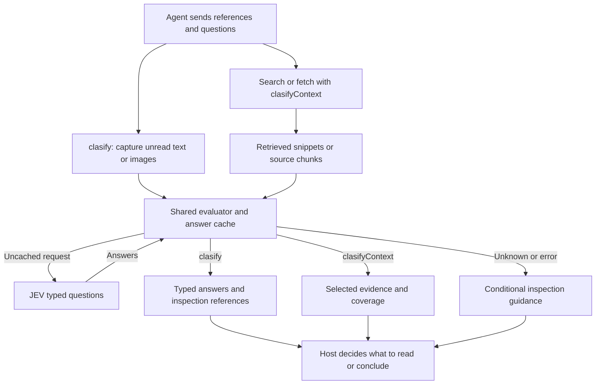

# JEV in Octocode

JEV scouts evidence before the main agent reads it. The aim is fewer tokens spent on irrelevant content while the host handles reasoning and verification. The agent sends paths, URLs or image references plus questions; Octocode acquires the content internally and sends it to JEV.

## Choose a route once

| Need | Use | Host receives |
|---|---|---|
| Choose which unread resource to inspect | `clasify` with `source` or image `assets` | Typed answers and inspection references; no source body or image bytes |
| Ask the same questions across text sections in many resources | `clasify` with `operation:"sections"` | Keyed section outcomes, exact coordinates, source identities and coverage |
| Read relevant passages from many hits or a large file | Search/fetch with `clasifyContext:{classifiers:[...]}` | Selected evidence, coverage counts and recovery links |
| Read a known line, small file, or exact symbol | Ordinary search/fetch, AST or LSP | Direct evidence; no JEV call |

Use one classification stage per relevance decision. If selected passages already answer the question, read them once and stop. A judgment over already-read `state` cannot save that reading.

## Shared mechanism



Standalone evaluation, section assessment and inline selection share validation, caching, concurrent-request deduplication, retries and usage accounting. Search/fetch passes captured evidence directly to the evaluator; it does not call the public `clasify` tool.

Identical evidence, questions, model, image bytes and options reuse complete validated answers for 30 minutes. Concurrent identical requests share one provider call. GitHub bytes are cached by resolved commit. New whole-source evaluations reacquire local files and URLs to check their content; section work continuations use their frozen capture plan and verify source access and freshness before new inference. Persistent storage also saves answers and captured URL/image evidence.

Local file reads and local text section captures recognize BOM-marked UTF-16 in either byte order. Coordinates describe decoded text; snapshots still identify original file bytes. Local UTF-16 reads above the bounded whole-file decoding limit fail explicitly with a conversion/splitting hint; ranges do not bypass that limit. GitHub section capture still requires UTF-8. Unmarked encodings are not inferred by section capture, and binary content remains rejected.

## JEV API support

Octocode supports all four [JEV question primitives](https://docs.typesafe.ai/primitives), evaluation through `POST /v1/systemone`, and model discovery through `GET /v1/models`.

| Primitive | Question / criteria | Returned answer |
|---|---|---|
| **Noul** (`noul`) | One yes/no predicate; optional `{true,false}` meanings | `noul`: probability of yes, 0–1 |
| **Choice** (`choice`) | Choose among 1–255 `{label:meaning}` alternatives | `choice`, every label's `probabilities`, `confidence` |
| **Score** (`score`) | Ordered `criteria` levels, low to high, up to 10 | Zero-based, possibly fractional `score`, `probabilities`, `confidence`, `legend` |
| **Box** (`box`) | Locate a named visible object in an image | Normalized `box:{top,bottom,left,right}` and nullable `confidence` |

Questions are keyed and independent. Group questions about the same resource or shared section-research resource set in one row; a sibling answer cannot supply context to another question. `instructions` and criterion meanings accept structured JSON; this organizes input, not arbitrary generated JSON output. Confidence describes the distribution, not correctness.

Also supported:

- **Images:** PNG/JPEG `assets` from local/GitHub paths or HTTPS URLs. Octocode sends original bytes without resizing and enables `TypeSafe-Danger-Zone-Images: true`. Images and Box are experimental and model-dependent.
- **Long context:** `longContext:true` enables `TypeSafe-Danger-Zone-Long-Context: true`. It increases admitted state size, not inline chunk size or selection budgets.
- **Models:** `operation:"models"` returns names, descriptions and release dates. Row `model` overrides `OCTOCODE_CLASSIFICATION_MODEL`; the default is `jev-latest`. Pin a tested model for reproducibility.
- **Results:** keyed `answers`, answering `model`, provider `usage` and `replayed`. Source/image provenance identifies what was judged; bodies stay out of standalone results.

## clasify: scout unread resources

Each evaluation row has `questions` and exactly one of `source` or `state`:

| Input | Meaning |
|---|---|
| `source:{tool:"localFetch",query:{path,ranges}}` | Read those local lines; `fullContent:true` can replace `ranges` |
| `source:{tool:"ghGetFileContent",query:{owner,repo,path,ref,ranges}}` | Read at the resolved GitHub commit; `fullContent:true` can replace `ranges` |
| `source:{url:"https://…#section"}` | Extract page text, select the section and save the capture; requires persistent storage |
| `state` | Literal data already held; paths and URLs inside it are not fetched |

Discover concrete paths before screening a folder. A call accepts up to five rows; whole-source evaluation uses one resource per row. For repeated questions over many text resources, use the sections operation below.

<!-- tool: clasify -->
```json
{
  "queries": [{
    "source": {
      "tool": "localFetch",
      "query": {"path": "docs/upgrade-guide.md", "fullContent": true}
    },
    "questions": {
      "restart": {
        "type": "noul",
        "instructions": "Does this guide explicitly require restarting the service after an upgrade?"
      }
    }
  }]
}
```

The read suggestion in the `hints` string array names the tool and input for opening the captured selection at the same snapshot/commit. It is not an answer-specific citation. Read the deciding passage before making a source claim; a task requesting only typed classification can finish with the answer. URL captures expire after 24 hours; their line numbers refer to extracted text, and a stale capture is not silently replaced.

For location scouting, Choice labels can name observed source ranges, with an insufficient-evidence option. Read the chosen range with context at the same revision. Choice selects one location; use classified fetch when several passages matter.

### Research text sections across resources

Development status: the section contract and runtime pass 90 end-to-end cases in an isolated integrated build. Integration into the shared checkout is pending a file handoff from the concurrent audit. Model quality and token savings have not been measured for this operation.

Use `operation:"sections"` when questions apply to individual regions in several text resources. Supply named `resources` once and a reusable keyed `questions` map once. Sources use the same local/GitHub/HTTPS forms as whole-source evaluation, including exact `ranges` or `fullContent:true` for file readers. Discover paths first with `structureSearch` or `localSearch`; use AST/LSP navigation when a symbol or binding is already known. Images keep the whole-image route below.

<!-- tool: clasify -->
```json
{
  "queries": [{
    "operation": "sections",
    "resources": {
      "guide": {
        "tool": "localFetch",
        "query": {"path": "docs/upgrade-guide.md", "fullContent": true}
      },
      "implementation": {
        "tool": "localFetch",
        "query": {"path": "src/lifecycle.ts", "fullContent": true}
      }
    },
    "questions": {
      "restart": {
        "type": "noul",
        "instructions": "Does the target section explicitly require restarting the service after an upgrade?"
      },
      "evidence": {
        "type": "score",
        "instructions": "How directly does the target section support the restart requirement?",
        "criteria": ["No evidence", "Indirect evidence", "Explicit requirement"]
      }
    }
  }]
}
```

Results are grouped as `resources.<key>.sections[]`. Each section has a stable `id`, a `target`, optional supporting `context` ranges and a keyed `answers` map. Target ranges identify what was judged; supporting context does not turn a finding elsewhere into a finding in the target. Ranges use half-open UTF-8 byte offsets, `[start,end)`, and one-based inclusive line pairs. Bytes distinguish targets on the same minified line. `coordinateSpace:"source"` refers to the original selected file; `"capture"` refers to immutable extracted URL text. Each ready resource includes its snapshot/commit and an executable `read` reference. Inspect the target at that version before making a source claim.

| Cell status | Meaning |
|---|---|
| `answered` | A validated typed answer, including its complete probability distribution where applicable |
| `error` | Assessment failed or an interrupted attempt has an unknown outcome; a canonical error describes why |
| `unsupported` | The target or question cannot be assessed within the supported capability or bounds |
| `unassessed` | No assessment outcome exists; a terminal result supplies a reason |

A Choice label named "unknown" is still `answered`. Low confidence is not an execution error. Each section answer takes its type from the shared question definition; the answer does not repeat `type`. Score answers use the shared question's ordered `criteria` as their legend. Resource acquisition failures retain their source and error with unknown coverage totals (`null`); an unread resource is not an empty completed one.

The executor retains partially settled cells and emits a section only when its complete keyed outcome map is ready. Assessment batches emit each section once. Per-resource `coverage` is cumulative: `completedSections + remainingSections = totalSections`; question outcome counts include unassessed cells. Do not sum these counters across batches. An explicit terminal stop emits all remaining question outcomes with reasons and no work continuation.

There are two distinct continuations:

| Lead | Work performed |
|---|---|
| `next.nextSectionPage` | Resumes the pinned assessment plan; it may perform inference for remaining cells |
| `responsePagination.next` | Reads a saved display page; it performs no acquisition or inference |

Copy either lead unchanged. Work resumes with only `operation:"sections"` and the opaque `assessment` token, without repeating sources or questions. Replaying a settled work token returns the same batch with `replayed:true` and zero current usage. A display page preserves historical receipts and marks `responsePagination.replayed:true`. Display fragments use the existing query `rowPart`; shared question definitions appear on the first fragment, and typed answers and distributions stay atomic.

Assessment plans require persistent storage across CLI invocations or the same long-lived MCP runtime. A memory-only CLI request whose plan requires multiple bounded batches returns `classificationContextUnavailable` before inference, preserving resource read links, coverage and terminal unassessed outcomes. If a one-batch request exhausts its execution budget, remaining outcomes are explicitly unassessed. Missing or expired work plans fail without restarting; a changed local source fails with `sourceMismatch` before further inference. Starting a new request is deliberate and may incur provider usage.

### Unread images

Reference an asset key in `state` or the questions. An image source uses the same local/GitHub reader identity, or a direct HTTPS PNG/JPEG URL. Images require persistent capture storage and available readers; embedded page images are not crawled.

<!-- tool: clasify -->
```json
{
  "queries": [{
    "model": "jev-1.14.0",
    "state": {"screen": "image_1"},
    "assets": {
      "image_1": {
        "type": "image",
        "source": {"tool": "localFetch", "query": {"path": "screenshots/settings.png"}}
      }
    },
    "questions": {
      "present": {"type": "noul", "instructions": "Is a Save button visible in screen?"},
      "location": {"type": "box", "instructions": "Locate the Save button in screen."}
    }
  }]
}
```

Results include each asset's saved `path`, origin, snapshot, format, dimensions, size and expiry. Inspect that image when details matter. Check presence before using Box coordinates: Box can return a location for an absent object. For diagrams, ask object presence and each directed relationship separately; recognizing both endpoints does not establish an arrow or its direction. Inspect the image when a relationship is uncertain. Octocode does not switch models after rejection.

## Classifiers on search and fetch

`clasifyContext` filters retrieved evidence before returning it. Only selected bodies return, in source order. Optional row `mainGoal` and a short `reasoning` rationale add context to every inline question; JEV receives no host conversation.

| Tool | What JEV evaluates | Use |
|---|---|---|
| `localSearch` | Each hit snippet (hit + context), before paging. With no context field set, a hit is judged with 8 lines each side: a bare hit line rarely shows what the code does, so it reads as related and is never kept; counts describe kept hits. `resultView` `paginated` or `matchOnly` only: another view is rejected at admission, and `repair` in `hints` drops it | Noisy search after path/glob and known-term filtering |
| `localFetch` | Windows from the file or selected ranges/matches | Large files with unknown relevant locations |
| `ghGetFileContent` | The same windows, at a resolved commit | Scoped GitHub file reads |
| `ghSearchCode` | Available hit lines on one provider page | Experimental; filename-only hits stay unknown |

<!-- tool: localSearch -->
```json
{
  "queries": [{
    "path": "src/cache",
    "matchString": "expire",
    "contextLines": 3,
    "clasifyContext": {
      "classifiers": ["Do these lines show expiry metadata being removed?"]
    }
  }]
}
```

The same `clasifyContext` works on fetch. Use `matchString` with enough `contextLines`, or explicit `ranges`, to retain deciding conditions. The default context window can complete a small declaration (an explicit `contextLines` is exact); ranges bound that expansion. Original line numbers remain source coordinates. Search never reads hidden whole-file bodies or recovers lexical misses.

Whole-file `localFetch` keeps declarations and their documentation together when they fit the character budget. Oversized declarations, source gaps, unsupported syntax and extracted views use complete line windows targeting 2,048 characters; omitted spans split windows. Cross-window questions can still stay unresolved, and `longContext` does not join windows. Path/count-only search views, explicit minification, fresh byte windows and streamed sources reject classification with recovery.

Keyword relevance prioritizes source-content windows for the bounded assessment budget, with each classifier getting an admission turn. This ordering does not select or exclude evidence: the classifier makes those decisions, and selected output stays in source order. Unassessed evidence remains unknown and recoverable.

Each classifier becomes a shared three-level Score rubric: no useful evidence, background, direct evidence. A candidate is selected when any question assigns direct evidence probability above 0.5; excluded only when all assign no useful evidence above 0.5; otherwise unknown. `selection` reports scope, status and selected/excluded/unknown counts; operational `failures` are a subset of unknowns. “Complete” covers that view, not the whole repository. A filtered result, including zero selected candidates, is not proof of absence: inspect the unfiltered evidence before making that claim.

AST/LSP remain ordinary identity and structure tools. Their candidate paths/ranges can feed `clasify` when expensive body reads need screening; classification does not prove identity, reachability or absence.

## Questions and recovery

Ask one observable fact per question: snippets show a check, documentation states a condition, an image contains an object. Keep correctness, vulnerability proof, exact counting and cross-file reasoning with the host. Noul requires nonblank instructions or usable true/false criteria; an empty predicate is rejected before a provider request. Choice needs distinct outcomes and an insufficient-evidence option when the resource may not answer; Score needs meaningful ordered levels, not an assumed 1–10 confidence scale.

| Situation | Next action |
|---|---|
| Selected evidence answers the scoped question | Stop; avoid a duplicate fetch or classification |
| More selected evidence is needed | Copy the selected-page continuation unchanged; it replays without JEV |
| Unknown/unavailable inline selection matters | Use `next.unfilteredUnknown` for the unknown evidence only, and `next.unfilteredUnknown2`, `next.unfilteredUnknown3`, … for unknown ranges past one call. `next.unfiltered` restores the complete original view ([context selection](OCTOCODE_TOOLS.md#context-selection)) |
| The provider is down or rate-limited (`classificationProviderUnavailable`, `classificationRateLimited`) | The view already came back unfiltered, with no `next.unfiltered` ([context selection](OCTOCODE_TOOLS.md#context-selection)). Read the warning and back off before you classify again |
| The candidate budget left candidates unjudged | Follow `next.nextCandidatePage` unchanged: the same classified call judges the rest, each candidate once |
| `clasify` fails or a typed answer is insufficient | Follow the read suggestion in the `error.hints` or `hints` string array when present; repair the named cause |
| Image judgment is uncertain or fails | Inspect the saved image or original reference with an image-capable tool |

Standalone answers and selected evidence can span response pages. Follow `responsePagination.next` unchanged; its compact saved-result reference reads settled output without repeating state/questions or making another provider request. In memory mode, saved output belongs to the current runtime session; separate CLI invocations need persistent storage to continue. Expired output fails explicitly and requires a deliberate new query. A new query may incur inference. The pending runtime integration returns the complete result without display pagination when a CLI call uses memory storage or when the complete snapshot cannot be retained; a warning explains why. It does not publish an unreachable display continuation.

Unknown/error is not “no.” Captured local/GitHub read leads preserve snapshot/commit and ranges; GitHub search recovery reruns its provider page and can reflect index changes. Following an inspection lead makes no JEV call; errors never automatically dump source bodies. Guidance uses successful-row `warnings`, empty/error `hints`, or `clasify`'s nested `error.hints`. Retry rejected input after correcting it; honor backoff for transient failures.

## Availability

| Configuration | Inline `clasifyContext` | Standalone `clasify` |
|---|---|---|
| No classification key | Unavailable | Hidden |
| `OCTOCODE_CLASSIFICATION_API` set | Available on the four readers | Hidden without beta |
| Key plus `OCTOCODE_BETA=1` | Available | Available |

Reader policies and tool allow/deny lists still apply. Calls without classification make no JEV request. See [key setup](AUTHENTICATION.md#classification-key-clasify) and [what leaves the machine](SECURITY.md#classification-egress). Restart MCP after configuration changes.

Inspect fields with `npx octocode schema clasify --view query`; execute a saved request with `npx octocode clasify --input request.json`. Discover models with `npx octocode clasify '{"queries":[{"operation":"models"}]}'`. CLI and MCP share the runtime and request contract.

## Limits

| Octocode limit | Value |
|---|---|
| Standalone rows / questions per row | 5 / 25 |
| Resources per section-research row | 1–25 |
| Inline classifiers / characters each | 1–5 / 1,000 |
| Serialized state, normal / long context | 32,000 / 256,000 characters, including escaping and source identity |
| Inline selection budget | 64 candidates, 131,072 characters, 10 seconds |
| Image count / bytes | 8 per row; 8 MiB each, 16 MiB combined |
| Image dimensions | 280–1,568 pixels per side; 78,400–2,458,624 total pixels |

Section assessment uses the existing 64-unit, 131,072-serialized-character and 10-second work budget per call, in addition to the request deadline. These implementation bounds passed the isolated end-to-end checks; shared-checkout integration remains pending. The 32 MiB retained-plan limit is not a process memory ceiling. The planner must retain a complete capture before inference; capture or storage limits become explicit outcomes, never an omitted suffix.

Oversized whole-source inputs fail rather than classify a truncated prefix; inline budgets leave unassessed candidates unknown. Admission does not guarantee provider acceptance, particularly for experimental images. Full fields: [tool reference](OCTOCODE_TOOLS.md#semantic-assessment-reference).

## Results and rating

**8/10 for integration and DX** — engineering assessment on 2026-10-15, not model accuracy. Strengths: unread-resource inputs, typed primitives, one evaluator and actionable recovery. Limits: chunk boundaries, experimental images and workload-dependent quality/savings. Recovery validation (local, unpublished `.octocode/octocode-dev/2026-10-15-jev-recovery/README.md`) passed 48 Rust tests and 24 CLI/MCP checks.

| Measured workflow | Tool input + output tokens | Guidance |
|---|---:|---|
| Noisy local search | −90% | Narrow lexically, then select |
| Large local fetch | −93% | Select when the useful location is unknown |
| Scoped GitHub fetch | −72% | Pin the ref and narrow the view |
| Exact local read | +32% | Read directly |

These paired cases (local, unpublished `.octocode/octocode-eval-benchmark/2026-10-15-jev-flow-review-v2/README.md`) do not establish whole-agent savings. GitHub search left every candidate unknown. A separate whole-agent evaluation (local, unpublished `.octocode/octocode-eval-benchmark/2026-10-15-jev-e2e/README.md`) found 2.8–10.7% savings on a forced-classification document task, while eight optional-use runs did not choose classification.

Measure all host input/output, including questions and recovery reads, separately from JEV usage. For inline selection, request `extras:["stats"]` to receive `selection.usage`: provider calls, known/unknown usage calls, reported tokens, replayed evaluations and resolved models. This receipt does not require persistent stats. Whole-source `replayed:true` identifies historical usage; section batch replay instead reports zero current usage; `responsePagination.replayed:true` marks a saved output page, so neither is a fresh provider spend. With stats and persistent storage enabled, `<octocode-home>/stats.json` records inference separately from model discovery (`discovery_calls`). Missing usage is unknown, not zero.
