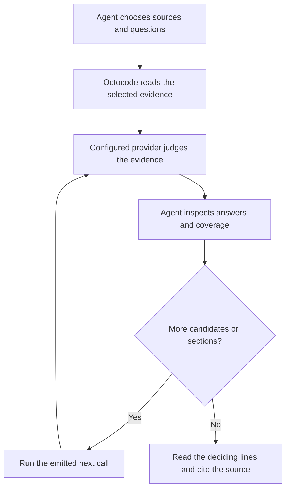

# Classify unread sources with `clasify`

`clasify` answers typed questions about large or unread evidence: files, search hits, command output, web pages and images. The agent asks a focused question, gets a typed answer, then opens the source lines before citing them.

Use exact tools first. Use ordinary search for a known spelling, `lspSearch` for symbol identity, and unfiltered evidence for counts or absence. Use `clasify` when the meaning has no spelling to search for.

Answers are candidates, not proof. Read the deciding lines in the original source before you cite them.

## Quick start

1. Save a provider key: `octocode config set OCTOCODE_CLASSIFICATION_API --stdin`, paste the key, then press Ctrl-D. Restart an open MCP server after changing the key. See [Classification key setup](AUTHENTICATION.md#classification-key-clasify).
2. Run `octocode schema clasify --view variants` to check availability. This does not contact the provider.
3. From a project with a `README.md`, ask a question about that file. The command below sends one provider request. An MCP agent can send the same JSON to `clasify`.

```bash
octocode clasify '{
  "queries": [{
    "operation": "evaluate",
    "source": {"tool": "localFetch", "query": {"path": "README.md"}},
    "questions": {
      "tests": {"type": "noul", "instructions": "Does the README give a shell command for running the test suite?"}
    }
  }]
}'
```

The `answers` array holds your question key (`tests`). A `noul` answer is the probability of yes. Follow the returned `next.read` to check the command in context. If the answer names its deciding `lines`, the read opens only those lines. Otherwise it opens the whole selection.

## Choose a route

| What the agent has | What to send | What comes back |
|---|---|---|
| Too many search hits or rows | Add `classification.predicates` to a supported search or read. Supported: `localSearch`, `localFetch`, `ghSearchCode`, `ghGetFileContent`, `ghSearchHistory`, `ghGetHistoryItem`, `structureSearch`. [Context selection](OCTOCODE_TOOLS.md#context-selection) | Selected evidence plus a `selection` receipt that counts the rest. |
| One unread file or public HTTPS page | `evaluate` with `source` set to `localFetch`, `ghGetFileContent` or `{"url": "https://…"}` | Answers and a read of the captured source. Local and GitHub reads accept line `ranges`. |
| Search hits, paths, history items or packages | `evaluate` with `source: {tool, query}`, using the named tool's own query fields | Answers for each row under `units`. A search hit is its own unit, judged with its line marked, its own context window and its enclosing declaration. A path or commit title can only answer questions about that text. |
| Several unread files | `evaluate` with `resources`, including local globs | An answer set for each file |
| A question whose answer could be anywhere in several files | `sections` with `resources` and `questions` | Sections with line ranges, answers and coverage for each resource |
| Long command output: a test run, build or CI log, `git log`, `ps` | Save it under the workspace (`<cmd> > .octocode/out.log 2>&1`), then `evaluate` with that path as `source`. From the CLI, a pipe can send it as `content` instead: [from a pipe](#from-a-pipe-cli). | Answers for the whole output when it fits one window. Use `sections` to learn every place or the order. A path outside the workspace, such as `/tmp`, is refused with `outsideAllowedRoots`. |
| Text or JSON already in hand | `evaluate` with literal `content`. For an array, set `perItem: true` to judge each item separately. | Answers for the whole input, or `units` keyed by array index |
| A screenshot or chart | `evaluate` with PNG or JPEG `assets` and `content` naming each asset key | Typed answers and image coordinates. `box` gives edges from 0 to 1 on the judged image. `sourceBox`, when returned, maps them to the original. |

Hits in a few files you would read anyway are cheaper to read directly.

A search `source` over several files, a glob in `resources` and a `sections` plan send more requests than the row names. Set `maxRequests` on them, or run the `next.confirm` the refusal returns. See [Budget](#budget-maxrequests).

### What every call does



Octocode sends the selected text, questions, optional `context`, and any referenced images to the configured provider. See [Privacy](#privacy).

## Questions

| Type | How to ask | How to read the answer |
|---|---|---|
| `noul` | One observable yes/no question. Name the action and the object, such as "Does this command run the unit tests?" Add `criteria` with `true` and `false` near misses when they help. | Probability of yes, from 0 to 1. A low answer can miss a real match, so it is not proof of absence. |
| `choice` | Two or more labels in `criteria` (2 to 255). Include an `unknown` label when the source may omit the fact. Use `unknown` for absence, not a label such as `no error`. | One label. The `details` view adds probabilities and confidence, which measures how concentrated the distribution is. |
| `score` | 2 to 10 ordered levels in `criteria`, starting at level 0 | Expected level, which can be fractional |
| `box` | The visible target in one image. Needs a vision-capable model. | Coordinates on the image. Inspect the original to confirm the location. |

Batch independent questions about the same source. For code, name the mechanism that decides the answer, and separate its implementation from declarations, validators and reports. Include an `unknown` label for missing evidence. High confidence does not establish correctness.

Read `next.read` before you cite a candidate. If that read covers much more than the question needs, use `localFetch` or `ghGetFileContent` with `view: "symbols"`, then `matchString` and `block: true` for the deciding declaration. Keep GitHub reads at the returned `commitSha`. Use `sections` when a claim needs every occurrence or the event order.

## Answers and next calls

Each response returns answers and a `next` object. Run each returned call unchanged.

| Returned call | When to run it | Cost |
|---|---|---|
| `responsePagination.next` | More of the current response remains. Finish these pages first. | Replays the response, no new request |
| `next.nextPage` | Another batch of sections or units is waiting | Judges newly reached units |
| `next.read` | Verify the lines of answers that said yes. A resource's own `read` opens its captured source. | Reads evidence, no request |
| `next.confirm` | A row was refused as over budget (see [Budget](#budget-maxrequests)). It reruns the same row with `maxRequests` raised to the ceiling. | Billed |
| `next.quiet` | Inspect sections held back because every answer was a `noul` below 0.3 | Replays saved answers |
| `next.details` | Inspect the detailed view of a saved sections page | Replays saved answers |
| `next.nextCandidatePage` | Judge remaining or retryable candidates of a classified search or read | Billed |
| `next.unfilteredUnknown` | Open the undecided evidence | Reads evidence |
| `next.unfiltered` | Exact count or an absence claim over the unfiltered source | Reads evidence. In a one-shot CLI call it is a fresh request. |

Before you claim absence after classification, run `next.nextCandidatePage` if offered, then `next.unfilteredUnknown`, then `next.unfiltered`.

`evaluate` answers name their deciding `lines` in the same request. A `noul` below 0.5, an `unknown` `choice` or an answer whose part chose no part names no lines and adds nothing to `next.read`. The read then opens only the lines the answers name.

## Filter search hits

From a project with `README.md`, this search asks the provider to judge each match in its surrounding lines. A direct file read is cheaper for a small result. Add the filter when the same search over a larger scope gives too many hits to read.

```bash
octocode localSearch '{
  "queries": [{
    "path": "README.md",
    "matchString": ["test"],
    "contextLines": {"before": 2, "after": 2},
    "classification": {"predicates": ["Does this passage give a command to run the test suite?"]}
  }]
}'
```

By default, `localSearch` supplies the hit line with no surrounding lines. Set `contextLines` when a predicate depends on nearby text. The receipt counts selected, excluded, related and unknown candidates across the walk. Keep the latest totals. `next.nextCandidatePage` judges remaining or retryable candidates, and `next.unfilteredUnknown` opens undecided evidence.

<a id="clasify-sections-map-questions-across-many-files"></a>
## Map questions across files

This example scans Markdown files under `docs/`. Narrow the glob to the files that matter to control usage. A sections plan sends one request per section, so it needs `maxRequests` (see [Budget](#budget-maxrequests)): each page takes the sections that fit it, and `next.nextPage` takes the rest.

```bash
octocode clasify '{
  "queries": [{
    "operation": "sections",
    "resources": {"guides": {"tool": "localFetch", "query": {"path": "docs/*.md"}}},
    "maxRequests": 10,
    "questions": {
      "login": {"type": "noul", "instructions": "Does this passage give a command to sign in to GitHub?"}
    }
  }]
}'
```

Read each resource's `coverage` and each section's `target.lines`. Coverage is cumulative. Errors, unsupported cells and unassessed cells leave a gap in what the agent checked. Follow continuations as described in [executable continuations](TOOL_DATA_CONTRACT.md#executable-continuations).

| Returned call | When to run it | Provider work |
|---|---|---|
| `responsePagination.next` | More of the current response remains | Replays the response |
| `next.nextPage` | Another batch of sections is waiting | Judges newly reached sections |
| `next.read` | Verify the lines of sections that answered yes | Reads evidence |
| `next.quiet` | Inspect sections held back | Replays saved answers |
| `next.details` | Inspect the detailed view of a saved page | Replays saved answers |

A text source that exceeds the provider window is judged section by section. The combined answer uses the highest `noul` or `score`, or the most confident `choice` other than `unknown`. Its `lines` name the deciding section. Read relevant sections together for event order, contradictions or claims about every code path. A single section covers only the text it received.

A text judged whole in one window also names its deciding `lines`. Octocode marks parts of the text with line-numbered markers and asks which part decides each question, in the same request. A source read with `ranges` names its lines within those ranges. A URL row's `lines` count lines of the captured page text, which its `next.read` opens. JSON `content` that is not a string and image rows name no `lines`. `lines` name the deciding part, which ends at a block edge (a section, paragraph, table or code block), so it can be wider than the sentence that decides.

<a id="from-a-pipe-cli"></a>
## From a pipe (CLI)

`--content -` reads stdin as the text of the one query row's `content`. The JSON comes from the argument or from `--input <file>`:

```bash
set -o pipefail
cargo test 2>&1 | octocode clasify --content - '{"queries":[{"operation":"evaluate","questions":{"fail":{"type":"noul","instructions":"Does any test fail?"}}}]}'
```

Rules:

- The JSON needs exactly one query row. That row must not name `content`, `source` or `resources`, or the command refuses before sending anything.
- `--input -` cannot be combined with `--content -`, because stdin carries the text.
- Stdin must be UTF-8. The text is bounded at 8 MiB, like a query read with `--input`.
- The text is screened for recognized secrets and redacted before the provider request, as for any `content`.
- A text over the provider window is refused, not judged in sections. Save it under the workspace and pass it as `source` instead.
- `lines` count lines of stdin. There is no `next.read`, so keep the output if you need to read those lines.
- MCP has no such flag. An MCP agent puts `content` in its call, or passes a saved file as `source`.

## Availability

| Setting or request field | Default | Effect |
|---|---|---|
| `classification.api` / `OCTOCODE_CLASSIFICATION_API` | Unset | A nonblank key enables `clasify` and inline `classification` on both interfaces, subject to MCP tool filters. A blank process variable disables both. |
| `classification.apiHost` | `https://api.typesafe.ai` | Provider API root. Only trusted configuration can set it. HTTPS is required except on loopback. [Configure another host](CONFIGURATION.md#change-the-classification-host) |
| `model` on a row | `jev-latest` (configured model) | Overrides the configured model for that row. `{"queries":[{"operation":"models"}]}` lists the models the provider serves. |
| `longContext` | Unset: the long window is used only after a provider refusal | `true` requests the long window up front. `false` never uses it. A longer request can cost more provider tokens. |
| `view` | `summary` | `details` adds token counts, probabilities, confidence, model and provenance. Repeating an evaluation to change the view makes a new provider request. |
| `context` | Unset | Text sent with every unit to the judge. It is not itself judged. |

### Billing

- **One billed request per row.** A `clasify` row is one request for each path, GitHub file, URL, `content` entry, `perItem` item or whole-file chunk. A search `source` bills **per file**: the hits of one file share one request, with one question per hit, and a long question's words are sent once per request. Identical units share one request. `perHit: true` (with a search or listing `source`) judges each hit in its own request instead, priced one request per hit; on a file or URL `source`, which has no hits, it is refused before anything is read.
- **Refusals and retries add requests.** When the provider refuses a request as too large, its hits are split and asked again. When it leaves an answer out, that hit is asked once more. An answer still missing is reported as an `error` cell. A refused request counts in `usage.calls` and `usage.refused` and reports no tokens; the provider does not document whether it bills one. Within one process, a size the provider refused is remembered: literal `content` at least that large is refused without a request, and a source goes to its sections.
- **`evaluate` always re-bills.** Repeating an identical `clasify` evaluation sends new requests, even on cached source.
- **Saved `sections` pages replay for free.** `next.details`, `next.quiet` and `responsePagination.next` replay saved answers with no request. A fresh `evaluate` or `sections` call starts again.
- **Saved pages expire** after 30 minutes of inactivity. A new process can also need new inference.

### Budget (`maxRequests`)

Set `maxRequests` (an integer of at least 1) on an `evaluate` row or a fresh `sections` row to cap the provider requests it may send in one response page. Re-asks, splits and transient retries count.

Without `maxRequests`, a row sends at most one first-round request per source, resource or `content` item it names. A plan whose own expansion needs more is refused before anything is sent: a search or listing `source` over several files, `perHit` over several hits, a glob that matches more files than its resource keys, a `sections` plan of more sections than resources, or a source over the provider window that would be judged in sections.

| Field | Meaning |
|---|---|
| `maxRequests` | Cap on provider requests for the row, per response page |
| `usage.requestsPlanned` | Requests the row expects to send |
| `usage.requestsCeiling` | Most requests the row or `sections` page can send: the first round, every re-ask and split, and the 3 transient retries the row shares, never more than `maxRequests` |
| `usage.calls` | Requests actually sent |
| `usage.refused` | Requests the provider refused |
| `usage.inputTokensAtMost` | On a refused row: input tokens its first round costs at most. It counts one token per byte sent plus the provider's own prompt, so it runs well above the tokens billed. Absent until the provider has answered a request in this process |
| `usage.remainingInputTokensEstimate` | On a `sections` page or a classified search with work left: input tokens of the rest, priced at this page's rate |

Behavior:

- A row runs when its first round (`requestsPlanned`) fits `maxRequests`. Re-asks, splits and transient retries use only what the first round leaves, so `requestsCeiling` never passes the cap.
- A first round above `maxRequests`, or above what an uncapped row names, is refused before anything is sent. The error is `classificationOverBudget`, with `usage.calls: 0`, the planned and ceiling counts, and `next.confirm`. `next.confirm` reruns the same row with `maxRequests` raised to the ceiling. That rerun is billed.
- A source over the provider window is judged in sections only when its `maxRequests` still holds them. Otherwise the refusal names how many sections it would send, its `usage.calls` counts the whole-source request already sent, and `next.confirm` allows them.
- A `sections` page with `maxRequests` takes the sections whose first round fits the cap; `next.nextPage` takes the rest.
- If the cap runs out during a run, the next send is not made: the unit, section or question it left is an `error` cell with `classificationOverBudget`.
- A row without `maxRequests` is held to its ceiling too, except that a refusal's retries (long window or split) may pass it; they are counted and named in a warning. Transient retries never pass it.
- Units still unanswered after the retries stay `error` cells; `next.retry` asks only them again, at their own price.
- To keep a request under budget, narrow the source: fewer files, hits or resources, or smaller line ranges.

```json
{"queries": [{
  "operation": "evaluate",
  "source": {"tool": "localSearch", "query": {"path": "src", "matchString": ["retry"]}},
  "maxRequests": 20,
  "questions": {"retry": {"type": "noul", "instructions": "Does this hit implement a retry loop?"}}
}]}
```

## Recovery

| What you see | What to do |
|---|---|
| `missingConfiguration` or missing discovery fields | Set the key in trusted configuration, check for a blank process override, and restart the MCP server. |
| `invalidInput` | Check `octocode schema clasify --view query`. An evaluation takes exactly one of `source`, `resources` or `content`. `evaluate` and `sections` both need `questions`. |
| `classificationOverBudget` | Read `usage.requestsCeiling`. Run `next.confirm` to allow it, or narrow the source. |
| `classificationContextEmpty`, refused source or expired plan | Check the source with its reader. Start a fresh request after expiry. |
| `classificationContextTooLarge` or `classificationStateTooLarge` | Use narrower line ranges or a `sections` call, if offered. Literal `content` and image rows can receive a size refusal. |
| `outsideAllowedRoots` | Save the output under the workspace and pass that path as `source`. |
| Provider error after capture | Read the error, then use the returned source read when available. |
| Provider HTTP 401 (rejected key) | Fix `OCTOCODE_CLASSIFICATION_API`. The process remembers the rejection for a minute, so the rest of a batch fails fast without more requests. A 403 is not remembered: it can be one model's refusal. |

## Privacy

Octocode sends the selected text, questions, optional `context` and any referenced images to the configured provider. Local path rules, GitHub authorization and URL policy apply before capture.

- Text is screened for recognized secrets, which are redacted before the request.
- Files with credential-like names are withheld from classification.
- Image pixels and metadata receive no text redaction. Large images may be resized and small ones padded.

The provider sees only what the request carries. See [classification egress](SECURITY.md#classification-egress).

## Limits

| Input | Limit |
|---|---|
| `clasify` batch | Up to five query rows |
| `choice` labels | 2 to 255 |
| `score` levels | 2 to 10 |
| PNG or JPEG | Up to 8,192 pixels per source side and 16 MiB per image, 32 MiB total. The judged image is fitted to 280 to 1,568 pixels per side. |
| Provider request body | 32 MiB encoded |
| Context | 32,000 tokens per question and 64,000 per standard request. The long window allows 262,000 tokens. |
| Questions per request | No separate limit. A request must fit both context limits. |

For batch sizing and concurrency, see [fixed internal limits](STORAGE_AND_LIMITS.md#fixed-internal-limits).

[Documentation hub](README.md)
