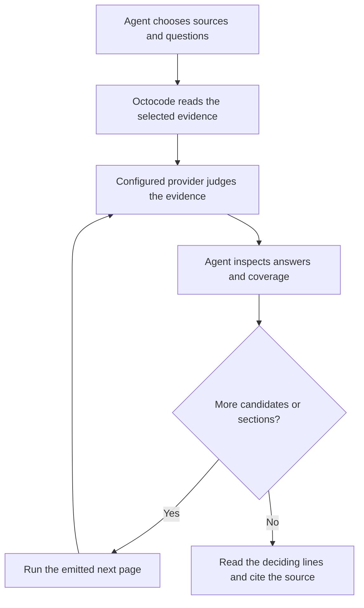

# Classify unread sources with Jev

Use `clasify` to find which passages in a large file or collection deserve a closer read. The agent asks a focused question, gets a typed answer, then opens the source lines before citing them. Use ordinary search for a known spelling, `lspSearch` for symbol identity, and unfiltered evidence for counts or absence.

## Quick start

1. Get a provider key and save it with `octocode config set OCTOCODE_CLASSIFICATION_API --stdin`. Paste the key and finish input (Ctrl-D in a POSIX shell). Restart an open MCP server after changing the key. [Classification key setup](AUTHENTICATION.md#classification-key-clasify)
2. Run `octocode schema clasify --view variants` to check availability without contacting the provider.
3. From a project with a `README.md`, ask a question about that file. The CLI command below makes a provider request. An MCP agent can call `clasify` with the same JSON.

```bash
octocode clasify '{
  "queries": [{
    "operation": "evaluate",
    "source": {"tool": "localFetch", "query": {"path": "README.md"}},
    "questions": {
      "tests": {"type": "noul", "instructions": "Does the README give a shell command for running the test suite?"}
    }
  }]
}'
```

In `answers`, find your question key (`tests`). Its `noul` value is the model's probability of “yes.” Follow the emitted `next.read` to check the command in context. When the answer names its deciding `lines`, the read opens only those lines; otherwise it opens the whole selection.

## Choose a route

| What the agent has | What to send | What comes back |
|---|---|---|
| Too many search hits or rows | Add `classification.predicates` to a supported search, listing or read | Selected evidence plus a `selection` receipt counting the rest. [Supported tools](OCTOCODE_TOOLS.md#context-selection) |
| One unread file or public HTTPS page | `evaluate` with `source` pointing to `localFetch`, `ghGetFileContent`, or `{"url":"https://…"}` | Answers and a read of the captured source. Local and GitHub readers accept line `ranges`. |
| Search hits, paths, history items or packages | `evaluate` with `source: {tool, query}`. Use the named tool's own query fields. | Answers for each listed row under `units`; a search hit is its own unit, `path:line`, judged with its line marked, its own `contextLines` window and the declaration around it, even where the tool joined nearby windows. `next.nextPage` judges the next source page. A path or commit title can only answer questions about that text. |
| Several unread files | `evaluate` with named `resources`, including local globs | An answer set for each file |
| A question whose answer could be anywhere in several files | `sections` with named `resources` and `questions` | Sections with line ranges, answers, and coverage for each resource |
| Long command output: a test run, build or CI log, `git log`, `ps` | Save it to a file under the workspace (`<cmd> > .octocode/out.log 2>&1`), then `evaluate` with that path as `source`. From the CLI, a pipe can send it as `content` instead: [from a pipe](#from-a-pipe-cli). Use `sections` to learn every place or the order. A path outside the workspace, such as `/tmp`, is refused with `outsideAllowedRoots`. | Answers for the whole output in one request when it fits one window, each yes with its deciding `lines`. Use [command output](#command-output-november-12-2026) to choose the route. |
| Text or JSON already in hand | `evaluate` with literal `content`. For an array, set `perItem: true` to judge each item separately. | Answers for the whole input, or `units` keyed by array index. Text names deciding `lines` of itself. A path inside `content` is literal text. |
| A screenshot or chart | `evaluate` with PNG/JPEG `assets` and `content` naming each asset key. Ask about presence before requesting a `box`. | Typed answers and image coordinates. `box` gives edges from 0 to 1 on the judged image. `sourceBox`, when available, maps them to the original. |

### What every call does



Octocode sends the selected text, questions, optional task `context`, and any explicitly referenced images to the configured provider. Local path rules, GitHub authorization and URL policy apply before capture. Octocode screens text for recognized secrets and withholds credential-named files from classification. Image pixels and metadata receive no text redaction. Large images may be resized and small ones padded. The provider sees only what the request carries. [Classification egress](SECURITY.md#classification-egress)

### Questions

| Type | How to ask | How to read the answer |
|---|---|---|
| `noul` | Ask one observable yes/no question. Name the action and object, such as “Does this command run the unit tests?” | Probability of yes, from 0 to 1. A low answer can miss a real match. |
| `choice` | Name two or more labels in `criteria`. Include an `unknown` label when the source may omit the fact, and use it for absence rather than a label such as `no error`. Over a sectioned source the most confident label other than `unknown` wins, so a section without the fact can outrank the section that has it. | A label. The detailed view adds probabilities and confidence, which measures how concentrated the distribution is. |
| `score` | Supply 2–10 ordered levels in `criteria`, starting at level 0. | Expected level, which can be fractional |
| `box` | Name the visible target in one image. Use a vision-capable provider model. | Coordinates on the image. Inspect the original to verify the location. |

Batch independent questions about the same source. For code, name the mechanism that would decide the answer and distinguish its implementation from declarations, validation or reporting. Include an `unknown` choice label for missing evidence; high confidence does not establish correctness.

Read `next.read` before citing a candidate. If that read covers much more than the question needs, use `localFetch` or `ghGetFileContent` with `view: "symbols"`, then `matchString` and `block: true` for the deciding declaration. Check that local source has not changed and keep GitHub reads at the returned commit. Use `sections` when the claim requires every occurrence or event order; it can add calls and verification work. [Measured scouting and exact-search comparison](../packages/octocode-benchmark/results/rounds/20.2.0-2026-11-15-workflow-efficiency/CLASSIFICATION.md)

### Filter search hits

From a project containing `README.md`, this search asks the provider to judge each match in its surrounding lines. A direct file read is cheaper for a small result. Add the filter when the same search across a larger scope produces too many hits to read.

```bash
octocode localSearch '{
  "queries": [{
    "path": "README.md",
    "matchString": ["test"],
    "contextLines": {"before": 2, "after": 2},
    "classification": {"predicates": ["Does this passage give a command to run the test suite?"]}
  }]
}'
```

By default, `localSearch` supplies the hit line with zero surrounding lines. Set `contextLines` when a predicate depends on nearby text. The receipt counts selected, excluded, related, and unknown candidates across the walk. Keep the latest totals. `next.nextCandidatePage` judges remaining or retryable candidates. `next.unfilteredUnknown` opens undecided evidence. Use `next.unfiltered` for an exact count or an absence claim. If an inline provider call fails, inspect the warning and returned unfiltered evidence or retry route.

<a id="clasify-sections-map-questions-across-many-files"></a>

### Map questions across files

This example scans Markdown files under `docs/` in the current project. Narrow the glob to the files relevant to your question to control provider usage.

```bash
octocode clasify '{
  "queries": [{
    "operation": "sections",
    "resources": {"guides": {"tool": "localFetch", "query": {"path": "docs/*.md"}}},
    "questions": {
      "login": {"type": "noul", "instructions": "Does this passage give a command to sign in to GitHub?"}
    }
  }]
}'
```

Read each resource's `coverage` and `sections[].target.lines`. The detailed view includes the captured `sourceDigest` where returned, plus section names, context, and individual answer states. Coverage is cumulative. Errors, unsupported cells, and unassessed cells leave a gap in what the agent checked. [How to follow continuations](TOOL_DATA_CONTRACT.md#executable-continuations)

| Returned call | When to run it | Provider work |
|---|---|---|
| `responsePagination.next` | More of the current response remains. Finish these pages first. | Replays the response |
| `next.nextPage` | Another batch of sections is waiting | Judges newly reached sections |
| `next.read` | Verify the lines of sections that answered yes. A resource's own `read` opens its captured source. | Reads evidence |
| `next.quiet` | Inspect sections held back because every answer was a `noul` below 0.3. The final batch offers this when available. | Replays saved answers |
| `next.details` | Inspect the detailed view of a saved sections page | Replays saved answers |

A text source that exceeds the provider window can also be judged section by section during `evaluate`. The combined answer uses the highest `noul` or `score`, or the most confident `choice` other than `unknown`. Its `lines` name the deciding section. Read relevant sections together for event order, contradictions, or claims about every code path. An isolated section only covers the text it received.

A text judged whole in one window names its deciding `lines` too. The provider answers typed values, never a span, so Octocode sends the text with each part between an opening and a closing marker line that name its lines (`<lines 1-167>` … `</lines 1-167>`) and adds one `choice` per `noul`, `choice` or `score` question to the same request: which part holds the text that decides it. That adds no request: when the provider's window splits the questions into separate requests, the part questions are dropped and the answers name no `lines`. A part is at most one page of the read that follows: its share of the text's shown characters (lines with their line-number gutter) over the pages they fill of the automatic response page (20,000 characters, what a read returns without `responseChars`), at least two parts and at most 254. A part ends at the last block edge within its share, so a paragraph, a table, a fenced block or an indented body is judged whole with its part, and a heading or a line ending with `:` stays with what it introduces. A text without blank lines splits between unindented lines. A block larger than a part is cut at a line, and the next part opens as `<lines 168-313 continues>`. Their cost is the marker lines and part labels, in the same request's tokens. A source read with `ranges`, a URL capture, JSON `content` and image rows name no `lines`.

Either way, a `noul` below 0.5, an `unknown` `choice` or an answer whose part question chose no part names no `lines` and adds nothing to `next.read`. The read opens only the lines the answers name, and `readChars` counts them. Lines are candidates like the answer: a fact that needs two distant lines, such as an event and its later reversal, names only the part the provider chose.

### From a pipe (CLI)

`--content -` reads stdin as the text of the one query row's `content`; the JSON comes from the argument or from `--input <file>`:

```bash
set -o pipefail
cargo test 2>&1 | octocode clasify --content - '{"queries":[{"operation":"evaluate","questions":{"fail":{"type":"noul","instructions":"Does any test fail?"}}}]}'
```

The JSON needs exactly one query row, and that row names no `content`, `source` or `resources`; otherwise the command refuses before anything is sent and names the conflict. `--input -` cannot be combined with it, because stdin carries the text. Stdin must be UTF-8, and the query with the text in it stays within the 8 MiB bound of a query read with `--input`. The text is then an ordinary `content` row: Octocode screens it for recognized secrets and redacts them before the provider request, as for any `content` ([classification egress](SECURITY.md#classification-egress)), and a text over the provider window gets the size refusal that literal content gets (it is not judged in sections; save it under the workspace and pass it as `source` for that). Its `lines` count lines of stdin; there is no `next.read`, so keep the output if you need to read them. MCP has no such flag: an MCP agent writes `content` into its call or passes a saved file as `source`.

## Availability

| Setting or request field | Default | Effect |
|---|---|---|
| `classification.api` / `OCTOCODE_CLASSIFICATION_API` | Unset | A nonblank key enables `clasify` and inline `classification` on both interfaces, subject to MCP tool filters. A blank process variable disables both. |
| `classification.apiHost` | `https://api.typesafe.ai` | Provider API root. Only trusted configuration can set it. HTTPS is required except on loopback. [Configure another host](CONFIGURATION.md#change-the-classification-host) |
| `classification.model` | `jev-latest` | A `clasify` row's `model` overrides the configured model. `{"queries":[{"operation":"models"}]}` asks the provider which models it serves. |
| `longContext` | Retry with the long window after a provider refusal | `true` requests the long window up front. `false` keeps the standard window. An admitted longer request can cost more provider tokens. |
| `view` | `summary` | Request `details` on the first evaluation for distributions, model and available provenance. Repeating an evaluation to switch views makes a fresh provider request. |

Fresh judgments consume provider tokens even when Octocode already has the file. A fresh `evaluate` or `sections` request starts again. Saved pages replay their answers. Repeating an inline candidate-page cursor can replay it with `calls: 0` while the same runtime retains it. Eviction or a new process can require new inference.

Section plans and their saved response pages expire after 30 minutes of inactivity. With `storage.mode: "memory"` every CLI call runs in its own process, which keeps nothing for a later call: use one running MCP server for a section plan or a source read larger than one response. A warning discloses when the read needs paging. A one-shot CLI call can still `evaluate` local or GitHub text and supply a read that fits one response. URL and image capture require persistent storage. [Storage modes](STORAGE_AND_LIMITS.md#cache-storage-and-lifecycle)

## Recovery

| What you see | What to do |
|---|---|
| `missingConfiguration` or missing discovery fields | Set the key in trusted configuration, check any blank process override, and restart MCP. |
| `invalidInput` | Inspect `octocode schema clasify --view query`. An evaluation takes exactly one of `source`, `resources`, or `content`. Both `evaluate` and `sections` need questions. |
| `classificationContextEmpty`, refused source, or expired plan | Check the source with its reader. Start a fresh request after expiry. |
| `classificationContextTooLarge` or `classificationStateTooLarge` | Use narrower line ranges or a `sections` call, if offered. Literal content and image rows can receive a size refusal. |
| Provider error after capture | Inspect the error, then use the returned source read when available. |

## Limits

| Input | Limit |
|---|---|
| `clasify` batch | Up to five query rows |
| Jev `choice` | 2–255 labels |
| PNG or JPEG | Up to 8,192 pixels per source side, 16 MiB per image and 32 MiB total. The provider request must also fit its 32 MiB encoded body limit. Octocode fits the judged image to 280–1,568 pixels per side. |
| Jev context | 32,000 tokens per question and 64,000 per standard request. The long window allows 262,000 tokens. |

For batch sizing and concurrency, see [fixed internal limits](STORAGE_AND_LIMITS.md#fixed-internal-limits).

## Benchmarks

### Accuracy on labelled sets, November 12, 2026

These checks ran Octocode 20.2.0 from a local development build through the CLI, one process per call, with the configured key and model `jev-1.14.0`. Every label was fixed in a file before the first provider call. Each label is listed in the [appendix](#appendix-labelled-sets). Each set ran once, so run-to-run variance is unmeasured. The benchmark author wrote the sets, each with a few near misses. Accuracy on real logs, code and reviews can be lower.

A `noul` answer counts as yes at 0.5 or above.

| Dataset, Nov 12 | Route | Items (positives) | Precision | Recall | F1 | Requests | Tokens in / out | Wall |
|---|---|---:|---:|---:|---:|---:|---:|---:|
| Log lines: failed authentication or authorization | `content`, `perItem: true` | 40 (16) | 1.00 (16/16) | 1.00 (16/16) | 1.00 | 40 | 14,744 / 800 | 1.9 s |
| TypeScript functions: network I/O in the body | `source: {tool: "localSearch"}`, one function per multiline hit | 40 (14) | 1.00 (14/14) | 1.00 (14/14) | 1.00 | 40, shared with the next row | 19,864 / 1,600 | 1.7 s |
| TypeScript functions: filesystem I/O in the body | Same request, second question | 40 (9) | 1.00 (9/9) | 1.00 (9/9) | 1.00 | — | — | — |
| Review comments: objects to the design or approach | `content`, `perItem: true` | 40 (13) | 1.00 (13/13) | 1.00 (13/13) | 1.00 | 40 | 14,051 / 800 | 1.9 s |

All 160 answers matched their labels. With 95% Wilson intervals, accuracy is at least 0.977 and pooled precision and recall (52 of 52 positives) are each at least 0.931. Each item was one provider request. Two questions on the same function shared that function's request.

| Dataset, Nov 12 | P(yes) of positives | Highest P(yes) of a negative | Thresholds with the same result |
|---|---|---:|---|
| Log lines | 0.90–0.99 | Below 0.30. The summary view lists the 24 negatives only as `quiet`. | 0.30–0.90 |
| Network I/O | 0.67–0.98 | 0.04 | 0.05–0.67 |
| Filesystem I/O | 0.78–0.98 | 0.09 | 0.10–0.78 |
| Review comments | 0.88–0.98 | 0.49 | 0.50–0.88 |

The review comments were the most sensitive to the threshold. At 0.40, two negatives become false positives and precision falls to 0.87. At 0.30, precision is 0.81, and at 0.25 it is 0.76. The closest negatives were a single-bug fix in a reducer (0.49), a request to bump a dependency in another pull request (0.44) and a question about duplicate job pickup (0.33). The lowest-scoring positive was a function that pipes a file into an HTTPS upload (0.67 for network, 0.78 for filesystem).

### Large sources and section aggregation, November 12, 2026

Five synthetic service logs contained planted lines. One row per source asked the same six questions: three about a backup change, one about an absent fact, one about event order and one about a value that changes. Every question shared each request. Expected answers are in the [appendix](#appendix-labelled-sets).

| Source, Nov 12 | Size | Planted lines | How it was judged | Requests | Input tokens | Wall | Correct |
|---|---:|---|---|---:|---:|---:|---:|
| S1 | 300,331 bytes, 3,532 lines | 310, 820, 1712, 2400, 2905 | The whole request was refused because it exceeded the long-window byte bound. Then 9 sections were combined. | 10, 1 refused | 166,520 | 1.6 s | 5/6 |
| S2 | 110,002 bytes | None | Whole, in the long window after a default-window refusal | 2, 1 refused | 58,995 | 3.1 s for S2–S5 together | 6/6 |
| S3 | 160,246 bytes | 1033 | Same | 2, 1 refused | 85,651 | Same | 6/6 |
| S4 | 200,212 bytes | 150, 400, 1500, 1820 | Same | 2, 1 refused | 107,021 | Same | 6/6 |
| S5 | 240,052 bytes | 2100 | Same | 2, 1 refused | 127,824 | Same | 6/6 |

By question type, 29 of 30 answers were correct: `noul` 14 of 15, `choice` 10 of 10 and `score` 5 of 5. These whole-window answers carried no `lines`, and their `next.read` opened the whole source (changed later on Nov 12: a whole-window answer names its deciding lines, [measured below](#deciding-lines-of-a-whole-window-answer-november-12-2026)).

The sectioned source answered each question from one section:

| S1 question, Nov 12 | Expected | Answer | Deciding `lines` | Contains the planted line |
|---|---|---|---|---|
| `backup` (`noul`): the backup destination changed | Yes, line 1712 | 0.99 | 1710–2131 | Yes |
| `region` (`choice`) | `eu-central-2` | `eu-central-2`. One of nine sections chose it; eight chose `unknown`. | 1710–2131 | Yes |
| `cost` (`score`, levels 0–3) | 2 | 2.0 | 1710–2131 | Yes |
| `payments` (`noul`): an absent fact | No | 0.02 | 1–428, the highest of nine low sections (fixed later on Nov 12: a `noul` below 0.5 now names no `lines`) | No fact to contain |
| `mwOpen` (`noul`): window still open at the end | No. It opened at line 820 and closed at 2400. | **0.96, wrong** | 429–853 | Only the opening line |
| `dns` (`choice`): primary provider at the end | `NS1`. It was `Cloudflare` at line 310 and became `NS1` at 2905. | `NS1`. One section chose each provider, and the more confident section decided. | 2559–2984 | Yes |

Coverage reported 9 sections and 54 answered cells, one for each question in each section. Low answers to the absent fact came back as 0.01–0.02 on all five sources. They are still not proof of absence. The whole-window rows answered both order questions correctly (S4, S5). The sectioned row answered `mwOpen` wrongly with high confidence, because no single section held both events. This is the documented limit. Its `dns` answer was right only because the later section was more confident.

### Saved pages and changed sources, November 12, 2026

A `sections` call over a 17,018-byte log (3 sections) located the planted line 150 in section 95–186 with three requests and 12,577 input tokens.

| Check, Nov 12 | Result | Requests |
|---|---|---:|
| `next.details`, run twice | Same answers both times, with `replayed: true` and `calls: 0`, in 0.08 s each | 0 |
| `next.quiet` | The two held-back sections at 0.01 each, with `calls: 0` | 0 |
| `next.read` | Opened the lines that contain the planted fact | 0 |
| The same `evaluate`, run twice | Billed both times with 9,432 input tokens each. The answers were 0.98, then 0.99. | 2 |
| After the planted line was removed: `next.read`, the resource `read` and the evaluation's `read` | Each returned `staleSnapshot` with a `next.restart` call. | 0 |
| After the planted line was removed: `next.details` and `next.quiet` | Measured: each replayed the earlier answers, including 0.99 for the removed fact, with no warning. Fixed the same day: every cursor of a plan now checks the source first and returns `staleSnapshot` with `next.restart`; rechecked live. | 0 |
| After the planted line was removed: a fresh `evaluate` | Judged the new text: 0.01 | 1 |

A saved page describes the text captured when it was judged; after the source changes, every cursor of that page returns `staleSnapshot` and a restart call instead of the old answers.

### Images, November 12, 2026

Five synthetic 480×360 PNG files each contained one or two filled shapes at known pixels. One row asked one `box` question per image and took one request, 5,060 input tokens and 0.47 s. Edges are left, top, right and bottom, from 0 to 1.

| Image, Nov 12 | Target | Expected box | Answer | IoU |
|---|---|---|---|---:|
| i1 | Red rectangle, 160×120 px | 0.083, 0.167, 0.417, 0.500 | 0.08, 0.15, 0.43, 0.51 | 0.88 |
| i2 | Green circle, 140 px | 0.104, 0.472, 0.396, 0.861 | 0.11, 0.46, 0.40, 0.86 | 0.94 |
| i3 | Black square, 40×40 px, beside a large gray rectangle | 0.833, 0.833, 0.917, 0.944 | 0.81, 0.80, 0.92, 0.95 | 0.56 |
| i4 | Purple rectangle, 120×100 px | 0.375, 0.361, 0.625, 0.639 | 0.38, 0.35, 0.62, 0.65 | 0.89 |
| i5 | Yellow circle, 80 px | 0.083, 0.111, 0.250, 0.333 | 0.08, 0.09, 0.28, 0.31 | 0.69 |

The mean IoU was 0.79, and every box had an IoU of at least 0.5. Smaller targets scored lower. A second row asked four presence and color questions over four of the images: whether i4 contains a circle (no), whether i3 contains a black square (yes), the color of the rectangle in i2 (orange) and the shape of the blue object in i1 (circle). All four answers were correct, using 1 request and 5,185 input tokens.

### Command output, November 12, 2026

These calls judged real command output, saved under the workspace with home paths and account names replaced. They used the same build and model as above, one CLI process per call, and one run each. The provider received 23 requests in total.

| Output, Nov 12 | Size | Route | Answer | Right? | Requests | Input tokens | Wall |
|---|---|---|---|---|---:|---:|---:|
| Test run: passing `node --test` suites, then vitest with 1 of 122 tests failing | 2,798 lines, 104 KB | `evaluate`, `source` path: "Does any test fail?" | `noul` 0.99, no `lines` | Yes | 1 | 31,022 | 0.7 s |
| Same log | Same | `sections`, same question | Section 1–69 at 0.63. It holds the failure at lines 53–58. The other 11 sections answered were quiet. 2 sections stayed unassessed. | Yes | 12 | 39,048 | 0.9 s |
| Three `tsc` runs, one type error at line 1718 | 3,749 lines, 374 KB | `evaluate`, `source` path: error yes/no and a `choice` of error kind | Refused whole, then judged in 5 sections. `noul` 0.65 with `lines` 1344–2185, which holds line 1718. The `choice` answered `no error` (0.6) from section 1–283. | `noul` yes, `choice` no | 6, 1 refused | 119,872 | 3.3 s |
| `git log --oneline -300` | 300 lines, 9 KB | `sections`: "Does a subject name authentication, login, tokens or credentials?" | Section 1–251 at 0.90. It holds the three login commits at lines 153–157. Section 252–300 was quiet. | Yes, but it narrowed 300 lines only to 251 | 2 | 5,514 | 0.3 s |
| `ps -axo pid,ppid,rss,%mem,etime,comm` | 764 lines, 83 KB | `evaluate`, `content` built with `jq -Rs`: does any process hold over 10% of memory, and does the output show memory growing? | 0.94 and 0.10 | Yes for both: one process held 18.7%, and one snapshot cannot show growth | 2, 1 refused | 42,135 | 0.8 s |

The results point to these routes:

- When the output fits one window, `evaluate` answers whether or why in one request. In these runs the answer named no `lines`, so its `next.read` opened the whole output, 104 KB here (changed later on Nov 12: the answer names its deciding lines in the same request, [measured below](#deciding-lines-of-a-whole-window-answer-november-12-2026)). A runner's marker (`FAIL`, `error TS`, `##[error]`) is still found with `localSearch` on the saved file, with no provider request.
- `sections` bills one request for each section. The 104 KB log produced 14 sections of about 7.5 KB each. Use it when the location or order has no searchable spelling.
- A `choice` that offers an absence label, such as `no error`, fails on a sectioned source. A section without the fact answers that label, and the most confident label other than `unknown` wins. Leave absence to `unknown`.
- Judging each item of a list, through `perItem` or a tool `source`, makes one request per item: 300 for this `git log`. Exact search found the three login commits by spelling, with no provider request. Use classification when the meaning has no spelling to search for.
- Passing `content` from a shell needed a JSON wrapper: `jq -Rs` added 1.6% to the `ps` text. The CLI now reads it from the pipe with `--content -` ([from a pipe](#from-a-pipe-cli)). An MCP agent must write the text into its own call, so a saved file passed as `source` costs it less.

### Deciding lines of a whole-window answer, November 12, 2026

Synthetic `cargo test` output (1,422 lines, 71,076 bytes) held one failing test at line 917 and its panic report at lines 1409–1418. One run each, with the configured key and model, from a local development build; the provider received 5 requests in total.

| Route, Nov 12 | Answer | Deciding `lines` | Requests | Tokens in / out | What the agent reads next |
|---|---|---|---:|---:|---|
| Before: `content` built with `jq -Rs`, piped to `--input -` (installed 20.2.0) | `noul` 0.99 | None | 1 | 24,685 / 20 | No read for `content`; for a saved file, `next.read` opened all 71,076 bytes, or `sections` billed one request per section |
| First cut, 237 parts (one per 6 lines), `--content -` | `noul` 0.99 | 913–918 | 1 | 27,848 / 2,309 | The 6 lines |
| First cut, saved file, `noul` plus a `choice` of the failing module | 0.99; `net` (right) | 913–918 for both | 1 | 30,052 / 4,676 | 408 characters |
| Parts of one read page (5 parts), `--content -` | `noul` 0.99 | 852–1134, which holds line 917 | 1 | 24,796 / 85 | The 283 lines, by number |
| Parts of one read page, saved file, the same two questions | 0.99; `net` (right) | 852–1134 for both | 1 | 25,010 / 228 | `next.read`: one page, 16,173 characters, with no next page |

Parts are sized to one line page of the automatic read, so the deciding lines are one `next.read` call. Against the request without parts, that cost 111 input tokens (0.4%) and about 65 output tokens per question here. Parts of a few lines cost 13% more input and about 2,300 output tokens per question, because the provider returns a probability for every part label, and named lines the agent could have found on the same single page.

### What is measured

| Claim | Status on November 12, 2026 |
|---|---|
| `noul` precision and recall on short items | Measured on four author-written sets of 40 items, one run each |
| Threshold sensitivity | Measured for those four sets. The log set's negatives are known only to be below 0.30. |
| Section aggregation: answer, deciding `lines`, coverage and requests | Measured on one source, with 9 sections and 6 questions |
| Large sources judged whole in the long window | Measured on four sources with 6 questions each |
| Absence and event order on a sectioned source | Shown on one source. Absence was answered low. Order was answered wrong. |
| Saved-page replay, repeated evaluations and changed sources | Measured on one 3-section source |
| Deciding `lines` of a whole-window answer | Measured once per part size on one synthetic test log, with up to 2 questions; every answer pointed at the part with the failing line |
| `box` IoU and image presence | Measured on 5 boxes and 4 questions over simple synthetic shapes |
| `choice` and `score` precision and recall on items | Not measured. They were tested only on the five large sources (15 answers). |
| Run-to-run variance | Not measured. One repeated evaluation moved from 0.98 to 0.99. |
| Real logs, code, reviews and screenshots | Real command output was measured once per route on five sources (above). Real code, reviews and screenshots were not measured. |
| Sectioned `evaluate` over many sections, `next.nextPage`, inline `classification`, GitHub and URL sources, photographs and text in images | Not measured here |
| Price | Not measured. Octocode reports tokens, not prices. |

### Main-agent tokens with and without Jev

These historical single runs on November 3, 2026 estimated main-agent tokens from response characters divided by four. Jev tokens came from provider usage. The comparison measured returned context, with no end-to-end latency or price measurement.

| Task | Baseline main-agent tokens | With Jev | Jev tokens |
|---|---:|---:|---:|
| Filter three questions over 28 local guides | 6.8k, exact search hits | 4.0k, inline selection | 23k |
| Filter three questions over 30 Vite files | 4.7k, GitHub search | 2.4k, inline selection | 12k |
| Filter three questions over 100 Java files | 26.8k, exact hits, or 2.2k for filenames alone | 4.1k, inline selection | 131k |
| Locate passages across 30 Vite files | 98.6k, read every file | 15.6k, `sections` | 134k |
| Locate passages across 100 Java files | 137.8k, read every file | 36.8k, `sections` | 156k |
| Check one literal in a small file | 0.09k, direct read | 0.07k, `evaluate` | 3.2k |

The Java corpus had 26 known matching files. Section assessment found 25 with two extra candidates. Filtering just the search hits found 14. Exact filename search used the least context when only filenames were needed.

A row for one named fact in a large document was withdrawn: its source document has changed since, and a later re-check found that the reported `evaluate` size came from four questions, not one. To measure it again, sum the response characters of every page of a whole read (`octocode localFetch '{"queries":[{"path":"<document>"}]}'`, following `responsePagination.next`) and compare them with the response characters of one `evaluate` question on the same `localFetch` source, as in the [quick start](#quick-start); take Jev tokens from that call's provider usage. Each `evaluate` is billed.

### What the model found

| Historical check | Observed result |
|---|---|
| Relations between passages, November 5, 2026 | Named events and conflicting values scored 26/26. A generic contradiction question missed two of eight cases. |
| 77,296-character Rust file, November 11, 2026 | Jev 1.14 answered three of three questions in one request, taking 0.62 seconds and 18,254 input tokens. |
| 294 KB synthetic Rust file, November 11, 2026 | A sectioned evaluation located three planted facts in 17 sections. One section identified the storage backend and 16 abstained. The 18 requests used 96,647 input tokens. |
| Text and images with known answers, date unrecorded | The model matched 83/90 text answers and 73/77 image answers. A high score can still accompany an incorrect answer. |

## Appendix: labelled sets

The labels for the November 12, 2026 benchmarks were written to a file before the first provider call and copied here. The fixture files were deleted after the run.

### Set A: log lines

Question `auth` (`noul`): “Does this log line report a failed authentication or authorization attempt: rejected or invalid credentials, an invalid, expired or missing token or key, a failed signature check, or a permission denial? A successful sign-in, a token refresh, a logout, slowness or a server error does not count.” The `content` array index is the unit key.

| # | Line | Label |
|---:|---|---|
| 0 | `2026-11-12T08:01:02Z WARN api-gateway request_id=7f3a user=alice POST /v1/orders -> 401 Unauthorized: bearer token expired` | yes |
| 1 | `2026-11-12T08:01:05Z INFO api-gateway request_id=7f3b user=bob GET /v1/orders -> 200 OK 12ms` | no |
| 2 | `2026-11-12T08:01:09Z ERROR auth-svc login failed for user=carol: invalid password (attempt 3 of 5)` | yes |
| 3 | `2026-11-12T08:01:11Z ERROR db-pool connection to postgres-primary timed out after 30000ms` | no |
| 4 | `2026-11-12T08:01:14Z WARN jwt-verifier token signature rejected kid=k-2026-09 iss=https://id.example.test` | yes |
| 5 | `2026-11-12T08:01:15Z INFO auth-svc user=dave signed in via SSO provider=okta-test mfa=passed` | no |
| 6 | `2026-11-12T08:01:20Z ERROR worker-3 OutOfMemoryError: Java heap space while resizing image batch 88` | no |
| 7 | `2026-11-12T08:01:22Z WARN storage-api PUT /buckets/reports/q3.csv -> 403 Forbidden: role viewer lacks storage.objects.create` | yes |
| 8 | `2026-11-12T08:01:25Z INFO auth-svc access token refreshed for session=s-4410 expires_in=3600` | no |
| 9 | `2026-11-12T08:01:31Z WARN api-gateway upstream auth-svc latency p99=1840ms above threshold 1500ms` | no |
| 10 | `2026-11-12T08:01:33Z ERROR sshd[2231]: Failed publickey for deploy from 10.0.4.17 port 52114 ssh2` | yes |
| 11 | `2026-11-12T08:01:40Z ERROR billing-svc payment declined for order=55120: card_expired` | no |
| 12 | `2026-11-12T08:01:42Z WARN ldap-bind bind failed for cn=svc-reports,ou=services: LDAP error 49 invalidCredentials` | yes |
| 13 | `2026-11-12T08:01:47Z INFO scheduler job nightly-export finished rows=120443 duration=93s` | no |
| 14 | `2026-11-12T08:01:49Z ERROR grpc server: rpc=/inventory.Stock/Reserve status=PERMISSION_DENIED caller=svc-cart` | yes |
| 15 | `2026-11-12T08:01:52Z DEBUG auth-svc loading 12 role mappings from config/roles.yaml` | no |
| 16 | `2026-11-12T08:01:55Z ERROR api-gateway POST /v1/login -> 500 Internal Server Error: NullPointerException in LoginController.render` | no |
| 17 | `2026-11-12T08:01:58Z WARN oauth callback error=invalid_grant description="authorization code expired" client=web-portal` | yes |
| 18 | `2026-11-12T08:02:03Z INFO cache-proxy evicted 4812 keys from namespace session-cache` | no |
| 19 | `2026-11-12T08:02:06Z WARN disk /var/lib/kafka usage 91% (threshold 85%)` | no |
| 20 | `2026-11-12T08:02:09Z ERROR k8s-apiserver: User "system:serviceaccount:ci:runner" cannot list resource "configmaps" in namespace "prod"` | yes |
| 21 | `2026-11-12T08:02:12Z INFO auth-svc password changed for user=erin; all other sessions revoked` | no |
| 22 | `2026-11-12T08:02:15Z WARN api-gateway rejected request: API key not recognized client_ip=198.51.100.23` | yes |
| 23 | `2026-11-12T08:02:18Z ERROR search-indexer failed to parse document 9921: unexpected token '}' at line 14` | no |
| 24 | `2026-11-12T08:02:21Z INFO api-gateway GET /docs/errors/401 -> 200 OK 3ms` | no |
| 25 | `2026-11-12T08:02:25Z ERROR mysql: Access denied for user 'report_ro'@'10.0.7.2' (using password: YES)` | yes |
| 26 | `2026-11-12T08:02:27Z WARN rate-limiter client=mobile-ios exceeded 100 req/min, responding 429` | no |
| 27 | `2026-11-12T08:02:30Z WARN webhook-receiver HMAC signature mismatch for delivery=d-8812; payload dropped` | yes |
| 28 | `2026-11-12T08:02:34Z INFO tls certificate for api.example.test renewed, valid until 2027-02-10` | no |
| 29 | `2026-11-12T08:02:37Z ERROR mailer SMTP 554 5.7.1 message rejected as spam by recipient server` | no |
| 30 | `2026-11-12T08:02:40Z WARN auth-svc account user=frank locked after 5 consecutive failed sign-in attempts` | yes |
| 31 | `2026-11-12T08:02:44Z INFO feature-flags flag new-checkout enabled for 10% of users` | no |
| 32 | `2026-11-12T08:02:46Z ERROR s3-client AccessDenied: user ci-uploader is not authorized to perform s3:GetObject on reports/q3.csv` | yes |
| 33 | `2026-11-12T08:02:50Z ERROR http-client GET https://partner.example.test/feed -> 502 Bad Gateway after 3 retries` | no |
| 34 | `2026-11-12T08:02:53Z WARN auth-svc clock skew of 4s detected against ntp pool; tokens still accepted` | no |
| 35 | `2026-11-12T08:02:55Z WARN saml-sp assertion rejected: audience restriction mismatch for entity web-portal` | yes |
| 36 | `2026-11-12T08:02:58Z INFO user=grace logged out; session s-5521 closed` | no |
| 37 | `2026-11-12T08:03:01Z ERROR thumbnailer unsupported image format: image/heic for upload u-771` | no |
| 38 | `2026-11-12T08:03:04Z ERROR api-gateway 401 from upstream billing-svc: missing Authorization header on internal call` | yes |
| 39 | `2026-11-12T08:03:07Z WARN gc pause 1.2s in service orders-api (G1 young collection)` | no |

### Set B: TypeScript functions

The source was one file with 40 exported functions, preceded by imports of `fs`, `http`, `https`, `net`, `tls`, `dns`, `dgram`, `crypto` and `child_process`. Each unit was one `localSearch` hit for the PCRE2 multiline pattern `^export (async )?function[\s\S]*?\n}\n`, which covers a whole function. The unit key is the path and starting line.

Ground truth came from a regular expression run over each function body, not from the model:

- Network: `\b(fetch|https?\.(request|get)|net\.connect|tls\.connect|dns\.promises\.(lookup|resolve\w*)|\w+\.listen|socket\.send)\(|new WebSocket\(`
- Filesystem: `\bfs\.(promises\.)?\w+\(`

The near misses build a `RequestInit` or `Request` without sending it, parse a URL, call a callback passed in, count a `fetchCount` variable, describe a retry policy in a string, spawn `git`, or hash with `crypto`.

Questions:

- `net` (`noul`): “Does this function itself perform network I/O in its own body: open a connection or socket, send or receive over the network, make an HTTP request, resolve DNS, or listen on a port? Building a request object, parsing a URL, or calling a callback passed in does not count.”
- `fs` (`noul`): “Does this function itself read, write, list, create or delete files or directories on the local filesystem in its own body? Writing to a network socket or spawning a process does not count.”

| Line | Function | Matched calls | Network | Filesystem |
|---:|---|---|---|---|
| 11 | `loadProfile` | `fetch(` | yes | no |
| 16 | `slugify` | — | no | no |
| 20 | `readSettings` | `fs.readFileSync(` | no | yes |
| 25 | `pingHost` | `net.connect(` | yes | no |
| 35 | `buildFetchOptions` | — | no | no |
| 43 | `postMetrics` | `https.request(` | yes | no |
| 49 | `sumInvoiceTotals` | — | no | no |
| 55 | `appendAuditLine` | `fs.appendFileSync(` | no | yes |
| 59 | `resolveServiceAddress` | `dns.promises.lookup(` | yes | no |
| 64 | `parseEndpoint` | — | no | no |
| 69 | `openTicker` | `new WebSocket(` | yes | no |
| 75 | `hashPassword` | — | no | no |
| 79 | `startHealthServer` | `server.listen(` | yes | no |
| 88 | `chunk` | — | no | no |
| 94 | `countPrefetchedRows` | — | no | no |
| 100 | `downloadReport` | `fetch(`, `fs.writeFileSync(` | yes | yes |
| 105 | `sendStatsdCounter` | `socket.send(` | yes | no |
| 110 | `formatDuration` | — | no | no |
| 115 | `listMigrations` | `fs.readdirSync(` | no | yes |
| 119 | `gitHeadSha` | — | no | no |
| 123 | `refreshAll` | — | no | no |
| 129 | `checkCertificate` | `tls.connect(` | yes | no |
| 139 | `debounce` | — | no | no |
| 147 | `makeRequest` | — | no | no |
| 151 | `getStatus` | `http.get(` | yes | no |
| 157 | `ensureDir` | `fs.existsSync(`, `fs.mkdirSync(` | no | yes |
| 161 | `isRetryableStatus` | — | no | no |
| 165 | `notifySlack` | `fetch(` | yes | no |
| 169 | `maskEmail` | — | no | no |
| 174 | `loadTemplate` | `fs.promises.readFile(` | no | yes |
| 178 | `backoffDelays` | — | no | no |
| 182 | `lookupMx` | `dns.promises.resolveMx(` | yes | no |
| 186 | `serializeCookie` | — | no | no |
| 190 | `streamUpload` | `fs.createReadStream(`, `https.request(` | yes | yes |
| 196 | `cacheKeyFor` | — | no | no |
| 200 | `writeLockFile` | `fs.writeFileSync(` | no | yes |
| 204 | `describeRetryPolicy` | — | no | no |
| 208 | `fetchWithTimeout` | `fetch(` | yes | no |
| 218 | `mergeHeaders` | — | no | no |
| 222 | `removeStaleSockets` | `fs.readdirSync(`, `fs.unlinkSync(` | no | yes |

### Set C: review comments

Question `design` (`noul`): “Does this code review comment object to the design or overall approach of the change, arguing that a different design or approach should be used? Nits, typos, naming, formatting, praise, requests for tests or docs, clarifying questions, reuse of an existing helper, and fixes to a single bug do not count.”

| # | Comment | Label |
|---:|---|---|
| 0 | Nit: trailing whitespace on line 42. | no |
| 1 | I don't think a global singleton is the right shape for this cache. Every test will share state; please pass the cache in through the constructor instead. | yes |
| 2 | LGTM, thanks for splitting this into smaller commits. | no |
| 3 | Typo in the docstring: 'recieve' should be 'receive'. | no |
| 4 | Polling the database every second to detect new jobs is the wrong approach here. We already publish job events on the queue; subscribe to those instead of adding a poller. | yes |
| 5 | Can you add a test for the empty-list case? | no |
| 6 | Why is the timeout 30 seconds? Is that from the upstream SLA or just a guess? | no |
| 7 | I'd rather we not introduce a second ORM. Mixing Prisma and raw Knex in the same service will make migrations a mess; please keep this on Knex. | yes |
| 8 | Could you rename `tmp2` to something descriptive like `pendingInvoices`? | no |
| 9 | This should be its own microservice? I disagree: the extra network hop and deployment buys us nothing at this scale. Keep it as a module inside billing. | yes |
| 10 | Nice catch on the off-by-one. | no |
| 11 | Please run the formatter; CI is complaining about import order. | no |
| 12 | Storing the session in a JWT means we can't revoke it. I'd push back on this design and keep server-side sessions in Redis as we do today. | yes |
| 13 | Minor: this log line should be debug, not info. | no |
| 14 | Is this branch reachable? I can't see a caller that passes `null` here. | no |
| 15 | The approach of copying every row into memory before filtering won't hold up at our table sizes. Push the filter into the SQL query rather than doing it in application code. | yes |
| 16 | Thanks! Approving once the changelog entry is added. | no |
| 17 | Should this constant live in config/limits.ts with the others? | no |
| 18 | I'm not convinced inheritance is the right model for these exporters. A small interface plus composition would avoid the fragile base class you're building here. | yes |
| 19 | Looks good to me overall. One small suggestion inline. | no |
| 20 | This duplicates the retry logic in http/retry.ts; can you call that helper instead of copying it? | no |
| 21 | Using a regex to parse the HTML template is going to break on nested tags. Please use the existing parser rather than this hand-rolled approach. | yes |
| 22 | Missing semicolon. | no |
| 23 | What happens if two workers pick up the same job? Do we have a lock somewhere I'm missing? | no |
| 24 | Rather than adding a feature flag check in every handler, I think the whole design should move to middleware. Scattering flag checks across 14 files is the wrong direction. | yes |
| 25 | +1 to the comment above about naming. | no |
| 26 | The README example still uses the old flag name. | no |
| 27 | We shouldn't build our own rate limiter. This reimplements token-bucket logic badly; we should use the gateway's built-in limiter and delete this module. | yes |
| 28 | Could you add a short comment explaining why we sort here? | no |
| 29 | Great test coverage on this one. | no |
| 30 | Making the client synchronous blocks the event loop for every request. I object to this direction; the API needs to stay async end to end. | yes |
| 31 | Small thing: prefer `const` over `let` since this is never reassigned. | no |
| 32 | Did you check this against the staging data set? | no |
| 33 | Encoding the tenant in the table name means a schema change per customer. I think this design is wrong; use a tenant_id column with row-level security instead. | yes |
| 34 | Please squash the fixup commits before merge. | no |
| 35 | This mutation inside the reducer will break time-travel debugging; return a new object instead. | no |
| 36 | Fine by me. | no |
| 37 | Duplicating the user record into three services to avoid a lookup is the wrong trade-off. We'll be chasing consistency bugs forever; keep one owner and call it. | yes |
| 38 | Can we bump the dependency in a separate PR? | no |
| 39 | The variable name `data` is a bit generic, but not a blocker. | no |

### Large sources S1–S5

Each line is `<timestamp> <level> <text>`, drawn with a fixed seed from six filler templates over 12 service names: heartbeat, consumer lag, deploy, log rotation, cache ratio and pool size. A planted line replaced the text after the timestamp. A case-insensitive search for `backup|dns|maintenance|MW-12|region|payment|database|cost` matched only the planted lines.

| Planted text | Lines |
|---|---|
| `NOTICE change-board approved CHG-4471: from tonight the nightly backup job writes to the cold-storage bucket in eu-central-2 instead of us-east-1; finance expects this to raise backup storage cost by about 30%.` | S1 1712, S3 1033 |
| `NOTICE netops: primary DNS provider for example.test is now Cloudflare; Route 53 kept as secondary.` | S1 310, S4 150 |
| `NOTICE netops: primary DNS provider for example.test switched from Cloudflare to NS1 after the resolver incident; Cloudflare removed.` | S1 2905, S4 1820 |
| `NOTICE ops: maintenance window MW-12 opened for kernel patching on node-1 to node-64; writes may pause.` | S1 820, S4 400, S5 2100 |
| `NOTICE ops: maintenance window MW-12 closed; all nodes patched and writes resumed.` | S1 2400, S4 1500 |

Questions:

- `backup` (`noul`): “Does the log state that the nightly backup job's storage destination was changed? Other jobs, deploys and log rotation do not count.”
- `region` (`choice`): “After the change described in the log, where does the nightly backup job write?” The criteria are `eu-central-2`, `us-east-1`, `ap-south-1` and `unknown`, which means the text does not say.
- `cost` (`score`): “By how much does the log say backup storage cost will change?” The levels are 0 = no cost change stated, 1 = a rise under 10%, 2 = a rise from 10% to 50%, and 3 = a rise over 50%.
- `payments` (`noul`): “Does the log state that the payment service was migrated to a new database? Other services and deploys do not count.”
- `mwOpen` (`noul`): “At the end of this log, is maintenance window MW-12 still open, that is, opened and never closed later in the log? A window that was never opened does not count.”
- `dns` (`choice`): “At the end of the log, which provider is the primary DNS provider for example.test?” The criteria are `Cloudflare`, `NS1`, `Route 53` and `unknown`.

| Expected | S1 | S2 | S3 | S4 | S5 |
|---|---|---|---|---|---|
| `backup` | Yes | No | Yes | No | No |
| `region` | `eu-central-2` | `unknown` | `eu-central-2` | `unknown` | `unknown` |
| `cost` | 2 | 0 | 2 | 0 | 0 |
| `payments` | No | No | No | No | No |
| `mwOpen` | No | No | No | No | Yes |
| `dns` | `NS1` | `unknown` | `unknown` | `NS1` | `unknown` |

The replay source was the first 200 lines of S2. Line 150 was replaced with the backup notice, without the cost clause, and later restored to a log-rotation line.

### Images

Each image was a 480×360 PNG with a white background. Pixel boxes are left, top, right and bottom.

| Image | Shapes |
|---|---|
| i1 | Red rectangle (40, 60, 200, 180), blue circle centered at (360, 260) with radius 50 |
| i2 | Green circle centered at (120, 240) with radius 70, orange rectangle (300, 40, 440, 120) |
| i3 | Gray rectangle (20, 20, 300, 200), black square (400, 300, 440, 340) |
| i4 | Purple rectangle (180, 130, 300, 230) |
| i5 | Yellow circle centered at (80, 80) with radius 40, red rectangle (250, 200, 460, 340) |

[Documentation hub](README.md)
