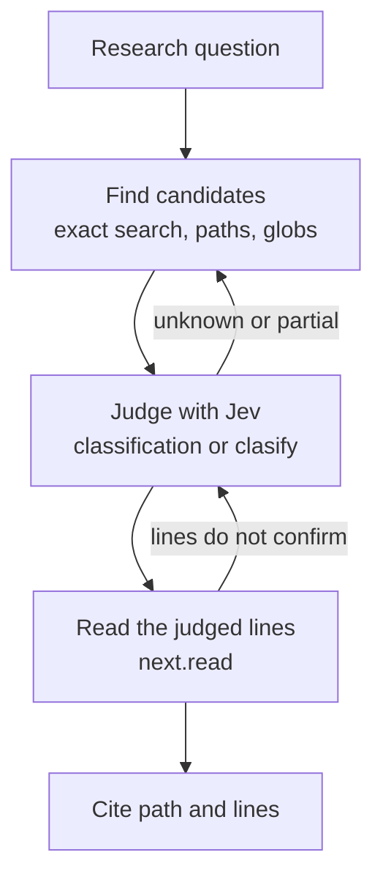
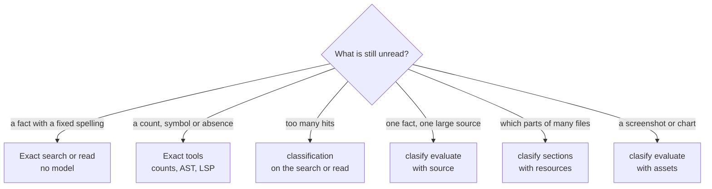
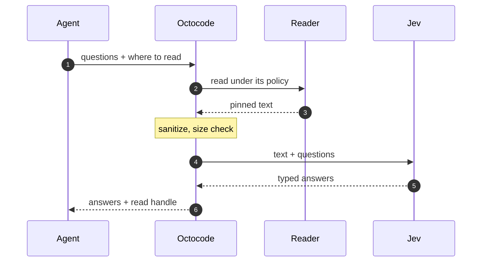
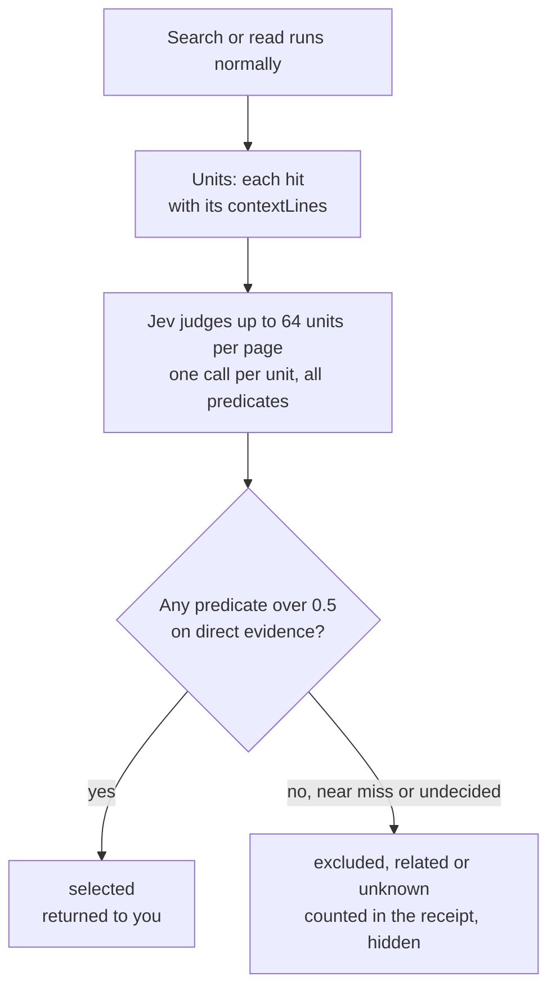
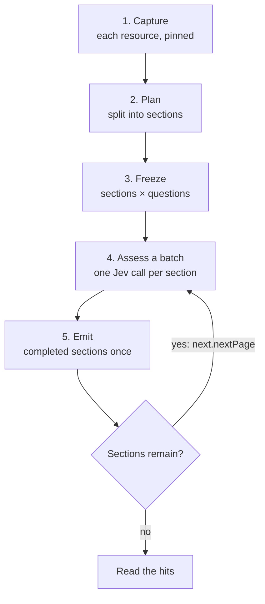
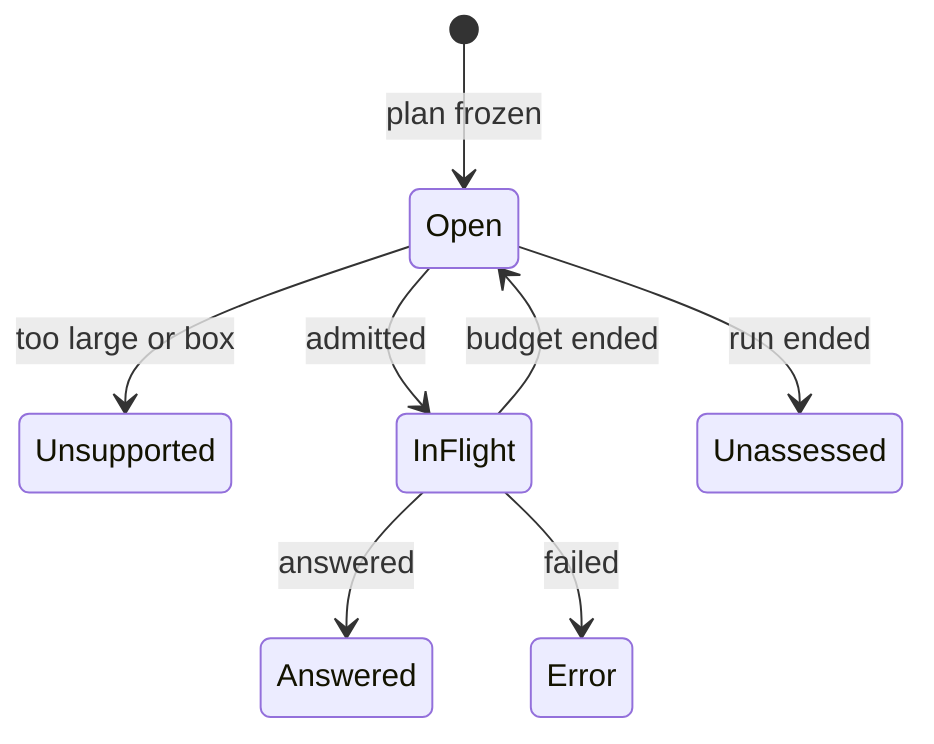
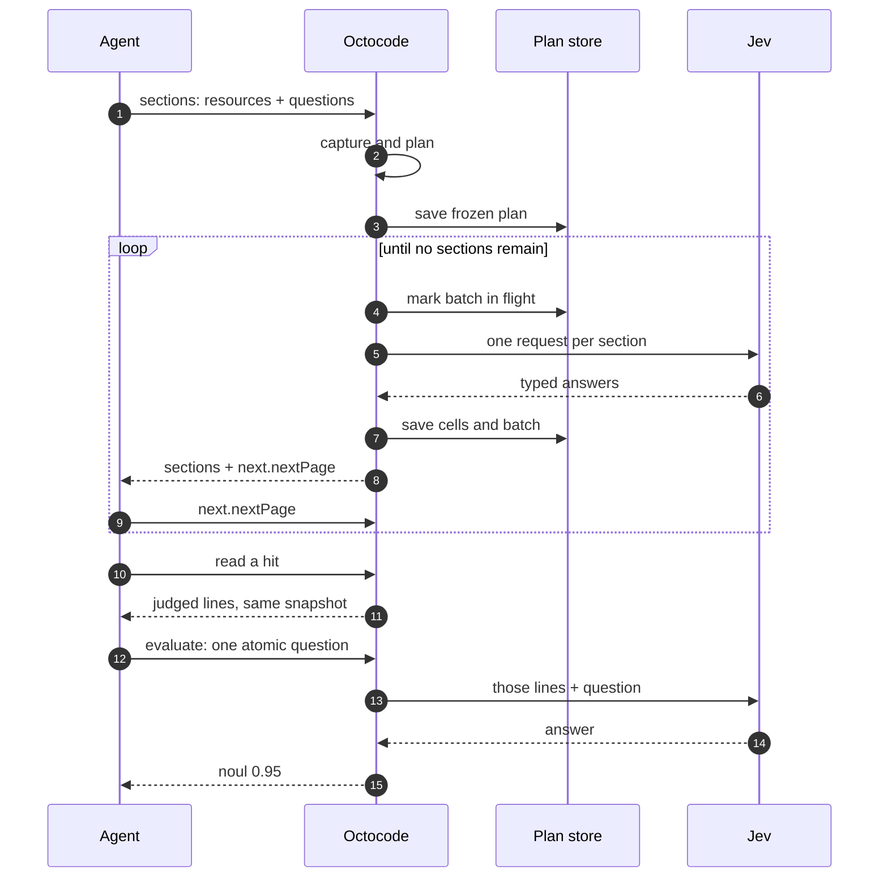

# Research with Jev: classification in Octocode

Jev is the decision model behind Octocode's classification. It reads text your agent has not
read and returns typed answers: a yes/no probability, a choice, a score or an image box. The
agent gets the answers and the exact lines worth reading, not the source bodies, so Jev spends
its tokens on reading and the main agent spends fewer of its own.

Measured on 2026-11-03: one fact from an unread 33 KB doc cost the main agent 98% fewer tokens
than reading it, and mapping three questions across 30–100 files cost 73–84% fewer than reading
every file ([benchmarks](#benchmarks-main-agent-tokens-with-and-without-jev)).

> [!TIP]
> Search for spelling, ask Jev for meaning, and read the lines before you cite them.

There are two ways in:

| Entry point | What it does | Use it when |
|---|---|---|
| `classification` on `localSearch`, `localFetch`, `ghSearchCode` or `ghGetFileContent` | Filters the hits or lines a search or read found, before the agent sees them | A search returns too many hits and no term or path splits them |
| The `clasify` tool | Answers typed questions about content, an unread source, images, or every section of up to 25 files | You need a named fact from a large unread source, or which parts of many files answer your questions |

## Quick start

1. Configure the classification key: [Authentication](AUTHENTICATION.md#classification-key-clasify).
2. Ask one exact question about a file you have not read:

   ```bash
   octocode clasify '{"queries":[{"operation":"evaluate","source":{"tool":"ghGetFileContent","query":{"owner":"vitejs","repo":"vite","path":"packages/vite/src/node/server/middlewares/hostCheck.ts","ref":"b3cb0575aff63004a71301a1ec798aeea2aa05d7"}},"questions":{"host":{"type":"noul","instructions":"Does this code reject an incoming request whose Host header is not in an allowed-hosts list?"}}}]}'
   ```

3. Read the answer (`noul` is P(yes)), then run the `next.read` call it prints when you need to
   quote the lines.

The MCP server takes the same requests as the CLI.

## The research loop

Jev does not replace search. It judges what search found, so the agent reads only what matters.



- **Find:** narrow by path, glob or term first. The model is for meaning, not spelling.
- **Judge:** ask one exact fact per question. An unknown answer is not a "no".
- **Read:** a Jev answer is a candidate. Read its lines before you rely on it or quote it.

## Choose a route

Pick the route by what is still unread:



| Route | You send | You get back |
|---|---|---|
| `classification` | A normal search or read plus `predicates` | Only the hits Jev selected, and a receipt counting the rest |
| `clasify evaluate` | One `source` (or literal `content`) and up to 25 questions | One typed answer per question and a `next.read` handle |
| `clasify sections` | Up to 25 named `resources` and up to 25 questions | Per file: each section's lines and answers, plus coverage |
| `clasify evaluate` with `assets` | Up to 8 PNG or JPEG images and questions | Typed answers; `box` gives a region of the image |

## How it works

### What every call does

The agent sends questions and where to read. It never sends or receives the source body.



- **The reader** is the same one a normal call uses: `localFetch` for local files,
  `ghGetFileContent` for GitHub (pinned to the resolved commit), or an HTTPS `url`. Path, auth
  and network policies apply before anything reaches Jev.
- **Oversized sources fail explicitly.** Octocode never judges a silently clipped prefix.
- **Jev sees only** the captured text, your questions and `context`. It has no conversation
  history and no sibling answers, so each question must stand alone.
- **No answer cache across requests.** Each fresh request is judged and billed again, so an
  edited file never gets an old answer. Saved result pages and `sections` continuations replay
  with no new inference. Identical evaluations inside one request are sent once.
- **Provider failures keep the evidence.** When capture succeeded, the read handle still works.

### Questions

Questions are keyed under `questions`, up to 25 per query. Every question is asked of every
unit Jev judges.

| Type | Ask | Answer |
|---|---|---|
| `noul` | A yes/no fact | `noul`: P(yes), 0 to 1 |
| `choice` | Pick one of up to 255 keyed options in `criteria` | `choice`, `probabilities`, `confidence` |
| `score` | A level on a scale of up to 11 levels in `criteria`, level 0 first | `score` (the expected level, may be fractional), `probabilities`, `legend` |
| `box` | Where something is in an image (needs `assets`) | `box` edges as 0–1 fractions of the image |

`confidence` measures how concentrated an answer is, not whether it is correct.

### Write atomic questions

An atomic question names one observable fact that a line of source can confirm. Vague questions
are the main cause of confident wrong answers.

| Instead of | Ask |
|---|---|
| "Any security bug here?" | "Does this code serve a file that lies outside the allowed filesystem roots?" |
| "Is the host handled?" | "Does this code reject a request whose Host header is not in an allowed-hosts list?" |
| "After 2027?" | "Is the year 2028 or later?" |
| "How many retries are there?" | Nothing: count with `localSearch` or a script |

- Write each question to stand alone; Jev does not see your other questions or answers.
- Say what does not count: "assigns a timeout, not one it forwards".
- Give `choice` an `unknown` option and a near-miss option, so Jev is not forced to guess.
- Treat answers between 0.3 and 0.7 as unsure.

### classification: filter hits before you see them

Add a `classification` object to a search or read. The tool runs normally, then Jev decides
which units reach you.



The receipt (`selection`) counts every group, and continuations reach the rest:

| Continuation | Use it when |
|---|---|
| `next.nextCandidatePage` | More candidates remain to judge |
| `next.unfilteredUnknown` | The units Jev could not decide might change your claim |
| `next.unfiltered` | You need the whole view, unjudged, for a count or an absence claim |

> [!IMPORTANT]
> Jev judges each hit and its `contextLines`, not the whole file. If the property you ask about
> lies outside that window, widen `contextLines` or use `clasify sections`. A filtered list does
> not prove that something is absent.

### clasify evaluate: one source, many questions

`evaluate` takes exactly one of `source` or `content`:

- `source` names a reader query (`localFetch`, `ghGetFileContent`) or an HTTPS `url`; Octocode
  reads it for you. Use it for anything you have not read.
- `content` is literal text or JSON you supply. Paths or URLs inside it are data and are not
  fetched.

Jev judges the captured text against every question. The result holds `answers.<key>`, `usage`
and `next.read`, which reads exactly the judged selection at its pinned snapshot or commit.

### clasify sections: map questions across many files

`sections` takes up to 25 named resources and your questions, and tells you which regions of
which files answer each question.



1. **Capture.** Each resource is read by its own reader and pinned. A source repeated across
   resources is read once.
2. **Plan.** Code is split at declaration edges, so whole functions, classes and methods stay
   together; other text is split into size-bounded chunks at line breaks. Each section keeps its
   preceding context lines.
3. **Freeze.** The plan becomes a matrix: one row per section, one column per question. Each
   cell is one answer slot. The plan is saved before any Jev call.
4. **Assess.** One Jev request per section answers all of its open questions. Sections in a batch
   run concurrently, admitted by a character budget.
5. **Emit.** Completed sections are returned once, with each resource's coverage and
   `next.nextPage` while work remains.

Each cell moves through these states:



| Transition | When |
|---|---|
| Open → Unsupported | The section exceeds the model's input limit, or the question is `box` (text sections have no image) |
| Open → InFlight | The batch's character budget admits the section |
| InFlight → Answered | Jev returned a typed answer |
| InFlight → Error | The provider failed, a different model answered, or the process stopped with the outcome unknown |
| InFlight → Open | The time budget ended before the request was sent; a later batch retries it |
| Open → Unassessed | The run ended with work left; `terminalReason` says why |

Coverage counts these states per resource (`answered`, `error`, `unsupported`, `unassessed`),
plus `totalSections` and `remainingSections`. An absent count is 0.

> [!IMPORTANT]
> `unassessed` and `error` cells were not judged: they are not a "no". A section hit is a
> candidate, because sections are judged with preceding context: read its `target.lines`
> before you cite it.

What comes back for each resource:

```text
resources.<key>
├─ status, snapshot           what was read, pinned (`source` on a cursor page, or when it changed)
├─ read                       a handle that reads the file at that snapshot
├─ coverage                   cell counts (cumulative, never add them up)
└─ sections[]
   ├─ id, kind, name, target.lines, context
   └─ answers.<question> {status, answer}
```

- Each completed section appears exactly once. A later batch repeats a resource only when it
  gains sections or its coverage changes, so keep each resource's last reported row.
- A resource that cannot be read or judged says so; Octocode never invents answers for it.

### State: where the data lives

One `sections` request from start to the final atomic follow-up:



| State | Where | How long | Holds |
|---|---|---|---|
| Capture pool | RAM | One call | The sanitized text of each captured source |
| Plan store | RAM, plus disk with persistent storage | 30 minutes | Section text, the cell matrix, rows in flight, every emitted batch |
| Saved result pages | The page store | The continuation idle lifetime | Emitted pages, replayed with no inference |
| Agent context | The main agent | The conversation | Answers, coverage and read handles only |

- If a process stops while rows are in flight, the next continuation reports those cells as
  errors with an unknown provider outcome. It does not send them again.
- An answer from a different model than the one the plan started with is refused.
- With `storage.mode: "memory"`, a CLI call whose plan needs more than one batch is refused
  before any inference. The default persistent storage and a running MCP server can continue it.

## Examples

Every GitHub source below is public and pinned, so these commands run as written.

### Filter search hits

```bash
octocode localSearch '{"queries":[{"path":"src","matchString":["cache"],"contextLines":{"before":3,"after":3},"classification":{"predicates":["Does this implement credential invalidation?"],"context":"Trace credential rotation through the cache."}}]}'
```

The same `classification` object works on `localFetch`, `ghSearchCode` and `ghGetFileContent`.
Predicates are independent questions; `context` tells Jev what the research is for.

### Ask about one unread file

```bash
octocode clasify '{"queries":[{"operation":"evaluate","source":{"tool":"ghGetFileContent","query":{"owner":"vitejs","repo":"vite","path":"packages/vite/src/node/server/middlewares/hostCheck.ts","ref":"b3cb0575aff63004a71301a1ec798aeea2aa05d7"}},"questions":{"host":{"type":"noul","instructions":"Does this code reject an incoming request whose Host header is not in an allowed-hosts list?"},"status":{"type":"choice","instructions":"Which HTTP status does a rejected request get?","criteria":{"400":"400 Bad Request","403":"403 Forbidden","404":"404 Not Found","unknown":"The code does not say"}}}}]}'
```

The agent receives about 330 characters instead of the file:

```text
model: jev-1.14.0
answers:
  host: type noul noul 0.86
  status:
    type: choice
    choice: unknown
    confidence: 0.79
    probabilities: 400 0.04 403 0.12 404 0.0 unknown 0.84
usage: input_tokens 1082 output_tokens 71
next.read: (a ghGetFileContent cursor call for the judged file)
```

`unknown` is right: the file hands rejection to a helper and sets no status itself. For a local
file, use `"source":{"tool":"localFetch","query":{"path":"src/cache.ts"}}`; for a web page, an
HTTPS `url`.

### Map questions across files

```bash
octocode clasify '{"queries":[{"operation":"sections","resources":{"hostCheck":{"tool":"ghGetFileContent","query":{"owner":"vitejs","repo":"vite","path":"packages/vite/src/node/server/middlewares/hostCheck.ts","ref":"b3cb0575aff63004a71301a1ec798aeea2aa05d7"}},"ws":{"tool":"ghGetFileContent","query":{"owner":"vitejs","repo":"vite","path":"packages/vite/src/node/server/ws.ts","ref":"b3cb0575aff63004a71301a1ec798aeea2aa05d7"}}},"questions":{"host":{"type":"noul","instructions":"Does this code reject or allow an incoming request based on its Host header or an allowed-hosts list?"},"fsdeny":{"type":"noul","instructions":"Does this code refuse to serve a file that lies outside the allowed filesystem roots (an fs allow or deny list)?"},"port":{"type":"noul","instructions":"Does this code pick another port when the requested port is already in use?"}}}]}'
```

The filled matrix, one row per section, P(yes) per question:

| Resource | Section | Lines | `host` | `fsdeny` | `port` |
|---|---|---|---|---|---|
| `hostCheck` | s0 | 1–62 | **0.95** | 0.07 | 0.02 |
| `ws` | s0 | 1–217 | **0.96** | 0.08 | 0.12 |
| `ws` | s1 | 217–374 | **0.94** | 0.07 | 0.05 |
| `ws` | s2 | 374–473 | 0.06 | 0.08 | 0.05 |

Probabilities can shift by about 0.01 between runs. Read the high-scoring sections with each
resource's `read` handle, and follow `next.nextPage` unchanged until no resource reports
`remainingSections`.

### Ask one atomic follow-up

A section hit says where to look. A follow-up asks one exact fact about just those lines, here
lines 46–62 of `hostCheck.ts`:

```bash
octocode clasify '{"queries":[{"operation":"evaluate","source":{"tool":"ghGetFileContent","query":{"owner":"vitejs","repo":"vite","path":"packages/vite/src/node/server/middlewares/hostCheck.ts","ref":"b3cb0575aff63004a71301a1ec798aeea2aa05d7","ranges":[{"startLine":46,"endLine":62}]}},"questions":{"preview":{"type":"noul","instructions":"Does the rejection message name preview.allowedHosts when the server runs in preview mode?"}}}]}'
```

```text
model: jev-1.14.0
answers:
  preview: type noul noul 0.95
usage: input_tokens 588 output_tokens 20
```

Line 55 confirms it: the option name is built from `isPreview ? 'preview' : 'server'`.

### Ask about an image

An image asset is a source reference, not binary data from the host. Reference its key from
`content` or the questions. Jev receives the admitted PNG or JPEG bytes; the result carries
dimensions, format, a snapshot and an inspection path for the captured bytes. Large images are
scaled down, never cropped, so crop first when fine text matters. Local path policy, size bounds
and HTTPS network policy apply before inference, and retained image evidence needs persistent
storage. Check for flaws one image per query.

## Benchmarks: main-agent tokens with and without Jev

Each benchmark asks the same questions with and without Jev and counts the exact characters the
main agent receives. Tokens are characters ÷ 4. Jev tokens are the provider tokens each result
reports in `usage`.

> [!NOTE]
> Single runs on 2026-11-03. Local corpora: 28 Markdown docs (198 KB) and 100 Elasticsearch
> `*Processor.java` files (497 KB). GitHub corpus: 30 files under
> `vitejs/vite@b3cb057/packages/vite/src/node/server` (316 KB).

### Tokens per task

| Task | Without Jev | With Jev | Main agent saves | Jev tokens |
|---|---|---|---|---|
| One named fact in an unread 33 KB doc | Read the doc: 8.4k | `clasify evaluate`: 0.15k | **8.3k (98%)** | 8.1k |
| 3 questions over 28 local docs | Exact search: 6.8k | `classification`: 4.0k | **2.8k (41%)** | 23k |
| 3 questions over 30 GitHub files | `ghSearchCode`: 4.7k | `classification`: 2.4k | **2.3k (48%)** | 12k |
| 3 questions over 100 Java files, all hit lines | Exact search: 26.8k | `classification`: 4.1k | **22.7k (85%)** | 131k |
| Same, when file names are enough | `view:"files"`: 2.2k | `classification`: 4.1k | −1.9k (costs more) | 131k |
| Map 3 questions across 30 GitHub files | Read every file: 98.6k | `clasify sections`: 15.6k | **83k (84%)** | 134k |
| Map 3 questions across 100 Java files | Read every file: 137.8k | `clasify sections`: 36.8k | **101k (73%)** | 156k |
| A literal in one small file | Exact read: 0.09k | `clasify`: 0.07k | about 0 | 3.2k |

### Every route on the same three corpora

Main-agent tokens; the smallest per corpus is in bold.

| Corpus | Read every file | Exact search | `classification` | `clasify sections` |
|---|---|---|---|---|
| 28 local docs | 33.3k | 6.8k | **4.0k** | 9.4k |
| 30 GitHub files | 98.6k | 4.7k | **2.4k** | 15.6k |
| 100 Java files | 137.8k | 26.8k (files view: **2.2k**) | 4.1k | 36.8k |

### What you get for the Jev tokens

| Route | Jev tokens per main-agent token saved | Found |
|---|---|---|
| `clasify evaluate` with `source` | about 1 | The named fact, with no body in context |
| `clasify sections` instead of reading every file | 1.5–3 | 25 of 26 matching Java files (2 extra); every host-check and file-deny file in Vite |
| `classification` instead of exact-search hits | 5–8 | 14 of 26 matching Java files, because it judges each hit and its context lines; missed 2 of 4 file-deny files in Vite |

### When Jev does not pay

- **The answer has a fixed spelling.** Exact search finds it with no model. On the Java corpus
  the `view:"files"` listing beat every Jev route on both tokens and accuracy.
- **The source is small.** One call per section costs more than reading a short file.
- **You need counts, totals, maxima or symbol identity.** Use `localSearch` counts, a script,
  `astSearch` or `lspSearch`.
- **You already know the candidate files.** `clasify sections` returns more than a targeted
  search (15.6k against 4.7k on Vite). Use it to replace reading, not searching.

In agent research runs (5 tasks, 4 runs), agents found every answer with exact search and called
Jev once. Extra classifier guidance raised their context by 40% with no gain in accuracy, so
reach for Jev when exact search cannot split the evidence, not by default.

To measure your own runs, turn on `storage.stats` (`OCTOCODE_ENABLE_STATS=1`) with persistent
storage; Octocode then records clasify calls and tokens in `stats.json`
([configuration](CONFIGURATION.md)).

## Recovery

A question must use its declared type and shape; input errors name the rejected field. Output
errors and partial receipts tell source, admission, provider and assessment failures apart.

| You see | Do |
|---|---|
| `next.nextPage`, `next.nextCandidatePage` | Run it unchanged: it continues saved work |
| `next.read`, `resources.<key>.read` | Run it to read exactly the judged selection, pinned |
| `related[]` | Optional fresh request; it may widen scope |
| `unassessed` cells or `terminalReason` | That work was not judged: it is not a "no" |
| A transient provider failure | Unfiltered evidence may come back with a disclosure; refused credentials and invalid provider answers stay typed failures |
| An answer between 0.3 and 0.7 | Unsure: read the lines before relying on it |

A Jev answer is a judgment, not proof. It does not establish symbol identity, and an uncertain
answer does not show that a source lacks something. Ground a score with a source search before
reporting it.

## Availability

[Configuration](CONFIGURATION.md#tool-availability-cli-and-mcp) owns CLI/MCP exposure, the
classification key, blank-key opt-out and MCP tool filters. The CLI always lists `clasify`; MCP
exposes it when its key is configured and catalog restrictions permit it. Discovery sends no
provider ping, so a missing credential, a rejected key or a provider outage is reported by the
call that needs the provider. Source access and storage policies still apply. For credential
setup, see [Authentication](AUTHENTICATION.md#classification-key-clasify).
`operation:"models"` lists the available models; `model`, `context` and `longContext` are
request fields.

## Limits

| Limit | Value |
|---|---|
| Queries per `clasify` call | 5 |
| Questions per query | 25 |
| `sections` resources per query | 25 |
| `choice` options | 255 |
| `score` levels | 11 |
| Images per query | 8, at most 8 MB each and 16 MB together |
| `classification` units judged per page | 64 |

The generated contract and native constants own these values; the runtime also bounds source
bytes, inference time and retained state. Every limit discloses unassessed work, a continuation
or a terminal reason. See [fixed internal limits](CONFIGURATION.md#fixed-internal-limits) and the
[data contract](TOOL_DATA_CONTRACT.md#evidence-boundaries).

## Accuracy scorecard

Scores are out of 10, from evaluation runs against known answers. Judge quality by agreement with
source evidence, complete coverage accounting and working read handles; shorter output alone is
not better.

| Area | Score | Evidence |
|---|---|---|
| Image classification | 9 | 73/77 correct. Every miss came with low confidence (0.51 or less) |
| Text classification | 8.5 | 83/90 correct. Its few confident wrong answers came from vague or broad questions |
| Scanning many files (sections) | 8 | 100/100 correct per file (25 files × 4 questions). Single sections next to a real hit can be false hits |
| Scouting (cutting what the agent reads) | 9.5 | 84–86% less output, with no relevant hits lost in the tests |
| Large sources | 9.5 | A 200k-character log came back as about 1 KB of answers, 5/5 correct |
| Confidence you can trust | 8 | Reliable for images; for text, only when the question names a specific thing |
| Freshness | not scored | Every file edit was judged again (whole-file, ranged, sections, and a same-size edit with its modification time restored). There is no answer cache, so a repeated request is judged and billed again |
| Ease of use | 7 | Strict limits and confusing errors when you pass unexpected arguments |

**Best at:** specific questions about large unread sources; narrowing searches to the hits that
matter; screenshots, charts and error popups; obvious design flaws; triaging incidents from logs.

**Weak at:** counting, totals and maxima (use a script); pixel-level layout (use DOM
measurements); broad questions like "any bug?" (ask one exact, named fact per question).
