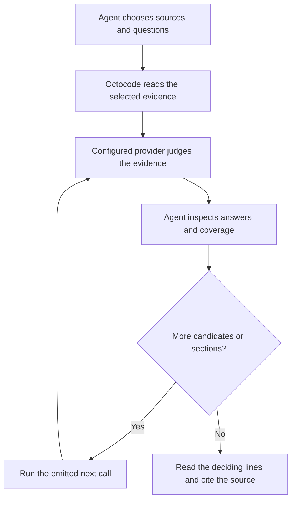

# Classify unread sources with `clasify`

`clasify` reads ahead and classifies for the agent. It answers typed questions about large or unread evidence: files, paths, search hits, command output, web pages, browser captures (HAR, DOM, logs) and images. The agent asks focused questions, gets typed answers, then opens only the deciding lines before citing them.

Use exact tools first. Use ordinary search for a known spelling, `lspSearch` for symbol identity, and unfiltered evidence for counts or absence. Use `clasify` when the meaning has no spelling to search for.

Answers are candidates, not proof. Read the deciding lines in the original source before you cite them.

## Quick start

1. Save a provider key: `octocode config set OCTOCODE_CLASSIFICATION_API --stdin`, paste the key, then press Ctrl-D. Restart an open MCP server after changing the key. See [Classification key setup](AUTHENTICATION.md#classification-key-clasify).
2. Run `octocode schema clasify --view variants` to check availability. This does not contact the provider.
3. From a project with a `README.md`, ask a question about that file. The command below sends one provider request. An MCP agent can send the same JSON to `clasify`.

```bash
octocode clasify '{
  "queries": [{
    "operation": "evaluate",
    "source": {"tool": "localFetch", "query": {"path": "README.md"}},
    "questions": {
      "tests": {"type": "noul", "instructions": "Does the README give a shell command for running the test suite?"}
    }
  }]
}'
```

The `answers` array holds your question key (`tests`). A `noul` answer is the probability of yes. Follow the returned `next.read` to check the command in context. If the answer names its deciding `lines`, the read opens only those lines. Otherwise it opens the whole selection.

## Choose a route

| What the agent has | What to send | What comes back |
|---|---|---|
| Too many search hits or rows, keep only those meaning X | `evaluate` with `source: {tool, query}` and `predicates: ["…"]` | Answers for each hit or row under `units`, keyed `p1`, `p2`, … in the order of the predicates. Hits all below 0.3 are left out and counted in `coverage.quiet`. |
| One unread file or public HTTPS page | `evaluate` with `source` set to `localFetch`, `ghGetFileContent` or `{"url": "https://…"}` | Answers and a read of the captured source. Local and GitHub reads accept line `ranges`. A web page goes as its URL, which is judged as extracted text, not as its saved HTML. |
| A screenshot, chart or other PNG or JPEG | The same `evaluate` with the image as `source` | Typed answers about the image. `box` gives edges from 0 to 1 on the judged image. `sourceBox`, when returned, maps them to the original. |
| Search hits, paths, history items or packages | `evaluate` with `source: {tool, query}`, using the named tool's own query fields, and `questions` or `predicates` (facts to keep rows by, each answered as `p1`, `p2`, … in order) | Answers for each row under `units`. A search hit is its own unit, judged with its line marked, its own context window and its enclosing declaration. A path or commit title can only answer questions about that text. |
| A long, repetitive log | `evaluate` with the whole log file as `source` (local or GitHub, no `ranges`) and `collapse: true` | One answer set per kind of line under `units`, keyed by the number of the kind's first line. Lines that differ only in widely varying numbers (timestamps, ids, durations) are one kind; a number with few distinct values, such as a status, keeps its kinds apart. |
| Several unread files or images | `evaluate` with `resources`, including local globs. One list can mix local files, GitHub files, URLs and images. | An answer set for each file or image |
| A question whose answer could be anywhere in several files | `sections` with `resources` and `questions` | Sections with line ranges, answers and coverage for each resource |
| Long command output: a test run, build or CI log, `git log`, `ps` | Save it under the workspace (`<cmd> > .octocode/out.log 2>&1`), then `evaluate` with that path as `source`. From the CLI, a pipe can send it as `content` instead: [from a pipe](#from-a-pipe-cli). | Answers for the whole output when it fits one window. Use `sections` to learn every place or the order. A path outside the workspace, such as `/tmp`, is refused with `outsideAllowedRoots`. |
| Text or JSON already in hand | `evaluate` with literal `content`. For an array, set `perItem: true` to judge each item separately. | Answers for the whole input, or `units` keyed by array index |
| Images beside text, or several images compared | `evaluate` with PNG or JPEG `assets` and `content` naming each asset key | Typed answers about the text and images together |

Hits in a few files you would read anyway are cheaper to read directly.

A search `source` over several files, a glob in `resources` and a `sections` plan send more requests than the row names. Set `maxRequests` on them, or run the `next.confirm` the refusal returns. See [Budget](#budget-maxrequests).

### What every call does



Octocode sends the selected text, questions, the row's `mainGoal`, optional `background`, and any referenced images to the configured provider. See [Privacy](#privacy).

## Questions

| Type | How to ask | How to read the answer |
|---|---|---|
| `noul` | One observable yes/no question. Name the action and the object, such as "Does this command run the unit tests?" Add `criteria` with `true` and `false` near misses when they help. | Probability of yes, from 0 to 1. A low answer can miss a real match, so it is not proof of absence. |
| `choice` | Two or more labels in `criteria` (2 to 255). Include an `unknown` label when the source may omit the fact. Use `unknown` for absence, not a label such as `no error`. | One label. The `details` view adds probabilities and confidence, which measures how concentrated the distribution is. |
| `score` | 2 to 10 ordered levels in `criteria`, starting at level 0 | Expected level, which can be fractional |
| `box` | The visible target in one image. Needs a vision-capable model. | Coordinates on the image. Inspect the original to confirm the location. |

Batch independent questions about the same source: the source is billed once per request and each further question adds little. Ask one snap judgment per question, and keep counting, date comparison and arithmetic in code. The row's `mainGoal` reaches the judge as the goal of every question, so write it as the question the row answers. `reasoning` is never sent: a stated belief moves the answers toward it. For code, name the mechanism that decides the answer, and separate its implementation from declarations, validators and reports. Include an `unknown` label for missing evidence. High confidence does not establish correctness.

Read `next.read` before you cite a candidate. If that read covers much more than the question needs, use `localFetch` or `ghGetFileContent` with `view: "symbols"`, then `matchString` and `block: true` for the deciding declaration. Keep GitHub reads at the returned `commitSha`. Use `sections` when a claim needs every occurrence or the event order.

## Patterns

Three patterns from the provider's own guides work through an ordinary `choice` question. Each result below was measured on 2026-11-21 with `jev-1.14.0` on the stated cases only.

### Pick one of many

To learn which one of many candidates fits, ask one `choice` whose `criteria` hold a label per candidate (up to 255), plus `none`. The label is what comes back, so use a short id and put the candidate in its description.

```json
{"queries": [{
  "operation": "evaluate",
  "content": {"task": "Each option is a source file path."},
  "questions": {
    "redact": {
      "type": "choice",
      "instructions": "The file that removes secrets from captured network traffic. Choose by path.",
      "criteria": {
        "f00": "src/engine/har-pager.mts",
        "f01": "src/engine/har-redact.mts",
        "f02": "src/engine/page-pdf-check.mts",
        "none": "No listed file."
      }
    }
  }
}]}
```

Among 74 paths, three descriptions with a known file each chose it, at confidence 0.94 to 1.00. A description of a file that does not exist came back at confidence 0.11. Read `details` for the confidence: a low one means undecided, not a pick. Every `choice` restates its options, so five picks over 74 options cost 13,941 input tokens; ask one question where one is enough.

### Extract a value from candidates

There is no free-text answer. To get a version, id or date, collect the candidate spans with a search (`localSearch` with `view: "matchOnly"` and `unique: "list"`), then let a `choice` pick one or `none`. The answer is a span that exists in the source, never an invented one.

```json
{"queries": [{
  "operation": "evaluate",
  "source": {"tool": "localFetch", "query": {"path": "Cargo.toml"}},
  "questions": {
    "rust": {
      "type": "choice",
      "instructions": "The Rust toolchain version this workspace requires.",
      "criteria": {"1.99": null, "2024": null, "0.52": null, "none": "No candidate is the answer."}
    }
  }
}]}
```

Among 18 candidates, the right version came back at confidence 1.00, and two values the file does not state came back as `none`. Read the answer's `lines` before you cite the value.

### Say when nothing fits

Add an `unknown` label (or `none` for a pick) so the question can abstain. On 8 messages, 4 of which fit no label, a `choice` with `unknown` was right on all 8. The provider's guide suggests a separate yes/no question instead; on the same messages that form was right only when both answers were read together, because the `choice` alone still named a label for the 4 that fit none.

## Answers and next calls

Each response returns answers and a `next` object. Run each returned call unchanged.

| Returned call | When to run it | Cost |
|---|---|---|
| The reply's top-level `next` | More remains: the rest of this response, or the next batch of sections or units. Run it unchanged until no `next` is left. | The rest of a saved response replays with no request (`replayed: true`); a new batch judges newly reached units and bills them (see `usage`) |
| `next.read` | Verify the lines of answers that said yes. A resource's own `read` opens its captured source. | Reads evidence, no request |
| `next.confirm` | A row was refused as over budget (see [Budget](#budget-maxrequests)). It retries the refused page with a higher allowance. | Billed |
| `next.quiet` | Inspect sections held back because every answer was a `noul` below 0.3 | Replays saved answers |
| `next.details` | Inspect the detailed view of a saved sections or source page when offered | Replays saved answers |

A low answer is not absence. Before you claim that nothing matches, run an exact search over the same scope.

`evaluate` answers name their deciding `lines` in the same request. A `noul` below 0.5, an `unknown` `choice` or an answer whose part chose no part names no lines and adds nothing to `next.read`. The read then opens only the lines the answers name.

## What it costs

Measured on 2026-11-21 with `jev-1.14.0`. Every answer below matched the known content of its source. Input tokens are what the provider bills.

| Source | Questions | Requests | Input tokens | What the agent read afterwards |
|---|---|---|---|---|
| Build log, 5,202 lines (241 KB) | 2 | 2 | 89,550 | 112 lines around the one failing test |
| Web page by URL | 3 | 1 | 2,720 | 12 lines |
| The same page as saved HTML (214 KB) | 3 | 2 | 75,856 | 20 lines |
| HAR capture, 75 requests (65 KB), judged whole | 4 | 1 | 26,188 | The three matching entries |
| The same HAR in `sections` | 2 | 9 | 34,212 | 2 of 9 sections |
| 12 Markdown docs by glob | 2 | 12 | 41,452 | 3 files |
| Build log, 30,000 lines (1.4 MB), split into 17 parts | 3 | 18 | 505,448 | The three parts that hold a failure |
| 48 file paths from `structureSearch` | 1 | 1 | 2,498 | The ranked paths (60 paths cost 60 requests and 18,894 tokens before rows shared requests) |
| The 1.4 MB log with `collapse: true` | 3 | 1 | 4,170 | The four deciding lines, by number |
| Access log, 8,000 lines, `collapse: true` | 2 | 1 | 784 | The one 500 and the first 404, by line number |
| Screenshot 716×1075 as `source` | 2 | 1 | 2,397 | Nothing more |

- A web page costs about 28 times less by URL than as saved HTML, with the same answers.
- A source over the standard window is asked again in the long window and billed whole. Use line `ranges` or `sections` when only part of it matters.
- Paths and other listed rows share requests. Path-only evidence still gives soft answers, so use exact tools when the name has a known spelling.
- A collapsed log shows one line per kind. A kind that stands for several lines names only its first line: search the log for the others.
- A goal in `mainGoal` cut a vague question's false positive from 0.77 to 0.30. A precise question with `criteria` near misses scored 0.91 against 0.05 and 0.02 without any goal, so precision in the question comes first.

## Filter search hits

No search or read tool takes an inline filter. To keep only the hits that mean something, give the search to `clasify` as its `source` and state the facts as `predicates`. From a project with `README.md`:

```bash
octocode clasify '{
  "queries": [{
    "operation": "evaluate",
    "source": {"tool": "localSearch", "query": {
      "path": "README.md",
      "matchString": ["test"],
      "contextLines": {"before": 2, "after": 2}
    }},
    "predicates": ["This passage gives a command to run the test suite."]
  }]
}'
```

Each predicate is asked as a yes/no question about every hit and answered as `p1`, `p2`, … in order. `predicates` can stand in place of `questions` or beside them, on any `evaluate` form. By default `localSearch` supplies the hit line alone; set `contextLines` when a predicate depends on nearby text. Hits of one file share one request. Read the kept hits with `next.read`.

On one search of 25 hits, measured on 2026-11-21, predicates kept 14 hits for 4,719 input tokens. The inline filter this replaced kept 5 of the same hits, left 5 undecided, and cost 5,672.

<a id="clasify-sections-map-questions-across-many-files"></a>
## Map questions across files

This example scans Markdown files under `docs/`. Narrow the glob to the files that matter to control usage. A sections plan sends one request per section, so it needs `maxRequests` (see [Budget](#budget-maxrequests)): each page takes the sections that fit it, and `next.nextPage` takes the rest.

```bash
octocode clasify '{
  "queries": [{
    "operation": "sections",
    "resources": {"guides": {"tool": "localFetch", "query": {"path": "docs/*.md"}}},
    "maxRequests": 10,
    "questions": {
      "login": {"type": "noul", "instructions": "Does this passage give a command to sign in to GitHub?"}
    }
  }]
}'
```

Read each resource's `coverage` and each section's `target.lines`. Coverage is cumulative. Errors, unsupported cells and unassessed cells leave a gap in what the agent checked. Follow continuations as described in [executable continuations](TOOL_DATA_CONTRACT.md#executable-continuations).

| Returned call | When to run it | Provider work |
|---|---|---|
| The reply's top-level `next` | More remains: the rest of this response, or the next batch of sections | A saved response replays; a new batch judges newly reached sections |
| `next.read` | Verify the lines of sections that answered yes | Reads evidence |
| `next.quiet` | Inspect sections held back | Replays saved answers |
| `next.details` | Inspect the detailed view of a saved page | Replays saved answers |

A text source that exceeds the provider window is split automatically and judged part by part, with the same questions and context for every part. The row lists each part under `sections`, with its `target.lines` and its own answer to every question (`details` adds `target.bytes`). A summary leaves out parts whose every `noul` is below 0.3 and counts them in `coverage.quiet`. The row's `answers` combine the parts: the highest `noul` or `score`, or the most confident `choice` other than `unknown`, with `lines` naming the deciding part. Read relevant sections together for event order, contradictions or claims about every code path. A single section covers only the text it received.

A text judged whole in one window also names its deciding `lines`. Octocode marks parts of the text with line-numbered markers and asks which part decides each question, in the same request. A source read with `ranges` names its lines within those ranges. A URL row's `lines` count lines of the captured page text, which its `next.read` opens. JSON `content` that is not a string and image rows name no `lines`. `lines` name the deciding part, which ends at a block edge (a section, paragraph, table or code block), so it can be wider than the sentence that decides.

<a id="from-a-pipe-cli"></a>
## From a pipe (CLI)

`--content -` reads stdin as the text of the one query row's `content`. The JSON comes from the argument or from `--input <file>`:

```bash
set -o pipefail
cargo test 2>&1 | octocode clasify --content - '{"queries":[{"operation":"evaluate","questions":{"fail":{"type":"noul","instructions":"Does any test fail?"}}}]}'
```

Rules:

- The JSON needs exactly one query row. That row must not name `content`, `source` or `resources`, or the command refuses before sending anything.
- `--input -` cannot be combined with `--content -`, because stdin carries the text.
- Stdin must be UTF-8. The text is bounded at 8 MiB, like a query read with `--input`.
- The text is screened for recognized secrets and redacted before the provider request, as for any `content`.
- A text over the provider window is refused, not judged in sections. Save it under the workspace and pass it as `source` instead.
- `lines` count lines of stdin. There is no `next.read`, so keep the output if you need to read those lines.
- MCP has no such flag. An MCP agent puts `content` in its call, or passes a saved file as `source`.

## Availability

| Setting or request field | Default | Effect |
|---|---|---|
| `classification.api` / `OCTOCODE_CLASSIFICATION_API` | Unset | A nonblank key enables `clasify` on both interfaces, subject to MCP tool filters. A blank process variable disables both. |
| `classification.apiHost` | `https://api.typesafe.ai` | Provider API root. Only trusted configuration can set it. HTTPS is required except on loopback. [Configure another host](CONFIGURATION.md#change-the-classification-host) |
| `model` on a row | `jev-latest` (configured model) | Overrides the configured model for that row. `{"queries":[{"operation":"models"}]}` lists the models the provider serves. |
| `longContext` | Unset: the long window is used only after a provider refusal | `true` requests the long window up front. `false` never uses it. A longer request can cost more provider tokens. |
| `view` | `summary` | `summary` states each row's requests and input and output tokens. `details` adds probabilities, confidence, model and provenance. Repeating an evaluation to change the view makes a new provider request. |
| `mainGoal` | Unset | Sent with every unit to the judge as the goal the questions serve. It is not itself judged. |
| `background` | Unset | Text about the material, sent with every unit after the goal. It is not itself judged. |

### Billing

- **One billed request per source.** A `clasify` row is one request for each path, GitHub file, URL, `content` entry or whole-file chunk. Listed rows, `perItem` items and the kinds of a collapsed log **share requests**: up to 48 fit one request, each as a named field of the request with its own question, and the provider's window closes a request sooner. A search `source` bills **per file**: the hits of one file share one request, with one question per hit, and a long question's words are sent once per request. Identical requests are sent once. `perHit: true` (with a search or listing `source`) judges each hit in its own request instead, priced one request per hit; on a file or URL `source`, which has no hits, it is refused before anything is read.
- **Refusals and retries add requests.** When the provider refuses a request as too large, its hits are split and asked again. When it leaves an answer out, that hit is asked once more. An answer still missing is reported as an `error` cell. A refused request counts in `usage.calls` and `usage.refused` and reports no tokens; the provider does not document whether it bills one. Within one process, a size the provider refused is remembered: literal `content` at least that large is refused without a request, and a source goes to its sections.
- **`evaluate` always re-bills.** Repeating an identical `clasify` evaluation sends new requests, even on cached source.
- **Saved answers replay for free.** `next.details`, `next.quiet` and the reply's `next` when it reads a saved response send no requests. When the reply's `next` reaches a new source page or section batch, it sends requests to judge that material.
- **Saved pages expire** after 30 minutes of inactivity. A new process can also need new inference.

### Budget (`maxRequests`)

Set `maxRequests` (an integer of at least 1) on an `evaluate` row or a fresh `sections` row to cap provider requests. For a search or listing `source` followed through issued cursors, the cap covers the source walk. Other evaluations and `sections` plans apply it to each page. Re-asks, splits and transient retries within a page count.

Without `maxRequests`, a row sends at most one first-round request per source, resource or `content` item it names. A plan whose own expansion needs more is refused before anything is sent: a search or listing `source` over several files, `perHit` over several hits, a glob that matches more files than its resource keys, or a `sections` plan of more sections than resources. One exception: a single named `source` or resource over the provider window is judged in its parts without `maxRequests`, because the row bills the file it named either way.

| Field | Meaning |
|---|---|
| `maxRequests` | Cap for one saved search or listing walk, or per page for other rows |
| `usage.requestsPlanned` | Requests the row expects to send |
| `usage.requestsCeiling` | Upper bound for this page, including its first round, re-asks, splits and transient retries |
| `usage.calls` | Requests attributed to this page. The first matching row in the batch carries the spend for a shared request |
| `usage.walkCalls` | Requests the source walk actually sent through the current page. The cursor uses this total for the remaining allowance |
| `usage.refused` | Requests the provider refused |
| `usage.inputTokensAtMost` | On a refused row: input tokens its first round costs at most. It counts one token per byte sent plus the provider's own prompt, so it runs well above the tokens billed. Absent until the provider has answered a request in this process |
| `usage.remainingInputTokensEstimate` | On a `sections` page with work left: input tokens of the rest, priced at this page's rate |

Behavior:

- A row runs when its first round (`requestsPlanned`) fits its remaining allowance. Re-asks, splits and transient retries use only what the first round leaves.
- A first round above the remaining allowance, or above what an uncapped row names, is refused before the page sends a request. The error is `classificationOverBudget`, with `usage.calls: 0`, the planned and ceiling counts, and a confirmation call. On a saved source walk, `next.confirm` raises `maxRequests` to cover the earlier requests plus the refused page's ceiling. Confirming bills the new work.
- A source over the provider window is judged in its parts. With `maxRequests` set, they run only when the cap still holds them. Otherwise the refusal names how many parts it would send, its `usage.calls` counts the whole-source request already sent, and `next.confirm` allows them.
- A `sections` page with `maxRequests` takes the sections whose first round fits the cap; the reply's `next` takes the rest.
- If the cap runs out during a run, the next send is not made: the unit, section or question it left is an `error` cell with `classificationOverBudget`.
- A row without `maxRequests` is held to its ceiling too, except that a refusal's retries (long window or split) may pass it; they are counted and named in a warning. Transient retries never pass it.
- Units still unanswered after the retries stay `error` cells; `next.retry` asks only them again, at their own price.
- To keep a request under budget, narrow the source: fewer files, hits or resources, or smaller line ranges.

#### Budget across a scout workflow

For a single search or listing, set `maxRequests` on the starting row and follow the issued cursors unchanged. Each new source page uses the allowance the earlier pages left. If its first round cannot fit, it returns `classificationOverBudget` before judging that page. Inspect `usage.walkCalls` for the running total and follow `next.confirm` only to raise the allowance.

For an allowance shared across several rows or fresh calls, track it in the caller. Set explicit caps so their sum fits the remaining allowance. The cap starts anew on a fresh `related` call when saved work is unavailable. A separate `next.retry` may bill again, so check its ceiling before following it.

For a shared allowance, subtract each billed page's `usage.calls` once. For an `evaluate` result with per-resource usage, add the `usage.calls` of its resource results. For an individual saved walk, subtract `usage.walkCalls` from its `maxRequests` instead. If two rows share a request, `usage.calls` may attribute it to a different row than the walk that sent it. The page discloses the difference when it happens. A replay marked `replayed: true` reports historical usage and consumes none of the allowance. Predicate summaries keep the P(yes) scores for quiet hits alongside the other scores, so reading them takes no new judgment.

```json
{"queries": [{
  "operation": "evaluate",
  "source": {"tool": "localSearch", "query": {"path": "src", "matchString": ["retry"]}},
  "maxRequests": 20,
  "predicates": ["Does this hit implement a retry loop?"]
}]}
```

## Recovery

| What you see | What to do |
|---|---|
| `missingConfiguration` or missing discovery fields | Set the key in trusted configuration, check for a blank process override, and restart the MCP server. |
| `invalidInput` | Check `octocode schema clasify --view query`. An evaluation takes exactly one of `source`, `resources` or `content`. `evaluate` and `sections` both need `questions`. |
| `classificationOverBudget` | Read `usage.requestsCeiling` for the refused page and `usage.walkCalls` for earlier requests, when present. Run `next.confirm` to raise the allowance, or narrow the source. |
| `classificationContextEmpty`, refused source or expired plan | Check the source with its reader. Start a fresh request after expiry. |
| `classificationContextTooLarge` or `classificationStateTooLarge` | Use narrower line ranges or a `sections` call, if offered. Literal `content` and image rows can receive a size refusal. |
| `outsideAllowedRoots` | Save the output under the workspace and pass that path as `source`. |
| Provider error after capture | Read the error, then use the returned source read when available. |
| Provider HTTP 401 (rejected key) | Fix `OCTOCODE_CLASSIFICATION_API`. The process remembers the rejection for a minute, so the rest of a batch fails fast without more requests. A 403 is not remembered: it can be one model's refusal. |

## Privacy

Octocode sends the selected text, questions, the row's `mainGoal`, optional `background` and any referenced images to the configured provider. `reasoning` is not sent. Local path rules, GitHub authorization and URL policy apply before capture.

- Text is screened for recognized secrets, which are redacted before the request.
- Files with credential-like names are withheld from classification.
- Image pixels and metadata receive no text redaction. Large images may be resized and small ones padded.

The provider sees only what the request carries. See [classification egress](SECURITY.md#classification-egress).

## Limits

| Input | Limit |
|---|---|
| `clasify` batch | Up to five query rows |
| `choice` labels | 2 to 255 |
| `score` levels | 2 to 10 |
| PNG or JPEG | Up to 8,192 pixels per source side and 16 MiB per image, 32 MiB total. The judged image is fitted to 280 to 1,568 pixels per side. |
| Provider request body | 32 MiB encoded |
| Context | 32,000 tokens per question and 64,000 per standard request. The long window allows 262,000 tokens. |
| Questions per request | No separate limit. A request must fit both context limits. |

For batch sizing and concurrency, see [fixed internal limits](STORAGE_AND_LIMITS.md#fixed-internal-limits).

[Documentation hub](README.md)
