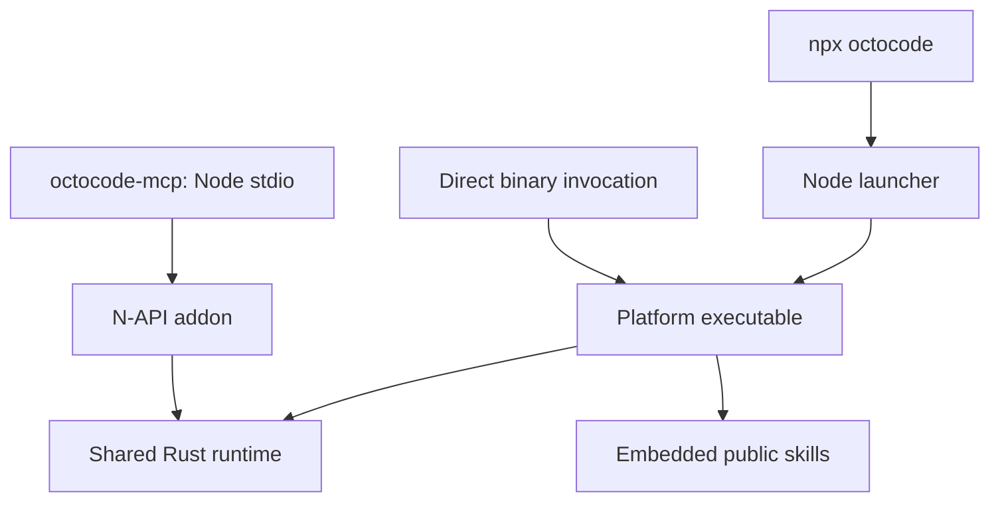

# Octocode CLI

`octocode` runs every Octocode research tool from a terminal or an agent's
shell. It uses the same tool names, query fields, security policy and native
runtime as the MCP server. A tool command takes flags like rg and gh
(`octocode localSearch PATTERN PATH -w -g '*.rs'`) or one JSON query. Both build
the same query. Output is plain text, on a terminal or a pipe; `--json` prints
JSON.



`npx octocode` and a global npm install run the same native binary. The
`octocode` npm package includes the small Node launcher, public skills and documentation. npm installs the
per-platform package that matches the machine (`@octocodeai/octocode-native-<platform>`,
selected by its `os`, `cpu` and, on Linux, `libc`), and the launcher starts its `octocode`
binary with every argument unchanged.

This page owns the CLI: commands, flags, input, output, exit codes. Field
meanings, defaults and limits: [tools reference](OCTOCODE_TOOLS.md). The result
envelope, `next.*` pages and `hints`: [tool data contract](TOOL_DATA_CONTRACT.md).
Which tool to call when: [workflows](OCTOCODE_WORKFLOWS.md). Settings:
[configuration](CONFIGURATION.md).

## Quick start

```bash
octocode --help                                         # commands, one example per tool, exit codes
octocode localSearch --help                             # primary flags, with examples
octocode localSearch createServer src -w                # like rg -w createServer src
octocode localFetch src/index.ts:1-40                   # like sed -n '1,40p'
octocode ghSearchRepo ripgrep --sort stars:desc -L 3    # like gh search repos
octocode localSearch '{"path":"src","matchString":"createServer"}'   # the same search as JSON
```

Authenticated GitHub endpoints and private repositories need a token; some public requests work without one. `octocode auth status` shows the one in use
([`auth`](#auth--github-authentication)).

## Commands

### Tool commands

`octocode <tool> --help` lists primary flags; `schema <tool> --view full` describes the complete JSON input. Positional arguments fill the
required fields in the order shown. A tool with operations takes the operation
first (`octocode lspSearch references …`); without it, the tool's default
operation runs.

| Command | Finds or reads | Usage | Familiar model |
|---|---|---|---|
| `localSearch` | Text or regex matches in local files | `localSearch PATTERN [PATH]` | `rg` |
| `structureSearch` | Directory trees, or files by name and metadata | `structureSearch [tree\|files] [PATH]` | `tree`, `fd` |
| `astSearch` | Structural matches, declarations, syntax trees | `astSearch match\|symbols\|syntaxTree [PATH] -p PATTERN -l LANG` | `ast-grep run` |
| `localFetch` | A known file, a line range, or the region around a match | `localFetch PATH[:N-M]` | `sed -n`, `cat -n` |
| `lspSearch` | Definitions, references, callers, types, symbols, diagnostics | `lspSearch OPERATION PATH[:LINE] SYMBOL` | an editor's "find references" |
| `ghSearchRepo` | GitHub repositories or one repository's facts | `ghSearchRepo KEYWORD…` | `gh search repos` |
| `ghSearchCode` | Code or paths in GitHub's default-branch index | `ghSearchCode KEYWORD… -R OWNER/REPO` | `gh search code` |
| `ghStructure` | A repository tree, refs, or languages | `ghStructure [tree\|refs\|languages] [PATH] -R OWNER/REPO` | `gh api …/git/trees` |
| `ghGetFileContent` | A known GitHub file or region at a ref | `ghGetFileContent PATH[:N-M] -R OWNER/REPO [--ref SHA]` | `gh api …/contents` |
| `ghSearchHistory` | Pull requests, issues, commits | `ghSearchHistory pullRequest\|issue\|commit KEYWORD… -R OWNER/REPO` | `gh search prs` / `issues` / `commits` |
| `ghGetHistoryItem` | One PR, issue, commit, or comparison | `ghGetHistoryItem pullRequest\|issue NUMBER`, `commit REF`, `compare BASE...HEAD` (with `-R`) | `gh pr view`, `git show`, `git diff A...B` |
| `artifactSearch` | Package versions, dependencies, release source | `artifactSearch PACKAGE --ecosystem npm` | `npm view` |
| `ghCloneRepo` | A cached shallow checkout for local tools (CLI only) | `ghCloneRepo OWNER/REPO` | `gh repo clone` |
| `clasify` | Beta: typed answers about unread text or images | JSON only: `clasify '<json>'` | — |

`clasify` needs `OCTOCODE_BETA=true` and `OCTOCODE_CLASSIFICATION_API`
([clasify](OCTOCODE_CLASIFY.md)). `ghCloneRepo` needs persistent storage.

### System commands

| Command | Purpose |
|---|---|
| `schema [tool]` | The tool catalog, or one tool's query schema and availability ([schema discovery](#schema-discovery)) |
| `config` | Config and `.env` paths, loaded key names, warnings; `home`, `get`, `set`, `unset`, `check`, `view` ([`config`](#config--settings-and-keys)) |
| `auth` | GitHub sign-in: `status`, `login`, `logout` ([`auth`](#auth--github-authentication)) |
| `install` | Add the MCP server to an agent client ([`install`](#install--mcp-client-setup)) |
| `skill` | Install, check, or remove bundled Agent Skills ([`skill`](#skill--agent-skills)) |
| `graph` | Build and query a persisted code graph ([`graph`](#graph--persisted-code-graph)) |
| `help` | Help for any command |

Hidden maintenance commands: `lsp-server` ([language servers](#lsp-server--language-servers))
and `serve` (warm tool calls for one workspace over a private socket).

## Flags

Every query field is a long flag with the field's exact name: `--wholeWord`,
`--caseMode insensitive`, `--include '*.rs'`. The JSON form, `schema` and the
[tools reference](OCTOCODE_TOOLS.md) use the same names. Value rules:

| Field type | Flag form |
|---|---|
| Boolean | `--wholeWord` is true; `--defaultExcludes=false` is false |
| Text, number, enum | `--language rust`, `--maxDepth 2`, `--resultView files` |
| List | Repeat the flag: `--include '*.ts' --include '*.tsx'`. A list of fixed values also takes commas, as gh does: `--sections body,files` |
| Object | One JSON value: `--size '{"greater":"10k"}'` |

Help lists the fields MCP publishes under "Query options" and the paging,
continuation and secondary fields under "More query options".

Short flags exist only where a familiar tool uses the same letter for the same
meaning, so rg and gh habits carry over. One letter sets one field, or one
value of a field:

| Command | Short flags (model) |
|---|---|
| `localSearch` (rg, grep) | `-e` matchString (repeatable) · `-F` literal · `-E` regex · `-P` pcre2 · `-i` / `-S` / `-s` case insensitive / smart / sensitive · `-w` wholeWord · `-v` invertMatch · `-U` multiline · `-g` include · `-t` language · `-d` maxDepth · `-A` / `-B` / `-C` context · `-l` files · `-c` countLines · `-o` matchOnly |
| `structureSearch` (fd) | `-g` include · `-e` extensions · `-t` entryType · `-d` maxDepth · `-E` exclude · `-H` includeHidden · `-I` includeIgnored |
| `astSearch` (ast-grep) | `-p` pattern · `-l` language |
| `localFetch`, `ghGetFileContent` (grep) | `-e` matchString · `-C` contextLines |
| `ghSearchRepo`, `ghStructure`, `artifactSearch` (gh) | `-L` pageSize (`ghStructure` also `-R`) |
| `ghSearchCode`, `ghSearchHistory`, `ghGetFileContent`, `ghGetHistoryItem` (gh) | `-R OWNER/REPO` (fills `owner` and `repo`) · `-L` pageSize · `-s` state (`ghSearchHistory`) |

Positional rules:

- A positional the flags already set is skipped: `localSearch -e foo -e bar src`
  searches `src` for either term.
- Local paths default to `.` when the flag form is used, as in rg and fd. The
  JSON form still names `path`.
- `PATH:N`, `PATH:N-M` and comma-joined spans (`PATH:10-20,40-50`) read a line
  or ranges (`localFetch a.ts:10-40`,
  `lspSearch references a.ts:12 run`), unless a local file with that exact name
  exists. A suffix beside `--ranges` or `--line` is an error, as is a range
  where one line is expected.
- A pattern that starts with `-` or `{` goes in `-e` (`localSearch -e '-x'`).
  A lone argument that starts with `{` is the JSON form.
- Flags and a JSON query do not mix in one call, and `--input` takes no other
  arguments; either call exits `2`.
- A boolean takes its value with `=`: `--wholeWord=false`. A separate `false`
  would read as an argument, so the call exits `2` and says so.
- An explicit `--operation` keeps every positional for fields, so
  `structureSearch --operation tree files` lists the `files` directory.
- A short letter can repeat; the last one wins (`-i -s` is case-sensitive). A
  long flag beats a short letter for the same field.
- `-l` lists files in `localSearch`, as in rg, and names the language in
  `astSearch`, as in ast-grep. `localSearch X src -l rust` exits `2` and points
  to `-t rust`.
- `structureSearch --extensions` takes bare extensions (`-e rs`). A glob such
  as `fs_*` exits `2` and points to `--include`.

### Differences from the familiar tools

These were run side by side on 2026-10-22 against ripgrep 15.2.0, ast-grep
0.45.0 and gh 2.96.0. Results matched except for these differences:

- `localSearch` is literal by default (rg reads a regex); `-E` or `-P` switches
  to regex. Case is smart by default (rg is case-sensitive). rg uses `-E` for
  `--encoding` and `-L` for `--follow`; Octocode borrows grep's `-E` and has no
  `-L`.
- `rg --no-ignore` equals `--includeIgnored --defaultExcludes=false`.
  `--includeIgnored` alone still skips ignored `build/`, `node_modules/` and
  similar directories. In a git work tree the default excludes skip only the
  listed directories git also ignores; outside git they skip every listed name
  ([shared local rules](OCTOCODE_TOOLS.md#shared-local-rules)). `.git/` and
  credential stores are never walked.
- astSearch patterns use ast-grep syntax (`$X` one node, `$$$X` zero or more)
  and must parse as one complete node: a Rust function needs its body,
  `fn $NAME($$$A) -> $R { $$$B }`. A pattern that does not parse fails with
  `invalidPattern` and names the token it could not place, where ast-grep may
  match on a guessed tree. `astSearch syntaxTree FILE --line N` shows a parse.
- `ghSearchRepo` excludes archived repositories unless `--includeArchived`;
  gh includes them. `--sort` takes `stars:desc`-style values. Searches without
  `--sort` use GitHub's best match with keywords, else newest first.
- For pull requests and issues, `--since` and `--until` filter by creation date.
  gh's `--author`, `--label` and `--reviewed-by` go in `--qualifiers 'author:x label:y'`.
- gh's `--json f1,f2` is `--fields f1 --fields f2`; Octocode's `--json` switches
  the whole output to JSON.

### Schema discovery

```bash
octocode --help                                        # commands, output rule, exit codes
octocode <tool> --help                                 # flags, examples, required fields per operation
octocode schema                                        # tools that run here, with purposes
octocode schema <tool>                                 # the JSON query schema
octocode schema <tool> --view variants                 # each operation's required fields and example
octocode schema <tool> --view full                     # every field, including paging and secondary ones
octocode schema ghSearchHistory --select operation=commit
```

`schema` prints JSON discovery data on a terminal and on a pipe; `schema <tool> --view full` includes the complete contract. The
catalog lists only the tools that run here. `schema <tool>` also answers for a
gated tool and reports `availability.enabled` with the `envVar` that turns it
on. A bare `octocode` prints the command reference on a terminal and the
catalog with agent instructions on a pipe.

### The JSON form

A tool also reads one JSON value: one query object, or `{"queries":[…]}` with 1
to 5 rows that run independently. Use it for batches, `clasify`, and
continuations the tool printed.

```bash
octocode localSearch '{"path":".","matchString":"TODO"}'                     # one query
octocode localSearch '{"queries":[{"path":"src","matchString":"a"},
                                  {"path":"lib","matchString":"b"}]}'        # batch
octocode localSearch --input query.json                                      # from a file
echo '{"path":".","matchString":"TODO"}' | octocode localSearch --input -    # from stdin
```

- Relative local paths resolve from the configured workspace root, which defaults to the current directory.
- `mainGoal` and `reasoning` are optional notes for multi-step research, JSON
  only. They provide intent context, including extra provider context for `clasifyContext`; they do not supply missing query fields.
- A mistyped field fails with exit `2` and a suggestion
  (`did you mean 'wholeWord'?`). When the fix is certain (an enum's case, a
  string sent for a number, `owner:"a/b"`), the error carries the corrected call
  ([repairs](OCTOCODE_TOOLS.md)). A mistyped flag gets clap's suggestion.

## Output

| Command | Default (terminal or pipe) | With `--json` |
|---|---|---|
| Tools, `graph`, `config`, `auth`, `skill`, `install` | Text | JSON |
| `schema` | JSON | JSON |

`--json` JSON is indented on a terminal and one line on a pipe. `NO_COLOR` turns
off color.

### Text output

`localSearch` hits, `astSearch` matches and declarations, and `structureSearch
files` print one line per result on stdout, as rg, ast-grep and fd do, so they
pipe into `cut`, `sort`, `xargs` and `wc -l`:

```text
$ octocode localSearch SearcherBuilder crates/engine -C 1
crates/engine/src/search/text_search.rs
25-use grep_regex::RegexMatcherBuilder;
26:use grep_searcher::{BinaryDetection, Searcher, SearcherBuilder, Sink, SinkContext, SinkMatch};
27-use ignore::overrides::Override;
--
1007-) -> Searcher {
1008:    let mut sb = SearcherBuilder::new();  [function build_searcher 1003-1027]
1009-    sb.line_number(true)
# matchCount: 2                     (stderr)
# matchedLineCount: 2               (stderr)
```

| Result | stdout lines |
|---|---|
| Hits | `path:N:text`; the enclosing declaration and other match fields follow the first hit line in `[ … ]` |
| Hits with context (`-C`, `-A`, `-B`, or `--clasifyContext`, which judges each hit with 8 lines each side) | as `rg --heading`: the path once, then `N:text` hits and `N-text` context, `--` between groups and a blank line between files; hit lines come from `matchedLines` when a snippet merges several |
| `-l` (files), `--resultView filesWithout` | one path per line |
| `-c` (countLines), `--resultView countMatches` | `path:count` |
| `-o` (matchOnly) | `path:N:value  [column 5]` |
| `-U` with context | numbered like `rg -n -U -C`: every line of the match is `path:N:text` |
| astSearch matches | `path:N:text` for every line of the match |
| `lspSearch` sites and locations (`references`, `definition`, `implementation`, …) | `path:N:text`, like hits; a declaration body or `contextLines` prints as `rg --heading` blocks |
| `lspSearch callers`/`callees` | `path:N: kind name  [N-M sites L:C,…]`: the calling or called declaration and its call sites |
| `lspSearch` with `groupByFile` | `path:N` per site |
| `lspSearch workspaceSymbol` | `path:N: kind name  [column C]` |
| `astSearch symbols PATH` (a directory) | `path:N: kind name  [N-M doc D]`; members indented under their parent |
| `structureSearch files` | one path per line, a directory's ending in `/`, as fd prints them; `[size]` follows when the query sorts or filters by size; symlinks and line counts follow in `[ … ]` |

Notes in `[ … ]` are words: `[declaration]`, `[enclosingLine 935]`,
`[function build_searcher 992-1016]`. An outline of one file and
`structureSearch tree` keep the rendered text.

Everything else in the result goes to stderr as `# key: value` notes: counts,
pagination, warnings, hints, skipped paths, row and response paging
(`rowPart`, `responsePagination`), and `root` when it is not the current
directory. Nothing is dropped. A snippet the
line format cannot place exactly (a clipped, unnumbered context window) keeps
the full rendering instead. Every other tool, and every batch,
prints an indented `key: value` rendering of the whole result on stdout. A call
whose every row failed prints that rendering on stderr instead, so a pipe never
reads an error as data.

A follow-up call (`next.*`, a suggested call in `hints`,
`responsePagination.next`, or an error's repair) prints once, on stderr, as a
command the shell runs as is; the `key: value` rendering on stdout leaves it
out. These commands come only from the result's structured
fields, never from source text, so fetched content that looks like a call is
printed unchanged:

```text
# next.nextPage: octocode ghSearchHistory '{"queries":[{"operation":"pullRequest","owner":"BurntSushi","repo":"ripgrep","page":2}]}'
```

Commands are quoted for the shell that runs them: POSIX shells, and Git Bash,
MSYS or Cygwin on Windows (`MSYSTEM` or `SHELL` set). Otherwise, on Windows they
are quoted for PowerShell 7.3 or later, which passes the JSON's double quotes
intact. In `cmd.exe`, save the JSON to a file and pass `--input FILE`.

Pull request and comment bodies and commit messages written with CRLF line
ends print as lines in text output; `--json` keeps the exact bytes.

### Reading a JSON result

With `--json`, a tool prints the result envelope:

```json
{"results":[{"index":0,"data":{
   "matchCount":2,"matchedLineCount":2,
   "files":[{"path":"crates/engine/src/search/text_search.rs","matches":[
     {"line":997,"value":"996\t) -> Searcher {\n997\t    let mut sb = SearcherBuilder::new();",
      "enclosing":{"symbolName":"build_searcher","kind":"function","line":992,"endLine":1016}}]}]}}],
 "root":"/Users/me/code/octocode"}
```

| Key | Meaning |
|---|---|
| `results[i]` | One row per query, in input order. `index` is the query's position |
| `results[i].status` | Omitted on a successful row with results; otherwise `empty`, `error`, or `outOfRange` (a page past the last) |
| `results[i].data` | The answer. Its keys depend on the tool ([tools reference](OCTOCODE_TOOLS.md)) |
| `data.pagination` | `currentPage`, `totalPages`, `totalItems`, `hasMore` |
| `data.next.*` | Ready-made follow-up calls, such as `nextPage`. Each is `{"tool","query"}`. Pass `query` back unchanged: `octocode <tool> "$(jq -c '.results[0].data.next.nextPage.query' out.json)"` |
| `data.hints` | Notes and suggested calls (`label: [Approximate: ]tool JSON`). Empty and failed rows, and default leads (`viewFileCount`, `includeSkipped`, …), always show them; `--extras hints` adds the optional leads of successful rows |
| `data.warnings`, `isPartial`, `partialReasons` | Coverage you did not get, and why |
| `root` | The absolute directory local `path`s are relative to. Join them before you build a call by hand |
| `shared` | Values every row has in common, lifted out once (`{"language":"Rust"}` means every repository listed is Rust) |

Source text arrives as `line<TAB>text` lines inside one string (`content` or a
match's `value`). `structureSearch` lists entries as `name (bytes)` grouped by
directory: join `dir` and the name without the ` (…)` suffix. Envelope details:
[tool data contract](TOOL_DATA_CONTRACT.md).

### Errors

Without `--json`, an error is text on stderr and stdout stays empty. With
`--json`, it is one envelope on stdout: `{"error":"…","errorCode":"…","details":[…]}`,
with `details` when there are more repair steps. A mistyped command or flag gets
the same envelope, with the parser's suggestion in `details`. If the npm
launcher cannot start the native binary, it reports that on stderr and exits
`5`.

### Exit codes

| Code | Meaning |
|---:|---|
| `0` | Success, including a result with more pages |
| `1` | Every row empty or out of range: no matches, or a page past the last. A GitHub search that returned nothing because GitHub's results were incomplete exits `1` too; its stderr notes say so and print the `retry` command |
| `2` | Invalid input or flags, including any rejected batch row |
| `3` | Not found |
| `4` | Authentication or permission failure |
| `5` | Execution error: an unavailable tool, a missing native runtime, a stale snapshot (`next.restart`) |
| `7` | Rate limited |
| `130` | Interrupted (Ctrl-C) |

A batch exits with its worst row. A rejected row (`2`) comes first. Next is a
failed row, which exits with its error's class (`3`, `4`, `5` or `7`; `5` when
failed rows disagree). Then comes every row empty (`1`), and otherwise `0`.
More pages are success: a result with `next.*` or `pagination.hasMore` exits
`0`. Read each row's `status` for empty or partial rows inside a successful
batch.

---

## `ghCloneRepo` — materialize a GitHub repository

```bash
octocode ghCloneRepo vercel/next.js
octocode ghCloneRepo vercel/next.js --path packages/next
```

Use it when you need to inspect many files, run `astSearch`, or use `lspSearch`
on remote code. Run local tools on the returned absolute path. The CLI and MCP
server share cache data under the Octocode home:

| Bucket | Path | Contents |
|---|---|---|
| Clone | `tmp/clone/{owner}/{repo}/{commit-and-scope-key}` | Reusable Git checkouts |
| Tree | `tmp/materialize/v3/{owner}/{repo}/{commitSha}` | Materialized trees; `{commitSha}.manifest.json` lists the files written |
| Response | `tmp/response/` | Eligible GitHub response payloads; registry responses use `tmp/artifact/` |

Delete a bucket to drop it. `config home` prints the home
([cache storage](CONFIGURATION.md#cache-storage-and-lifecycle)).

---

## `graph` — persisted code graph

Parse a repository once, then answer structural questions in milliseconds
without re-reading source. Local tools must be enabled. Unlike tool commands,
`graph` takes positional arguments and flags. `graph --help`,
`graph ingest --help` and `graph query --help` are the full reference.

```bash
octocode graph ingest .                         # build a snapshot (an unchanged tree is reused)
octocode graph query stats                      # size, languages, hubs, gaps
octocode graph query find createServer          # locate a node id
octocode graph query callers 'src/server.ts#createServer'
octocode graph query impact --since origin/main # blast radius and tests to run
octocode graph query issues                     # ranked possible problems
octocode graph query stale                      # changed since ingest? re-ingest
```

| Question | Op |
|---|---|
| What is in this repo? | `stats`, `hubs`, `symbols <file>` |
| Where is X? | `find <text> [--kind file\|symbol\|package]`, `node <ref>` |
| What does X use, or who uses X? | `deps`, `dependents`, `callers`, `callees` |
| How are A and B connected? | `path <a> <b>`, `walk <ref> --depth n` |
| What breaks if X changes? | `impact <ref>`, `impact --changed a,b`, `impact --since <rev>` |
| What looks wrong? | `issues`, `cycles`, `diagnostics` |
| What changed between two trees? | `drift --graph <head> --baseline <baseline>` (ingest both first) |
| Is the snapshot current? | `stale` |

- Node ids: `src/a.ts` (file), `src/a.ts#Class.method` (symbol), `pkg:react`
  (package). An ambiguous reference exits `2` and lists `candidates`.
- A cut list adds `truncated` and `next`, a paste-ready command; the exit stays
  `0`. An answer over a snapshot whose scan was cut carries
  `graph.partialReasons` and a `graph.reingest` command.
- `ingest --language-glob <lang>=<glob>` (repeatable) picks a parser by
  root-relative glob, such as `cpp=include/**/*.h`.
- `dependents <file>` also lists files that use its exports through a
  re-exporting module (rows with `edge: uses, via: reexport`).
- Answers that follow calls carry `coverage.callInternalRecall`. Below 0.9 they
  add a `warning`: treat those caller lists as a lower bound.
- Results are leads from syntax. Confirm identity with `lspSearch` before
  deleting or renaming. Reflection, dynamic dispatch and FFI edges are invisible.

How ingest links calls, the snapshot format, and size bounds:
[code graph architecture](../packages/octocode-native/docs/engine/CODE_GRAPH.md).

### `issues` — ranked hypotheses

Each finding carries `evidence`, the false-positive `controls` applied,
`verify` commands, and a `score` (severity × confidence × (0.5 + 0.5 × PageRank
percentile)).

| Group | Detectors |
|---|---|
| Structure | `cycle` (runtime imports; witness plus `suggestedCuts`) · `dir-cycle` · `unreachable-file` · `test-only` · `unused-export` (JS/TS/Python) · `export-only-local` (exported but used only in its own file) |
| Dependencies | `undeclared-dependency` (including hoisted phantoms) · `dev-dependency-in-production` · `boundary-violation` (deep imports between npm packages) · `unresolved-import` |
| Architecture | `god-file` · `critical-file` (PageRank) · `single-point-of-failure` (articulation points) · `unstable-dependency` · `main-sequence` · `misplaced-file` |

- Any edge keeps code alive. Only runtime imports between authored files prove
  cycles, hubs, or layering; type-only, dynamic, and Python function-level
  imports never do.
- Go, JVM and .NET files share package scope, so file-level checks skip them.
  Python libraries skip reachability. Generated, bundled, vendored and unparsed
  files are never subjects.
- Each finding has a `tier`: `100` nothing references it; `90` no graph or code
  reference (bare prose words are listed in `evidence.textMentions`); `60` the
  file path, or every unused export, is referenced in code or qualified text
  such as `mod.run` (`evidence.mentionedIn`; some exports alone keep 90), or
  no mention scan ran. The default shows 90 and above; `--min-tier 60` shows
  all, and `summary.hiddenBelowTier` counts the rest.
- `--baseline <snapshot>` labels findings `new` or `existing` and lists
  `resolvedFindings`. `summary.health` reports Lakos NCCD.

### `impact` — blast radius

- A changed file affects every importer, transitively. A changed symbol affects
  only the `calls`, `uses` and `inherits` edges bound to it, plus importers that
  bind no name (`precision: "symbol"`). Barrel files pass changes through by
  symbol.
- Depth defaults to 3 (`--depth` widens it). Rows carry `depth`, `risk`
  (`direct` at depth 1, `likely` at 2, `transitive` at 3+), `packageDistance`,
  `confidence` and `typesOnly`.
- The summary (first page only) counts rows `byDepth` and lists
  `affectedEntrypoints`, `testsToRun`, `components`, and `testFunctions`
  (including Rust `mod tests` and pytest `test_*` functions). A list over 100
  entries previews 100, and `nextLists` pages the rest from entry 100.
- A manifest, lockfile, or tsconfig/pyproject/go.mod change affects everything
  below its directory; `allAffected` marks a root-level change.

### Recipes

| Goal | Walk |
|---|---|
| Who can reach a dangerous operation? | `impact <wrapper>` on the function that deletes, spawns or writes. `affectedEntrypoints` is the attack surface. |
| Unbounded recursion | `cycles --edge calls`; check each SCC that walks untrusted input for a depth bound. |
| Choke points | `issues --detector single-point-of-failure,critical-file`. |
| Is this cycle real? | `path <a> <b>` shows the witness; `issues --detector cycle` gives `suggestedCuts`. |
| Dead or orphaned code | `issues --detector unreachable-file,unused-export` (add `test-only` for files only tests reach; `--entry <ref,...>` names entrypoints), then `dependents <ref> --edge imports,uses,calls` before deleting. |

---

## `install` — MCP client setup

```bash
octocode install --list                              # every client: status and config path
octocode install --ide cursor
octocode install --ide cursor --scope workspace      # this project's .cursor/mcp.json
octocode install --ide claude-code --scope local     # this directory only, in ~/.claude.json
octocode install --ide claude-code --check
octocode install --ide claude-desktop --force
octocode install --ide cursor --dry-run              # preview; --json for the entry
octocode install --ide cursor --remove               # delete the entry (backup kept)
```

Clients: Cursor, Claude Desktop, Claude Code, Windsurf, Trae, Antigravity, VS
Code Cline/Roo/Continue, Zed, OpenCode, Gemini CLI, Kiro, Codex. Use an
exact id; a partial id such as `claude` is rejected with the ids it could mean.

`install --list [--scope …]` shows each client's entry: `installed`, `disabled`,
`custom` (an `octocode` entry install did not write), `absent`, `invalid`
(unreadable config) or `unsupported` (no such scope), with the config path.
`--scope` picks the file: `home` (default, the user config), `workspace` (the
project file under the current directory: Cursor, Claude Code, Continue, Kiro,
Codex) or `local` (Claude Code's per-directory section of `~/.claude.json`).

`--remove` deletes the entry and keeps the previous file as a rolling backup;
no entry is a successful no-op, and a `custom` entry needs `--force`. Other
flags: `--method npx|bunx|pnpm`, `--enable-local true|false`, `--pass-env`
(copies `GITHUB_TOKEN` and `OCTOCODE_ENABLE_LOCAL` from this shell into the
entry, so the client config stores the token in plain text), `--rollback
<file.bak>`. Without `--ide` on a terminal, the CLI lists clients with their
status and asks for a number. Press Enter to cancel. Piped or JSON invocations
require `--ide`.

---

## `auth` — GitHub authentication

```bash
octocode auth status --json     # authenticated, username, tokenSource
octocode auth login             # OAuth device flow (--hostname for GitHub Enterprise)
octocode auth login --refresh   # exchange the stored refresh token
octocode auth logout            # delete stored Octocode credentials
```

People run `auth login` once. Agents and CI set `GH_TOKEN` or `GITHUB_TOKEN`,
which take priority over stored logins. Resolution order, storage, refresh and
GitHub Enterprise: [authentication](AUTHENTICATION.md).

---

## `config` — settings and keys

```bash
octocode config --json                                # paths, key names, warnings
octocode config home                                  # Octocode home directory
octocode config get OCTOCODE_BETA                     # resolved value; exit 1 when unset
octocode config set OCTOCODE_BETA true                # or a setting path: config set local.beta true
octocode config set OCTOCODE_CLASSIFICATION_API --stdin
octocode config check OCTOCODE_CLASSIFICATION_API     # exit 0 set, 1 unset; never prints the value
octocode config unset OCTOCODE_BETA
octocode config view                                  # local settings page
```

- `set`, `unset` and `check` take an environment key or its setting path
  (`classification.api`); `set` and `unset` edit the global `.env` only. They
  keep unrelated lines, lock and replace the file atomically, and never print
  values.
- `set` refuses a [removed setting](generated/CONFIG_SETTINGS.md#removed-settings)
  with `invalidInput` (exit `2`). Internal limits such as timeouts, retries and
  page sizes are not settings.
- `get` masks secrets as `[REDACTED-<KEY>]` and names where the value lives.
  `check --json` on an unset GitHub token key adds `githubTokenSource`, the
  credential GitHub calls use instead.
- Process variables and a workspace `.octocode/.env` still override a global
  value. Precedence, home-only keys, and every setting:
  [configuration](CONFIGURATION.md).

---

## `lsp-server` — language servers

```bash
octocode lsp-server list                 # managed downloads and install status
octocode lsp-server status src/main.rs   # which language and server a file resolves to
octocode lsp-server install rust-analyzer
octocode lsp-server install --all
```

Use it when `lspSearch` reports that a server is unavailable. Managed downloads
cover `rust-analyzer` and `clangd`. Built-in routes and custom servers:
[language servers](OCTOCODE_TOOLS.md#language-servers).

---

## `skill` — agent skills

The native executable embeds the public skills from this repository's
`skills/` directory. `install` copies a skill into the durable store
`$OCTOCODE_HOME/skills/<name>` atomically, then links each selected platform's
skill directory to that copy. Links never target an npm or `npx` cache.

```bash
octocode skill list
octocode skill info octocode-research
octocode skill install octocode-research --platform pi --global
octocode skill install --all --platform pi,cursor --global
octocode skill install octocode-research --platform codex --project-dir "$PWD"
octocode skill install --add ./skills/my-skill --platform claude --global
octocode skill check --json
octocode skill remove octocode-research --platform pi
```

| Flag | Meaning |
|---|---|
| `--platform pi,cursor,claude,codex,opencode,copilot,gemini,all` | Agent skill directories (`codex` is the shared `.agents/skills` location). `all` selects all seven. |
| `--global` / `--project-dir <dir>` | Link scope; use exactly one with `--platform`. |
| `--add <path>` | Install a local skill directory (or its `SKILL.md`). Not combinable with `--all`. The skill name is the one `name: token` frontmatter line (bare or double-quoted) and must match the folder; no YAML parser runs, so any other form (block scalar, single quotes, trailing comment) needs a name override: `skill install --add <path> <name>`. |
| `--path <dir>` | Use a custom store instead of `$OCTOCODE_HOME/skills`. Not combinable with `--platform`. |
| `--mode symlink\|copy\|auto` | Install strategy; `symlink` is the default, `copy` a portability fallback. |
| `--force` | install: replace differing content (kept by default). remove: also delete real directories. |
| `--upgrade` | Refresh changed bundled content in the store. A copy refreshes only while it still matches the previous content; other drift stays a conflict. |
| `--dry-run` | Preview `install`, `remove`, or `check --fix` without writing. |
| `--fix` | `check`: refresh stale or broken installs in place; never adds platforms. A failed repair exits 1. |
| `--workspace` | `check --fix`: also repair existing `<cwd>/.agents/skills` installations. |
| `--no-env` | `check`: skip environment readiness. |

`skill list` marks installs that differ from the bundled copy `[stale]` and
broken links `[broken]`. `skill check` reports `ok`, `stale`, `broken` or
`not-installed`, plus readiness: `needs-config` (a required setting is missing)
or `partial` (an optional setting would unlock more). A GitHub token from
`auth login` or a `gh` login counts as set. `check` exits 1 on stale, broken or
needs-config. Every skill command works from the native binary alone, without
Node, npm, network access, or another `octocode` on `PATH`.

---

## How the CLI aligns with MCP

- Tool commands run the same named tools as MCP, with the same query fields and
  result data. Flags are generated from those fields, so they cannot drift.
- MCP lists only available tools and never the CLI-only `ghCloneRepo`.
- `install` writes the client entry that runs `octocode-mcp`; `auth` manages the
  credentials both use; `skill` needs no MCP transport.
- `@octocodeai/octocode-core` authors schemas and instructions,
  `@octocodeai/config` delivers them, `@octocodeai/octocode-native` validates
  and runs them, and `octocode` and `octocode-mcp` are thin launchers.
