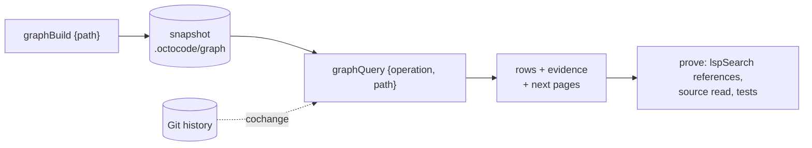

# Code graph

`graphBuild` turns one directory into a syntax snapshot: file, symbol and package nodes joined by
typed edges. `graphQuery` answers structural questions from it: importers, callers, paths, cycles,
hubs, dead-code hypotheses, change impact, drift and Git co-change. Answers are syntax candidates
that show **where to inspect**; they do not prove what runs or what breaks.



The CLI always has both tools. MCP exposes them with `local.beta: true`
([settings](CONFIGURATION.md#all-settings-and-defaults)); `local.graphHome` keeps snapshots outside
the checkout and lets you build a clone.

## Build

```bash
octocode graphBuild '{"queries":[{"path":"src"}]}'
```

| Situation | What happens |
|---|---|
| Unchanged scope | The existing snapshot returns at once |
| Files edited since | `graphQuery` `stale` says `fresh:false` and gives the `reingest` call |
| Long build | It pauses with progress; run `next.expandScan` or repeat the call to resume |
| Scope too large | `scopeTooBroad` names narrower scopes to build |

Use the same `path` for build and queries. Omit `graph` to read the newest snapshot of exactly that
path, or pass the build's `id`.

## Query

| Question | `operation` |
|---|---|
| Size, coverage, why calls stayed unlinked | `stats`, `unresolved`, `diagnostics` |
| Find a node | `find`, `candidates`, `node`, `symbols` |
| Imports and importers | `deps`, `dependents` |
| Callers and callees | `callers`, `callees`, `walk` |
| How A reaches B | `path` |
| Most depended on | `hubs`: `rankBy: "degree"` (default) or `"pageRank"` |
| Import loops | `cycles` |
| Dead code, choke points, layering | `issues` |
| What depends on a change | `impact` (`target`, `changed` or `since`) |
| Structural change between snapshots | `drift` |
| Files changed together in Git | `cochange` |
| Every occurrence behind an edge | `witnesses` |

```bash
octocode graphQuery '{"queries":[{"operation":"hubs","path":"src","kind":"file","rankBy":"pageRank"}]}'
octocode graphQuery '{"queries":[{"operation":"impact","path":"src","target":"src/config.ts"}]}'
octocode graphQuery '{"queries":[{"operation":"cochange","path":"src","target":"src/config.ts"}]}'
```

`octocode schema graphQuery` lists every field and which operations accept it.

## Read the answer

**Weights.** Each signal has one meaning; none is a probability or a runtime frequency.

| Signal | Field | Meaning |
|---|---|---|
| Binding confidence | `confidence` | Categorical: `high` strong syntax binding, `medium` scoped or ambiguous candidates, `low` a bare call's only declaration of its name. Queries default to `high`; ask `medium` before reading an empty answer as absence |
| Connection strength | `sites` | Distinct source occurrences behind an edge; on `hubs`, summed over the counted edges |
| Structural importance | `pageRank` | `hubs` with `rankBy: "pageRank"`: PageRank over the admitted edges, each weighted by its `sites`; values sum to 1 |
| Change coupling | `commits`, `share`, `linked` | `cochange`: commits that changed both files, divided by the target's commits; `linked:false` is coupling with no graph edge |
| Runtime frequency | — | Not modeled. It would need observed profiling data, never syntax |

**Impact.** Rows are dependents, not breakage. `risk: "direct"` means the file depends on the change
directly and should be inspected first; only tests or execution prove a break. `testsToRun` and
`affectedEntrypoints` say where to look; `testsToRun` names every test the change reaches, even past
`depth`.

**Issues.** Findings are ranked hypotheses with `evidence` and the `controls` applied.
`score = severity × confidence × (0.5 + 0.5 × impact)`, ×1.1 (at most 1) for each other detector
that flags the same subject; `impact` is the highest PageRank percentile among the subject's files,
and equal structure gets an equal percentile. `critical-file` lists every production file with five
or more transitive runtime dependents, so paging reaches all of them.

**Edges.** `calls` come from call sites. A named function passed as an argument yields a `passes`
edge, an argument slot rather than proof of invocation; other value uses yield no edge. Dynamic
dispatch, reflection and string loading are not modeled; `unresolved` lists unlinked sites with a
reason. A bare call of a parameter, local variable or closure links to no same-named declaration:
it stays unresolved as `local-binding`.

**Pages.** Follow `responsePagination.next`, then `next.*`. A count with `hasMore` is a floor.
[Continuations](TOOL_DATA_CONTRACT.md#executable-continuations)

## Prove

Before citing callers, absence or dead code, run `lspSearch` references at the row's `path`,
`symbolName` and `line`, and read the source. The [graph skill](../skills/octocode-graph/SKILL.md)
gives agents the same routine; [Graph View](../skills/octocode-graph-view/) renders a whole
repository. Engine design, limits and evaluation:
[code graph architecture](../packages/octocode-native/docs/engine/CODE_GRAPH.md).
