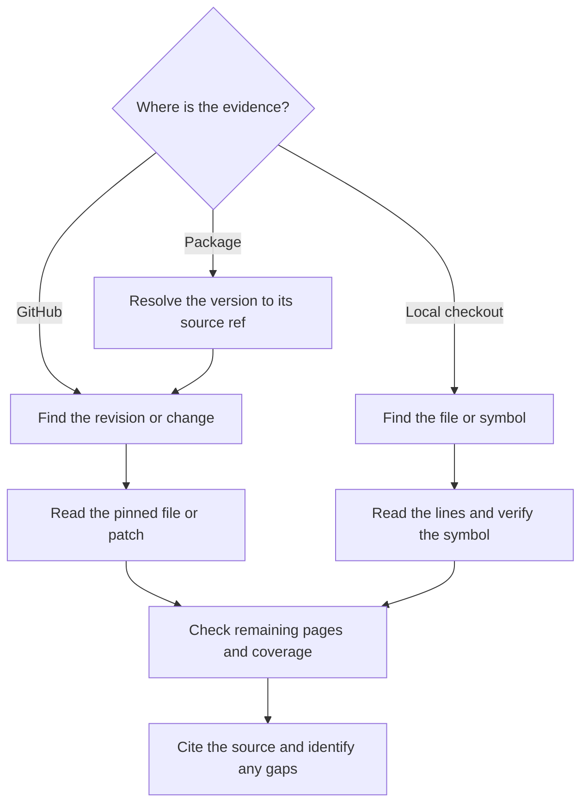

# How an agent researches a code question

Start with where the evidence lives. A search gives the agent a candidate. A source read gives it something to cite. The same sequence works through an [MCP client](OCTOCODE_MCP.md) or the [CLI](OCTOCODE_CLI.md).

## Research loop

| Ask your agent | How it gets an answer |
|---|---|
| “Who calls this function?” | Find its declaration with `localSearch` or `astSearch`. Give `lspSearch` the path, symbol and line. Check whether the locations are semantic results or syntax candidates, then read the call sites with `localFetch`. |
| “Why did this GitHub change land?” | Use `ghSearchHistory` to find a pull request or commit. Read the matching item with `ghGetHistoryItem`. Use the patch to show what changed and the discussion or commit message to attribute a reason. |
| “Does the version in our lockfile support this option?” | Read the locked version locally. Use `artifactSearch` to resolve that version, then browse and read the matching upstream revision. Report a missing source ref if the registry cannot identify it. |
| “Which of these long documents discuss retries?” | With a classification key, ask `clasify` a focused question about the unread sources. Follow the source-read calls for likely matches. Inspect the unfiltered set before claiming every document was covered. |

## What a result proves

Use the view that answers the question. A text hit establishes spelling, an AST match establishes syntax, and a language server can resolve symbol identity within its indexed scope. A graph or a classification answer can narrow the next read. For a quote, read the source lines. For a claim about every result, walk the pages and check for skipped files, index limits and partial answers.

Independent searches of the same tool can share a batch. If one call needs a path, symbol, pull request number or commit from another, wait for the first result and use its returned identity. [Tool reference](OCTOCODE_TOOLS.md) · [Paging and evidence boundaries](TOOL_DATA_CONTRACT.md) · [Tool routing guide](../skills/octocode-research/references/tool-flow.md)
