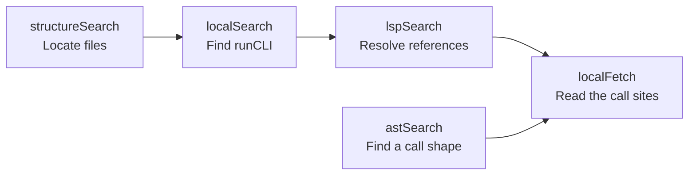
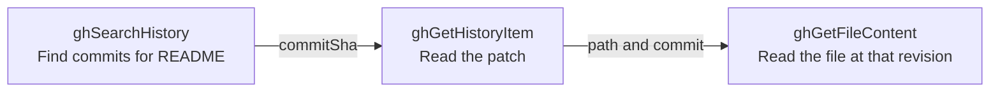
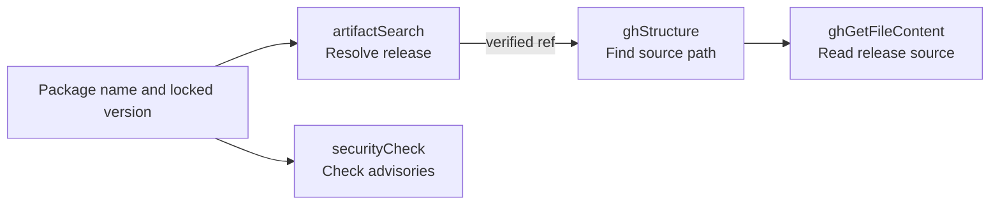

# Octocode tools reference

The catalog has 17 tools. Agents call them by name over [MCP](OCTOCODE_MCP.md). In the [CLI](OCTOCODE_CLI.md), run `octocode <tool> '<JSON input>'` and add `--json` for structured output. Run `octocode schema` to see your CLI catalog. An MCP client discovers its enabled tools with `tools/list`. [Configuration and defaults](CONFIGURATION.md#tool-availability-cli-and-mcp)

| Start with | What the agent can find |
|---|---|
| [A local checkout](#local-code-tools-reference) | Matching files, exact lines, declarations, callers and repository-wide dependencies |
| [A GitHub repository](#github-tools-reference) | Files at a revision, commits, pull requests, discussions and patches |
| [A package name or lockfile](#package-and-advisory-tools) | The published version, source revision and known advisories |
| [A question about unread evidence](#semantic-assessment-reference) | Files or sections worth opening, using a configured classification provider |

## How every tool call works

Start with `{"queries":[…]}`. Each row in `results` has an `index` pointing back to its query. For a tool's fields, allowed combinations and defaults, ask the installed version. For example, this command shows the inputs for resolving a package.

```sh
octocode schema artifactSearch --view query --select operation=resolve
```

### Results, evidence, partial failures, and continuations

Read each row's status, coverage and warnings. When the response has `responsePagination.next`, call its named tool with its exact `input` first. Otherwise follow the relevant `next.*` calls, including `next.nextPage`, until the requested evidence is complete. `related[]` offers optional new queries. If the provider reaches a terminal limit or a source fails, report what remains unknown. [Rows, split results and executable continuations](TOOL_DATA_CONTRACT.md#executable-continuations)

## Local code tools reference

**“Where does the CLI call `runCLI`, and what would a change affect?”** In the Octocode checkout, a text search finds the declaration and the invocation. An agent can then resolve references across the project and read the relevant lines.



<a id="text-ast-graph-and-lsp-choose-the-evidence-you-need"></a>

### Choose the evidence you need

| Question | Start with | What the result establishes |
|---|---|---|
| Where does this text occur? | `localSearch` | Matches within the searched scope |
| Which calls have this shape? | `astSearch` | Parsed syntax at each source location |
| Which files might this change affect? | `graphBuild` → `graphQuery` | Candidates from a snapshot's import and call edges |
| Which symbol does this name resolve to? | `lspSearch` | The editor or server's answer when available. Check coverage and fallback before drawing conclusions. |

### `structureSearch`

List a directory tree, find a half-known path, or rank files by size, line count or date. The default `view:"paths"` gives names and the value used for a size, line or date sort. Use `view:"details"` for metadata. Check skipped paths when the answer depends on coverage.

### `localSearch`

Find text or patterns, list matching files, or count occurrences and matching lines. Matching is literal by default. Long lines show a window around the match and its column. Read the original line with `localFetch`.

```json
{"queries":[{"path":"packages/octocode/src","matchString":["runCLI"]}]}
```

### `localFetch`

Read a known file. Use `ranges` for inclusive, 1-based lines, or `matchString` with `block:true` for the enclosing declaration. The default `content` view preserves source text after redaction. `symbols` gives an outline and `compact` can remove comments and spare whitespace. Check `viewFallback` if a requested view could not be served. GitHub file reads use the same views.

### `astSearch`

Match a syntax pattern, list declarations, or inspect a syntax tree. For example, `{"pattern":"runCLI()"}` as the `rule` for `operation:"match"` finds calls with that syntax. Use a semantic reference query to confirm which declaration a call reaches. [Supported parsers](../packages/octocode-native/docs/engine/SUPPORTED_LANGUAGES_AND_FEATURES.md)

### `graphBuild`

Build or reuse a syntax graph of the smallest directory containing both ends of a relationship. Snapshots go under the workspace's `.octocode/graph` by default. Set `local.graphHome` to write outside the checkout and build from another authorized directory, including a clone. A paused build supplies `next.expandScan`. [Graph settings](CONFIGURATION.md#all-settings-and-defaults)

### `graphQuery`

Query the same path as the build to find importers, hubs, cycles, paths, change impact or Git co-change. Check freshness and examine the source for the reported edges. For symbol-level impact or unused-code claims, verify the candidates with references and source reads. [Code graph guide](OCTOCODE_GRAPH.md)

### `lspSearch`

Resolve definitions, references, callers, callees or type hierarchies. Start with the symbol name, path and line returned by a search. For the example above, the references result includes the CLI entry point and its tests.

```json
{"queries":[{"operation":"references","path":"packages/octocode/src/cli/index.ts","symbolName":"runCLI","line":7,"view":"files"}]}
```

| `lsp.level` | How to interpret the answer |
|---|---|
| `ide` | The editor's language features resolved the query through the VS Code extension's bridge. |
| `server` | A language server answered. A successful server result can omit the entire `lsp` receipt. |
| `syntax` | A grammar produced candidates by name or shape. Diagnostics at this level report parse errors. |
| `text` | No structural answer was available. Use the text-search or source-read leads. |

When present, `lsp.fellBackFrom` explains which source failed. Read `partialReasons` and the remaining continuations before claiming all references. Octocode infers the project root from the file. Set `workspaceRoot` to a directory containing the file if the inferred project misses neighboring code. If workspace-symbol results reach a server's cap, narrow `symbolFuzzy`.

#### Subtypes and implementations without an answer in time

For implementations and subtype queries, the engine can also find candidates by scanning inheritance declarations. Rows labeled `native-graph-facts` need verification in source. Follow any hierarchy continuations to finish the requested depth.

#### Language servers

Run `octocode lsp-server status` to see which servers Octocode finds. Rust and C/C++ support managed installs. To add or replace a server, configure `lsp-servers.json`. Rust build scripts and proc macros require the host's `lsp.allowBuildScripts` opt-in and a query that requests them. [Language support](../packages/octocode-native/docs/engine/SUPPORTED_LANGUAGES_AND_FEATURES.md) · [Custom servers and Rust build context](../packages/octocode-native/docs/engine/LSP_SERVER_LIFECYCLE.md)

#### TypeScript backends

An explicit `lsp-servers.json` entry takes priority. For TypeScript, Octocode prefers `tsgo` from a trusted project's install or its bundled installation. If unavailable or unable to start, it uses `typescript-language-server`. JavaScript uses `typescript-language-server`. [Server discovery](../packages/octocode-native/docs/engine/LSP_SERVER_LIFECYCLE.md#resolution)

#### Fetched code

By default Octocode refuses to start a language server on its clones, materialized GitHub files or URL captures, including a workspace root that contains fetched code. Use text and AST tools there. To run a language server on that code, set `lsp.trustFetchedCode` in the home settings or process environment. A server can execute code from the project it opens. [External processes](SECURITY.md#external-processes)

## GitHub tools reference

**“Which commit changed this file, and what changed?”** Give the agent an owner, repository and path. In `octocat/Hello-World`, the history of `README` contains a commit that adds a final newline. Its patch shows exactly which line changed. [GitHub login and tokens](AUTHENTICATION.md)



### `ghSearchRepo`

Search repositories by keyword or filter, list an owner's repositories, or get one known repository. Carry the returned `owner` and `repo` into tree, code and history calls.

### `ghSearchCode`

Find text, paths or filenames in GitHub's default-branch code index. A `ref` re-reads hits at that revision. For files unique to another branch, start with its tree. GitHub omits some files, forks and repositories from its index, so an empty search leaves those unexamined.

### `ghStructure`

Browse a tree, list tags and branches, resolve a ref to a commit, or get repository languages. A tree defaults to one level. Use `materialize:true` to save selected files for repeated local reads. Keep the returned commit and check materialization coverage.

### `ghGetFileContent`

Read a path at a branch, tag or commit. Supply the returned commit SHA for a reproducible citation and `ranges` or `matchString` to narrow the read. [File views](#localfetch)

### `ghSearchHistory`

Search pull requests, issues or commits. A commit query with a path and no keywords lists changes to that path. The returned commit SHA or issue/PR number identifies what to open next.

```json
{"queries":[{"operation":"commit","owner":"octocat","repo":"Hello-World","path":"README"}]}
```

### `ghGetHistoryItem`

Read one pull request, issue or commit, or compare two revisions. Omit `sections` for the summary. For one file's diff, request `sections:["patches"]` with `include`. Section reads retain a short header, including `headCommitSha` for a pull request or `commitSha` for a commit. A paged section appears in `sectionPagination` and has a matching `next.<section>` call.

### `ghCloneRepo`

Create a checkout at the requested revision for repeated local analysis. Optional `paths` select a sparse checkout. Use the returned `location.path` and keep its commit and path scope with your findings. Octocode preserves existing checkouts with local changes. Clone requires Git, repository access and persistent storage. [Clone opt-in](CONFIGURATION.md#tool-availability-cli-and-mcp) · [Storage](STORAGE_AND_LIMITS.md#cache-storage-and-lifecycle) · [LSP on fetched code](#fetched-code)

## Package and advisory tools

**“Which source revision matches my dependency, and are there known advisories for that version?”** Read the resolved version from the lockfile and use it for both lookups.



### `artifactSearch`

Resolve a package version on npm, PyPI, crates.io, Maven, NuGet, Go, Packagist or RubyGems. All except PyPI also accept keyword searches. Without a version, resolution normally selects the latest stable release (npm uses the `latest` tag). The default `summary` gives version and available source coordinates. Ask for `view:"details"` for metadata such as dependencies and license.

```json
{"queries":[{"operation":"resolve","ecosystem":"npm","packageName":"zod","version":"3.22.4"}]}
```

For this release, `verification:"tag"` links the version to a commit in `colinhacks/zod`. `provenance` also ties source to a release. A `registryRef` is an unchecked registry claim, and `defaultBranch` identifies the current project. Only PyPI and NuGet return registry advisory data on this tool.

### `securityCheck`

Check known advisories and published fixes using OSV and GitHub. The CLI offers this tool by default. To expose it over MCP, enable `tools.enableSecurityCheck` in the home settings or set `OCTOCODE_SECURITY_CHECKS=true` in the process environment, then restart MCP. [Advisory egress](SECURITY.md#advisory-egress)

| Operation | What leaves the machine |
|---|---|
| `package` | For the eight registries above, the public registry receives the lookup first. OSV receives the confirmed name and, if listed, its version. GitHub can receive the coordinates and claimed repository. Other supported ecosystems send the supplied name and version directly to OSV. |
| `repository` | GitHub receives `owner/name`. OSV receives published advisory IDs only after GitHub identifies the repository as public. The result describes repository facts and cautions. |
| `commit` | OSV receives the full hash, including for private commits. If supplied, `repo` and the hash also go to GitHub. |
| `advisory` | OSV receives the advisory ID. For a GHSA, GitHub also receives the ID and any supplied repository. |
| `url` | A supported package URL, purl or GitHub URL uses the matching operation above. |

The default summary reports `affected`, `upgradeTo` and `advisoryCount` when established. Request `view:"details"` for records, sources and affected ranges. An empty completed lookup means the source knows of no matching advisory. `versionEvaluated:false`, a failed source or incomplete coverage leaves the corresponding version or source unchecked.

## Semantic assessment reference

### `clasify`

With a classification key, use `evaluate` to ask typed questions about supplied content or an unread source. Use `sections` to locate relevant passages across files and `models` to discover available models. An agent can then follow `next.read` to verify the deciding lines. Fresh evaluations send evidence to the configured provider and incur usage. [Classification setup, examples and costs](OCTOCODE_CLASIFY.md)

### Context selection

`classification` is supported by `localSearch`, `localFetch`, `ghSearchCode`, `ghGetFileContent`, `ghSearchHistory`, `ghGetHistoryItem` and `structureSearch`. Use a predicate to filter hits, source chunks, paths or discussion rows before reading them. Check the receipt for excluded and unknown units. Follow the unfiltered continuation before drawing a conclusion about absence. [Classification guide](OCTOCODE_CLASIFY.md)
