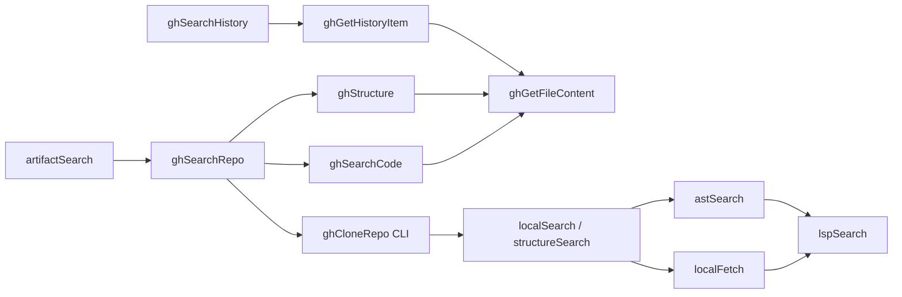

# Octocode workflows

Choose a tool from the evidence needed, then narrow with observed identities. Keep the research question in the agent's working context; tool requests carry only fields with execution semantics.

## Research flow graph



## Choose the first tool

| Need | Start with |
|---|---|
| Known local path or source span | localFetch |
| Text spelling in a local scope | localSearch |
| File names or directory shape | structureSearch |
| Syntax pattern or declarations | astSearch |
| Verified symbol references/callers | lspSearch |
| Repository discovery | ghSearchRepo |
| GitHub indexed code | ghSearchCode |
| Known GitHub file/ref | ghGetFileContent |
| Repository tree or refs | ghStructure |
| Find a historical change | ghSearchHistory |
| Read a known PR, issue, commit or compare | ghGetHistoryItem |
| Package/version or package discovery | artifactSearch |
| Remote source requiring local analysis | ghCloneRepo through CLI |
| Typed judgments over unread evidence | clasify, or inline classification on a reader/search |

## Make a call

Discover the live schema. Submit `{"queries":[...]}` with up to five independent rows of one tool. `responseChars` sets an optional output target. Use a dependent query only after the preceding result supplies its path, line, identity or ref. CLI accepts the same envelope as MCP. [Fields and examples](OCTOCODE_TOOLS.md).

## Local research

Search a narrow directory with an explicit string array, read the relevant source, then use its observed symbol name and line for LSP. AST identifies syntax and declaration candidates; LSP confirms semantic relationships. Shared include/exclude globs preserve scope across local search, structure and AST.

```bash
octocode localSearch '{"queries":[{"path":"src","matchString":["registerHandler"],"wholeWord":true}]}'
octocode localFetch '{"queries":[{"path":"src/registry.ts","ranges":[{"startLine":20,"endLine":60}]}]}'
octocode lspSearch '{"queries":[{"operation":"references","path":"src/registry.ts","symbolName":"registerHandler","line":27}]}'
```

The latter path and line are illustrative; replace them with evidence from the preceding call. Read skipped-scope and indexing disclosures before making absence claims.

## GitHub research

Find the repository, inspect its tree/code index, then read a returned file. Pin reproducible reads to a returned full commit SHA. Code search is an index; a missing match is not proof that a branch or file lacks the text. Use exact reads or a local checkout when the index cannot answer the question.

## History

Search titles, keywords and typed filters before opening items. Read only the sections needed, then finish each requested collection's continuation. Follow a related source read to verify code at the appropriate commit. Comparisons distinguish baseRef and headRef; a PR's head and merge commit have different meanings.

## External to local

Resolve packageName and version separately in artifactSearch. Inspect its source/release identity; clone the verified repository/ref when AST or LSP is needed. Run local tools at the returned path. A sparse materialization does not imply a complete repository.

## Pages and recovery: `next`

Execute `responsePagination.next` until the displayed response is complete, then follow relevant `next.*` calls. Every continue call is `{kind:"continue",tool,input:{cursor}}`. Copy input unchanged. Track independent collections and exact-once evidence. A terminal cap must remain in the final coverage statement.

## Related work and hints

`related[]` contains typed calls that start fresh work. Broader scope, a linked historical item or a new source read may help, but does not count as continuation of the initial claim. `hints[]` is prose only. Invalid input names the field to correct; it does not silently run a guessed repair.

## Compact and symbol views

Read source content for exact quotations. `view:"compact"` preserves useful source coordinates while transforming text; `view:"symbols"` outlines declarations. The live schema defines which selectors combine with each view. Matchers, ranges and context have the same typed forms on local and GitHub readers.

## clasify gate

Use inline `classification:{predicates:[...]}` to select retrieved evidence before reading large bodies, or clasify for typed questions over supplied content/unread sources. A sufficient exact lookup needs no classifier. Inspect the selection receipt and continue selected evidence, unjudged work or unfiltered recovery as the task requires. [Classification](OCTOCODE_CLASIFY.md).

## Cite and stop

Cite source path, revision and lines supporting the claim. State unvisited scope, unavailable capabilities and terminal limits. Stop when the question is answered with adequate evidence; optional related work is not a completion requirement.
