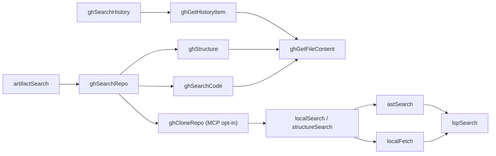

# Octocode workflows

Choose a tool from the evidence needed, then narrow with observed identities. Each request row takes `mainGoal` (the task) and `reasoning` (why this query, what it should establish); these two state intent and change no result, and every other request field has execution semantics.

## Research flow graph



## Choose the first tool

| Need | Start with |
|---|---|
| Known local path or source span | localFetch; `view:"symbols"` to orient within a file |
| Text spelling in a local scope | localSearch |
| File names or directory shape | structureSearch with `view:"paths"` |
| Syntax pattern or declarations | astSearch |
| Verified symbol references/callers | lspSearch |
| Repository discovery | ghSearchRepo |
| GitHub indexed code | ghSearchCode |
| Known GitHub file/ref | ghGetFileContent |
| Repository tree or refs | ghStructure |
| Find a historical change | ghSearchHistory |
| Read a known PR, issue, commit or compare | ghGetHistoryItem |
| Package/version or package discovery | artifactSearch |
| Remote source requiring local analysis | ghCloneRepo: always in the CLI; in MCP with [`tools.enableClone`](CONFIGURATION.md#tool-availability-cli-and-mcp) |
| Typed judgments over unread evidence | clasify, or inline classification on a reader/search |

## Make a call

Discover the live schema. Submit `{"queries":[...]}` with up to five independent rows of one tool. `responseChars` sets an optional output target. Use a dependent query only after the preceding result supplies its path, line, identity or ref. CLI accepts the same envelope as MCP. [Fields and examples](OCTOCODE_TOOLS.md).

## Local research

Search a narrow directory with an explicit string array, read the relevant source, then use its observed symbol name and line for LSP. AST identifies syntax and declaration candidates; LSP confirms semantic relationships. Shared include/exclude globs preserve scope across local search, structure and AST.

```bash
octocode localSearch '{"queries":[{"path":"src","matchString":["registerHandler"],"wholeWord":true}]}'
octocode localFetch '{"queries":[{"path":"src/registry.ts","matchString":["registerHandler"],"wholeWord":true,"contextLines":{"before":3,"after":6}}]}'
octocode lspSearch '{"queries":[{"operation":"references","path":"src/registry.ts","symbolName":"registerHandler","line":27}]}'
```

The latter path and line are illustrative; replace them with evidence from the preceding call. Preserve the search's matching options when reusing its terms. A known declaration span can be read directly with `ranges`; an outline's `start-end` gutter supplies those inclusive bounds. Read skipped-scope and indexing disclosures before making absence claims.

Choose the smallest representation that answers the question. Request `localSearch` with `view:"files"` for matching paths, `countLines` or `countMatches` for counts, and content when the matching source matters. Use `structureSearch` with `view:"paths"` for discovery and its default `details` view when file metadata matters. Read known ranges directly; widen context or request an enclosing block when the evidence is incomplete.

Use AST to investigate code connections expressed in syntax: call expressions, imports, inheritance, or a call contained in a method. For example, combine a call pattern with `inside` to restrict its enclosing declaration, or `has` to find a declaration containing that pattern. LSP resolves which declaration a call or reference names. A graph snapshot is useful for repeated relationship or impact queries over one scope; a single known caller or declaration lookup usually starts with LSP or AST. Verify graph candidates against source and LSP before treating them as resolved relationships. graphQuery rows place evidence by file and line by default; set `includeProvenance:true` for claims about exact source bytes ([provenance](TOOL_DATA_CONTRACT.md#minimal-by-default)).

| Evidence available | Next useful read |
|---|---|
| `structureSearch` found a relevant file | `localFetch view:"symbols"`, then content ranges for the relevant declaration or section |
| `localSearch` found relevant text | `localFetch matchString` with the same matching options and enough context, or the returned declaration range |
| `astSearch` found a declaration or structural match | `localFetch ranges` at its source span; use LSP if identity matters |
| `lspSearch` resolved a definition or reference | `localFetch ranges` at the returned file and lines; `block:true` can expand a declaration range |
| `graphQuery` found a candidate node | Resolve its file against the graph root, read its source span, then confirm the relationship with LSP |
| `clasify` assessed an unread source | Follow its saved read continuation for the exact judged evidence before making source claims |

Measure token cost across every continuation required by the claim, with equal evidence scope and a named tokenizer. Output bytes, tokens and elapsed time are separate measurements. A small `responseChars` target increases repeated page overhead; narrow the source scope or choose a suitable view before shrinking pages. A targeted `rg` result can cost fewer tokens than structured output for a literal lookup. Syntax, resolved identity, coverage and executable continuations provide additional capabilities that a text-only comparison does not measure.

## GitHub research

Find the repository, inspect its tree/code index, then read a returned file. Pin reproducible reads to a returned full commit SHA. Code search is an index; a missing match is not proof that a branch or file lacks the text. Use exact reads or a local checkout when the index cannot answer the question.

## History

Search titles, keywords and typed filters before opening items. Read only the sections needed, then finish each requested collection's continuation. Follow a related source read to verify code at the appropriate commit. Comparisons distinguish baseRef and headRef; a PR's head and merge commit have different meanings.

## External to local

Resolve packageName and version separately in artifactSearch. Inspect its source/release identity; clone the verified repository/ref when AST or LSP is needed. Run local tools at the returned path. A sparse materialization does not imply a complete repository.

## Pages and recovery: `next`

Execute `responsePagination.next` until the displayed response is complete, then follow relevant `next.*` calls. Every continue call is `{kind:"continue",tool,input:{cursor}}`. Copy input unchanged. Track independent collections and exact-once evidence. A terminal cap must remain in the final coverage statement.

## Related work and hints

`related[]` contains typed calls that start fresh work. Broader scope, a linked historical item or a new source read may help, but does not count as continuation of the initial claim. `hints[]` is prose only. Invalid input names the field to correct; it does not silently run a guessed repair.

## Recover from errors

Inspect every result row's `errorCode`, message, `hints` and recovery calls, even in a successful batch. Choose recovery by the cause:

| Cause | Agent action |
|---|---|
| Invalid input | Correct the named field using the live schema; keep the intended scope. |
| Unsupported AST grammar or declarations | Use the related document outline or text read. `localFetch` with `view:"symbols"` can outline document headings/keys; `localSearch` finds literal text. Set a parser override only for source actually written in that grammar. |
| Missing LSP server or capability | Inspect related source/text candidates; report semantic verification as unavailable. Retry after server configuration changes, or use another advertised operation that answers the question. |
| Missing path, identifier or revision | Verify the observed identity and access rights; use an emitted discovery call. Do not substitute a different revision as evidence. |
| Timeout or transient provider failure | Follow the hint and retry at most once when retrying can help; respect `retryable:false`. Narrow only when the task permits it, and state the remaining scope. |
| Authentication, permission or rate limit | Correct access or wait for the reported reset; repeating unchanged calls does not restore access. |
| Stale or expired continuation | Use its restart call or repeat the original request. Never construct a cursor or keep stale coordinates. |
| Tool/internal contract failure | Preserve the failing call and error code, use applicable recovery, and report the coverage gap. |

A fallback starts a different evidence operation. Text matches do not prove callers, references, types or compilation; a document outline is not an AST. Preserve the original error and label the evidence obtained by recovery. Stop repeating a failure when its cause has not changed.

## Compact and symbol views

Use `view:"symbols"` to orient within a known file: code declarations, Markdown `#` headings, or data keys and containers. Gutters identify source lines or `start-end` spans; choose inclusive `ranges` for the content read. Use `astSearch operation:"symbols"` for declaration filters across files and `lspSearch documentSymbols` for a server-backed outline.

For Markdown, discover files with `structureSearch`, then fetch an outline. Read a section from its heading line through the line before the next heading of the same or higher level; that includes its nested headings. Use the file's end for the last section. Outlines recognize ATX (`#`) headings; underline-style Setext headings require content reads. `block` expands code declarations, not Markdown sections. Markdown LSP needs a configured server; heading outlines do not.

Read content for exact quotations. `view:"compact"` transforms text while retaining source coordinates; YAML stays verbatim to preserve scalar values. Inspect `viewFallback` before assuming a symbols read produced an outline. Symbols accepts no match or range selectors; compact accepts ranges; `matchString` and `contextLines` belong to content. Local and GitHub readers share these forms.

## clasify gate

Use inline `classification:{predicates:[...]}` to select retrieved evidence before reading large bodies, or clasify for typed questions over supplied content/unread sources. A sufficient exact lookup needs no classifier. Inspect the selection receipt and continue selected evidence, unjudged work or unfiltered recovery as the task requires. [Classification](OCTOCODE_CLASIFY.md).

## Cite and stop

Cite source path, revision and lines supporting the claim. State unvisited scope, unavailable capabilities and terminal limits. Stop when the question is answered with adequate evidence; optional related work is not a completion requirement.
