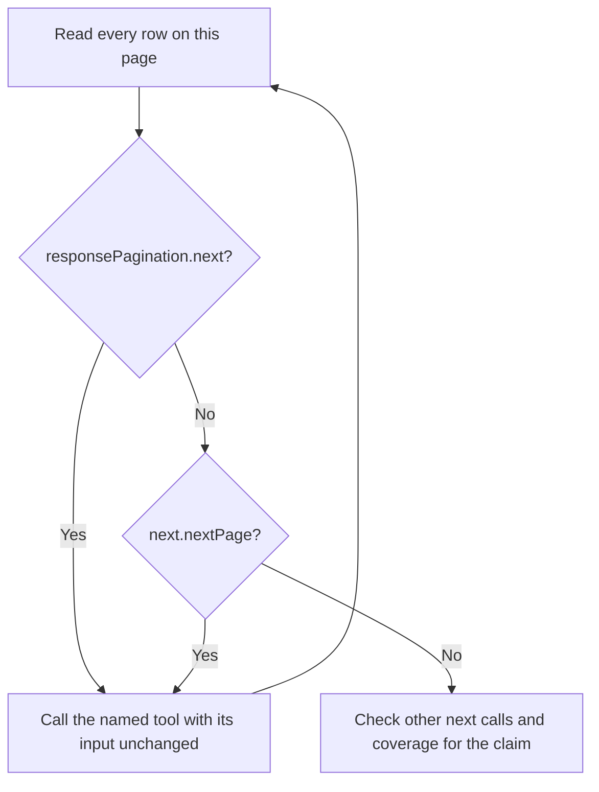

# Tool data and continuations

Octocode uses the same JSON input and indexed results on the CLI and MCP. Use `--json` for a script. In MCP, parse the JSON in the tool result's text block.

## Requests and result rows

Send `queries` for new work. Each row is independent and belongs to the same tool. Most tools accept up to five rows. Check the tool's schema for its batch limit and fields.

### Example: a localFetch request

```json
{"queries":[{"path":"README.md","ranges":[{"startLine":1,"endLine":1}]}]}
```

For a two-line README starting with `# Example project`, the response is

```json
{"results":[{"index":0,"data":{"content":"1\t# Example project\n","totalLines":2}}]}
```

### Result rows

| Result | Meaning |
|---|---|
| `index` | Zero-based position in the original `queries` array. Resumed work keeps that index, including when a query expands into several reads. |
| `data` with no `status` | The query returned evidence. Check for pagination and coverage warnings. |
| `status: "empty"` | The query found nothing in its stated scope. |
| `status: "outOfRange"` | The requested page is beyond the available collection. A file range that starts beyond the end instead reports invalid input. |
| `status: "error"` | Read `data.errorCode`, `data.error`, hints and any recovery calls. Valid siblings in a mixed batch can still succeed. |

Use `octocode schema <tool> --view variants` for examples, `--select operation=<value>` to narrow a schema, and `--view output` for result fields. Native validation accepts some unambiguous input repairs. If it maps a common field to a declared field, the warning identifies what actually ran. Correct ambiguous input using the reported field error. An invalid envelope can fail before producing rows. [CLI exit codes](OCTOCODE_CLI.md#exit-codes)

### Numbered source content

Numbered `content` uses a one-based line number, a tab, then the source text. Ranges include both endpoints. A `matchString` read can include context. When present, `matchedLines` lists the actual hits on that page, including an empty list for a context-only page. When omitted from a matched read, every returned line is a hit.

### Search result shapes

Text, AST and many LSP results group matches by `files[].path`. Locations carry their own line and, where supported, a one-based UTF-16 column. A text hit's `enclosing` indexes its file's `declarations`. Structure listings group names by directory. Resolve workspace-relative paths against the configured workspace. Allowed external paths remain absolute.

### Minimal by default

A fresh response can omit an identity already supplied in the request. Read it from the element, then the row's `data`, then the request. A cursor page restates the identity it needs. Warnings shared across rows can appear once at the top level.

Choose a view to match the claim. A compact read changes formatting, and a symbols view gives an outline. Use source lines for direct quotes. Where available, `includeProvenance: true` adds byte spans and source identity. A default result still discloses nontrivial source transformations and incomplete parses.

## Executable continuations



| Channel | What to do |
|---|---|
| `responsePagination.next` | Finish the response pages first. A single continuation can carry several rows or sections forward. |
| `next.nextPage` | Read the next tool page if the response has no continuation of its own. |
| Other `next` entries | Continue the indicated branch when your claim depends on it, such as a patch, unfiltered results or an exact source read. |
| `related[]` | Start optional fresh work with the supplied queries. The scope may differ. An empty, failed or partial row lists its recovery calls; a complete row keeps every batch for its tool's usual next step, plus every call that carries a fact the row does not state or that a warning names. |
| `hints[]` | Read the explanation for help interpreting or correcting the request. |

A continuation has this shape. Pass **only its complete `input`** to its `tool`. Use the cursor the tool issued.

```json
{"kind":"continue","tool":"localFetch","input":{"cursor":"<issued cursor>"}}
```

Cursors are bound to the tool, configuration, access context and saved state. Replaying a retained page can return historical usage. Follow a returned restart call on `staleSnapshot` and start the evidence walk again. A memory-only CLI invocation needing a saved continuation reports a failure. Use persistent storage that permits saving the result or keep an MCP session open. [Storage and limits](STORAGE_AND_LIMITS.md)

## Paging

`responseChars` is an optional per-call page-size target. Large responses split at row boundaries where possible, then inside long strings (`rowPart`). A long line is read in byte windows of at least 4,096 bytes whatever the target, each served whole on its own page, so a narrow target never takes thousands of calls per line. A page can exceed the target by its fixed parts: the envelope, the `responsePagination` block and the context each row part repeats. Provider metadata and rejected input rows can also add to the first page. A page states `oversized: true` only when it holds one value longer than the target that no page can split: an identity such as a path, a bounded value or a ready call. Other free text longer than a page is split into parts instead.

| Field | How to consume it |
|---|---|
| `pagination` | Read `unit`, zero-based `offset`, `length`, `hasMore`, and `total` when known. A one-page result can omit this object. Each section can have its own paging state. |
| `countScope` | `loaded`, `partial` and `capped` qualify the reported total. For a capped result, only the reachable portion is counted. |
| Byte windows | Reassemble by `offset`. A matched window on a long line can arrive before its preceding bytes. Offsets count the decoded, redacted representation as served. |
| `rowPart` | Join parts in order for the same result. Keep repeated identities and required scalar values once. Append new list elements. Use `rowPart.continues` to merge a resumed array element, and append resumed text at the JSON pointer in `rowPart.text`. Missing prior text or an empty list on a later part preserves the earlier evidence. |

Programmatic consumers can read `collectionPaths` and, when present, recursive `collectionRefs` from `octocode schema <tool> --view output --json` or the tool's MCP output-reference resource. These routes come from the embedded contract: append declared collections, retain repeated context arrays once, and reconstruct each `rowPart` before treating it as a complete row. A response continuation can also carry later complete rows with the same query index; consume every row before advancing its remaining tool continuations.

## Evidence boundaries

A complete page can belong to a partial search. Inspect `isPartial`, `partialReasons`, skipped paths, unassessed candidates, warnings and terminal provider limits before reporting a total or absence. GitHub code search covers its index. A classification result covers assessed candidates. An empty `securityCheck` result means the advisory lookup found no known match for the supplied target. A failed check is a separate error.

Use the exact revision, path, lines or package version returned for the claim. If a source or page is unreachable, name the missing scope. [Examples of agent research workflows](OCTOCODE_PROTOCOL.md)
