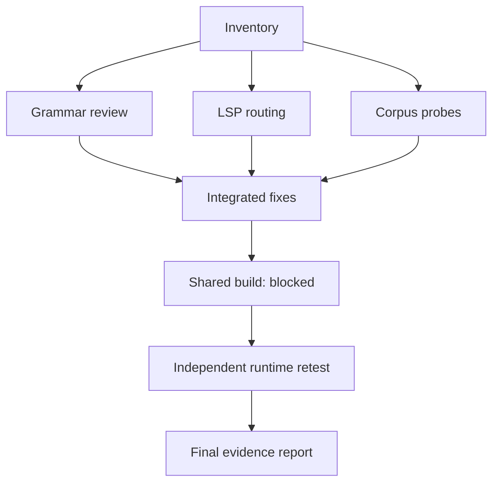

# LSP and grammar audit — 13 November 2026

## Executive summary

Audited the canonical **13 grammar entries, 30 owned extensions and 27 built-in LSP routes**, then exercised every registered grammar on real files under `packages/octocode-benchmark/local/repos`. Registry wiring is consistent. The audit reproduced defects in symbol hierarchy, declaration extents, directory routing, configured document language IDs, escaped-identifier fallback and literal reference filtering.

Corrections and regression tests are implemented. **Compiled verification and rebuilt CLI/MCP acceptance are pending:** another process holds the shared Cargo target lock, and the host has been heavily loaded. This report does not certify release readiness or complete semantic correctness.

## Key findings

All findings affect agents consuming code evidence. Severity reflects incorrect evidence or unavailable navigation, not a measured security exposure. Confidence is high for reproduced baseline behavior; corrected runtime behavior remains unverified until the new tests and rebuilt interfaces run.

| Finding and trigger | Owning source | Evidence and impact | Correction/status |
|---|---|---|---|
| Java class and constructor share a name; same-line declarations amplify ambiguity | `crates/runtime/src/tools/ast_search/symbols/rows.rs`, `response/symbol_outline.rs` | Guava `Absent.java:36` is an empty constructor, but following class methods appear in its `members`. Minimal multiline and same-line fixtures reproduce the error. Wrong hierarchy misdirects navigation. | Preserve exact internal ancestry when names/lines collide, count duplicate names across kinds, and remove internal metadata from public output. Regression cases cover same-line Rust impls, filtering and single-row pages. Implemented; compiled checks pending. |
| Indentation grammar owns the following declaration's comments/dedent | `crates/engine/src/signatures/graph_facts/positions.rs`, `declarations.rs`, `validity.rs` | Cats `Align.scala` method at60–61 is reported through73; following documentation and declaration boundary contaminate its extent. | Normalize the declaration endpoint along the rightmost syntax branch; share it across line ranges, byte spans and declaration parse assessments. Preserve literal bytes, delimiters and body comments. Implemented; compiled checks pending. |
| Directory has only `.pyi`, `.sbt`, or TypeScript declaration files, or its source is deeply nested | `crates/engine/src/lsp/config/workspace_root.rs`, `directory.rs` | A `.pyi`-only project returns `serverUnavailable` before a server can be selected, although `.pyi` has a built-in route. Source also omitted `.sbt` and skipped `.d.ts`. Terminal depth/entry caps could produce false absence. | Derive family extensions from the route catalog, retain declaration-file fallbacks, prefer implementation units, and exhaust eligible traversal. Implemented; compiled checks pending. |
| Explicit custom language ID differs from the file extension's built-in ID | `crates/engine/src/lsp/config/user_config.rs`, `client/sync.rs`, `types.rs`, `pool.rs` | Source resolves custom `.h`→`cpp`, then `didOpen` overwrites it with `c`. The LSP document's language changes silently. | Carry explicit extension-to-ID choices into synchronization and pool identity; unrelated siblings retain their built-in IDs. Protocol-frame and pool-key regressions written. Implemented; compiled checks pending. |
| Escaped identifier spelling differs from its language-level name | Engine resolver and runtime LSP syntax fallback | Rust canonical `type` misses `r#type`; C# canonical `class` misses `@class`; Scala backquoted source spelling misses normalized `type`. | Shared language-aware comparison normalization also covers heritage; JavaScript sigils remain significant. Source review completed; compiled checks pending. |
| Syntax fallback scans identifier text in strings/comments | `crates/runtime/src/tools/lsp_search/syntax/facts.rs` | Isolated Rust fixture with two code occurrences and two literal/comment matches returns matchCount4, explicitly labeled unverified fallback. | Reuse exact grammar occurrence spans; preserve quoted declarations, interpolation and complete ranges; exclude Go rune and Scala symbol literals; disclose unread parses. Source review completed; compiled checks pending. |
| Anonymous C-family aggregate has named members | `crates/engine/src/signatures/nodes/declarations.rs` | Generic descendant-name fallback can borrow an anonymous aggregate's member name as the type's name. | Require the aggregate's own name field. Implemented; named implicit-forward candidates preserved. Compiled checks pending. |

**Unresolved C tag-use classification:** Redis `adlist.c:24` (`struct list *list;`) and67 (a cast) are reported as struct declarations. Blanket suppression of bodyless type specifiers was rejected because C permits an unseen tag to be introduced by such a specifier. Existing typedef-forward candidates are preserved. Correct disambiguation requires visibility/preprocessing evidence; the current syntax extractor cannot prove this for imported tags.

## Analysis

### Corpus coverage

Each row received direct `astSearch symbols`, `astSearch syntaxTree`, and `localFetch view:symbols` probes. These are representative source checks, not exhaustive checks of all files or syntax constructs.

| Grammar | Corpus representative | Baseline observation |
|---|---|---|
| TypeScript | `typescript/packages/typescript/src/api/async/api.ts` | Useful class/declaration output and typed tree |
| TSX | `tsx/packages/excalidraw/components/ActiveConfirmDialog.tsx` | Component and atom declarations; TSX tree |
| JavaScript | `javascript/lodash.js`, `nextjs/scripts/adopt-pr.js` | Function and CommonJS script evidence |
| Python | `python/django/__init__.py` | Version assignments and `setup` |
| Go | `go/util/almost/almost.go` | Constant and `Equal` function |
| Rust | `rust/tokio/src/blocking.rs` | Macro-contained declarations and impl members |
| Java | `java/guava/src/com/google/common/base/Absent.java` | Declarations returned; hierarchy defect reproduced |
| C | `c/src/adlist.c` | Real functions returned; tag-use ambiguity reproduced |
| Assembly | `asm/simd/i386/jccolext-avx2.asm` | Labels returned; `parseRecovered` explicitly disclosed |
| Scala | `scala/core/src/main/scala/cats/Align.scala` | Methods returned; excess extents reproduced |
| C++ | `cpp/include/nlohmann/byte_container_with_subtype.hpp` | Useful results; macro-heavy files disclose recovery and missed declarations |
| CUDA | `cuda/examples/00_basic_gemm/basic_gemm.cu` | Eight functions, including kernel declarations |
| C# | `csharp/Src/Newtonsoft.Json.TestConsole/Program.cs` | Namespace, class and method returned; BOM disclosed |

HCL in the Terraform checkout is a negative control: native symbols are explicitly unsupported. Assembly has grammar support but intentionally no built-in server route. Six `huge-*` trees and `langchain` were not exhaustively probed. Real semantic language-server behavior is not established by these AST checks or by executable discovery. Identifier transformations beyond the tested escape delimiters, including Unicode normalization/escape rewriting, remain unverified.

### Verification and limitations

| Check | Result |
|---|---|
| All 13 registered grammars, real corpus, three syntax surfaces | Executed; observations above |
| Java/C CLI and MCP discrepancy comparison | Reproduced on existing interfaces; baseline was not pinned |
| Minimal Java baseline assertion | Failed as expected: constructor captured its sibling |
| `.pyi`-only directory baseline | Reproduced `serverUnavailable` |
| Rust raw identifier baseline, isolated missing-server route | Reproduced canonical-name miss; no semantic server started |
| C#/Scala escaped identifier baselines, isolated missing-server routes | Four executed definition probes reproduce canonical/source-spelling mismatch |
| Rust literal/comment reference baseline | Reproduced matchCount4 for two actual code occurrences |
| Existing grammar protocol/oracle/readiness harness self-tests | Passed:21 tests, zero failures on Node26.4.0; does not execute the modified Rust code or verify the required Node24 runtime |
| Independent implementation review | Completed for final changed boundaries. Found and corrected production `expect`, literal false matches, and raw heritage comparison gaps; no further definite source blocker found |
| File-scoped Rust formatting | Passed after final source integration |
| `dev docs:verify` | Passed earlier; final global check fails on two gitignored evidence links in the unrelated `packages/octocode-native/docs/audits/2026-11-13-performance-cache-audit.md` report. That report was not changed by this audit |
| `dev check-outputs` | Passed: staged artifact version/contract checks; does not certify freshness against the edited Rust source |
| `git diff --check` | Passed after final source integration |
| Repository file-length check | Failed:278 files exceed400 lines; log `/tmp/octocode-lsp-grammar-audit-20261113/file-length.log`. No baseline limits changed. |
| New identifier/reference regression cases |20 added in that lane (`raw_identifier`:16; `escaped_identifiers`:4); unexecuted. Additional Java, C/Scala, routing and custom-ID regressions are also unexecuted |
| Focused Rust tests, clippy, host build and rebuilt acceptance | Pending: shared Cargo lock held externally; no competing build was started |
| Real-server semantics, all extensions and all LSP operations | Unverified |
| CPU, memory or latency improvement | Unmeasured; no performance claim |

Baseline repository identities and full probe details are retained in `/tmp/octocode-lsp-grammar-audit-20261113/corpus-probes.md`; the raw-identifier reproducer is in `raw-identifier.md` beside it. C#/Scala outputs, fixtures and primary-source findings are in `escaped-identifiers/findings.md` and its sibling logs. These are audit evidence, not a new test harness. Existing unrelated worktree changes were preserved.

The minimal Java baseline fixtures are `Absent.java` and `SameLine.java` in that evidence directory. Harness, artifact and final documentation-check output are retained as `grammar-harness-tests.log`, `check-outputs.log` and `docs-verify.log`. All tracked command sessions have completed; sandbox denial of process enumeration prevents a complete host process/leak inventory. Other sessions' processes were not stopped.

The extraction schema version is advanced from32 to33 to invalidate graph facts affected by declaration output changes. The public tool contract is unchanged. Custom document-ID provenance is internal and participates in the canonical server-pool key.

Build blocker: a nonblocking advisory-lock check repeatedly finds `packages/octocode-native/target/debug/.cargo-lock` held by another process. Its PID/owner is unknown because process inspection is denied. At the final measured resource check, load was6.25 on12cores and system memory was65% free, so the shared lock remains the immediate obstacle. No competing Cargo queue, private target, cache cleanup or process termination was used. Finish the checks below when that existing owner releases the target.

### Primary sources

- [Language Server Protocol specification](https://microsoft.github.io/language-server-protocol/specifications/lsp/3.17/specification/).
- [Tree-sitter: concrete syntax trees, byte/point positions and named versus anonymous nodes](https://tree-sitter.github.io/tree-sitter/using-parsers/2-basic-parsing.html).
- [Rust Reference: raw identifiers](https://doc.rust-lang.org/stable/reference/identifiers.html#raw-identifiers).
- [C# specification section6.4.3: identifier identity excludes the verbatim prefix](https://learn.microsoft.com/en-us/dotnet/csharp/language-reference/language-specification/lexical-structure).
- [Scala3.4 lexical syntax: backquotes delimit the identifier](https://www.scala-lang.org/files/archive/spec/3.4/01-lexical-syntax.html).
- [WG14 N1570, section6.7.2.3 paragraphs8–9: tag introduction depends on visibility](https://www.open-std.org/jtc1/sc22/wg14/www/docs/n1570.pdf).

## Recommendations

1. Treat syntax evidence and semantic-server evidence separately. A grammar inventory or discoverable executable does not certify a semantic operation.
2. Finish the focused compiler/test gates on the shared target, then rebuild only the host binary and affected interfaces. Keep all test expectations and coverage floors intact.
3. Rerun the original corpus discrepancies through CLI and MCP on one recorded binary, including tiny pagination windows and filtered symbol outlines.
4. Use the existing live grammar acceptance suite for actual server coverage; missing servers and incomplete project metadata must remain explicit gaps.
5. Resolve C tag visibility through a general scope/preprocessing design rather than blanket syntax suppression.

The following focused Rust commands are **unexecuted**. Run them sequentially from `packages/octocode-native` after the shared build is available:

```sh
cargo test --locked -p octocode-engine --all-features --lib lsp::
cargo test --locked -p octocode-engine --all-features --lib signatures::nodes::tests::
cargo test --locked -p octocode-engine --all-features --lib signatures::graph_facts::tests::validity::
cargo dev-test -- tools::ast_search::
cargo dev-test -- tools::lsp_search::
```

Then run the repository Rust lint task, host-only native `build:dev`, and the `astSearch` and `lspSearch` sanity and end-to-end checks of [tool checks](../../packages/octocode-benchmark/CHECKS.md) on CLI and MCP. A passing output-version check alone does not replace these checks.

## Next steps and execution ownership

| Work | Owner | State |
|---|---|---|
| Registry and corpus baseline | Grammar reviewer and corpus verifier | Completed |
| LSP directory/document-ID corrections | LSP reviewer | Implemented; not compiled |
| Java ancestry, integration and reporting | Coordinator | Implemented; verification pending |
| Scala extents and C aggregate review | Grammar reviewer | Implemented; C tag visibility remains unresolved |
| Escaped identifiers and exact syntax references | Corpus verifier | Implemented; not compiled |
| Independent source review | Independent reviewer | Final boundary review completed; runtime verification pending |
| Shared build, focused regressions and rebuilt retest | Coordinator, then independent verifier | Blocked/pending |



Source ownership is disjoint; all Cargo work belongs to the coordinator. No commits, stashes, downloads, user configuration changes or release actions were performed. The checkpoint is `/tmp/octocode-lsp-grammar-audit-20261113/state.md`.
