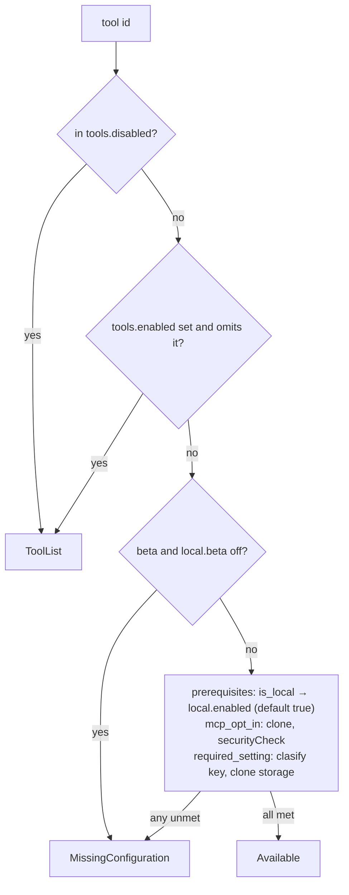
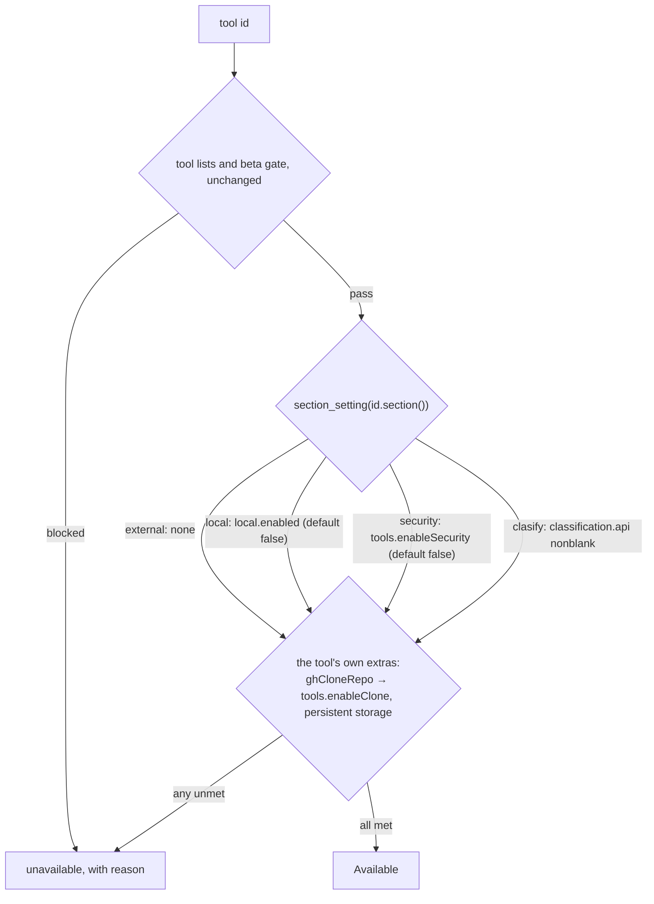
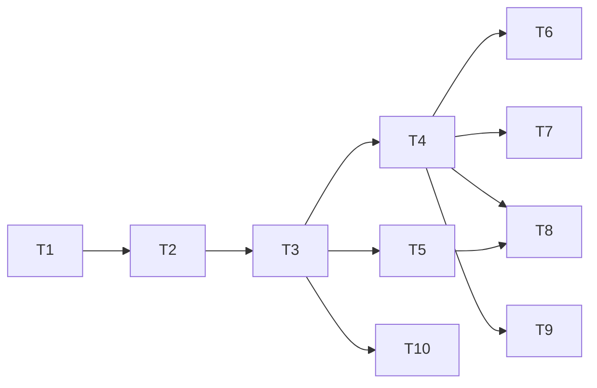

# Tool sections: external tools always on, local and security tools opt-in

Give every tool one of four sections (`external`, `local`, `security`, `clasify`) in the core contract, and
let one table in native say which setting turns a section on for MCP. Three of the four rules the owner asked
for already hold in the code. The one behavior change is the default of `local.enabled`
(`OCTOCODE_ENABLE_LOCAL`): `true` before, `false` now. A default MCP session lists 7 tools instead of
12 and sends 21,563 characters of tool definitions instead of 41,392. The CLI is unchanged.

The owner accepted the design on 26 November 2026 and T1–T9 are built and tested (the
[task table](#tasks-and-rollout) has each task's state). The owner then asked for two more things, both built:
a renamed setting keeps its earlier variable and file key as aliases (D7; the prefix-free variables first
asked for were built and then reverted for collision risk), and a
description names another section's tool only in a clause the host drops when that tool is not listed (D8).
Still open: the benchmark that decides whether the new default costs quality (T10).

## Summary

| Section | Tools | On for MCP when | Today | Proposed |
|---|---|---|---|---|
| `external` | `ghSearchRepo`, `ghSearchCode`, `ghStructure`, `ghGetFileContent`, `ghSearchHistory`, `ghGetHistoryItem`, `artifactSearch` | always | always | no change |
| `local` | `localSearch`, `localFetch`, `structureSearch`, `astSearch`, `lspSearch`; `ghCloneRepo` (also needs `tools.enableClone`); `graphBuild`, `graphQuery` (also need `local.beta`) | `local.enabled` is `true` | default `true` | default `false`; `ghCloneRepo` joins the section |
| `security` | `securityCheck` | the security setting is `true` | the security switch (then enableSecurityCheck under `tools`), default `false` | same rule; renamed `enableSecurity` (under `tools`) / `OCTOCODE_ENABLE_SECURITY` (Q2) |
| `clasify` | `clasify` | `classification.api` holds a nonblank key | same | no change |

- **F1:** a default MCP session lists the seven external tools only.
- **F2:** `OCTOCODE_ENABLE_LOCAL=true` lists the local section.
- **F3:** `ghCloneRepo` is listed only when the local tools that read its checkout are.
- **F4:** `OCTOCODE_ENABLE_SECURITY=true` lists `securityCheck`.
- **F5:** `clasify` is listed exactly when its key is set (unchanged).
- **F6:** the tool catalog names each tool's section and the setting that turns it on.
- **F7:** the graph MCP server and `octocode mcp install` still give local tools to a user who asks for them.
- **F8:** the user docs describe sections, the new default and how to turn local tools on.

The choice of what the plugins do (Q1) is the owner's and decides whether plugin users keep local tools
without acting; the engine tasks do not wait for it.

## Glossary

| Term | Meaning here | Where it lives |
|---|---|---|
| Section | The group a tool is exposed with: `external`, `local`, `security` or `clasify`. New | core `ToolPolicy.section` (proposed) |
| Family | Where a tool executes and which policy scopes it: `local`, `github` or `remote`. Not a section: `artifactSearch`, `securityCheck` and `clasify` share `remote` | core [names.ts](https://github.com/bgauryy/octocode-mcp-host/blob/d650921462120f69db830a1c407b08a39edc5029/packages/octocode-core/src/toolContract/names.ts), `ToolId::family()` |
| Opt-in | A setting an MCP host needs before a tool is listed | [availability.rs](../../packages/octocode-native/crates/runtime-base/src/execution/availability.rs) |
| Surface | The CLI or MCP. Availability is resolved per surface | `RuntimeSurface` |
| Home-only | A setting a repository's `.octocoderc` or `.env` can narrow but never turn on | `workspaceNarrowsTo` in [sections.ts](../../packages/octocode-config/scripts/config-contract/declaration/sections.ts) |

## Problem and context

**How a tool is gated today.** One function decides, [`resolve`](../../packages/octocode-native/crates/runtime-base/src/execution/availability.rs),
from three hand-written rules: `id.is_local()` adds `local.enabled`; `mcp_opt_in` adds `tools.enableClone`
for `ghCloneRepo` and that switch for `securityCheck`; `required_setting` adds
`classification.api` for `clasify` and persistent storage for `ghCloneRepo`. The CLI applies only
`required_setting`. `tools.enabled`, `tools.disabled` and `local.beta` apply on MCP before these.

**What the owner asked for, against the code.**

| Rule asked for | Code today | Gap |
|---|---|---|
| External tools (GitHub, package search) always on | no gate on the six `gh*` read tools or `artifactSearch` | none |
| `clasify` on whenever its key exists | `required_setting(Clasify) = classification.api`, blank is off | none |
| Security needs a switch, default off | that switch (`OCTOCODE_SECURITY_CHECKS`), default `false` | the name only |
| Local needs `OCTOCODE_ENABLE_LOCAL=true`, default off | `local.enabled` (`OCTOCODE_ENABLE_LOCAL`), default `true` | the default |

**The measured cost of the default.** `tools/list` and `initialize` of the local build
(`20.2.0+91434a43`, SHA-256 `cce5ad43…d928`), read over stdio with an empty Octocode home:

| MCP environment | Tools | Tool definitions | Instructions |
|---|---:|---:|---:|
| default today | 12 | 41,392 chars | 3,198 chars |
| `OCTOCODE_ENABLE_LOCAL=false` | 7 | 21,563 chars | 2,832 chars |
| `OCTOCODE_ENABLE_LOCAL=false`, `OCTOCODE_ENABLE_CLONE=true` | 8 | 22,908 chars | 2,901 chars |

In the [26 November round](../../packages/octocode-benchmark/results/rounds/20.2.0-2026-11-26-local-gh/README.md)
(30 GitHub questions, three passes) an Octocode session re-read about 24,000 cached tokens of prompt on its
first call against 5,000 for `gh`, and re-read three times as many cached tokens over a question. Octocode
cost 1.19× `gh` (95% interval 1.09–1.31) at equal quality.

**What the measurement does not show.** Cached re-reads were $1.99 of Octocode's $13.24 in that round, so
halving the definitions is estimated to save 2–3% of cost, not the gap to `gh`. That estimate is not a
measurement. In the same round 102 of 580 calls (18%) went to local tools reading `ghCloneRepo` checkouts; how
agents answer those questions without local tools is unmeasured (V8).

**Three defects the grouping exposes.**

1. With local tools off and cloning on, `ghCloneRepo` is still listed (third row above), though no listed tool
   can read the checkout it returns.
2. The availability rule is restated outside native: `needsSetup` and `DEFAULT_TOOL_COUNT` in
   [docs-verify.mjs](../../skills-dev/octocode-dev/scripts/docs-verify.mjs), the "(conditional: requires …)"
   notes in [manifest.json](../../packages/octocode-mcp/manifest.json), and the availability table of
   [CONFIGURATION.md](../CONFIGURATION.md#tool-availability-cli-and-mcp). Each is a copy that a new gate must
   remember to edit.
3. `family: "remote"` lumps `artifactSearch` (always on), `securityCheck` (opt-in) and `clasify` (key), so the
   family cannot drive exposure and each tool has its own `match` arm.

**Cost of inaction.** Every MCP host that loads all definitions keeps paying for five local tools in
sessions that only research GitHub and packages. The
remote research profile in CONFIGURATION.md (replaced by the [local profile](../CONFIGURATION.md#local-profile)
in T8) existed because users already worked around this by hand.

## Goals and scope

- A tool's section is declared once, in core, and reaches native, the catalog and the docs checker through
  the generated contract.
- One native table maps a section to its enabling setting; no rule names a tool except a tool's own extra
  prerequisite.
- A default MCP session lists the external section only.
- Every place that restates availability reads the contract or is checked against it.

Out of scope: the CLI's tool set; tool schemas, descriptions and replies; `tools.enabled` and
`tools.disabled`; the `local.beta` gate; classification billing; reply size, which is where most of the cost
is.

Constraints from [AGENTS.md](../../AGENTS.md): schemas and agent-facing text live in core; the contract is
generated, never hand-edited; one name per setting with no alias or legacy path; a contract field is removed
or renamed in one step with regeneration and the native change.

## Prerequisites

| ID | What must hold | Check | Owner |
|---|---|---|---|
| P1 | The sibling core repository is checked out and builds | `$DEV setup --install` then `$DEV contracts:regen` exits 0 with no diff | implementer |
| P2 | Nobody else holds the gates or a contract regeneration | `$DEV slots` shows `regen 1: free` | owner |
| P3 | The owner has answered Q1 before the plugin task starts | Q1 marked resolved in this RFC | owner |

## Entities and flows

| Entity | What it is | Lives in | State |
|---|---|---|---|
| `ToolPolicy.section` | A tool's section | core `toolContract/names.ts`, generated into `packages/octocode-config/contract/tool-contract.json` | new |
| `ToolSection` | The Rust enum generated from it, with `ToolId::section()` | `crates/runtime-base/build/tool_gen.rs`, `crates/runtime-base/src/id.rs` | new |
| `section_setting` | Section → enabling setting | `crates/runtime-base/src/execution/availability.rs` | new, replaces `id.is_local()` and the `securityCheck` arm of `mcp_opt_in` |
| `local.enabled` | Turns the local section on for MCP | `sections.ts`, `OCTOCODE_ENABLE_LOCAL` | changed: default `false` |
| `enableSecurity` (under `tools`) | Turns the security section on for MCP | `sections.ts`, `OCTOCODE_ENABLE_SECURITY` | changed: renamed from that switch / `OCTOCODE_SECURITY_CHECKS` (Q2) |
| `tools.enableClone` | Extra opt-in of `ghCloneRepo` | `sections.ts`, `OCTOCODE_ENABLE_CLONE` | read |
| `classification.api` | The key that turns the clasify section on, on both surfaces | `sections.ts`, `OCTOCODE_TYPESAFE_KEY` | read |
| `ToolFamily` | Execution and policy scope | core `names.ts`, `id.rs` | read |
| Catalog row | One tool in `octocode schema` | native CLI | changed: gains `section` |

Current flow, MCP surface:



Proposed flow: the same checks, with the prerequisites read from the section.



The server instructions need no new logic: each route line already lists the tools it needs and is dropped
when one is missing ([instructions.ts](https://github.com/bgauryy/octocode-mcp-host/blob/d650921462120f69db830a1c407b08a39edc5029/packages/octocode-core/src/toolContract/instructions.ts)),
which is why the measured instructions shrink with the tool list.

## Features

| ID | Consumer | Before → after | Example | Accepted by |
|---|---|---|---|---|
| F1 | MCP host with no Octocode settings | lists 12 tools → lists the 7 external tools | `tools/list` with an empty home | V1 |
| F2 | User who wants local tools on MCP | on without acting → on after `OCTOCODE_ENABLE_LOCAL=true` in the server entry, or `octocode config set local.enabled true` | `tools/list` then names `localSearch`, `localFetch`, `structureSearch`, `astSearch`, `lspSearch` | V2, V3 |
| F3 | Agent on MCP | `ghCloneRepo` listed with cloning on even when nothing can read the checkout → listed only when the local section is on too | `OCTOCODE_ENABLE_CLONE=true` alone: `ghCloneRepo` absent | V4 |
| F4 | User who wants advisory checks on MCP | `OCTOCODE_SECURITY_CHECKS=true` → `OCTOCODE_ENABLE_SECURITY=true` | `tools/list` names `securityCheck` | V5 |
| F5 | User with a classification key | `clasify` listed when the key is set → the same | `OCTOCODE_TYPESAFE_KEY=<key>` lists `clasify` | V6 |
| F6 | Agent or user reading the catalog | a tool that is off states the setting it needs → every tool also states its section | `octocode schema` rows carry `"section":"local"` | V7 |
| F7 | Graph MCP user; user running `octocode mcp install` | graph tools listed because local tools default on → the graph launcher turns the local section on itself; the installer says local tools are off and how to turn them on | `octocode mcp install --enable-local true` writes the variable | V9, V10 |
| F8 | Reader of the docs | docs say local tools are on by default → docs describe the four sections and the new default | [CONFIGURATION.md](../CONFIGURATION.md#tool-availability-cli-and-mcp) | V11 |

CLI callers observe one change only: the `section` field in the catalog (F6). Every tool the CLI offers today
it still offers.

## Proposed design

### Sections are declared in core

`ToolPolicy` gains a required `section`. `family` stays, because it answers a different question (which
policy scopes a call), and `ghCloneRepo` shows the two differ: it executes against GitHub and belongs with
the local tools.

```ts
export type ToolSection = "external" | "local" | "security" | "clasify";
[TOOL_NAMES.GITHUB_CLONE_REPO]: policy({ family: "github", section: "local", mutatesWorkspace: true }),
[TOOL_NAMES.PACKAGE_SEARCH]:    policy({ family: "remote", section: "external" }),
[TOOL_NAMES.SECURITY_CHECK]:    policy({ family: "remote", section: "security" }),
[TOOL_NAMES.CLASIFY]:           policy({ family: "remote", section: "clasify" }),
```

`contracts:regen` carries the field into `tool-contract.json`; `tool_gen.rs` generates `ToolSection` and
`ToolId::section()` beside `family()`.

### One table in native

```rust
/// The setting that turns a section on for an MCP host. `External` needs none.
const fn section_setting(section: ToolSection) -> Option<&'static ConfigFieldSpec> {
    match section {
        ToolSection::External => None,
        ToolSection::Local => Some(field::LOCAL_ENABLED),
        ToolSection::Security => Some(field::TOOLS_ENABLE_SECURITY),
        ToolSection::Clasify => Some(field::CLASSIFICATION_API),
    }
}
```

`prerequisites(id)` becomes `section_setting(id.section())`, then the tool's own extras. `mcp_opt_in` keeps
one arm (`ghCloneRepo` → `tools.enableClone`). `required_setting` is unchanged, so the clasify key and clone
storage still apply on the CLI. `MissingConfiguration` already carries the unmet settings in order, so a
hidden tool's `unavailableReason` reads "it needs local.enabled (OCTOCODE_ENABLE_LOCAL)" with no new text.

### Settings

| Setting | Variable | Default | Change |
|---|---|---|---|
| `local.enabled` | `OCTOCODE_ENABLE_LOCAL` | `false` | default flipped; description states that it turns the local section on for MCP |
| `enableSecurity` (under `tools`) | `OCTOCODE_ENABLE_SECURITY` | `false` | renamed (Q2); OSV egress text unchanged |
| `tools.enableClone` | `OCTOCODE_ENABLE_CLONE` | `false` | description adds "needs local tools on MCP" |
| `classification.api` | `OCTOCODE_TYPESAFE_KEY` | unset | none |

`local.enabled` keeps `workspaceNarrowsTo: 'false'`. With a `false` default this makes it home-only in
effect: the MCP server entry's environment, the home `.env` or `octocode config set local.enabled true` turn
it on; a repository's `.octocoderc` cannot. That is the same trust rule the security and clone switches
already have, and it is the reason not to loosen it.

### The configuration and Node layers

The Node MCP launcher holds no tool or configuration logic today
([index.ts](../../packages/octocode-mcp/src/index.ts) only starts `octocode mcp`), and it stays that way.
The cleanups are in what surrounds it:

- `@octocodeai/config` stays the only declaration of a setting. No launcher, plugin or script reads
  `OCTOCODE_ENABLE_*` itself.
- [docs-verify.mjs](../../skills-dev/octocode-dev/scripts/docs-verify.mjs) drops `needsSetup` and its
  hand-written `DEFAULT_TOOL_COUNT` filter and computes the default MCP list from the contract's `section`
  and the config defaults.
- [manifest.json](../../packages/octocode-mcp/manifest.json) keeps its tool list, and `docs-verify` checks
  each "(conditional: requires …)" note against the section's variable, so the note cannot go stale.
- [server.json](../../packages/octocode-mcp/server.json) lists `OCTOCODE_ENABLE_LOCAL` as an optional,
  non-secret variable, so a registry client can offer it.
- The graph launcher ([mcp-server.ts](../../packages/octocode-graph/src/runtime/mcp-server.ts)) sets
  `OCTOCODE_ENABLE_LOCAL: 'true'` beside `OCTOCODE_BETA: 'true'`, before `...process.env`, so a user's own
  `false` still wins.
- `octocode mcp install` keeps `--enable-local <bool>` and `--pass-env`
  ([mcp_install.rs](../../packages/octocode-native/crates/cli/src/cli/mcp_install.rs)). Without the flag it
  writes no variable, and its result states that local tools are off and gives the flag.

### Compatibility

| Who | Effect | What they do |
|---|---|---|
| MCP user relying on default local tools | five tools disappear after upgrade | set `OCTOCODE_ENABLE_LOCAL=true` in the server entry, or run `octocode config set local.enabled true` once |
| MCP user with `OCTOCODE_ENABLE_LOCAL=true` already set (the benchmark manifests) | none | nothing |
| MCP user with `OCTOCODE_SECURITY_CHECKS=true` | `securityCheck` disappears until renamed | rename the variable |
| MCP user with `OCTOCODE_ENABLE_CLONE=true` and local off | `ghCloneRepo` disappears | turn local on |
| Plugin users (Claude, Codex, VS Code) | decided by Q1 | |
| CLI user | none | nothing |

The remote research profile in CONFIGURATION.md becomes the default and is replaced by a "local profile".

### Agent-facing text

No tool description or schema changes. The instructions change only by the existing route filter. The
catalog gains `section` per row; its field is declared in core and its effect in
`crates/runtime-base/src/contracts/field-effect-coverage.json` if regeneration requires it.

### Core: instructions and descriptions by section

The owner asked for leaner instructions and for the security and clasify sections to bring their own
"when to use" text. In core, as built:

- The instructions were already composed per tool: a route is served only while every tool it names is
  listed, and a tool's block only while that tool is. With sections this is the whole mechanism: a host with
  no setting gets the external routes and the shared body (2,845 bytes), and each section turned on adds its
  own lines. A core test holds that the external-only text is the shortest served and names no other
  section's tool.
- **Security.** The route now says when: "before using a package, commit or repo: vulnerabilities →
  securityCheck" (was "vulnerabilities or package trust"). The tool's trigger opens "Before adding, upgrading
  or trusting a dependency, commit or GitHub repo, check its known advisories and fixes". Both are served
  only while the section is on.
- **Clasify.** Unchanged: its three routes, its trigger and its billing block already arrive only with a key.
- **Paid for inside the ceiling.** The longest text a host can be served (every tool plus the text-replies
  block) sits 6 characters under the 4,096-character host cut, so the security wording (+24) was paid by dropping `in {"queries":[...]}` from the Batch line (−19):
  every schema and worked example shows the envelope.
- **Budgets.** Core gains a fourth measured ceiling, `MCP_EXTERNAL_SURFACE_MAX_BYTES` = 24,700 (measured
  24,678), for what a host with no setting loads. The other three keep their tool sets.

### Core surface audit: what else can be cut

Measured on the build with every section on (15 tools), in UTF-8 bytes, with the agentic skill's
`mcp-surface.mjs`:

| Part | Bytes | Share |
|---|---:|---:|
| Input schemas: structure (keywords, types, names, enums) | 25,888 | 44% |
| Input schemas: field notes | 17,954 | 31% |
| Tool descriptions (trigger, worked example, rules) | 8,511 | 14% |
| Instructions | 3,918 | 7% |
| Names, titles, annotations | 2,488 | 4% |
| Whole surface | 58,759 | |

| Candidate | Bytes | Loses a rule? | Result |
|---|---:|---|---|
| Local section off by default | 19,960 for a default host (44,638 → 24,678) | no: one variable restores it | done (this RFC) |
| Drop an array's `maxItems` at the shared input ceiling | about 285 | yes: the graph viewer reads the published target batch size | tried, reverted |
| Drop zero-count defaults (`contextLines` 0/0) from the published view | about 400 | yes: they are what tells the readers (omitted: no lines) from lspSearch (omitted: the whole declaration) | tried, reverted |
| Gate the clauses that name clasify (ghGetFileContent) and securityCheck (artifactSearch) | 51 and 39 for a session without them, and the "if available" hedges for all | no | done (D8) |
| One note per shared field (19 notes are served by 2 to 15 tools each) | about 2,600 | no, if hosts resolved a shared definition | not possible in MCP: each tool's schema stands alone |
| Shorter field notes and descriptions | up to 26,465 of prose | each note states a rule a test or a past failure pins | open: one tool at a time, with a cold interview and a replay per edit |

The structure was already compacted by the [context-efficiency RFC](context-efficiency.md): bounds an agent
cannot hit, `additionalProperties: false` below the row, and aliases are gone from the published view. What
remains is prose, and no further cut is free: the size ceilings and the 4,096-character cut are all
within 0.2% of their limits, and each remaining sentence is held by a test that names the failure it
prevents. A smaller surface is not evidence of better answers. In the 26 November round 59% of Octocode's
cost was new input (tool replies) and 28% output, so reply size, not definitions, is where the next saving is.

## Decisions and reasoning

**D1: A declared `section`, not a rule derived from `family`.** Evidence: `family` is `remote` for three
tools with three different gates, and `ghCloneRepo` is `github` while its output is only useful to local
tools. Reasoning: deriving the section needs a special case per exception, which is today's `match` arms
under a new name. Rejected: reuse `family` (cannot separate `artifactSearch` from `securityCheck`); derive in
native (keeps the rule out of the contract, so `docs-verify` and the catalog would restate it). Reverses if:
sections and families become identical after a later regrouping.

**D2: `ghCloneRepo` is in the local section and keeps its own opt-in.** Evidence: measured, it is listed with
local tools off; the benchmark's 23 clone calls were each followed by local reads. Reasoning: "external tools
are always on" then holds with no exception, and a tool is never listed without its readers. Rejected: leave
it external with its opt-in (keeps defect 1); drop the opt-in (a clone writes to disk, which the opt-in
exists to gate). Reverses if: a GitHub tool learns to read a checkout by path.

**D3: Sections gate MCP only; the CLI keeps every tool.** Evidence: `resolve` returns early for the CLI by
design ("a CLI call is the user's own request"), and a CLI call adds nothing to a model's prompt. Reasoning:
the cost being cut is the definitions a host loads; the CLI has none. Rejected: gate both surfaces (breaks
skills and scripts that call `octocode localSearch`, for no saving). Reverses if: the owner wants one switch
to remove local access from a machine entirely.

**D4: Flip the default instead of documenting the profile.** Evidence: 12 → 7 tools and 41,392 → 21,563
characters, measured; the profile already exists and is opt-in. Reasoning: the owner's rule is that local
needs `OCTOCODE_ENABLE_LOCAL=true`. Rejected: keep `true` and promote the profile (no change for the hosts that pay
the cost). Reverses if: V8 shows quality or cost worse on the GitHub set without local tools, or Q1 is
answered "plugins must keep local tools and cannot set a variable".

**D5: Rename the security switch with no alias.** Evidence: the owner named it `OCTOCODE_ENABLE_SECURITY`; the two
sibling switches are `OCTOCODE_ENABLE_LOCAL` and `OCTOCODE_ENABLE_CLONE`; the repository rule is one name per
setting. Reasoning: one `OCTOCODE_ENABLE_<SECTION>` pattern is guessable. Rejected: keep
`OCTOCODE_SECURITY_CHECKS` (works, inconsistent); accept both (forbidden alias). Reverses if: Q2 is answered
"keep the name", which drops T5 and nothing else.

**D6: The setting is not an `enabled` key under `security`.** Evidence: the `security` section of the configuration
already holds `security.credentialFiles`, a read policy. Reasoning: `enabled=false` under `security` reads as
"security is off". `enableSecurity` (under `tools`) stays beside `tools.enableClone`.

**D7: A renamed setting keeps its earlier names; setting variables keep the `OCTOCODE_` prefix.** Evidence: the
owner first asked for unprefixed variables with aliases, then reversed it: a name such as `BETA` or
`STORAGE_MODE` can collide with an unrelated variable in the same environment. Built: the config contract can
list a variable's earlier names (`env.aliases`) and a setting's earlier `.octocoderc` keys (`keyAliases`).
Both loaders rewrite every source of variables to current names, and native rewrites each config file to
current keys, before anything reads them, so trust rules, validation and the runtime's identity see one name;
the current name wins when both are set. One setting uses it: the security switch, renamed
`OCTOCODE_ENABLE_SECURITY` and `tools.enableSecurity`, still read as `OCTOCODE_SECURITY_CHECKS` and as the
enableSecurityCheck key. Tests hold that a repository's `.env` or `.octocoderc` cannot use an earlier name to
turn on a home-only setting. Rejected: unprefixed names (collisions); a rename with no alias (breaks every
install that set the switch). Reverses if: no 20.0–20.2 install is left to carry the old names. Reversed
2026-11-26: no 20.x release was published, so no install carries the old names; the aliases, `keyAliases`
and the alias mechanism were removed, and only `OCTOCODE_ENABLE_SECURITY` and `tools.enableSecurity` are read.

**D8: A description names another section's tool only in a gated clause.** Evidence: with the default
session, ghGetFileContent pointed at clasify and artifactSearch at securityCheck, hedged "if available".
Reasoning: core declares the clause (`gatedClauses`: the tool it needs, its exact text), the presentation
carries it, and native serves the description without it when that tool is not listed; the hedge is gone and
no session is sent to a tool it lacks. Core tests hold that an optional section's tool is named from another
tool nowhere else. Rejected: the hedge alone (the agent cannot tell whether "available" holds).

## Risks and mitigations

| Risk | Detection or prevention |
|---|---|
| Users lose local tools silently on upgrade | release notes and the [upgrade guide](../V20.md) lead with it; `octocode mcp install` and `octocode config --json` state that local tools are off and the variable to set |
| Agents answer GitHub questions worse without clone-and-search | V8 measures it before the default ships; D4 reverses on a loss |
| An old `OCTOCODE_SECURITY_CHECKS=true` is ignored silently | the rename table in the upgrade guide; whether config diagnostics flag an unknown `OCTOCODE_*` variable is unverified (Q3) |
| Tests that assumed local-on-MCP by default fail | 21 Rust files reference the setting; each MCP-surface test sets it explicitly (T4) |
| Public skills assume local tools on MCP | T9 audits the skills; a skill that needs local tools says so or uses the CLI |
| Two regenerations collide with another session | P2; the contract change lands as one step |

## Tasks and rollout

| ID | What to make | Where | Serves | Depends on | Done when | State |
|---|---|---|---|---|---|---|
| T1 | `ToolSection`, required `ToolPolicy.section`, a value per tool, `section` in the catalog row type; core tests | `../octocode-mcp-host/packages/octocode-core/src/toolContract/names.ts`, `catalog.ts` | F6, P1 | P1, P2 | core tests pass; every tool has a section | done: core tests 2,032 pass, `toolSections.test.ts` added |
| T2 | Regenerate the contract; generate `ToolSection` and `ToolId::section()` | `packages/octocode-config/contract/` (generated), `crates/runtime-base/build/tool_gen.rs`, `crates/runtime-base/src/id.rs` | F6 | T1 | `$DEV contracts:regen` then `$DEV build:dev` pass; `octocode schema` rows carry `section` | done: contract regenerated, `octocode schema` rows carry `section` |
| T3 | `section_setting`; `prerequisites` reads it; remove `id.is_local()` from the gate and the `securityCheck` arm of `mcp_opt_in`; tests that assert each section's gate from the table | `crates/runtime-base/src/execution/availability.rs`, `availability/tests.rs` | F3, F5 | T2 | `$DEV test:dev --crate octocode-runtime-base -- availability` passes; no behavior change yet except `ghCloneRepo` | done: `availability/tests.rs`, 3 new tests |
| T4 | `local.enabled` default `false`, new description; regenerate; set the variable explicitly in every MCP-surface test that needs local tools | `packages/octocode-config/scripts/config-contract/declaration/sections.ts`, the 21 Rust test files, `packages/octocode-config/tests/config.test.ts` | F1, F2 | T3 | `$DEV gates` green; V1–V3 hold | done: Rust suite 9,611 pass |
| T5 | Rename that switch to `enableSecurity` (under `tools`), `OCTOCODE_SECURITY_CHECKS` → `OCTOCODE_ENABLE_SECURITY`, with every reader and test in one step | `sections.ts`, `availability.rs`, `docs-verify.mjs`, `skills/octocode-research/references/tool-flow-carry.md` | F4 | T3 | no match for the old names outside the upgrade guide; V5 holds | done: `OCTOCODE_ENABLE_SECURITY` and `tools.enableSecurity`; the earlier variable and file key are read as aliases (D7) |
| T6 | Graph launcher sets `OCTOCODE_ENABLE_LOCAL`; `octocode mcp install` result states the local state; `server.json` lists the variable | `packages/octocode-graph/src/runtime/mcp-server.ts`, `crates/cli/src/cli/mcp_install.rs`, `packages/octocode-mcp/server.json` | F7 | T4 | V9 and V10 hold | done: launcher, `server.json`, and the installer names the flag when the entry leaves local tools off |
| T7 | `docs-verify` computes the default MCP list from the contract and checks the manifest's conditional notes | `skills-dev/octocode-dev/scripts/docs-verify.mjs`, `packages/octocode-mcp/manifest.json` | F8 | T4 | `$DEV gates` docs row green; the script names no tool | done: `docs-verify` and `sync-manifest.mjs` read the section from the contract |
| T8 | User docs: sections table, new default, local profile in place of the remote profile, settings table, rename table, tool counts | `docs/CONFIGURATION.md`, `docs/OCTOCODE_MCP.md`, `docs/OCTOCODE_TOOLS.md`, `docs/OCTOCODE_CLI.md`, `docs/V20.md`, `README.md`, `packages/octocode-mcp/README.md`, `packages/octocode-benchmark/TESTING_ENV.md` | F8 | T4, T5 | V11 holds | done |
| T9 | Plugin and extension launch configs per Q1; audit public skills for local-tool assumptions | `packages/octocode-claude-plugin/.mcp.json`, `packages/octocode-codex-plugin/`, `packages/octocode-vscode/`, `skills/` | F7, P3 | T4, P3 | `$DEV skills:check` passes; each plugin's `tools/list` matches the Q1 answer | done for the launch configs (the plugins and the VS Code extension turn local tools on; the owner may reverse it); the setup skill passes `--enable-local true` |
| T10 | Measure the GitHub set with local tools off | a round manifest under `packages/octocode-benchmark/harness/rounds/` | F1 | T3 | V8 recorded in `packages/octocode-benchmark/results/` | todo |



Critical path: T1 → T2 → T3 → T4 → T8. T3 lands alone first: it moves the gate to the table with defaults
unchanged, so it can ship and be reverted by itself. T10 runs on T3's build with
`OCTOCODE_ENABLE_LOCAL=false` set in the manifest, so the measurement arrives before T4 changes the default.

Rollout: T4, T5, T6 and T8 ship in one release, since the default and its docs must not disagree. Rollback is
reverting T4 (one default and its tests); the section field and table stay. The owner triggers the release;
core publishes first.

## Validation and success

- **V1 (F1):** given an empty Octocode home and no `OCTOCODE_*` variables, when an MCP client calls
  `tools/list`, then it gets exactly the seven external tools.
- **V2 (F2):** given `OCTOCODE_ENABLE_LOCAL=true`, when the client calls `tools/list`, then the five local
  tools are added and the instructions contain their route lines.
- **V3 (F2):** given a workspace `.octocoderc` with `{"local":{"enabled":true}}` and nothing else, when the
  client calls `tools/list`, then no local tool is listed and `octocode config --json` reports the narrowing.
- **V4 (F3):** given `OCTOCODE_ENABLE_CLONE=true` alone, when the client calls `tools/list`, then
  `ghCloneRepo` is absent and `octocode schema` gives its reason as `local.enabled`; with
  `OCTOCODE_ENABLE_LOCAL=true` added it is listed.
- **V5 (F4):** given `OCTOCODE_ENABLE_SECURITY=true`, when the client calls `tools/list`, then
  `securityCheck` is listed; given only `OCTOCODE_SECURITY_CHECKS=true`, it is not.
- **V6 (F5):** given a nonblank `OCTOCODE_TYPESAFE_KEY`, when the client calls `tools/list`, then
  `clasify` is listed; given a blank value, it is not, on both surfaces.
- **V7 (F6):** given any configuration, when a user runs `octocode schema`, then every row has a `section`
  that equals the core policy, and the CLI's tool set is the same as before the change.
- **V8 (F1):** given the 30 GitHub questions, three interleaved passes and the harness in
  [METHOD.md](../../packages/octocode-benchmark/METHOD.md), when an arm with local tools off is compared with
  the stored arm with them on, then no fact the stored arm has right is lost and the cost ratio's upper bound
  is at or below 1.00. Baseline: quality 9.68, 580 calls, $13.24 over 90 answers. A lost fact or a lower
  bound above 1.00 reverses D4.
- **V9 (F7):** given the graph MCP server with no settings, when a client calls `tools/list`, then
  `graphBuild` and `graphQuery` are listed; given `OCTOCODE_ENABLE_LOCAL=false`, they are not.
- **V10 (F7):** given `octocode mcp install --enable-local true`, when the client config is read, then the
  server entry holds `OCTOCODE_ENABLE_LOCAL=true`; without the flag the entry holds no such variable and the
  command's output names the flag.
- **V11 (F8):** given the built docs, when `$DEV gates` runs, then `docs-verify` passes with "MCP starts
  with 7", and CONFIGURATION.md's settings table shows `local.enabled` default `false`.

Estimates, not measurements: the 2–3% cost saving and the fixed prompt of 15,000–19,000 tokens per call.

## Open questions

- **Q5 Non-blocking:** The one-click install links in the README and the plugins' launch configs set no
  environment, so they now give the 7-tool default while the quick start tells users to pass
  `--enable-local true`. Whether those links should carry the variable follows Q1. Settled by: the owner.
- **Q1 Non-blocking (built one way, the owner may reverse it):** Do the Claude and Codex plugins and the VS Code extension set `OCTOCODE_ENABLE_LOCAL=true`
  in their launch configuration? They run inside coding agents, where local tools are the common use; setting
  it keeps today's behavior for those users and leaves the saving to hosts that install the server bare.
  Not setting it gives every host the lean default and makes plugin users opt in. It blocks T9 and the
  release note, not T1–T8. Settled by: the owner.
- **Q2 Non-blocking (resolved by the owner: renamed, with the alias of D7):** Is `OCTOCODE_ENABLE_SECURITY` a rename (D5) or shorthand for the existing
  `OCTOCODE_SECURITY_CHECKS`? Keeping the name drops T5. Settled by: the owner.
- **Q3 Non-blocking:** Does configuration loading report an unknown `OCTOCODE_*` variable, so a stale
  `OCTOCODE_SECURITY_CHECKS` is visible? Not checked. Settled by: reading the diagnostics in
  `crates/runtime-base/src/config/` before T5.
- **Q4 Non-blocking:** `ghStructure`'s definition is 262 characters shorter with local tools off; that this
  is the `materialize` option being withheld is an inference. Settled by: diffing the two schemas in T3.

## Sources

- [AGENTS.md](../../AGENTS.md): repository rules for contracts, names and builds.
- [sections.ts](../../packages/octocode-config/scripts/config-contract/declaration/sections.ts): every setting, its default, variable and `workspaceNarrowsTo`, at commit `e3ed53555`.
- [availability.rs](../../packages/octocode-native/crates/runtime-base/src/execution/availability.rs): `resolve`, `prerequisites`, `mcp_opt_in`, `required_setting`.
- [mcp_install.rs](../../packages/octocode-native/crates/cli/src/cli/mcp_install.rs): `--enable-local`, `--pass-env`.
- [index.ts](../../packages/octocode-mcp/src/index.ts), [manifest.json](../../packages/octocode-mcp/manifest.json), [server.json](../../packages/octocode-mcp/server.json): the Node launcher and its registry manifests.
- [mcp-server.ts](../../packages/octocode-graph/src/runtime/mcp-server.ts): the graph launcher's environment.
- [docs-verify.mjs](../../skills-dev/octocode-dev/scripts/docs-verify.mjs): the tool counts the docs must state.
- [names.ts](https://github.com/bgauryy/octocode-mcp-host/blob/d650921462120f69db830a1c407b08a39edc5029/packages/octocode-core/src/toolContract/names.ts) and [instructions.ts](https://github.com/bgauryy/octocode-mcp-host/blob/d650921462120f69db830a1c407b08a39edc5029/packages/octocode-core/src/toolContract/instructions.ts): `ToolPolicy`, `ToolFamily`, route filtering, in `octocode-mcp-host` at commit `d650921`.
- [CONFIGURATION.md](../CONFIGURATION.md): today's availability table, remote research profile and settings table.
- [upgrade guide](../V20.md): the renamed-settings table that T5 and T8 extend.
- [context-efficiency RFC](context-efficiency.md): the earlier compaction of the published schemas.
- [METHOD.md](../../packages/octocode-benchmark/METHOD.md): how a cost claim is accepted.
- [26 November round](../../packages/octocode-benchmark/results/rounds/20.2.0-2026-11-26-local-gh/README.md): cost, calls and quality of Octocode against `gh`.
- Measurement: `initialize` and `tools/list` sent over stdio to `node packages/octocode-mcp/dist/index.js` with `NODE_ENV=development`, `OCTOCODE_NATIVE_BIN=<pin>`, an empty `OCTOCODE_HOME`, and `OCTOCODE_ENABLE_LOCAL` `true` or `false`, with and without `OCTOCODE_ENABLE_CLONE=true`; sizes are `JSON.stringify(tool).length` summed.
