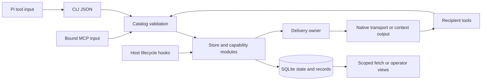

# Communication runtime

CLI, MCP, hooks and host adapters share one TypeScript store and SQLite protocol, written in `src/runtime/` and bundled by esbuild into `dist/`; Node.js `^24.15.0` and its built-in `node:sqlite` are the only requirements. `bin/` is a thin launcher over the bundle. Host adapters (Pi extension and inbox bridge, lease guards) live in `src/hosts/` and ship in `dist/hosts/`. The companion skill in the repository's `skills/` folder carries guidance and routes operations to the npm CLI.

## Boundaries and owners

CLI and MCP converge at `Store.call`; MCP does not execute the CLI dispatcher.
Pi bound tools launch the CLI. Host hooks also use lifecycle and delivery methods directly.

| Owner | Responsibility and contract |
| --- | --- |
| `assets/catalog.json`, `catalog.ts`, `validation.ts` | Command inputs, record payload schemas, tool profiles, discovery, and validation (patterns run as JavaScript `RegExp` with the `u` flag) |
| `protocols.ts` | Message kinds, one field each, with the protocol in [OPERATING.md](OPERATING.md#send-and-handle-messages); request and wake policy come from the catalog's `messageKinds` markers: cross-reference checks the schema cannot state (check-back, decision options, handoff leases, pinned `document:` evidence, RACI informed) and body rendering from the catalog slots |
| `cli.ts`, `mcp.ts`, `main.ts` | Bounded ingress, command routing, output framing, and bound MCP identity; managed MCP owns its lifecycle |
| `store.ts` and capability modules (`sessions.ts`, `peers.ts`, `leases.ts`, `documents.ts`, `completion.ts`, `expiry.ts`, `health.ts`, `retention.ts`, `activity.ts`) | Workspace/identity checks, current state, messaging, leases, documents, health, and scoped history. Modules are free functions over a host interface (`store-types.ts`); none imports `store.ts` |
| `assets/schema.sql`, `database.ts`, `database-export.ts` | Storage identity/fingerprint, no-clobber snapshots (`db export`), transactions (explicit `BEGIN IMMEDIATE`), constraints, indexes, and atomic event triggers |
| `paths.ts`, `workspace.ts`, `text.ts`, `json-text.ts`, `unicode16.ts` | Canonical paths; workspace identity (coordination scope, current branch, registration); code-point ordering, truncation, whitespace and UTF-8 bounds (`text.ts`); byte-stable JSON text and strict UTF-8 decoding (`json-text.ts`); lease keys folded with the frozen Unicode 16 tables in `assets/unicode16.json` (never ICU) |
| `registry.ts` | Per-process registry entry for a non-default `--database`, which the Pi extension reads ([format](docs/DB.md#active-database-registry)) |
| `records.ts` | Unified envelopes, visibility, indexed filters, fixed-ceiling pagination, and generic memory/event writes |
| `dispatch.ts`, `dispatch-outcomes.ts`, `delivery-types.ts`, `loop-control.ts`, `transport.ts`, `transport-codex.ts`, `native-io.ts`, `owner-lock.ts` | Attempt tokens and delivery ownership; offer outcomes, bounded retry and usage audit; signal-owning delivery loops; native I/O and transport-specific receipts; the OS-released owner lock (Unix socket; Windows named pipe, untested) |
| `proxy.ts`, `vendor-workers.ts`, `wire.ts` | Requested worker lifecycle, the Codex, Pi and Claude worker protocols, host process supervision over newline-delimited JSON, and the parent-death watchdog |
| `host-hooks.ts`, `src/hosts/` | Host events, context budgets, durable Pi receipts, and optional structured-edit admission |
| `view.ts`, `view-data.ts`, `assets/dashboard/` | Local read-only operator views and bundled UI; no frontend build |

`assets/catalog.json` owns public field definitions; `catalog.ts` owns the tool profile presets. `assets/schema.sql` owns persisted structure and invariants.
Discovery combines these sources; no interface maintains a second command or record schema.
`src/catalog-types.ts` compiles the catalog with `json-schema-to-typescript` into `src/runtime/catalog-types.generated.ts`: one `<Command>Input` per command that takes input (`CommandInputs`, `CommandInput<N>`) and one `<Type>Data` per record type (`RecordData`). `yarn types` and `yarn build` regenerate the committed file, and `yarn lint` fails when it is stale (`node src/emit-types.ts --check`). The generator drops what a schema cannot state locally (`not`, `if/then`, `dependentRequired`, cross-field `oneOf`), so a type narrows a shape, not a validated value: `catalog.command(name, value)` validates and is the one place that returns the typed `CommandCall`; `Store.call` dispatches through a handler table typed by it.
The top-level `results` object of the catalog, keyed by command name, states what each command prints once its null members are stripped (`Store.call` and the CLI strip them). The generator turns each entry into a `<Command>Result` and emits `CommandResults`, so `Store.call`, the handlers and the Pi bridge return typed results; `catalog.ts` refuses to load a catalog in which a command lacks a result schema, `schema` carries the schemas, and `tools/list` and `schema <command>` do not (their bytes are unchanged). `tests/command-results.test.ts` validates every command's real result against its schema. A database row is a `Row` read through the typed `row*` readers in `database.ts`, and JSON read from a wire or a column is `unknown` until `validation.ts` narrows it; no shape is untyped.
`src/build.ts` inlines `assets/` and `OPERATING.md` into the bundle, so `dist/` needs no other directory, and reads the version from `package.json`; CLI and MCP version reporting use that release version. It fails when a catalog `pattern` does not compile as a JavaScript `RegExp` with the `u` flag. The same build then emits declarations with `tsc` (`src/emit-types.ts`, `tsconfig.types.json`): every `src/entries/<name>.ts` is `dist/<name>.js` and every `src/hosts/<name>.ts` is `dist/hosts/<name>.js`, each with a `dist/…/<name>.d.ts` stub that the package `exports` name as `types`; `yarn typecheck` checks `src/` and `tests/` with `tsgo --noEmit` and emits nothing; only the build writes declarations.

## Three representative flows

### Request and final reply

`CLI/MCP input → catalog validation → kind → protocols.messageSlots → Store.send → one write transaction → message, recipients, and record triggers → send receipt`.

The kind field fixes reply policy and wake. The transaction validates live sender identity, repository coordination scope, routing, idempotency key, and the kind's cross-references, and stores the slots with the rendered body.
`complete` with `outcome` and a BLUF `reply` creates the correlated final answer and parent acknowledgement atomically; in the same transaction it enforces a requested check-back, delivers copies to RACI informed peers, and moves handed-off leases.
FYI completion acknowledges received IDs without creating a reply. A failed transition rolls back.

### Delivery and handling

`delivery owner → prepare → stage/token commit → host I/O → submitted or uncertain receipt → recipient complete`.

External I/O occurs outside the staging transaction. One-time submission and recipient acknowledgement are separate states.
Ambiguous/staged attempts require inspected recovery; expiry or restart does not authorize replay.
Hooks emit full envelopes or fetch references within the host budget. Deferred rows remain eligible for later events.
Pi reconciles receipt tokens with its durable host ledger before confirmation.

### Scoped history and operator audit

`bound fetch → read snapshot → repository/participant visibility → indexed query → resolved envelope → executable continuation`.

Message bodies live once in immutable `messages`; `records.ts` resolves them into `data`.
The append-only `records` stream uses `{recordId,path,from,to,type,timestamp,branch?,data}`.
Operational tables enforce current presence, leases, recipients, replies, and attempts; hot inbox checks require no event replay.
FTS5 is derived searchable content. Generic JSON nulls remain intact; shared records retain `to:null`.
Participant fetch and workspace-wide operator dashboards/exports have different visibility boundaries.

## Preservation and compatibility

Peer discovery, messages, documents and shared records use the repository `coordinationScope`; leases, Git activity and native receiver checks use the actual worktree ([scope rules](docs/DB.md#identity-and-discovery)).

Session IDs route cooperating same-user processes; they are not credentials or filesystem isolation. `peers`, message senders and lease owners show exact IDs, and a CLI caller supplies its own `--session`, so any process that holds a peer's ID acts as that peer. A per-session secret would sit beside the ID: the database file, `db export` and process arguments are readable by the same OS user, so it would add no boundary and would need every host, hook and the Pi lease reader to carry it. The boundaries that hold are pinned by `tests/identity-trust.test.ts`: no tool input names the acting session (bound MCP and Pi tools fix it at launch), an ID acts only in its own workspace and only while live, and native receipt and write checks compare the host session. Isolation between mutually distrusting agents needs separate OS users or databases.
Leases use canonical paths and frozen Unicode case folding. They are advisory; guards cover only reported operations.

The on-disk format is unchanged from earlier releases (application ID, schema version and fingerprint), so a store created by an earlier release opens here. The delivery-owner lock is not shared: earlier releases used a file lock and this runtime a socket, so run one runtime per database while upgrading ([DB.md](docs/DB.md#cleanup-and-conformance)). Other differences that surface to users: `pathRegex` is a JavaScript `RegExp`, whole-number floats such as `5.0` are integers, database paths must stay within 504 bytes after resolving symlinks, and Windows has no Job Object for a killed worker ([limits](README.md#requirements-and-limits)).

The runtime opens only the exact current schema fingerprint and leaves any other database unchanged ([database identity](docs/DB.md#identity-and-discovery)).

## Documentation and verification

[README.md](README.md#documentation-map) maps every guide to its reader. [OPERATING.md](OPERATING.md) is the runtime operating guide: `skill` returns it and managed workers receive it, so edit it there only. `db protocol` serves [DB.md](docs/DB.md) verbatim.

The package manifest owns build, typecheck, regression and smoke commands; the repo-root `docs:verify` checks Markdown links and anchors. `src/release-smoke.ts` exercises real CLI/MCP replies, leases, export and restore against the packed package. Crash tests exercise real transaction and process boundaries; the opt-in `src/live.ts` harness (graders, worker mechanics and options in `src/live/`) runs real Pi, Claude and Codex workers (single-host trials and a three-host soak across request waves) ([operations](docs/OPERATIONS.md#verify-concurrent-native-workers)). Checks prove their named paths on the local platform, not arbitrary vendor versions or OS isolation.

## npm interfaces

Routes, input forms and lifecycle: [entry points](docs/INTERFACES.md). `octocode-mcp-cli` (bundled at build time, not a published dependency) supplies CLI validation, typed flags and help to both the `/cli` route and the `./cli` subpath. The full 18-tool `tools/list` stays within 20 KiB including field descriptions (`tests/tool-selection.test.ts`); profiles reduce it further.
