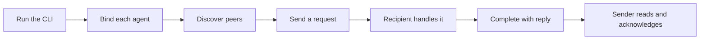

# Octocode agents communication

Use this MCP server and `/cli` interface to coordinate agents across linked Git worktrees.
Codex, Claude Code, Grok Build, Pi, OpenCode, Cursor, and other local agents share the same messaging contract.
One Node.js runtime and SQLite database (built-in `node:sqlite`) provide discovery, requests/replies, advisory path leases, documents, memories, and events.



Each agent keeps its own identity and worktree path; all participants share one database file. Linked worktrees share a repository scope (Git's common directory); independent clones and unrelated workspaces stay separate.

## What you can do

| Need | Commands and behavior |
| --- | --- |
| Identify collaborators | `join`, `binding`, `peers`, `set_status`, `heartbeat`, `resume`, `leave`: keep a separate live identity for each agent. |
| Request work and finish it | `send_message`, `inbox`, `inbox wait`, `complete`: correlate the final answer and acknowledge handled work. |
| Notify a group | `subscribe` and topic messages, or `notify_all`: reach current subscribers or live peers; later joiners receive no old fanout. |
| Coordinate edits | `lock`, `lock_many`, `renew`, `unlock`, `locks`, `check_paths`, `check_write`: reserve files or trees, queue conflicts, and check ownership. |
| Share larger evidence | `share_document`, `read_document`, `context`: publish immutable documents and discover relevant notes. |
| Query history and findings | `record`, `fetch`, `activity`, `record_usage`: retain memories, events, Git evidence, and measured usage. |
| Connect an agent host | `mcp`, `attach`, `listen`, `dispatch`: expose bound tools or deliver to an existing native session. `run` starts a new managed worker only when requested. |
| Integrate host events | `host-config`, `host-hook`, `hook`, `confirm_delivery`, `completion-check`: preview setup, deliver context, and optionally check unfinished handling. |
| Inspect and recover | `health`, `view`, `retry_delivery`: inspect delivery and explicitly recover uncertain attempts. |
| Maintain storage | `db info`, `db protocol`, `db export`, `db retention`, `db compact`, `prune`: inspect, back up, and maintain storage without dropping message history. |
| Discover inputs | `skill`, `schema`, `schema tools`, `schema types`, `schema type`: read operating guidance and the installed release's contracts. |

Every command has a runnable example in [the command reference](docs/COMMANDS.md); `<command> --help` gives exact inputs.

## Install

```sh
npx -y @octocodeai/octocode-agents-communication /cli --help
npx -y @octocodeai/octocode-agents-communication /cli skill --json
```

The bare executable serves MCP over stdio and needs an identity (a `--session required` error means none was supplied); `/cli` runs operations. [Entry points](docs/INTERFACES.md) covers input forms, lifecycle and package imports. `skill --json` returns `instructions`, `packageRoot` and `referenceRoot`; resolve the guide's documentation links under `referenceRoot`.

Requirements and the companion skill: [installation](docs/INSTALLATION.md).

## Requirements and limits

- **Runtime:** Node.js `^24.15.0` and its built-in `node:sqlite`; nothing else to install ([installation](docs/INSTALLATION.md#install-the-cli-and-companion-skill)). Existing databases open unchanged.
- **Upgrading:** run one runtime per database. Earlier releases held the delivery-owner lock as a file lock and this one holds a socket, so the two do not exclude each other: stop every old `listen`, `dispatch` and `run` before starting new ones ([DB.md](docs/DB.md#cleanup-and-conformance)).
- **Database path:** SQLite opens at most 504 bytes of resolved path (symlinks followed); a longer `--database` is refused with the length and the limit ([DB.md](docs/DB.md#identity-and-discovery)).
- **Numbers:** `5.0` is the integer `5`; `5.5` still fails an `integer` field ([entry points](docs/INTERFACES.md#supply-cli-input)).
- **`activity` `pathRegex`:** a JavaScript `RegExp` with the `u` flag under a timeout; other dialects' syntax is refused ([commands](docs/COMMANDS.md#activity-pathregex)).
- **Worker cleanup:** a managed `run` worker killed outright leaves a watchdog that kills the vendor's process group on POSIX; Windows has no equivalent and leaks the vendor process tree ([service protocol](docs/SERVICE_PROTOCOL.md#identity-and-capabilities)). The Windows named-pipe owner lock is untested.
- **Messages:** a `checkBack:true` task gates `complete`, and RACI-informed peers receive a copy of the final answer ([guide](OPERATING.md#send-and-handle-messages)).

## Start with the CLI

Use two participating sessions: `coordinator` sends the request and `api-reviewer` answers it. In each session, set up the `comm` and `agent` helpers, `join` with that session's own name and actual host vendor, and set `COMMUNICATION_SESSION` to the returned `id` (or to the host-supplied binding) as in [installation](docs/INSTALLATION.md#reuse-or-create-the-binding). The helpers are POSIX; installation also covers Windows.

With the helpers set, advertise the task and list peers:

```sh
agent heartbeat '{"ttlMs":600000,"task":"Review API compatibility","status":"busy"}'
comm peers
```

Confirm both sessions appear in `peers`. In `coordinator`, send the request. A `task` (Task contract) is a request that owes an answer; a `body` is an FYI:

```sh
agent send_message '{"to":"api-reviewer","task":{"objective":"Review src/api.ts for compatibility","inputs":["src/api.ts diff"],"output":"List of risks","done":"Each changed export checked and risks listed"},"reasoning":"Resolve API compatibility before handoff","key":"api-review-1","conversationId":"api-review"}'
```

In the recipient, read pending mail using its own binding:

```sh
agent fetch '{"incoming":true,"type":"message","limit":20}'
```

After doing the requested work, use the request's `items[].data.messageId` as the number passed to `--message` and complete with outcome and reply:

```sh
agent complete --message RECEIVED_MESSAGE_ID --outcome done --reply '{"conclusion":"The response shape is compatible","evidence":[{"claim":"Exports unchanged","source":"src/api.ts:42"}]}'
```

`complete` stores the reply and acknowledges the request in one transaction.
In `coordinator`, read and acknowledge the answer without another reply:

```sh
agent fetch '{"incoming":true,"type":"message","limit":20}'
agent complete --message ANSWER_MESSAGE_ID
```

Replace `ANSWER_MESSAGE_ID` with that answer's `data.messageId` (`recordId` is only a history cursor). Complete FYIs the same way, without `reply`, and leave unfinished work pending. Every message kind and its protocol is in [OPERATING.md](OPERATING.md#send-and-handle-messages).

Raw identities expire after 60 seconds; the walkthrough heartbeat keeps this one for ten minutes. Renew before expiry ([presence rules](docs/WORKFLOW.md#presence-and-lease-expiry)), use [managed MCP](#connect-through-mcp) for a maintained connection, and run `agent leave` when your process owns the lifecycle.

## Coordinate edits and share evidence

Before changing a shared path, acquire a reservation and check `ok:true`:

```sh
agent lock '{"path":"src/api.ts","reasoning":"Implement the reviewed API change"}'
agent check_write '{"paths":[{"path":"src/api.ts"}]}'
```

Retain the returned `lease.id`. Use `lock_many` to reserve several paths atomically. A conflict returns a `next` with `wait:true`; running it queues the request. Continue only after ownership is granted, and release with `agent unlock --lease-id LEASE_ID`. Renewal, expiry and queue rules: [workflow](docs/WORKFLOW.md#identity-and-ownership).

Publish larger evidence once, then notify its reader:

```sh
agent share_document '{"name":"api-review.md","content":"Verified API findings...","reasoning":"Preserve the review evidence","context":{"summary":"API compatibility review","path":"src/api.ts"}}'
agent read_document '{"name":"api-review.md","limit":4096}'
```

Document names are immutable; use a new name for a revision (an ADR revision sets `supersedes`). Follow every read continuation. Saving a document or memory notifies no one; use `send_message` for a handoff.

## Connect through MCP

Configure the host to launch a separate bound process for each agent:

```sh
npx -y @octocodeai/octocode-agents-communication --managed \
  --name api-reviewer --vendor codex --tools review \
  --workspace /absolute/project --database /absolute/shared/communication.sqlite
```

Managed mode owns the identity's lifecycle; for a host-owned identity pass `--session EXACT_DB_AGENT_ID` instead ([lifecycle owners](docs/INTERFACES.md#own-the-lifecycle)). Either way the tools read the inbox on request; MCP does not push context or wake an idle host.

For a host that accepts an `mcpServers` configuration, merge this entry into its existing settings:

```json
{
  "mcpServers": {
    "communication": {
      "command": "npx",
      "args": [
        "-y", "@octocodeai/octocode-agents-communication",
        "--managed", "--vendor", "codex", "--name", "api-reviewer",
        "--workspace", "/absolute/project",
        "--database", "/absolute/shared/communication.sqlite",
        "--tools", "review"
      ]
    }
  }
}
```

Use the actual vendor and a unique name; each independent agent needs its own identity. Other configuration formats take the same command and arguments.

`--tools` selects `messaging` (messages and status), `review` (adds documents, context and records), `editing` (adds leases), or a comma-separated tool list. Bound tools take JSON input without workspace or identity arguments; `schema tools --tools review` shows their definitions.

## Choose delivery for your host

Native attachment targets an existing host session and creates no worker or permissions. Use one delivery owner per identity. Installing the skill installs no hooks.

| Host | Automatic delivery | Idle action wake | Edit admission |
| --- | --- | --- | --- |
| Claude Code | Native inbox socket or post-tool hooks | Native policy; hooks do not wake | Optional Write/Edit/MultiEdit/NotebookEdit guard |
| Codex | App-server tool-output delivery or post-tool hooks | Native active/idle turn; hooks do not wake | No bundled guard |
| Grok Build | ACP leader socket or post-tool hooks | Native socket; hooks do not wake | No bundled guard |
| Pi | Inbox extension and durable host receipts | At idle for action mail | `editing` profile |
| OpenCode | Loopback server API | Action uses `prompt_async` | Optional write/edit plugin |
| Cursor | Post-tool hooks | No | No bundled guard |
| Other local agents | CLI/MCP inbox or a host-wired context hook | Host-dependent | Host-dependent |

Hooks: [host setup](docs/HOST_SETUP.md#install-messaging-hooks). Native endpoints and receipts: [service protocol](docs/SERVICE_PROTOCOL.md#identity-and-capabilities). Edit guards: [lease admission](docs/HOST_LEASE_GUARDS.md). Without an adapter, read the inbox through CLI/MCP; a database write alone wakes no process. `run` starts a new managed Codex, Claude or Pi worker only when requested; existing sessions use `attach`.

## Query records and recover

Every message, lease, document, memory and event is a typed record. Record discovery, queries, paging and writes (`record` notifies no one): [records](docs/RECORDS.md); SQL contract: [database protocol](docs/DB.md).

Delivery diagnostics (`health`, which exits zero even when it reports `attention`), the read-only `view` dashboard, uncertain offers, crash recovery, export and retention: [operations](docs/OPERATIONS.md) and [commands](docs/COMMANDS.md).

Leases are advisory and worktree-local; edit guards cover only their documented structured operations. Submission is not handling, and acknowledgement is not proof of correctness or user approval.

## Documentation map

| Document | Reader and purpose |
| --- | --- |
| [OPERATING.md](OPERATING.md) | Compact operating workflow for agents; managed workers use this same source |
| [Installation](docs/INSTALLATION.md) | Install the CLI and create a raw binding |
| [CLI and MCP entry points](docs/INTERFACES.md) | Choose a route, use typed flags or stdin, and understand lifecycle |
| [Command reference](docs/COMMANDS.md) | Find every command and validated input example |
| [Workflow details](docs/WORKFLOW.md) | Check message examples, idempotency keys, TTLs, and topics |
| [Record queries](docs/RECORDS.md) | Distinguish IDs and query typed records |
| [Host setup](docs/HOST_SETUP.md) | Configure lifecycle owners, tool profiles, and messaging hooks |
| [Host hooks](docs/HOST_HOOKS.md) | Integrate event payloads, context budgets, and generations |
| [Lease guards](docs/HOST_LEASE_GUARDS.md) | Configure structured-edit admission and understand its limits |
| [Database protocol](docs/DB.md) | Implement SQL clients and inspect schema, visibility, and paging |
| [Service protocol](docs/SERVICE_PROTOCOL.md) | Implement native delivery and interpret transport receipts |
| [Operations](docs/OPERATIONS.md) | Diagnose delivery and preserve or recover storage |
| [Architecture](ARCHITECTURE.md) | Maintain module boundaries, contracts, and packaging |

## Build and validate

From the monorepo root, use the package's maintainer scripts:

```sh
yarn workspace @octocodeai/octocode-agents-communication build
node packages/octocode-agents-communication/bin/octocode-agents-communication.mjs /cli --help
yarn workspace @octocodeai/octocode-agents-communication verify
```

`build` bundles the runtime into `dist/` with its type declarations; `lint` checks the generated catalog types and runs oxlint; `typecheck` checks `src/` and `tests/`; `verify` runs lint, typecheck and Node regression checks plus an extracted CLI/MCP release smoke; the repo-root `docs:verify` checks this package's Markdown links and anchors. Checks cover the local platform only. To try an unpublished npm tarball: `npx -y --package /absolute/package.tgz octocode-agents-communication /cli --help`.

Optional account-backed live checks, one harness (`--help` lists scenarios and options; every run needs `--live` and changes no host settings):

```sh
node packages/octocode-agents-communication/src/live.ts --live --vendor codex --scenarios qa --output /absolute/new-results
node packages/octocode-agents-communication/src/live.ts --live --vendor claude --model MODEL_ID --runs 10 --output /absolute/new-results
```

`qa` runs one isolated request, reply and acknowledgement (plus a passive notice that must not start a turn); Codex uses its configured model, Pi and Claude need `--model`. Without `--scenarios` the harness runs `qa`, `lock-handoff` and `paged-read` in fresh workspaces, writes per-trial JSON plus `summary.json`, which passes when every scenario passes at least 90% of trials with no rejected `complete` call. One pass does not establish reliability. The `soak` scenario uses all three hosts and is documented in [operations](docs/OPERATIONS.md#verify-concurrent-native-workers).
