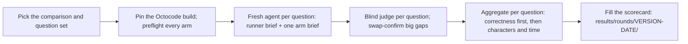
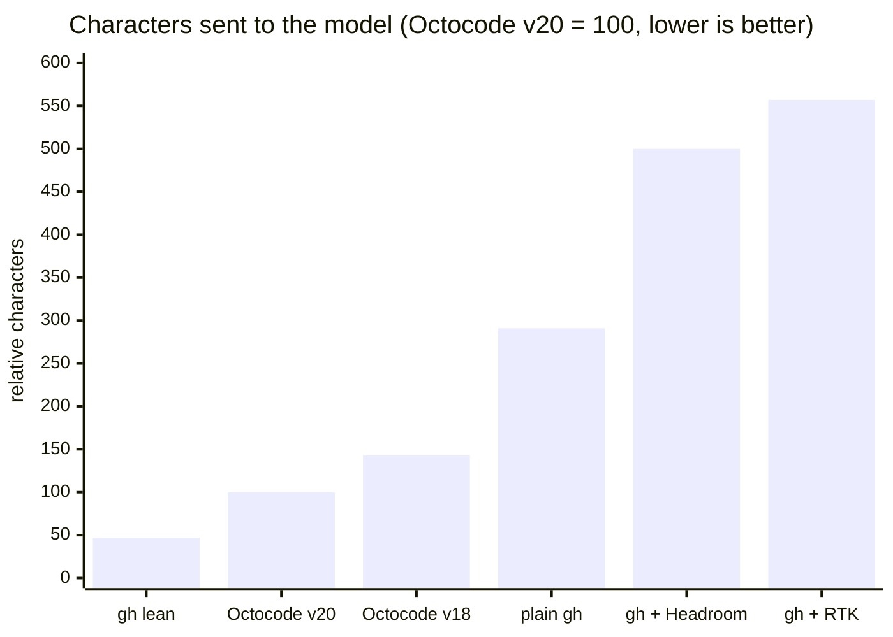
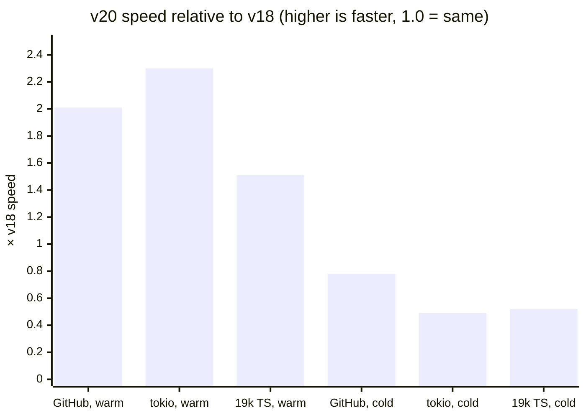

# Octocode benchmark

Does Octocode give an AI agent correct, source-backed answers with less context and less
waiting than the tools an expert would otherwise use, and is each version ready? This package is the one
home of Octocode's checks and benchmarks, as behavioral docs (what to check, what to compare it against,
how to judge, what to record), with the question sets, the per-question baselines and the version timeline
of stored results. Agents run it by direct calls and judgement;
there are no driver scripts.

| Doc | What it owns |
|---|---|
| [CHECKS.md](CHECKS.md) | Every check of Octocode, core tools first: the 8-dimension tool review, end to end, per tool, workflows, security, skills, and the areas other packages own |
| [METHOD.md](METHOD.md) | Benchmark rounds: arms, isolation, what to measure, blind judging, aggregation, comparing a new version, what a round records |
| [COMPARISONS.md](COMPARISONS.md) | Each Octocode tool and workflow against its expert competitor (rg, ast-grep, graphify, gh and gh-lean, registries, OSV, RTK, Headroom), and what "better" means |
| [briefs/](briefs/) | What an agent is handed: [runner](briefs/runner.md), [judge](briefs/judge.md), [arm briefs](briefs/arms/), [check-local](briefs/check-local.md) and [check-github](briefs/check-github.md) capability rounds, and the [scorecard](briefs/SCORECARD.md) every round fills in |
| [questions/](questions/README.md) | Question sets as data: 30 GitHub, 30 + 40 + 12 local, 30 local scenarios |
| [results/README.md](results/README.md) | The version timeline, per-question [baselines](results/baselines/) and the index of every stored round |
| [local/](local/README.md) | The pinned clones (repositories, commits, clone form) and the [local flows benchmark](local/FLOWS.md) |

## Run a round



1. **Pick** the comparison from [COMPARISONS.md](COMPARISONS.md) and the question set that tests
   it. A tool change gets a capability round; a release headline gets a research round.
2. **Reuse stored baselines.** Run only the Octocode arm being improved; gh, gh-lean, RTK,
   Headroom and older Octocode builds are already stored ([METHOD.md](METHOD.md#arms)).
3. **Pin** one build, name its SHA-256, and check every arm answers one real call.
4. **Answer, judge, aggregate and record** as [METHOD.md](METHOD.md) describes; for a release, also run
   every area of [CHECKS.md](CHECKS.md). Fill in one [scorecard](briefs/SCORECARD.md) in
   `results/rounds/<version>-<date>/` and add the version to the
   [timeline](results/README.md#version-timeline). A new headline also updates [Results](#results).

## Results

### GitHub research, 30 questions

Every setup answered the same [30 GitHub questions](questions/github/README.md). The newest
Octocode version is on top; each new version adds a row and becomes the reference column.

| Setup | Run | Correctness (of 10) | Characters per question, mean | Characters per question, median | Characters vs Octocode v20 (95% CI) | Questions where v20 used fewer characters | Speed in a session vs v18 | Speed of a cold call vs v18 | Verdict |
|---|---|---:|---:|---:|---:|---:|---|---|---|
| **Octocode v20** (Rust) | 2026-10-29 · 1 pass · Opus 5.5 judge | **9.57** | 15,590 | 13,872 | 1.0× | — | **1.5–2.3× faster** | 1.3–2.0× slower | Most correct. Leaner than every setup except gh-lean. Cold start is the regression. |
| `gh` lean (`--json`, `--jq`, raw regions) | answers 2026-10-09 · 1 pass · same Opus 5.5 judge as v20, blind in the same pairs | 8.83 | **7,577** | **6,068** | **0.47× (0.39–0.57)** | 2 / 30 | not measured | not measured | The leanest setup, about 2× fewer characters than v20, and less correct: v20 scored higher on 13 questions and lower on 2 (by more than one point: 7 and 1, with 22 tied). |
| Octocode v18 (TypeScript) | 2026-08-07 · 3 passes · gpt-5.5 judge | 9.26 | 22,111 | 16,233 | 1.43× (1.21–1.70) | 23 / 30 | baseline | baseline | Tied `gh` on correctness with far fewer characters. |
| plain `gh` | 2026-08 · 3 passes · gpt-5.5 judge | 9.28 | 114,849 | 37,560 | 2.91× (1.78–4.69) | 22 / 30 | not measured | not measured | Correct, but reads whole files. |
| `gh` + [RTK](https://github.com/rtk-ai/rtk) | 2026-08 · 3 passes · gpt-5.5 judge | 9.40 | 368,586 | 68,395 | 5.57× (3.33–9.57) | 24 / 30 | not measured | not measured | The most correct `gh` setup, and the most characters. |
| `gh` + Headroom | 2026-08 · 3 passes · gpt-5.5 judge | 8.66 | 382,598 | 72,681 | 5.00× (2.72–9.62) | 24 / 30 | not measured | not measured | Compression cost accuracy: the lowest correctness. |



#### Reading the table

| Column | Meaning and measurement |
|---|---|
| **Setup** | The tool the agent was given, per its [arm brief](briefs/arms/). Every `gh` setup is read-only. gh lean projects fields and reads regions; RTK filters and compresses `gh` output; Headroom compresses `gh` output before the model reads it. |
| **Run** | The date, the number of passes over the 30 questions, and the blind judge model. |
| **Correctness** | The judge's mean score, 0–10, checked against the source at the commit the answer cites. Correctness is scored first, so a wrong answer never wins on characters. |
| **Characters per question** | Text that reached the model: tool output plus the agent's commands and final answer. Characters ≈ tokens, so fewer means a leaner context and lower cost. |
| **Characters vs Octocode v20** | The setup's characters divided by v20's, per question, averaged as a geometric mean (which resists outliers), with a bootstrap 95% interval. Below 1× means the setup was leaner. |
| **Questions where v20 used fewer characters** | On how many of the 30 questions v20 used fewer characters than this setup. |
| **Speed** | From a paired timing run on one machine ([Speed](#speed)). **In a session** means v20's warm `octocode serve` process is running; a **cold call** has nothing running yet. **not measured:** no fair `gh` timing exists, because the 2026-08 campaign timed Octocode through an `npx` start on every call. |

Where the comparison numbers come from:

- **gh lean** is the only setup judged together with v20: each v20 answer was paired blind with
  the stored gh-lean answer to the same question, by one judge. The answers are 20 days apart
  (both Sonnet 5.5 runners), and gh-lean's characters were counted from its transcripts while
  v20's came from per-call logs; both count tool output, the agent's commands and its answer.
  The judge's winner, with ties decided by fewer characters, was gh-lean on 17 questions and
  v20 on 13.
- **plain gh, RTK and Headroom** were not rerun: their ratios use per-question numbers stored
  from the 2026-08 campaign, judged by another model on another date. Their raw answers are not
  kept, so they cannot be judged again beside a new build.
- The large `gh` ratios have two causes: plain `gh` has no region read, so it fetches whole files,
  and some answers pulled whole trees or files (Q28 alone took 1.47M characters on plain `gh`).

#### Evaluation

| Question | Evidence | Verdict |
|---|---|---|
| Is v20 at least as correct as v18? | 9.57 vs 9.26; higher on 20 questions, lower on 6 | **Accept** |
| Does v20 use fewer characters than v18? | 1.43× fewer per question (95% CI 1.21–1.70); leaner on 23 of 30 | **Accept** |
| Is v20 faster than v18 in a session? | 1.5–2.3× faster per task group, warm | **Accept** |
| Is v20 faster than v18 on a cold call? | 1.3–2.0× slower | **Regression**: fix cold start |
| Is v20 leaner than the plain `gh`, RTK and Headroom setups? | 2.9–5.6× fewer characters, at higher correctness | **Accept** (against stored August numbers) |
| Is v20 more correct than gh lean? | 9.57 vs 8.83, same judge; by more than one point v20 is ahead on 7 questions and behind on 1, 22 tied (sign test p ≈ 0.07) | **Inconclusive**: the direction favors v20; one pass |
| Is v20 as lean as gh lean? | gh lean used 0.47× v20's characters (95% CI 0.39–0.57); v20 leaner on 2 of 30 | **Reject**: gh lean is about 2× leaner |
| Is the v18 comparison like-for-like? | Different judge model and pass count, runs 11 weeks apart | **Inconclusive** for exact sizes; confirm with a same-day rerun |

The full v20 run is in `results/github30-v20-2026-10-29/` (`REPORT.md`, `per-question.md`, verdicts,
logs, timing). Totals: 467,696 characters over all 30 questions, against v18's 663,319.

### Local code against a lean shell, 30 questions

Octocode's local tools against a lean shell, on the [local-core](questions/local-core/README.md) questions over pinned repositories (2026-10-10, one pass, a pre-release v20 build, one fresh Sonnet 5.5 agent per question, gpt-5.5 blind judge). The shell arm could use `rg`, `grep`, `find`, `ls`, `cat`, `sed -n`, `head`, `tail`, `wc`, `sort`, `uniq`, `cut`, read-only `git` and `ast-grep`.

| | Octocode | Lean shell | Octocode 19.1.0 |
|---|---:|---:|---:|
| Correctness (of 10) | 10.0 | 9.60 | 9.63 |
| More correct than Octocode on | — | 0 (Octocode on 8; p = 0.01) | 1 (Octocode on 7) |
| Median characters per question | 3,839 | 3,339 | 9,261 |
| Characters vs Octocode, geometric mean (95% CI) | 1× | 0.81× (0.68–0.96) | 2.32× (2.01–2.69) |
| Median seconds per question | 7.0 | 7.3 | 10.4 |
| Time vs Octocode (95% CI) | 1× | 1.01× (0.93–1.09) | 1.67× (1.50–1.89) |

By question kind, the shell's characters against Octocode's: basic 0.70×, advanced 0.99×, edge cases 0.53×, workflow 1.04×. Correctness differs slightly by pair because each pair is a separate blind verdict; the table shows Octocode's score from the pair against the shell.


### Package lookup

`artifactSearch` against `npm view` and the registries' JSON (2026-11-04, characters only):
see [COMPARISONS.md](COMPARISONS.md#artifactsearch).

### Speed

Both versions ran on the same machine against the same work:
- **Builds:** published `octocode@18.2.2` against the v20 **release** build.
- **Calls:** every call is a fresh CLI process, the way an agent runs it.
- **Repetition:** 5 reps per task, with the run order rotated and a different query each rep, so no cache can answer a repeat.
- **Work:** GitHub reads pinned to one axios commit, plus two local repositories: tokio (about 2k files) and a TypeScript monorepo (about 19k files).

v20 is timed two ways:
- **v20 warm** is normal use. After a session's first call, the CLI hands each read-only call to its background `octocode serve` process.
- **v20 cold** is a single call with nothing running yet.

| 7 tasks per group, median ms summed | v18 | v20 cold | **v20 warm** | Warm vs v18 | Cold vs v18 |
|---|---:|---:|---:|---:|---:|
| GitHub tools | 5,774 | 7,485 | **4,135** | **2.01× faster** | 1.3× slower |
| Local tools, tokio | 1,378 | 2,823 | **710** | **2.30× faster** | 2.0× slower |
| Local tools, 19k-file TypeScript repo | 2,668 | 4,868 | **2,645** | **1.51× faster** | 1.9× slower |

The two ratio columns are geometric means of the seven tasks' own ratios, so they differ from a ratio of the summed medians, which gives warm 1.40×, 1.94× and 1.01×. The gains are uneven. On GitHub, file outline (13×) and package lookup (8×) carry the mean through v20's response cache, while repo lookup (805 → 1,296 ms) and repo tree (515 → 870 ms) got slower even when warm. Raw per-task medians: `results/github30-v20-2026-10-29/timing/v18-vs-v20.json`.

The chart shows v20's speed relative to v18 (1.0 = the same; higher is faster):



Single calls, v20 warm against v18:

| Call | v18 | v20 warm |
|---|---:|---:|
| Single-file read, outline or tree (local) | 150–165 ms | **50–70 ms** |
| Text search, tokio | 278 ms | **124 ms** |
| Text search, 19k-file repo | 613 ms | **549 ms** |
| Structural (AST) search, 19k-file repo | **621 ms** | 1,156 ms |

> [!WARNING]
> **Cold start is v20's regression.**
> - A single cold call takes about 300 ms even for one small file, against v18's 160 ms.
> - The first call of a session also starts the background server (about 400 ms).
> - Short sessions and one-off calls feel this, and it is the next speed target.

> [!NOTE]
> **Part of the GitHub speedup is caching.** Warm GitHub times include v20's response cache, which v18 does not have. For example, the outline task re-read files the previous task had just fetched: 65 ms vs 852 ms.

Raw data: `results/github30-v20-2026-10-29/timing/v18-vs-v20.json` and `v18-vs-v20.log`. To time a new release the same way: fresh CLI processes, 5 reps per task with the order rotated and a different query each rep, GitHub reads pinned to one commit plus the `rust` and `huge-ts` clones, and each version timed warm and cold ([COMPARISONS.md](COMPARISONS.md#version-against-version)).

> [!IMPORTANT]
> Run `node skills-dev/octocode-dev/scripts/dev.mjs build` (the release build) before timing. `build:dev` installs a **debug** binary, which is several times slower.

### Classification

Main-agent token savings per task are owned by the [classification guide](../../docs/OCTOCODE_CLASIFY.md#main-agent-tokens-with-and-without-jev).

Offering it is not the same as using it. In a paired run over 40 local and 30 GitHub questions (2026-10-13, `gpt-5.6-terra`), agents made no `clasify` or goal calls in the enabled arm, so no general saving appeared: enabled ÷ disabled character ratios were 1.009 (95% CI 0.885–1.137) locally and 1.041 (0.923–1.179) on GitHub.

## What we learned

1. **The speed win comes from the warm server, not from process start.** The Rust port pays off when calls reuse a running session. Cold start needs work so that one-off calls benefit too.
2. **Correctness gains come from complete answers.** v20 lost points mainly by misquoting code it had read (a hunk header, a call signature), not by missing evidence. Runners must quote exact lines.
3. **Where v20 still spends characters:**
   - file reads: 42%
   - PR and commit patches: 19% (a single compare read returned 14–18k)
   - default code search: 18% (about 19k for one keyword)
   - failed calls: 7.5%

   The next cuts are a leaner search default, smaller history pages, and a line view for reads.
4. **16% of calls failed on guessed field names.** Examples: `path` (the field is `path`), `sha` (it's `ref`) and `limit`.
   - Every runner recovered from the error message, but the failures cost 35k characters.
   - Fix: accept those spellings, or teach them in the primer.
5. **Benchmark hygiene:**
   - **Build:** time release builds only.
   - **Primer:** check the [Octocode arm brief](briefs/arms/octocode.md) against `octocode schema` for each release.
   - **Concurrency:** keep GitHub runners to about 7 at once, because GitHub rate-limits code search.


## Layout and checks

```text
README.md        purpose, how to run a round, headline results
CHECKS.md        every check: core tools, security, skills, areas owned elsewhere
METHOD.md        benchmark rounds and version-to-version comparison
COMPARISONS.md   Octocode against each expert competitor
briefs/          runner, judge, arm briefs, capability-round briefs, SCORECARD template
questions/       question sets (data), the repositories they use, judge rubrics
local/           README (repositories, commits, clone form), FLOWS (the local flows benchmark), repos/ (clones, gitignored)
docs/articles/   the published benchmark article
results/         README (version timeline and index), baselines/ and rounds/ tracked; all other data gitignored
campaigns/       raw campaign evidence (gitignored)
```

The package has no build, tests or scripts. From the monorepo root,
`node skills-dev/octocode-dev/scripts/dev.mjs docs:verify` checks its links.
