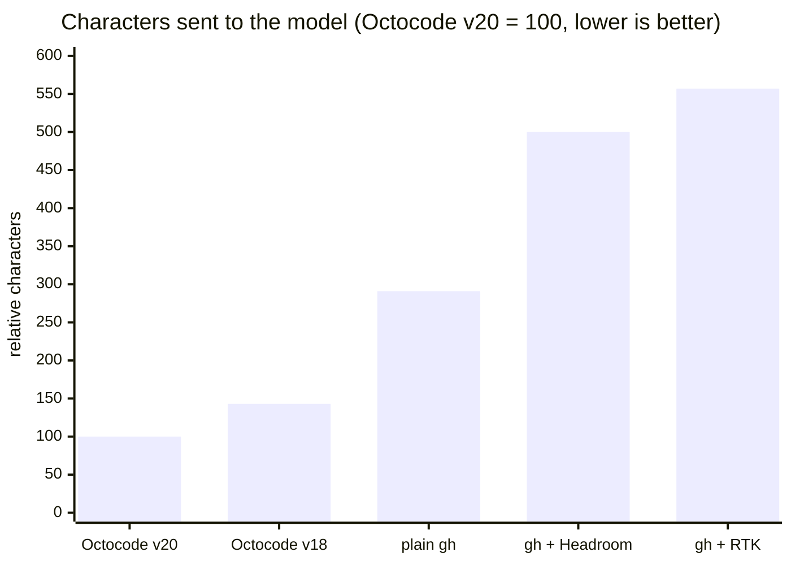
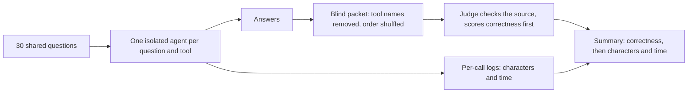
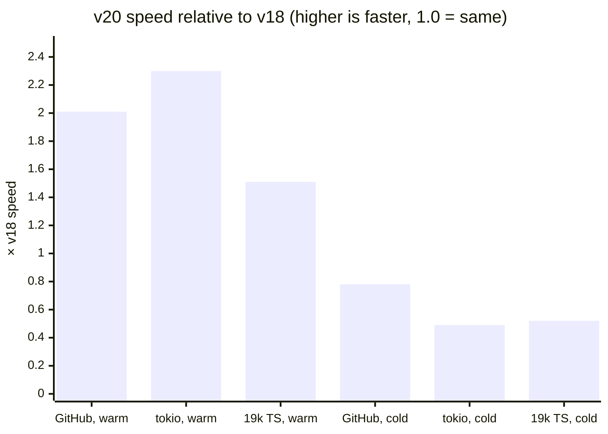

# Octocode benchmark - v20

Does Octocode give an AI agent correct, source-backed answers with less context and less
waiting? This package measures every Octocode version, and the GitHub CLI (`gh`), on the same
30 GitHub research questions.

## TL;DR

- **Octocode v20 is the best setup measured:** the most correct (9.57 out of 10) and the leanest. It uses 29% fewer characters than v18, and 3–6× fewer than the `gh` CLI setups.
- **Speed:** v20 is about 2× faster than v18 per call once its session server is warm, and about 2× slower on a single cold call.
- **Next targets:** cold start, structural search on large repos, and the characters spent on file and history reads.

## Results

Every setup answered the same [30 GitHub questions](compare/github-questions/). The newest Octocode version is on top, and each new version adds a row.

| Setup | Run | Correctness (of 10) | Characters per question, mean | Characters per question, median | Characters vs Octocode v20 (95% CI) | Questions where v20 used fewer characters | Speed in a session vs v18 | Speed of a cold call vs v18 | Verdict |
|---|---|---:|---:|---:|---:|---:|---|---|---|
| **Octocode v20** (Rust) | 2026-10-29 · 1 pass · Opus 5.5 judge | **9.57** | **15,590** | **13,872** | **1.0×** | — | **1.5–2.3× faster** | 1.3–2.0× slower | Most correct and leanest. Cold start is the regression. |
| Octocode v18 (TypeScript) | 2026-08-07 · 3 passes · gpt-5.5 judge | 9.26 | 22,111 | 16,233 | 1.43× (1.21–1.70) | 23 / 30 | baseline | baseline | Tied `gh` on correctness with far fewer characters. |
| plain `gh` | 2026-08 · 3 passes · gpt-5.5 judge | 9.28 | 114,849 | 37,560 | 2.91× (1.78–4.69) | 22 / 30 | not measured | not measured | Correct, but reads whole files. |
| `gh` + [RTK](https://github.com/rtk-ai/rtk) | 2026-08 · 3 passes · gpt-5.5 judge | 9.40 | 368,586 | 68,395 | 5.57× (3.33–9.57) | 24 / 30 | not measured | not measured | The most correct `gh` setup, and the most characters. |
| `gh` + Headroom | 2026-08 · 3 passes · gpt-5.5 judge | 8.66 | 382,598 | 72,681 | 5.00× (2.72–9.62) | 24 / 30 | not measured | not measured | Compression cost accuracy: the lowest correctness. |



### Reading the table

| Column | Meaning and measurement |
|---|---|
| **Setup** | The tool the agent was given. Octocode runs through `compare/bin/octoc`. `gh` is read-only (`gh api`, `gh search`, `gh pr view`). RTK filters and compresses `gh` output. Headroom compresses `gh` output before the model reads it. |
| **Run** | The date, the number of passes over the 30 questions, and the blind judge model. |
| **Correctness** | The judge's mean score, 0–10. The judge checks every claim against the source at the commit the answer cites. Correctness is scored first, so a wrong answer never wins on characters. |
| **Characters per question** | Text that reached the model: tool output plus the agent's commands and final answer, counted from per-call logs. Characters ≈ tokens, so fewer means a leaner context and lower cost. |
| **Characters vs Octocode v20** | How many times more characters the setup used than the newest Octocode. It is the per-question ratio, averaged as a geometric mean (which resists outliers), with a bootstrap 95% confidence interval. |
| **Questions where v20 used fewer characters** | On how many of the 30 questions the newest Octocode used fewer characters than this setup. |
| **Speed** | From a paired timing run on one machine, explained in [Speed](#speed). **In a session** means v20's warm `octocode serve` process is running; a **cold call** has nothing running yet. **not measured:** there is no fair `gh` timing, because the 2026-08 campaign timed Octocode through an `npx` start on every call. |

Where the `gh` numbers come from: the `gh` setups were not rerun beside v20. v20's ratios against them use their stored answers from the 2026-08 campaign.

The `gh` ratios are large for two reasons:
- **Whole-file reads:** plain `gh` has no region read, so it fetches whole files where Octocode reads only the lines it needs.
- **Occasional huge dumps:** some answers pulled whole trees or files. For example, Q28 alone took 1.47M characters on plain `gh`.

### Adding a new version

1. Run the 30 questions with the new build, following [Run the CLI matchup](#run-the-cli-matchup), into a new run folder such as `compare/github-questions_v21/`.
2. Add a row at the top of the table. Rename the ratio column to the new version (for example, *Characters vs Octocode v21*), and recompute every row's ratio and confidence interval against it.
3. Rerun [`compare/bin/version_timing.mjs`](compare/bin/version_timing.mjs) against the previous version to fill the speed columns.
4. Keep the older rows; they are the history.

## Evaluation

| Question | Evidence | Verdict |
|---|---|---|
| Is v20 at least as correct as v18? | 9.57 vs 9.26; higher on 20 questions, lower on 6 | **Accept** |
| Does v20 use fewer characters than v18? | 1.43× fewer per question (95% CI 1.21–1.70); leaner on 23 of 30 | **Accept** |
| Is v20 faster than v18 in a session? | 1.5–2.3× faster per task group, warm | **Accept** |
| Is v20 faster than v18 on a cold call? | 1.3–2.0× slower | **Regression**: fix cold start |
| Is v20 leaner than the `gh` CLI setups? | 2.9–5.6× fewer characters, at higher correctness | **Accept** (against stored August answers) |
| Is the v18 comparison like-for-like? | Different judge model and pass count, runs 11 weeks apart | **Inconclusive** for exact sizes; confirm with a same-day rerun |

What the verdicts mean:
- **Accept:** the evidence supports the claim.
- **Regression:** v20 is measurably worse.
- **Inconclusive:** the direction holds, but the size needs a cleaner run.

As in the [octocode-eval-benchmark](../../skills/octocode-eval-benchmark/SKILL.md) rules, correctness is decided first; cost (characters and time) counts only when correctness holds.

### How it was evaluated



- **Characters** are counted by the call wrappers in [`compare/bin/`](compare/bin/), never self-reported. The fixed tool primer each agent gets is excluded.
- **Re-judging:** a question whose two answers differ by 2 or more points is judged again by a fresh judge, with the answer order swapped. All 8 such v20 questions kept their result.
- **Fairness:** every tool takes its leanest legitimate path: targeted reads, snippets, minimal fields. Dumping a whole tree or file where a targeted read would answer invalidates the comparison.

> [!NOTE]
> **Limits of the v20 comparison:**
> - The runs differ in judge model and in number of passes; see the *Run* column in [Results](#results).
> - They are 11 weeks apart, so moving branches such as `canary` resolve differently.
> - Pooled character sums, which outliers dominate, are in the campaign write-ups. This page uses per-question geometric means.

## v20 vs v18

### Characters and correctness

- **Totals:** 467,696 characters over all 30 questions, against v18's 663,319.
- **Per-question numbers:** [github-questions/README.md](compare/github-questions/README.md#per-question-results-v18-vs-v20).
- **The full v20 run** (answers, judge verdicts, logs): [REPORT.md](compare/github-questions_v20/REPORT.md).

### Speed

Both versions ran on the same machine against the same work:
- **Builds:** published `octocode@18.2.2` against the v20 **release** build.
- **Calls:** every call is a fresh CLI process, the way an agent runs it.
- **Repetition:** 5 reps per task, with the run order rotated and a different query each rep, so no cache can answer a repeat.
- **Work:** GitHub reads pinned to one axios commit, plus two local repositories: tokio (about 2k files) and a TypeScript monorepo (about 19k files).

v20 is timed two ways:
- **v20 warm** is normal use. After a session's first call, the CLI hands each read-only call to its background `octocode serve` process.
- **v20 cold** is a single call with nothing running yet.

| 7 tasks per group, median ms summed | v18 | v20 cold | **v20 warm** | Warm vs v18 | Cold vs v18 |
|---|---:|---:|---:|---:|---:|
| GitHub tools | 5,774 | 7,485 | **4,135** | **2.01× faster** | 1.3× slower |
| Local tools, tokio | 1,378 | 2,823 | **710** | **2.30× faster** | 2.0× slower |
| Local tools, 19k-file TypeScript repo | 2,668 | 4,868 | **2,645** | **1.51× faster** | 1.9× slower |

The chart shows v20's speed relative to v18 (1.0 = the same; higher is faster):



Single calls, v20 warm against v18:

| Call | v18 | v20 warm |
|---|---:|---:|
| Single-file read, outline or tree (local) | 150–165 ms | **50–70 ms** |
| Text search, tokio | 278 ms | **124 ms** |
| Text search, 19k-file repo | 613 ms | **549 ms** |
| Structural (AST) search, 19k-file repo | **621 ms** | 1,156 ms |

> [!WARNING]
> **Cold start is v20's regression.**
> - A single cold call takes about 300 ms even for one small file, against v18's 160 ms.
> - The first call of a session also starts the background server (about 400 ms).
> - Short sessions and one-off calls feel this, and it is the next speed target.

> [!NOTE]
> **Part of the GitHub speedup is caching.** Warm GitHub times include v20's response cache, which v18 does not have. For example, the outline task re-read files the previous task had just fetched: 65 ms vs 852 ms.

Raw data: [timing/v18-vs-v20.json](compare/github-questions_v20/timing/v18-vs-v20.json) and [the log](compare/github-questions_v20/timing/v18-vs-v20.log). To rerun the timing:

```bash
npm install --prefix /tmp/octo18 octocode@18.2.2
node compare/bin/version_timing.mjs \
  --v18 /tmp/octo18/node_modules/octocode/out/octocode.js \
  --v20 ../octocode/out/octocode.js \
  --corpus rust=$PWD/local/repos/rust --corpus huge-ts=$PWD/local/repos/huge-ts \
  --out timing.json
```

> [!IMPORTANT]
> Run `node skills-dev/octocode-dev/scripts/dev.mjs build` (the release build) before timing. `build:dev` installs a **debug** binary, which is several times slower.

## What we learned

1. **The speed win comes from the warm server, not from process start.** The Rust port pays off when calls reuse a running session. Cold start needs work so that one-off calls benefit too.
2. **Correctness gains come from complete answers.** v20 lost points mainly by misquoting code it had read (a hunk header, a call signature), not by missing evidence. Runners must quote exact lines.
3. **Where v20 still spends characters:**
   - file reads: 42%
   - PR and commit patches: 19% (a single compare read returned 14–18k)
   - default code search: 18% (about 19k for one keyword)
   - failed calls: 7.5%

   The next cuts are a leaner search default, smaller history pages, and a line view for reads.
4. **16% of calls failed on guessed field names.** Examples: `path` (the field is `pathPrefix`), `sha` (it's `ref`) and `limit`.
   - Every runner recovered from the error message, but the failures cost 35k characters.
   - Fix: accept those spellings, or teach them in the primer.
5. **Benchmark hygiene:**
   - **Build:** time release builds only.
   - **Primer:** regenerate the Octocode primer from `octocode <tool> --help` for each release.
   - **Concurrency:** keep GitHub runners to about 7 at once, because GitHub rate-limits code search.

## Choose the benchmark and evaluation method

Use the [octocode-eval-benchmark skill](../../skills/octocode-eval-benchmark/SKILL.md)
to design and assess a comparison. Before launching agents, freeze the following in the campaign plan, and keep the plan beside the raw run:
- the primary metric and correctness guardrails;
- which questions are exposed, and how the judge is calibrated;
- budgets, retry policy and the decision rule.

| Comparison | Follow | Runs with |
|---|---|---|
| Octocode CLI vs `gh` setups, or one Octocode build vs another | [Benchmark skill](skills/octocode-benchmark/SKILL.md) + [`compare/`](compare/) | A fresh agent per question through the `compare/bin/` wrappers; blind X/Y judge |
| Speed, v18 vs v20 | [`compare/bin/version_timing.mjs`](compare/bin/version_timing.mjs) | Fresh CLI processes, interleaved; v20 timed cold and warm |
| GitHub research, scripted | [External cookbook](external/README.md) | Claude or Pi for MCP vs `gh`/shell; Codex for MCP arms |
| Pinned local repositories | [Local cookbook](local/README.md) | Fresh Codex MCP workers; existing Claude/Pi local shell arms |
| Installed local models with the native tools | [Local model cookbook](local/README.md#compare-installed-local-models-with-the-native-tools) | FreeLlama MCP inference and six native local tools |
| Native binary vs `rg` | [Recorded exploration](local/README.md#reproduce-the-native-cli-versus-shell-exploration) | Saved-run audit |

Don't substitute one execution lane for another without recording the harness change and rerunning both arms.
- **Verdicts:** finish with `Accept`, `Revert`, `Inconclusive` or `Invalid`.
- **No win without both:** missing quality data or noncomparable usage cannot establish a win.

## Run the CLI matchup

Octocode is the anchor. Each `gh` setup is a separate pairwise matchup over the same questions, and a new Octocode build is compared with the last one on the same questions.

```bash
cd packages/octocode-benchmark
bash skills/octocode-benchmark/scripts/check-prereqs.sh       # non-zero exit = fix first

CAMP=compare/github-questions_v21; mkdir -p "$CAMP/answers/parts" "$CAMP/judge"
# One fresh agent per question; every research call goes through the wrapper:
OCTO_LOG="$CAMP/octocode-p1-Q4.jsonl" ./compare/bin/octoc ghGetFileContent \
  '{"queries":[{"owner":"axios","repo":"axios","path":"lib/adapters/http.js","matchString":["follow-redirects"]}]}'
python3 compare/bin/record_answer.py --log "$CAMP/octocode-p1-Q4.jsonl" --question Q4 --file answer.txt

# After every answer exists: validate, build the blind packet, then one judge per question.
python3 compare/bin/validate_campaign.py "$CAMP" --question-count 30 --arms octocode,rtk > "$CAMP/metrics.json"
python3 compare/bin/build_blind_packet.py "$CAMP" "$CAMP/metrics.json" "$CAMP/blind-packet.md" \
  --passes 1 --baseline rtk --seed <seed> --map "$CAMP/judge/.MAP.secret.txt"
```

The protocol, step by step:
- **Runner brief:** [RUNNER.md](skills/octocode-benchmark/references/RUNNER.md) plus the arm's primer from [RUNNER_TOOL_CONTEXT.md](skills/octocode-benchmark/references/RUNNER_TOOL_CONTEXT.md).
- **Judging:** [JUDGING.md](skills/octocode-benchmark/references/JUDGING.md).
- **Write-up:** [REPORT_TEMPLATE.md](skills/octocode-benchmark/references/REPORT_TEMPLATE.md).
- **Reusing stored answers:** copy a stored campaign's answers and logs rather than rerunning that tool; [github-questions_v20](compare/github-questions_v20/) shows the layout.
- **Comparing against v18 itself:** run the published pin `compare/bin/octoc-npm` (`OCTO_SPEC`, with [primer-octocode-18.md](skills/octocode-benchmark/references/primer-octocode-18.md)).

<details>
<summary><b>Scripted GitHub comparison</b> (MCP vs <code>gh</code>, run by <code>scripts/</code>)</summary>

Run from `packages/octocode-benchmark` with an authenticated Claude, Pi or Codex installation. Codex supports MCP arms only; use Claude or Pi for shell and `gh` arms.

```bash
bash scripts/preflight.sh mcp,gh
python3 scripts/leak_check.py

CAMP=campaigns/github-comparison
RUNNER=claude bash scripts/run_campaign.sh "$CAMP" mcp,gh 1 all 4

python3 scripts/question_catalog.py external/questions |
  xargs -P 4 -I{} env JUDGE_RUNNER=codex JUDGE_MODEL=gpt-6.1-sol \
    bash scripts/judge_pair.sh "$CAMP" mcp gh 1 {}

python3 scripts/campaign_summary.py "$CAMP" --question-set github-v2 --judge-model gpt-6.1-sol
python3 scripts/matrix_summary.py --question-set github-v2
python3 dashboard/build_datasets.py --static results/overview/index.html
```

Before scored runs, freeze the build, question set, source revisions, model, reasoning effort, budgets and retry policy.
- MCP arms snapshot the local build unless `OCTO_MCP_CMD` selects another server.
- Match `RUNNER_MODEL` between arms.
- Never rerun a valid answer just because it scored poorly.

</details>

<details>
<summary><b>Local comparison</b> (pinned repositories)</summary>

The [local cookbook](local/README.md) covers the language questions, the pinned datasets, native CLI exploration and saved-run audits. For a fresh local MCP worker:

```bash
export LOCAL_REPOS="$PWD/local/repos"
export QUESTION_DIR="$PWD/local/questions"
export QUESTION_REPO_MAP="$PWD/local/repositories.json"
RUNNER=codex RUNNER_MODEL=gpt-5.6-terra bash scripts/preflight.sh local-mcp
RUNNER=codex RUNNER_MODEL=gpt-5.6-terra \
  bash scripts/run_campaign.sh campaigns/local-comparison local-mcp 1 all 1
```

The manifest pins revisions and assigns repository scope outside the question text, and a dirty tracked tree fails closed. For a two-arm version comparison, see the [paired local run](local/README.md#run-a-paired-local-mcp-comparison).

</details>

## Workers, judges and measurements

- **Workers** get one shared research brief ([GitHub](prompts/runner.md) or [local](prompts/local-runner.md)), one primer for their tool, and one question.
- **Judges** follow [source-backed judging](docs/judging.md). Workers never see private rubrics or competing answers.
- **Judging rules:**
  - calibrate the judge;
  - shuffle answer order;
  - withhold costs until quality is locked;
  - keep uncertainty, and review disagreements.
- **Reporting:** report provider token usage separately. Unknown timing stays unknown.
- **Evidence vs correctness:** a citation that exists, or a snippet whose bytes match, does not by itself make an answer correct.

More detail: [method and isolation](docs/method.md), [runner configuration](docs/running.md), [harness components](docs/harness.md), [output accounting](docs/outputs.md).

## Find and save results

| Where | What |
|---|---|
| [`compare/github-questions_v20/`](compare/github-questions_v20/) | The v20 run: answers, per-call logs, blind packet, verdicts, timing, REPORT.md |
| `results/README.md` | Index of campaign write-ups, one directory and README per result |
| `results/overview/README.md` | Default matrix, dashboard and historical aggregate data |
| `campaigns/<name>/` | Raw transcripts, sealed answers, receipts and judge attempts (gitignored) |

Preserve existing reports and raw records. For a separate question set, pass `--question-set` to the summaries, and never overwrite the GitHub overview with local results.

## Add a question

A GitHub question goes in the shared [`compare/github-questions/`](compare/github-questions/) folder, which every tool uses. A corpus-local question goes in that corpus's `questions/` folder. Create `Q<n>.md` with exactly:

```markdown
# Q<n> — Short title

**id:** `unique-kebab-id`

## Question

One self-contained, objectively checkable prompt. Name the repo(s)/ref(s) or `$CORPUS`
path, and say exactly what to report. No hints, no approach, no answer.
```

Then add its row to that folder's `README.md`.

## Package layout and checks

```text
compare/       CLI matchups: bin/ wrappers and timing, github-questions/, per-run folders
skills/        octocode-benchmark skill: protocol, primers, judging, preflight
scripts/       scripted harness: runners, guards, measurement, judges and tests
prompts/       worker briefs and primers for the scripted harness
local/         local cookbook, repos/, e2e/, questions, pinned datasets, saved-run review
external/      GitHub cookbook and questions
dashboard/     dashboard source, data builder and release notes
docs/          method, judging, outputs, harness guide
experiments/   scoped benchmark experiments
results/       one directory and README per result; overview aggregates
campaigns/     raw campaign evidence (gitignored)
```

```bash
# From the monorepo root:
yarn workspace @octocodeai/octocode-benchmark verify
node skills-dev/octocode-dev/scripts/dev.mjs docs:verify
```
