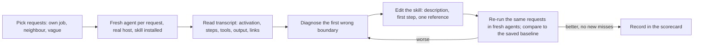

# Skills: benchmark and improve

How to check what an agent does with each public skill under `skills/`, and how to improve a skill from what the
checks show. Questions, not scripts: a fresh agent gets an ordinary request, you read what it did. Mechanical
gate (lint, links, contracts, size): `node skills-dev/octocode-dev/scripts/dev.mjs skills:check`. How to author or
review one skill: [check skills](../../skills/octocode-skills/references/check-skills.md); how to test
activation in depth: [skill activation](../../skills/octocode-agentic/references/skill-activation.md). Agent and
environment setup: [TESTING_ENV.md](TESTING_ENV.md).

## Questions

[questions/skills/](questions/skills/README.md) lists, per skill, requests it must handle and requests that belong
to its nearest neighbour. Write new ones in the user's voice, with no skill name and no hint of the steps.
Three kinds per skill:

| Kind | Example shape | Pass |
|---|---|---|
| **Own job** | an ordinary request the skill exists for, in different wordings | activates, first action matches the skill |
| **Neighbour** | a request the nearest skill should take | does **not** activate |
| **Vague or mixed** | the job under-specified, or two jobs at once | asks or routes the way the skill says; does not guess |

## Check one skill

Fresh agent per request, in a real host with the skill installed the way a user gets it (plugin or `skills/`
folder), and only that skill's tools. Then read the transcript:

| Check | Look at | Pass when |
|---|---|---|
| **Activation** | did the host load the skill, and when | loads for own-job and vague requests, not for neighbour requests; record hits and misses per request |
| **Steps** | the agent's first action and order | follows the skill's first action and steps, asks for missing input the way the skill says, stops where the skill says it is done |
| **Tool use** | the calls it made | uses the Octocode CLI or MCP tools the skill names, with valid fields, follows `next` leads instead of guessing |
| **Output** | what it wrote | saved output lands under `.octocode/<skill-name>/` (or the user's path); has the promised shape; evidence and unchecked scope are stated |
| **References** | every reference the run needed | each resolves and loads when its condition is met; nothing required is unreachable; nothing unneeded was loaded |
| **Cost** | characters read, calls, time | not more than the baseline for the same request; a skill that adds ceremony is a regression |

Rate each skill 1–5 on these, one line of evidence each, in the [scorecard](briefs/SCORECARD.md). For
clean-up skills use the [clean-skill acceptance checks](briefs/check-cleanup.md).

## Improve a skill

1. **Save a baseline** first: the same requests, the same host and model, fresh agents, transcripts kept in
   `campaigns/<round>/`. Without it, a later run proves nothing.
2. **Find the first wrong boundary**, not the last symptom: a missed activation is a description problem; a wrong
   first step is a skill-body problem; a bad tool call is a tool-contract problem (report it, do not paper over it
   in the skill); a missing reference is a link problem.
3. **Change one thing at a time**, smallest first: the description's trigger wording, then the first action, then
   a reference. Say why in one line. No special cases for the test requests: that is overfitting, and the
   requests are public.
4. **Re-run the same requests in fresh agents** and compare to the baseline. Also run requests the edit should not
   affect: a fix that steals a neighbour's requests is worse than the miss.
5. **Run `skills:check`**, then record: skill, baseline vs after (activation hits, steps, tools, cost), what
   changed, what is still failing.

A fixer never signs off its own work: another fresh agent judges the transcripts.
