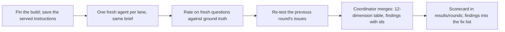

# Independent raters

How to rate every Octocode tool with independent agents. Each agent uses its tools on fresh research questions,
checks every answer against a source outside Octocode, and scores each tool on the
[12-dimension rubric](../RATINGS.md#agent-experience-rubric-12-dimensions). The
[tool checks](../tool-checks/README.md) test the paths they were written for; independent raters find what those
paths miss. Rate on one pinned build; fix nothing during the round.

## Before the round

1. **Pin the build.** Record `octocode --version`, the binary's SHA-256 and the commit, and whether the tree is
   dirty. Raters call that binary directly: `octocode <tool> '{"queries":[…]}' --json`, and continuations with
   `{"cursor":"…"}`. An MCP server already running in the coordinator's session may serve an older build, so
   raters do not use it.
2. **Save the served instructions.** Write the `instructions` from the `octocode mcp` initialize result to a file;
   the end-to-end lane uses only that file and each tool's `--help` and `schema`.
3. **Note the running `octocode serve` processes.** Raters' CLI calls start more of them; afterwards the
   coordinator stops only the new ones, by PID.

The CLI and the MCP server run the same tools, fields and runtime; the CLI is the surface raters use. Cover MCP in
the same round with the tool checks (`run.mjs` drives `octocode mcp` over stdio) and with a default-surface run
over MCP: an empty `OCTOCODE_HOME`, `tools/list`, one call per step of each default tool's check file, and a scan
for any tool the surface names but does not serve.

## Lanes

One agent per lane, each with this brief plus its lane: the tools, edge cases worth covering, and the previous
round's issues to re-test.

| Lane | Tools | Ground truth |
|---|---|---|
| Packages | artifactSearch, securityCheck | registry web APIs, api.osv.dev, GitHub tags |
| clasify | clasify, and the `classification` option of search tools | hand-labelled items read in source; cited lines read with `sed -n` |
| Local | structureSearch, localSearch, localFetch | `rg`, `find`, `git ls-files`, `sed -n`, `cmp` |
| Code intelligence | astSearch, lspSearch | `rg` plus reading each site; text-only hits separated from real misses |
| GitHub read | ghSearchRepo, ghSearchCode, ghStructure, ghGetFileContent | `gh api` (GET only), raw file reads |
| GitHub history | ghSearchHistory, ghGetHistoryItem, ghCloneRepo | `gh api` (GET only), `git` in the clone |
| Graph | graphBuild, graphQuery | `rg`, reading call sites, a fixture with known edges |
| End to end | every tool the questions route to | each cited claim checked after the answer |

The end-to-end lane answers real questions (one local, one about a public library and its releases, plus the
previous round's question) using only the served instructions and `--help`/`schema`, and records per question:
calls, characters, wall time, wrong turns, and which leads helped or misled. It also rates the guidance itself.

## Rules for raters

- **Read-only.** No edits in the repository, no git writes, no builds. Scratch files go in the lane's own scratch
  folder and are deleted at the end.
- **Graph snapshots** go to a scratch `OCTOCODE_GRAPH_HOME`, never into the repository.
- **Secrets.** Never read, print or copy `~/.octocode/.env` or any key. Never post to GitHub.
- **Billing.** clasify bills the configured classification account. Give each lane that may bill a fixed request
  budget (the sum of `usage.calls`), require an explicit `maxRequests` on every billed call, and have the rater
  ask the coordinator before going over it.
- **Shared quotas.** GitHub code search allows about 10 calls a minute across all lanes; spend it on questions
  that decide a score. Confirm a GitHub defect on more than one public repository.
- **Processes.** Stop processes by PID only, never by pattern.

## What each rater measures

- Every dimension of the rubric for every tool in the lane, from at least: a cold and a warm call, one stress
  test, one batch of up to 5 queries, and a walk of every page of at least one paged answer.
- A claim counts as correct only after the rater checked it; claims it could not check are listed as unverified.
- Rate first on fresh questions. Only then re-test each of the previous round's issues, and mark it fixed, partly
  fixed or not fixed, with evidence.

## What each rater returns

1. One table: tool | Desc | Schema | Workflow | Clarity | Time | Tokens | Paging | Smart | Short | Long | Stress |
   Hints | Overall | Correct, plus calls and characters spent, and one line per tool:
   `in: <tools> → tool → out: <tools>`.
2. Up to 6 defects, most severe first, each with the exact input, observed vs expected, the ground-truth
   evidence, a severity (high, med, low) and the likely owner (core text and schema, or native behavior).
3. The regression check.
4. One or two lines on what is good.

## After the round (coordinator)

1. **Spot-check** the deciding anchor of each high-severity finding yourself (the code path, a free refusal, a
   doc line) before reporting it.
2. **Merge** the lanes into one 17-tool table with per-dimension averages, and the round-to-round change per tool.
3. **Apply the correctness gate** from [RATINGS.md](../RATINGS.md): a tool with an unresolved wrong answer, silent
   evidence loss or unreachable required page is capped at 4 for readiness, whatever its rater score.
4. **Record** the round in `results/rounds/<version>-<date>/SCORECARD.md`, freeze every finding with an id in the
   same folder, add the round to the [results index](../results/README.md), and copy the findings into the fix
   list.
5. **Clean up:** stop the `octocode serve` processes the round started (by PID), and confirm no rater file or
   graph snapshot is left in the repository.
