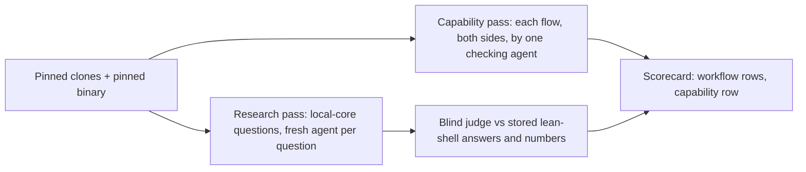

# Local flows benchmark

The one doc to follow for a local round: the research flows an agent runs on a local checkout, what each is
compared against, which questions feed it and what to record. Repositories and setup are in
[README.md](README.md); judging and aggregation in [METHOD.md](../METHOD.md); the per-tool checks behind each
flow in [CHECKS.md](../CHECKS.md#core-tools); the expert commands in [COMPARISONS.md](../COMPARISONS.md).

## Before the round

- Clones at their pinned commits ([README.md](README.md#repositories)), clean tracked trees.
- One pinned Octocode binary: version, SHA-256, commit. The CLI and MCP surfaces both, or say which.
- `rg`, `ast-grep`, `fd` and `git` versions; graphify only if the owner installed it.
- The previous round's flow rows (calls, characters, time per flow) from its scorecard or from
  [results/baselines/local-core30.md](../results/baselines/local-core30.md).

## The flows

Each flow is a question shape, not a recipe: start from the question, let each response lead, and count the
calls. "Feeds" names the questions whose answers depend on the flow.

| # | Flow | Octocode path | Compared with | Feeds | Better means |
|---|---|---|---|---|---|
| 1 | **Find, then read** a known name | localSearch → localFetch `matchString` + `block` | `rg -n` → `sed -n A,Bp` (length guessed) | core Q1, Q2, Q4–Q6; goals | the whole declaration on page 1 without guessing its length; fewer characters |
| 2 | **Who calls it**, with roles | localSearch → lspSearch `callers` / `references` at the hit's line | `rg -n -w NAME` and reading each hit | core Q7, Q8, Q15, Q23 | only real calls, with roles; rg's false positives counted |
| 3 | **Type hierarchy**: subclasses, implementations | lspSearch `subtypes` / `implementation`, or astSearch with a rule | `rg -U 'extends\s+NAME'` / `ast-grep` pattern | core Q10, Q14 | complete set across files; nothing from comments or tests unless asked |
| 4 | **Shape search**: calls of a form, calls inside a function, functions that skip a call | astSearch `match` with a `rule` (has / inside / not) | `ast-grep run -p`, `ast-grep scan --inline-rules` | core Q9 | same match set as ast-grep; the shape only |
| 5 | **Outline of a large file** | localFetch `view: symbols`, or astSearch `symbols` | `ast-grep` kind rules; `rg -n '^(class\|def) '` | core Q11, Q29 | every declaration, with lines, in fewer characters than reading |
| 6 | **Structured-file membership**: which table or section a key is in | localFetch whole file or exact range | `sed -n` / `jq` on the file | core Q12, Q13, Q18, Q24 | the exact containing section; absence proved from the whole object |
| 7 | **Layout**: a directory listing; largest, longest, newest files | structureSearch tree / `files` with `sort` | `fd`, `find … -maxdepth`, `find … stat \| sort -rn` | core Q3 | same listing; one metric per row |
| 8 | **Large and awkward files**: multi-MB, minified, one long line, BOM, non-ASCII paths | localSearch window → localFetch pages | `rg -o -b '.{0,60}T.{0,60}'`, `head -c`, `sed -n` | core Q16, Q17, Q19, Q21 | a window with its offset instead of the line; every byte reachable once; redaction intact |
| 9 | **Absence with scope stated** | localSearch with an empty result | `rg` exit 1 | core Q22 | the empty result says what was scanned; the answer states the scope |
| 10 | **Same name, other languages** | localSearch `include` by language → lspSearch / astSearch per language | `rg -w` with `-g` per extension | core Q20 | each language's symbol kept apart |
| 11 | **Across repositories** | the same calls per clone, batched | the same `rg` per clone | core Q24 | one batch; per-clone answers kept apart |
| 12 | **Described target**: behavior described, name unknown | localSearch on likely terms → clasify over the candidates → localFetch the deciding lines | reading the candidates | core Q23, Q25–Q30; goals; scenarios | the deciding lines in fewer main-agent characters; billed requests counted |
| 13 | **Importers, unused exports, cycles, impact** | graphBuild → graphQuery `dependents`, `issues`, `cycles`, `impact` | `rg -o "from '…'" \| sort \| uniq -c`; graphify when installed | capability pass only | edges confirmed on a sample against source; claims marked as hypotheses |
| 14 | **Many searches after a clone** | ghCloneRepo → localSearch ×3 | `gh repo clone -- --depth 1` → `rg` ×3 | capability pass only | time to the first local answer, then flow 1 rows |
| 15 | **Root-cause scenario**: a symptom, several questions | any of the above, led by responses | the lean shell arm | scenarios | correct causal chain with cited lines; exploratory, not one fresh agent per question |

## Question sets

| Set | Use it for | Notes |
|---|---|---|
| [local-core](../questions/local-core/README.md) (30) | the research pass: fresh agent per question, blind judge with the rubric in `answers/` | stored lean-shell, 19.1.0 and pre-release v20 numbers in [baselines](../results/baselines/local-core30.md); question kinds map to flows 1–12 above |
| [local-goals](../questions/local-goals/README.md) (40) | goal-driven research and the Terraform slice (Q33–Q40) | checkout named by path in each question; private rubrics; stored clasify ablations |
| local-transfer (12) | checking that guidance transfers to questions it was not written against | never pooled with other sets |
| local-scenarios (30) | flow 15: open root-cause scenarios across 17 clones | no rubric; judge from source; stored exploratory native-CLI vs shell run |

## Run it

1. **Capability pass.** One checking agent runs every flow on a real target from the clones (a different
   target from last round where the flow allows, plus the same one for comparison), both sides, using the
   [check-local brief](../briefs/check-local.md). Use a large clone (`huge-ts`, `huge-go`) for flows 7, 8 and
   13 at least once.
2. **Research pass.** A fresh agent per local-core question with the [runner brief](../briefs/runner.md) and the
   [Octocode arm brief](../briefs/arms/octocode.md); about 10 questions spread over the flows unless the round
   asks for all 30. Judge blind per [METHOD.md](../METHOD.md#judge). Don't rerun the lean shell: compare
   against its stored numbers.
3. **Graph.** Flow 13 against graphify only when installed; otherwise record "graphify not installed" and the
   shell fallback.

## Record

Per flow, one row:

| Flow | Target (clone, path) | Octocode calls | Octocode characters | Octocode ms, first / repeat | Expert command | Expert characters, ms | Right on both? | Calls last round | Better and why |
|---|---|---|---|---|---|---|---|---|---|

Then the research pass's per-question table and its comparison with the stored baselines. Both go into the
round's [scorecard](../briefs/SCORECARD.md): the flow rows under Workflows, the comparisons under Benchmark,
every defect with its exact call. A flow that needs more calls than last round is a defect unless the answer
improved.
