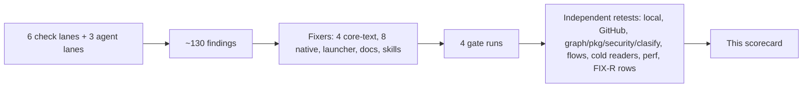
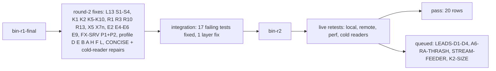
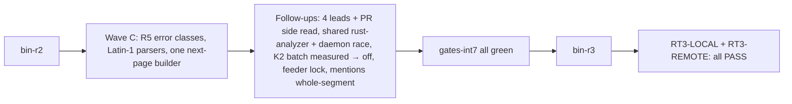

# Scorecard — 20.2.0, 2026-11-15, full round

What changed in one day of checking, fixing, and independent retesting of every Octocode tool, flow and surface. The evidence lives in the campaign folder `packages/octocode-benchmark/campaigns/20.2.0-2026-11-15-full-round/`: `DEFECTS.md` is the single queue, and each lane keeps a `REPORT.md` and receipts. Nothing is committed.

**Binaries**
- Morning baseline: `bin/octocode`, SHA256 `e354a30c…`.
- Release after fixes: `bin-int1-release/octocode`, SHA256 `0587ee0f…`.
- Debug builds used for retests: `bin-int1`, `bin-int2` and `bin-int2-regen`.

## Verdict

**Ready to integrate.** Every confirmed defect found this round is fixed and was retested by someone other than its fixer, with one exception: the items listed under "Open", which need either an owner decision or a round-2 design. No retest found a regression.

Gates in the final run (gate run 4, `gates-int2/`) are pending; see below.

## Ratings: before → after

Scored on 8 dimensions (schema, description, input, output, workflow, pagination, stress, efficiency), each 1–10, with the overall score as the mean. "Before" is the morning check on the baseline binary; "after" is the independent retest on the fixed binaries.

| Tool | Before | After | What moved it |
|---|---:|---:|---|
| localSearch | 8.3 | 8.6 | long-line hits disclose their window and offer a read of the whole line; absence names the binary files it did not search; literal-vs-regex hint; `sampled` meaning; exact `include` overrides default excludes |
| localFetch | 8.3 | 8.8 | long-line pages follow `responseChars` (a 6 MB line takes 12 calls, down from 359); no stray blank line in CLI text |
| structureSearch | 8.6 | 8.8 | relative listings; empty results count what matched |
| astSearch | 8.2 | 8.4 | `not` with a reused metavariable fixed (wrong answer); Latin-1 count; per-file grammar noise removed; full unparsed list; the +195 M-instruction regression introduced and removed this round |
| lspSearch | 8.0 | 8.3 | `workspaceSymbol` on a directory now marked partial (`workspaceSymbolOneProject`); operation echo; Cargo `target/` walk −98% |
| ghSearchRepo | 8.1 | ~8.3 | `archive` note; past-cap total; archive-only listing |
| ghSearchCode | 8.5 | 8.5 | `limit`/`ref` notes; page unit `files`; ref-index warning |
| ghStructure | 8.8 | 8.8 | `ref` note (G4 deferred) |
| ghGetFileContent | 9.1 | ~9.3 | `commitSha`→`ref` repair; missing path 187 → 23.5 MB; `binaryFileUnsupported`; parent-is-a-file lead; 1,000-entry listing note |
| ghSearchHistory | 8.2 | ~8.6 | 1,000-result cap: total and walk agree, rows 1,001–1,020 served |
| ghGetHistoryItem | 8.7 | ~8.9 | read-more menus kept; `base`/`head` repair; status-letter legend |
| ghCloneRepo | 9.0 | 9.0 | describes `location.commitSha`, `checkoutDirty`, and graph/LSP use on clones |
| graphBuild | 8.2 | 8.3 | the full unparsed list pages; spill-limit warning; per-build job bytes |
| graphQuery | **4** (capped: wrong answer) | 8.3 | shallow-clone `cochange` fixed; drift `name@n`; skip notes; `::` paths; prose false mentions; hidden-tier count; `witnesses` lead to `to` |
| artifactSearch | 8.3 | 8.5 | transport errors name their cause and fix |
| securityCheck | 8.7 | 8.7 | `fixedIn` / sources wording |
| clasify | 7.2 | 8.0 | silent-provider stall ends at the stall (5:00) instead of 4 × 300 s; nested query repair; `sourceBox` duplicate removed |

Ratings marked ~ were inferred from the retest's per-dimension changes, not re-averaged.

## Performance: morning vs fixed release

Measured as retired-instruction counts and peak memory, which do not depend on machine load. Wall times are indicative only.

| Scenario | Before | After |
|---|---|---|
| 6 MB minified line, read to the end | 359 calls, 28.6 G instr, 7.3 s | 12 calls, 2.6 G, 0.5 s |
| lspSearch after any file change (Cargo `target/` present) | 815 M instr per call | 13–21 M (−98%) |
| ghGetFileContent, path not found on next.js | 186.6 MB peak, 5.35 G | 23.5 MB, 0.64 G |
| Rust localSearch with test-code spans (default) | 18.7 G instr, 200 MB | 9.9 G, 172 MB (−47%) |
| Installed `octocode --version` / warm call | Node launcher: ~395 M instr, 50 MB, ~60 ms | native: 41 M, 9 MB, <10 ms |
| Silent clasify provider | 20:01 wall (4 × 300 s) | 5:00 (one attempt, no retry) |
| GitHub search past the 1,000-result cap | rows 1,001–1,020 silently missing | served; total matches the walk |
| All 17 tools, one call each | — | within ±4%, after the astSearch regression fix |

## Agent quality

- **Cold-agent research flows:** 10/10 GitHub and package flows (morning) and 12/12 mixed local, GitHub, package and clone flows (after) were correct, with Haiku 3/3 both times. After the fixes, `commitSha` repair saved a call in 2 flows. The ky and flask flows used fewer calls and bytes than in the morning.
- **Cold-reader interviews (Haiku):** 8 of the 11 questions that failed in the morning now pass. The rest got wording fixes; the final rerun is pending (`rt/cold2/`).
- **Classification:** precision 1.00 and recall 0.90 across six inline tools; lossless continuation; egress shows only redacted text.
- **Security:** 7/7 checks pass after the fixes, including 4,857 secrets on 3 MB of page edges with no fragment leaked.

## Closed this round (highlights)

| Kind | Rows |
|---|---|
| Wrong answers | graphQuery `cochange` on shallow clones (P1); astSearch `not` with a reused metavariable (X1); lspSearch `workspaceSymbol` false empty, now partial (A1) |
| Rigid caps removed | localFetch 16 KiB long-line pages (L1); GitHub owner listing 5-page cap (N1); GitHub search page past the cap (G1) |
| Memory and speed | test-code scan first (F1); Cargo `target/` prune (F2); missing-path tree walk (E3); native bin at install (F3); clasify stall (P2); astSearch type table built lazily |
| Leads and flows | PR/issue read-more menus (G3); whole-line read lead (L5); file-parent recovery (V1); 1,000-entry listings disclosed (V7a) |
| Input repair | `commitSha`→`ref`, `kind`, `match`, `language`, `base`/`head` (E1, E7, R12, X8) |
| Contract and docs | 21 description fixes (A1–A21), the output-fields pointer, CLI/MCP-neutral wording, skills alignment, stale `LSP.md`, audit files moved out of the package docs |
| Cleanup | duplicate helpers, test-only public functions, campaign IDs in comments, weakened tests strengthened, one swallowed error |
| Dev hygiene | workspace `yarn install` no longer swaps the dev launcher for a stale binary (W19); pnpm global install keeps the Node launcher (V2) |

## Open

| Item | Why open | Next |
|---|---|---|
| localSearch fast page 1, rigid ranking removed (L13) | owner decision; design ready (`design-l13/`) | round 2 |
| Leads and prewarm (R1, R3) | design ready (`design-r1-r3/`) | round 2 |
| MCP uses the warm server, socket key, (device, inode) key (R2, F3b) | owner decision; design in progress | round 2 |
| Action-based error classes (R5) | owner decision; design in progress | round 2 |
| Latin-1 parsing for parsers | owner decision; needs a contract encoding value | round 2 |
| ghSearchHistory classification judges titles only (K1) | wrong answer; design in progress | round 2 |
| Classification billing granularity (K2/K3), memory-mode billing (K5) | design in progress | round 2 |
| Issue/PR comment text filter (E2) | ~0.5 MB to find one comment; design in progress | round 2 |
| Finish the one next-page builder (C2) | owner decision; emitters span 4 tool folders | round 2 |
| X5 callers on non-empty answers; X7 `releaseTag` field; G4 ghStructure identity on stdout | need owner decisions or a core field | ask |
| F1 remainder (~3 G of span work) | removed by L13 | round 2 |
| E4–E6, R6–R14, K4, K6–K10, L15, L16 | minor | round 2 backlog |

## Per tool: 13 dimensions and how each can get better

Scores are 1–10 and use today's evidence only: the check lanes, the independent retests, RT-PERF instruction counts, and the cold-agent and cold-reader runs. The manager combined that evidence into these numbers; no new measurement was made for this table. "–" means the dimension does not apply. Links point to round-2 designs in `campaigns/20.2.0-2026-11-15-full-round/`.

**Dimensions**
- **Eff (efficiency):** bytes an agent reads to get the answer, against the rival (rg/fd/ast-grep/gh).
- **Ctx (context/prompt):** how well a cold agent understands it from the served text.
- **Impl (implementation):** defects found and fixed, rigidity left.
- **Res (results):** correctness against ground truth.
- **Flow:** chaining into other tools via ids, leads and identity.
- **Page (pagination):** lossless walks to the end.
- **Cont (continuity):** cursors across processes, stale refusal, restart.
- **Cache:** reuse across repeats and processes.
- **Speed:** latency against the rival.
- **Mem (memory):** peak RSS.
- **CPU:** instructions.
- **API:** provider requests used.
- **Lev (leverage):** what it does that the rival cannot.

| Tool | Eff | Ctx | Impl | Res | Flow | Page | Cont | Cache | Speed | Mem | CPU | API | Lev |
|---|---|---|---|---|---|---|---|---|---|---|---|---|---|
| localSearch | 8 | 9 | 8 | 10 | 9 | 10 | 10 | 8 | 5 | 6 | 6 | – | 9 |
| localFetch | 8 | 9 | 9 | 10 | 9 | 10 | 10 | 8 | 8 | 8 | 8 | – | 8 |
| structureSearch | 7 | 9 | 9 | 10 | 8 | 10 | 10 | 8 | 9 | 9 | 8 | – | 7 |
| astSearch | 8 | 8 | 8 | 10 | 8 | 10 | 9 | 6 | 5 | 7 | 5 | – | 9 |
| lspSearch | 8 | 7 | 8 | 9 | 9 | 10 | 9 | 7 | 6 | 4 | 7 | – | 10 |
| ghSearchRepo | 7 | 9 | 9 | 10 | 8 | 9 | 10 | 5 | 7 | 9 | 9 | 5 | 6 |
| ghSearchCode | 8 | 8 | 9 | 10 | 9 | 9 | 10 | 9 | 8 | 9 | 9 | 8 | 8 |
| ghStructure | 8 | 8 | 8 | 10 | 9 | 10 | 10 | 9 | 8 | 8 | 9 | 6 | 8 |
| ghGetFileContent | 9 | 9 | 9 | 10 | 9 | 10 | 10 | 9 | 8 | 9 | 9 | 9 | 9 |
| ghSearchHistory | 8 | 8 | 8 | 9 | 9 | 9 | 10 | 5 | 7 | 9 | 9 | 5 | 7 |
| ghGetHistoryItem | 6 | 9 | 8 | 10 | 9 | 10 | 10 | 8 | 7 | 8 | 8 | 7 | 10 |
| ghCloneRepo | 8 | 8 | 9 | 10 | 8 | – | 9 | 9 | 7 | 8 | 8 | 8 | 8 |
| artifactSearch | 9 | 8 | 9 | 10 | 8 | 8 | 9 | 8 | 7 | 9 | 9 | 8 | 8 |
| securityCheck | 8 | 9 | 8 | 10 | 7 | 10 | 9 | 8 | 7 | 8 | 9 | 8 | 9 |
| graphBuild | 7 | 8 | 8 | 9 | 8 | 9 | 8 | 5 | 5 | 4 | 5 | – | 9 |
| graphQuery | 8 | 8 | 8 | 9 | 9 | 10 | 9 | 8 | 8 | 8 | 8 | – | 10 |
| clasify | 6 | 8 | 8 | 9 | 8 | 9 | 9 | 7 | 6 | 9 | 9 | 5 | 9 |

### localSearch
- **Evidence:**
  - Output is smaller than rg (5.3 vs 7.3 KB; 882 B vs 1.8 KB).
  - Pagination matches rg exactly (884 rows, 508 on kubernetes), and cursors resume in a fresh process.
  - Page 1 on a huge scope takes 3.8–5.1 s vs 17 ms for `rg | head`.
  - Rust spans are 9.9 G instr after F1, down from 18.7 G.
  - Peak 172–361 MB in a fresh process on large scopes.
- **How it can be better:**
  1. **L13 fast page 1:** the walk-order default with no rigid ranking (design `design-l13/`). Expected page 1 near rg speed, and it also removes the remaining ~3 G of span work and the `scopeTooBroad` memory refusal.
  2. The literal-looking-regex hint for multi-term queries (T3/E8; needs per-term counts).
  3. Classification billing per file is already batched; keep it as the model for K2.

### localFetch
- **Evidence:**
  - A 6 MB minified line takes 12 calls / 2.6 G instr (was 359 / 28.6 G).
  - `block` reads a 703-line function exactly; Latin-1 decodes with a warning.
  - Redaction holds across page edges (4,857 secrets, no fragment).
  - Short reads cost 2–4× more than `sed` (fixed launcher + server round trip).
- **How it can be better:**
  1. K7: `unfilteredUnknown` should mark the undecided lines (design-classification §4).
  2. L15: state the minified outline's size against the content view on page 1 (core text).
  3. The native bin at install already removes the ~40 ms launcher cost for installed CLIs; MCP pays it once.

### structureSearch
- **Evidence:**
  - Sorting by size is 10× faster than `fd -x stat` (162 vs 1,664 ms).
  - Listings now print relative to a `# root:`, and empty results count what matched without the filter.
  - Classification bills one request per path (13 paths = 13 requests).
- **How it can be better:**
  1. K2 unit batching (13 → 1 request).
  2. Keep the walk order shared with localSearch's L13 traversal (one owner of "walk order").

### astSearch
- **Evidence:**
  - Matches inside macro bodies that ast-grep misses (645 extra `unwrap()`s, all real).
  - The `not` wrong answer is fixed.
  - The +195 M per-call type-table regression is fixed, so `Arc::clone` on io/src is back to ~750 M.
  - The `$X.unwrap()` crates sweep is 850 ms warm vs ast-grep 452–496 ms, with no warm reuse.
  - Largest schema (7.2 KB).
- **How it can be better:**
  1. Profile the matcher (the `profiling` profile exists) and add warm reuse of parsed trees keyed by content digest, the way the FACTS memo works for spans.
  2. Latin-1 parsing (owner decision: decode with a warning; needs the contract encoding value).
  3. Trim schema size through the cold-reader loop, never by dropping guidance.
  4. Optional extension→type map so the ripgrep type table is cheap when it is needed.

### lspSearch
- **Evidence:**
  - Cold start 10–17 s, warm 0.3–0.4 s.
  - The Cargo `target/` walk is −98% (815 → 13–21 M instr per call).
  - Prewarm can start rust-analyzer at 1–3.4 GB from leads the agent never sees (R1).
  - Every MCP process has its own pool (R2).
  - Cold readers still choose `workspaceRoot` for `workspaceSymbol` when they have no file (0/2).
- **How it can be better:**
  1. R1: prewarm only from served leads (`design-r1-r3/`).
  2. R2: MCP uses the workspace's warm server; Phase 2 moves the spawn env into the LSP config, so GUI and terminal share one rust-analyzer (`design-r2-r5/`).
  3. CORE-5: say what to pass when no file is known, and document `coverage.state`.
  4. Measure cold-start reuse across the shared daemon (A.6).

### ghSearchRepo
- **Evidence:**
  - Past-cap totals agree with the walk (1,020 rows served).
  - Archive-only listing no longer yields empty pages.
  - The `archive` note is fixed.
  - No-cache searches re-ask every time (5 identical rows = 5 requests): owner decision, strict caching.
- **How it can be better:**
  1. Read archive-only listings at a larger provider page size, to cut sequential provider pages on large owners (N1 follow-up).
  2. Keep strict caching per the owner decision; disclose the per-search quota cost in the description.

### ghSearchCode
- **Evidence:**
  - Line numbers that `gh search code` lacks.
  - 5 identical searches = 1 request; a repeat = 0 (54 ms).
  - Waits and says so past the per-minute limit.
  - Page unit is now `files`; the ref-index warning is clear.
  - `coverage.indexLimit` repeats on every page (R11).
- **How it can be better:**
  1. R11: emit `indexLimit` only when it differs from github.com.
  2. A `rowPart` marker on the first split piece of a multi-extension page.

### ghStructure
- **Evidence:**
  - Full trees with sizes match gh exactly (2,386 files; next.js 52,685 entries in 4 requests).
  - Materialize costs one blob request per file (~198 for net/http).
  - Tree pages stay at 300 items whatever `responseChars` says (E10).
  - G4: materialize identity goes to stderr only.
- **How it can be better:**
  1. Materialize through the git tree + a sparse archive or clone path to cut per-file requests.
  2. Let `responseChars` raise the default item limit (E10).
  3. G4 once "identity on stdout" is defined for CLI text.

### ghGetFileContent
- **Evidence:**
  - A 2.28 MB line shows all 11 hits on page 1.
  - Not-found recovery is 23.5 MB (was 187 MB).
  - `commitSha` → `ref` repair (saved calls in 2 cold flows); binary files give `binaryFileUnsupported`.
- **How it can be better:**
  1. When page 1 of a `matchString` read already holds every hit, say so next to `hasMore` (148 gap pages otherwise invite reading).
  2. K2 batching for whole-file classification (26 → 1–2 requests).

### ghSearchHistory
- **Evidence:**
  - The 1,000-result cap is fixed (rows 1,001–1,020 served); the target PR is found in 1 call in the cold flows.
  - Classification judges titles only (K1, wrong answer).
  - No-cache searches re-ask (owner decision).
- **How it can be better:**
  1. K1: judge the bodies, with no extra GitHub requests (design-classification §1).
  2. The commit → PR route stated once in the description (R13).

### ghGetHistoryItem
- **Evidence:**
  - A compare past GitHub's 300-file cap is exact (2,588 files), where gh is silently empty.
  - 2,503 comments in order, and the read-more menus are kept.
  - Finding one comment in a 417-comment thread costs 418–492 KB vs ~1–2 KB with gh (E2).
  - Repeated hunk headers are ~45% of a matched patch (E4).
- **How it can be better:**
  1. E2: a `matchString` filter on discussion sections (design-classification §5; expected 1 call, ~1–3 KB).
  2. E4: print a hunk header once per hunk.
  3. E5: point the compare lead at the hit file.
  4. E6: a behind-base compare reads as an answer, not "empty".

### ghCloneRepo
- **Evidence:**
  - Sparse clone at a SHA in 1.8–2.6 s; reuse in 0.17–0.36 s; a dirty checkout is refused and kept.
  - Graph and LSP on a clone need `OCTOCODE_GRAPH_HOME` / `OCTOCODE_LSP_TRUST_FETCHED_CODE` (now in the description).
- **How it can be better:**
  1. CORE-5: say how to set those two settings.
  2. Let graphBuild accept a clone's `location.path` directly when `graphHome` is set (X4).

### artifactSearch
- **Evidence:**
  - 8 ecosystems resolve correctly in 1 call, including tag-verified commits.
  - Transport errors name the cause and the fix.
  - The verified tag name is not returned (X7).
- **How it can be better:**
  1. X7: a `releaseTag` output field (core + native).
  2. Keep the promised securityCheck link (R3 row 3).
  3. Fix the stale "in calls" output-doc text (CORE-5).

### securityCheck
- **Evidence:**
  - OSV alias grouping is exact (jackson-databind 60/60); 1 call gives advisories and `upgradeTo`.
  - 412 of 629 B of a summary is "withdrawn, not a match" warnings (R10).
  - The summary promises "related" calls it does not serve (R3).
- **How it can be better:**
  1. R3: serve the promised details link.
  2. R10: collapse withdrawn advisories into one count.
  3. E9: render the `osv` source status unambiguously.

### graphBuild
- **Evidence:**
  - Native crates take 9–10 s / 1.3 GB; kubernetes 113 s / 4 GB.
  - A 1-line edit rebuilds everything (10.4 s, 0 files reused).
  - Checkpoints spill 846 MB per build; the spill limit is now disclosed.
- **How it can be better:**
  1. F5: profile first (link + projection ≈5 s, encode + publish 2.7 s), then choose between faster projection/encoding and a content-addressed per-file facts store.
  2. Precompute per-name unresolved call counts for X5 (owner decision).
  3. Reduce the spill volume (34× source on Rust).

### graphQuery
- **Evidence:**
  - Importer and caller counts match rg (34/34, 47/47).
  - The shallow-clone wrong answer is fixed.
  - `witnesses` leads to `to`; hidden-tier findings are counted.
  - `callers` is silent about unresolved receivers on non-empty answers (X5).
- **How it can be better:**
  1. X5 partial marking from the precomputed counts.
  2. Page cycle members through `cycles` instead of inlining them in `issues` rows (172 paths on django).
  3. A `historyShallow` partial reason for `cochange`.

### clasify
- **Evidence:**
  - Precision 1.00, recall 0.90 inline; lossless continuation; egress is redacted.
  - A silent provider now ends at the stall (5:00, was 20:01).
  - Billing is one request per unit (16 units = 16 requests vs 1 inline).
  - Memory mode bills, then fails (K5); 91 requests cost ≈$0.004.
- **How it can be better:**
  1. K2/K3: unit batching (16 → 1 request, ~3× fewer tokens).
  2. K5: deliver without cursors in memory mode.
  3. K6: short-circuit 401/403.
  4. K4: quiet units reachable for free.

### Across tools (leverage and workflows)
- **Multi-tool flows work:** 12/12 cold-agent flows were correct, chaining by identity (commitSha / location.path / ref / ids).
- **Remaining cross-tool gaps:**
  1. Promised links dropped by lead retention (R3).
  2. Prewarm memory from unseen leads (R1).
  3. Each MCP process runs its own language servers (R2).
  4. Errors don't say what action to take (R5, `errorClass`).
- **Context cost:** the connect surface is 83.8 KB eager (Claude Code defers schemas); responses are lean (envelope 13–16%). The lever is host deferred loading, not cutting responses.

## Gates (final run, `gates-int2/`, 2026-11-15 16:2x–16:38)

| Gate | Exit | Time | Load (1m) |
|---|---|---|---|
| contracts:regen (new text confirmed in contract: "callee side", "Run each emitted call unchanged", "one per affected range", "local tools at location.path") | 0 | 14 s | 7 |
| build:dev | 0 | 69 s | 16 |
| skills:check | 0 | 24 s | 19 |
| full Rust suite (`NEXTEST_PROFILE=ci`, every test runs) | 0 | 438 s | 27 |
| lint:rust (clippy ratchet) | 0 | 83 s | 11 |
| lint:ci | 0 | 17 s | 9 |
| typecheck:ci | 0 | 12 s | 9 |
| test:ci | 0 | 161 s | 10 |
| docs:verify | 0 | 1 s | 10 |
| check-outputs | 0 | 0 s | 10 |
| release build (host) | 0 | 160 s | 11 |

The workspace launcher stays the 393-byte Node stub (W19 holds), and the disk has 489 GiB free. The final round-1 release binary is pinned as `bin-r1-final/octocode` (SHA256 `eabc0204…`).

Earlier gate runs are kept as receipts:
- `gates-int1/`: fail-fast hid 7,054 tests; CLI instructions named an MCP URI.
- `gates-int1b/`: 2 of 7,084 failed; 3 clippy borrows.
- `gates-int1c/`: skills:check timed out at load 119.

Every failure in those runs was fixed at its root.

**Verdict: round 1 is ready to integrate. Round 2 starts from this baseline.**

## Round 2 (2026-11-15 evening): binary `bin-r2` (SHA256 ca818281…), measured against `bin-r1-final`

**Verdict:** round 2's fixes hold live, with large speed gains. The live retests found five defects, and K2's batch size goes back to measurement:
- four `related` leads that tools build but the response stage drops;
- GUI and terminal clients do not share one rust-analyzer;
- a lock in the localSearch streaming path slows few-hit full scans;
- K2 batching fails its quality gate on fuzzy predicates.

All five are queued with owners; wave C (error classes, Latin-1, next-page builder) is in progress.

### Performance (instruction counts, 3+ runs; RT-PERF2)
| Path | r1 | r2 | Change |
|---|---|---|---|
| localSearch `const` page 1, huge-ts (19,577 files) | 74 G, 4–4.9 s, 490 MB | 0.77 G, 0.05 s, 68 MB | −99% instructions; same files and order as `rg --sort path` |
| astSearch `$X.unwrap()`, crates | 41.6 G | 30.6 G | −26%; identical 3,354 matches |
| graphBuild, crates (memory / persistent) | 254.8 / 302.8 G | 236.0 / 285 G | −7.4% / −5.9%; identical graph |
| ghStructure materialize net/http | 8.7–9.2 s, 200 requests | 7.2–7.6 s, 200 requests | −18% wall |
| PR discussion matchString (rust-lang/rust#158734) | 14 calls, 207 KB | 1 call, 14 KB | exact 52 matching comments |
| clasify localFetch (django query.py) | 143 requests, 4.4 s | 1 request, 0.65 s | quality gate failed on fuzzy predicates (below) |
| few-hit full scan (`KeyedFlight`) | 4.75 G, 0.15 s | 5.06 G, 0.28 s | **regression** (STREAM-FEEDER) |

### Live retest verdicts
| Area | Verdict | Evidence |
|---|---|---|
| localSearch fast page 1 (L13) | PASS | A 49-page walk equals `rg -n -i --sort path` (5,641 lines). Totals are floors until the last page. |
| astSearch bounded type parameters, exact-miss field | PASS | TS, Rust and Java match (r1: empty); the warning names `return_type`. |
| lspSearch cold start, option spelling, loading | PASS | 7.9 s cold with its warning, then 0.06–0.4 s. |
| Warm daemon shared by GUI + terminal | PARTIAL | One daemon. rust-analyzer is replaced on every env switch (6–9 s cold, about 4 GB each). |
| K7 undecided replay | PASS | No provider call. |
| Redaction and credential files | PASS | Only the matched part is redacted; `.env`, `id_rsa` and `.aws` withheld. |
| E2 comment filter, E4 hunk headers, R3 commit→PR lead | PASS | — |
| E6 behind-base compare, X5 callers, cycles | PARTIAL | The rows are right; their leads are dropped (LEADS-D1-D4). |
| releaseTag, securityCheck `related`, ghCloneRepo text | PASS | — |
| K2 batching quality | FAIL (fuzzy) | Crisp predicates 100%; fuzzy 66–92% vs per-unit. Owner: smaller groups + re-test. |
| Cold readers on the served text | PASS after repair | CO5 billing and CL12 noul fixed; all-tools instructions 4,095 / 4,096. |

### Gates (`gates-int4/`)
| Gate | Result |
|---|---|
| Rust | 7,174 tests: 7,173 pass + 1 layer fix (focused re-run green) |
| clippy | 0 |
| lint / typecheck | 0 |
| skills | 0 |
| check-outputs | 0 |
| release build | 0 |
| docs / test:ci | red only from wave C's phase-A text before its regen (expected) |

### Open after round 2
| Row | What | Next |
|---|---|---|
| LEADS-D1-D4 | Each of the four notes must promise its lead (`retain_guidance` keeps only promised, new-identity or more-of-the-same calls) | next native slot |
| A6-RA-THRASH (+ DAEMON-GONE) | Key the language server by the resolved server and toolchain, not the raw PATH | next native slot |
| K2-SIZE | Measure caps of 4 and 8 with the live A/B | next native slot |
| STREAM-FEEDER | Wait and pull outside the feeder mutex | next native slot |
| PERF-NEXT | I fact reuse, K sparse-clone materialize, G/J | round 3 |
| Wave C | R5 error classes, Latin-1, C2 builder | in progress |

## Wave C + round-2 follow-ups (2026-11-16): binary `bin-r3` (SHA256 4d903d7b…)

**Verdict:** every fix holds live. All gates pass (Rust 7,191 + 1,690, clippy, lint, typecheck, test:ci, docs, release), and the two independent retests passed every item.

| Change | Before → after (live) |
|---|---|
| Error classes | `errorClass` on every error row. Exits: 2 correctInput (missing path was 3), 4 refused, 5 unservable (`lsp install` was 3), 6 restart (edited file under a cursor; next.restart works), 7 transient. Exit 3 unused. |
| Latin-1 / stray bytes | astSearch, lspSearch and graph went from `fileReadFailed` / skipped to decoded with the localSearch warning; graph `diagnostics.decoded`; NUL file → `binaryFileUnsupported` with no dead lead |
| GUI + terminal rust-analyzer | 7 servers over 12 alternating calls → 1; warm references 6.6 s → 0.37 s; the daemon stays up (idle-exit race fixed) |
| Dropped leads | PR comment filter, behind-base compare, graph callers (→ commander line 1379), cycles (181 members paged), PR side read: all served and promised; 15 paired calls lost no lead |
| K2 batching | Measured at caps 4 and 8: quality fell (17–28 of 40 unknown on a fuzzy query). Ships one unit per request, with the same kept set as round 1. |
| Next page | One builder for every tool (contract-checked); 5 local + 4 GitHub tools paged, rows once each |
| Speed (instructions) | localSearch page 1 73 G → 0.75 G; astSearch 41.6 → 30.4 G; few-hit scans back to about round 1 (1.53 G vs 1.43–1.78 G) |

### Open (round 3)
| Row | What |
|---|---|
| STREAM-WALK | The single-thread sorted walk bounds few-hit full-scan wall: design a prefetching walker that keeps cursors |
| PERF-NEXT | I per-file fact reuse after an edit; K sparse-clone materialize (200 → few requests); G/J graph serial tail |
| SIDE-READ-ONE | The PR side read covers the first matching file only |
| SEC-NOTFOUND-HINT | securityCheck not-found hint names a related[] it does not serve |
| LSP columns | Latin-1/lossy didOpen text vs rust-analyzer's own disk read: columns unverified for non-ASCII bytes |
| K2-QTEXT | If batching is retried: the per-unit question wording |
| Nits | DECODED-NO-PATH, HUNK-HEADER-HIT, RA-TOOLCHAIN-SWAP, the cycles page note |
