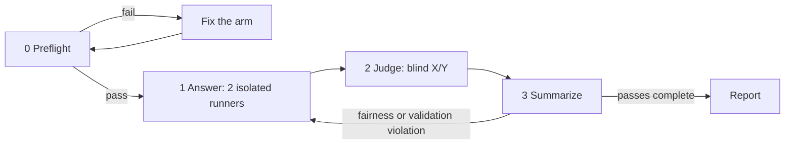

# Octocode benchmark

Plain-markdown, run-by-hand CLI research comparison. Octocode is the **anchor**; each baseline
is a **separate pairwise matchup** (`octocode` vs `rtk` | `headroom` | `gh`). Per question,
per pass: two isolated runners answer, one blind judge grades them **X / Y** (randomized per
question). Run ≥3 passes; the rollup shows every matchup together. Human reports are Markdown; instrumented evidence remains JSONL.

Paths below are relative to the package root `packages/octocode-benchmark/`. Shared tooling
lives in `compare/bin/`; questions in `compare/github-questions/`; new run artifacts follow [output.md](output.md); existing published results stay in `results/`.

## Flow (4 phases)

0. **Preflight** — verify + pin every arm; a failure invalidates the run.
1. **Answer** — 2 isolated runners (anchor + baseline) per question/pass, leanest-legal path, each appends a `## Q<n>` section to `answers/<arm>-p<pass>.md`.
2. **Judge** — after both sections exist, one blind judge reasons to a verdict, then scores.
3. **Summarize** — validate logs, aggregate paired stats, update the rollup.

## Validity requirements

- **Isolation** — a fresh agent per (question, arm, pass) + a separate judge; no shared transcript, no answer key. Batch dispatch within an arm only if every question still gets a fresh runner context; never mix arms.
- **Fairness** — leanest-legal path on every arm; no whole-tree/whole-file dump where a targeted read/search answers (inflates chars, invalidates the ratio). `sumlog.py` emits advisory `FAIRNESS:` lines for `recursive=1` dumps / oversized reads — review them.
- **Blind + reasoned** — grade X/Y in randomized order; the judge reasons before scoring, correctness-first; a confidently-wrong answer never wins.
- **Measured, not self-reported** — `total_chars = model-in + model-out` from the instrumented log; recompute, never hand-count.
- **Honest stats** — geometric-mean char ratio (never a pooled sum) + bootstrap CI; ≥3 passes; the public set is orientation, not a shipping gate.

## Resources

| When | Read | Why |
|---|---|---|
| understand the design | [BENCHMARK.md](references/BENCHMARK.md) | Pairwise scope |
| run a matchup | [INSTRUCTIONS.md](references/INSTRUCTIONS.md) | Execution order |
| brief a runner | [RUNNER.md](references/RUNNER.md) | Isolation and tool context |
| judge a question | [JUDGING.md](references/JUDGING.md) | Blind scoring |
| score + aggregate | [SCORING.md](references/SCORING.md) | Paired statistics |
| write the report | [REPORT_TEMPLATE.md](references/REPORT_TEMPLATE.md) | Result contract |
| author a matchup README | [matchup-readme.md](references/matchup-readme.md) | Reader entry point |
| Instrument calls or interpret scores | [Measurement](references/measurement.md) | Exact metrics, wrappers, scoring and limits |
| Run command examples | [Quickstart](references/quickstart.md), [run with agents](references/run-with-agents.md) | Setup and phase-specific guides |
| Supply runner tools and examples | [Tool context](references/RUNNER_TOOL_CONTEXT.md), [example verdict](references/example-verdict.md), [aggregation](references/aggregation-and-stats.md) | Arm isolation, grading and statistics |
| Diagnose Headroom prerequisites | [_hr_check.py](scripts/_hr_check.py), [_hr_import.py](scripts/_hr_import.py) | Helpers used by the prerequisite check |

## Scripts + tooling

- `scripts/check-prereqs.sh` — Phase 0 gate (all arms + questions + primers).
- `scripts/measure.sh` — fallback char wrapper for an arm without a dedicated `bin/` wrapper.
- `compare/bin/`: `octoc` · `octoc-npm` · `rtkm` · `ghc` · `ghm` (arm wrappers) ·
  `instrument_command.py` / `hr_compress.py` (char capture) · `record_answer.py` ·
  `sumlog.py` (per-question total, `--strict`) · `build_blind_packet.py` (X/Y packet) ·
  `validate_campaign.py` (byte-faithful campaign check) · `per_question_summary.py`
  (per-question + overall chars & correctness across all 4 arms) · `test_instrumentation.py`.

## Stop when

The matchup's questions are answered, judged, and aggregated across ≥3 passes with CIs — or a
preflight/fairness violation blocks the run; fix before continuing.

## Add a question

Copy an existing `Q<n>.md`, bump the number, edit title / `id` / `## Question` only. GitHub →
`compare/github-questions/`; corpus-local → that matchup's `questions/`; add its README row.

## Related skills

Use `octocode-eval-benchmark` for a general experiment or skill activation study; this skill owns the package's specific research comparison.

## Output

Follow [output.md](output.md) for artifacts, complete evidence and optional HTML.
