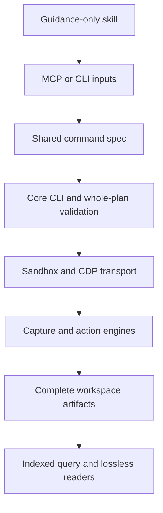

# Chrome package boundaries

The package owns execution; `skills/octocode-chrome-devtools` contains only guidance. The npm executable follows the communication package: MCP by default, `/cli` for typed commands. `/raw` reaches the same argument-oriented engine used by the adapter.

| Owner | Responsibility |
|---|---|
| `bin/octocode-chrome-devtools.mjs` | Route default MCP, `/cli`, and `/raw`; no browser logic |
| `src/adapter.ts` | CLI/MCP composition, command registration, whole-input parsing and server lifecycle |
| `@octocodeai/octocode-core` through `@octocodeai/config/schema` | Browser schemas (imported directly as `chromeSchemaFor` and `ChromeInvocation`), descriptions, instructions, output windows and the research catalog; the native Octocode tool registry stays separate |
| `src/invocation.ts` | Serialized child execution, deadlines, private stdout/stderr capture and engine shutdown |
| `src/engine/cli-catalog.mts`, `src/engine/cli.mts`, `src/engine/cli-options.mts`, `src/engine/cli-schema.mts` | Command/recipe registry, core arguments and preflight routing; option parsing and runner connection flags; the `schema` output |
| `src/engine/cdp-connection.mts` | Shared WebSocket transport, request deadlines, flattened-session events, error evidence and pending-request cleanup |
| `src/engine/scraping-bridge.mts` | Optional scraping-tool discovery and argument forwarding, shared by corpus/HAR/protocol commands |
| `src/engine/cdp-sandbox.mts`, `src/engine/cdp-runner.mts` | Permissions, connection/session routing and run lifecycle. The sandbox reads only `cdp-checks/` and the engine files it lists: a new module the runner or a check imports from `src/engine/` joins that list |
| `src/engine/cdp-runner-targets.mts`, `src/engine/cdp-runner-session.mts`, `src/engine/cdp-runner-guard.mts`, `src/engine/target-owner.mts` | Target selection, foregrounding and first navigation; run folder, session metadata, run history, resource map and complete artifact writes; localhost-only fetch/WebSocket; the top-level page owning an iframe target |
| `src/engine/open-browser.mts`, `src/engine/browser-process.mts`, `src/engine/browser-session.mts`, `src/engine/browser-launch-config.mts` | Launch, reuse and cleanup; the Chrome executable, pid and command line; per-port isolated sessions and ownership checks; proxy config and launch flags |
| `src/engine/cdp-checks/`, DOM/frame/input helpers | Browser actions, captures, observation, executor references and stream draining. `browser-execute` runs plans through `plan-validate`, `plan-scopes`, `plan-page-ops`, `plan-protocol-ops` and `plan-condition`; DOM steps run through `dom-config`, `dom-locate`, `dom-pointer`, `dom-act`, `dom-ref-diff` and the page-side `dom-page-scripts` |
| `src/engine/evidence-query.mts`, `src/engine/evidence-predicates.mts`, `src/engine/artifact-query.mts` | Complete filtered indexes and digest-pinned continuations; exact JSON reads, pointers and where/select predicates |
| `src/engine/capture-result.mts`, `src/engine/flow-page.mts` | Compact verified acknowledgements, hoisted provenance, direct read pages, manifests and shared continuation routing; full source/log retention |
| `OPERATING.md`, `docs/`, `src/engine/guide.mts` | Package operating knowledge, available through CLI/MCP `skill` |
| `tools/build.mjs` | One bundled adapter runtime, thin CLI/MCP modules, and a refreshed shared config copy |
| `tests/*suite.mjs`, `tests/unit/` | Hermetic, real-browser, transport and extracted-package regression checks; each real-browser suite entry runs its fixtures, harness and named cases from `tests/live/`, `tests/protocol/` or `tests/cdp-all/` |

MCP and typed CLI use the same spec, delegate to the same core CLI and stop on the same failures. Browser business logic is not duplicated in the interfaces. Plan schema validation remains in the executor; raw CDP params remain open and Chrome validates them. These are package-local browser operations, not native Octocode tools.

Config comes from `@octocodeai/config`: build copies its compiled standalone module into `dist/engine/` for the sandbox and dependency-free archive, as the communication runtime does for Python. No home/env parsing is reimplemented. Only the build refreshes that generated copy.

The adapter is bundled once into `dist/runtime.js`; `dist/cli.js` and `dist/mcp.js` expose it without a duplicate bundle. Each build rewrites the generated outputs and deletes obsolete ones. All production sources are TypeScript (`.ts` / ESM `.mts`). `typecheck` checks all engines, then checks the adapter, command inputs, invocation, capture, registry, transport and scraping bridge with strict mode. Inherited dynamic CDP engines retain inferred checking; their protocol payloads stay open. Archives contain generated runtime/engines, the bin, operating docs and the complete canonical skill copied into `dist/skills/octocode-chrome-devtools/`. The `./skill` export resolves its `SKILL.md`; building refreshes all skill assets and removes obsolete generated files. Source, tests and build tooling stay in the repository.

Within-server requests serialize. Engine deadlines and server shutdown share termination ownership: SIGTERM, then SIGKILL after five seconds if the engine remains alive. Completion clears both timers. MCP cancellation propagates to queued and active requests; partial captures survive and in-flight mutation outcomes remain uncertain. Separate servers must coordinate shared tabs. Captures are complete; pages carry executable continuations. A structural protocol inventory distinguishes advertised methods from methods actually exercised by fixtures.

## Known limits

- Popups (`window.open`, `target=_blank`) and service workers start with the native user agent under `--stealth`; covering them needs browser-level auto-attach (see `docs/launch-stealth.md`).
- A plan stops at its first failed step. A continue-on-error option is a change to the shared core contract (`octocode-mcp-host`), not to this package.
- One `cdp` call starts four Node processes (about 390 ms). Merging the engine CLI and the sandbox is the known saving (about 60–100 ms per call), deferred.
