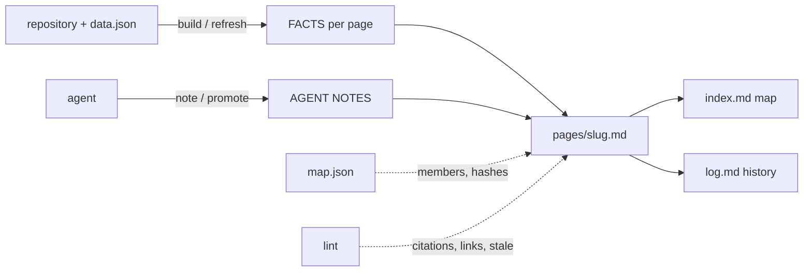

Load when reading, writing, promoting into or linting the code wiki of a graph result.

# Code wiki

Each multi-file community gets a page of generated facts and optional notes. Use `read <out> --file <path>` for a known file or browse the ranked pages in `index.md`.

Page layout, stale notes, orphans and lint issue kinds: [wiki pages](wiki-pages.md).

## Files under `<out>/wiki/`

| File | Holds | Written by |
|---|---|---|
| `index.md` | Pages ranked by summed PageRank: slug, label, size, PageRank, notes state, one-line summary; stale and empty pages; orphaned pages | every build, note and promote |
| `pages/<slug>.md` | Header line, FACTS, AGENT NOTES | FACTS: build; notes: `note`/`promote` only |
| `pages/isolated.md` | Every file in no community (communities of one) | build |
| `log.md` | Append-only history: builds and refreshes (with the changed files), pages created, updated, marked stale, orphaned or removed, and the reason; notes written; promotions | every operation |
| `map.json` | Per slug: community id, label, size, PageRank, members (PageRank order), the manifest path of package members, and the notes baseline (`notes.at`, a content hash per member) | build, note, promote |

## Operations

Run from the workspace: `octocode-graph wiki <command> <out> ...`. In the live viewer, use the same operations through `octocode-graph reply wiki` or the channel's `wiki_*` tools ([chat](chat.md)), so the open drawer updates.

| Operation | Command | Effect |
|---|---|---|
| Ingest | runs inside every build and refresh; `octocode-graph wiki build <out> [--changed a,b]` reruns it from `data.json` | Recomputes FACTS for every page and rewrites only pages whose content changed; marks notes stale; emits a `wiki` event |
| Query | `octocode-graph wiki read <out> index`, `read <out> <slug>`, `read <out> --file <path>` | Prints the page; `--file` finds the page that holds the file |
| Write | `octocode-graph wiki note <out> <slug> "markdown"` (`-` reads stdin, `--from <file>` reads a file) | Replaces the AGENT NOTES and makes them fresh against the members' current content |
| Promote | `octocode-graph wiki promote <out> <slug> "answer" --source "<where it came from>"` | Appends `**Promoted <date> from <source>:** answer`; keeps earlier notes and their freshness baseline. Through `reply wiki`, `promote --chat <id>` takes the latest reply and, without a slug, the page holding the question's file |
| Lint | `octocode-graph wiki lint <out> [--root <repo>] [--top N] [--json]` | Lists issues, one per line; exits 1 when it finds any |

## Writing notes

Write a note for a design decision, invariant or verified finding the Facts section cannot show. The first sentence becomes the index summary. Cite source locations such as `src/main.ts:12-16` for code claims and link neighboring pages with `[[slug]]`. Lint checks that the location exists. When saving a chat answer, `promote` records its source and date. [Evidence](evidence.md)
