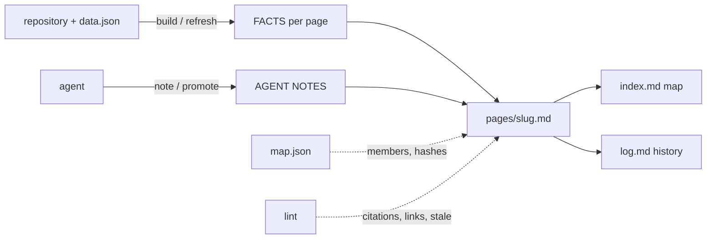

Load when reading, writing, promoting into or linting the code wiki of a graph result.

# Code wiki

Each multi-file community gets a page of generated facts and optional notes. Use `read <out> --file <path>` for a known file or browse the ranked pages in `index.md`.

## Files under `<out>/wiki/`

| File | Holds | Written by |
|---|---|---|
| `index.md` | Pages ranked by summed PageRank: slug, label, size, PageRank, notes state, one-line summary; stale and empty pages; orphaned pages | every build, note and promote |
| `pages/<slug>.md` | Header line, FACTS, AGENT NOTES | FACTS: build; notes: `note`/`promote` only |
| `pages/isolated.md` | Every file in no community (communities of one) | build |
| `log.md` | Append-only history: builds and refreshes (with the changed files), pages created, updated, marked stale, orphaned or removed, and the reason; notes written; promotions | every operation |
| `map.json` | Per slug: community id, label, size, PageRank, members (PageRank order), the manifest path of package members, and the notes baseline (`notes.at`, a content hash per member) | build, note, promote |

## Operations

Run from the workspace: `node <skill>/scripts/wiki.mjs <command> <out> ...`. In the live viewer, use the same operations through `reply.mjs wiki` or the channel's `wiki_*` tools ([chat](chat.md)), so the open drawer updates.

| Operation | Command | Effect |
|---|---|---|
| Ingest | runs inside every build and refresh (`pipeline.mjs` finishRun); `wiki.mjs build <out> [--changed a,b]` reruns it from `data.json` | Recomputes FACTS for every page and rewrites only pages whose content changed; marks notes stale; emits a `wiki` event |
| Query | `wiki.mjs read <out> index`, `read <out> <slug>`, `read <out> --file <path>` | Prints the page; `--file` finds the page that holds the file |
| Write | `wiki.mjs note <out> <slug> "markdown"` (`-` reads stdin, `--from <file>` reads a file) | Replaces the AGENT NOTES and makes them fresh against the members' current content |
| Promote | `wiki.mjs promote <out> <slug> "answer" --source "<where it came from>"` | Appends `**Promoted <date> from <source>:** answer`; keeps earlier notes and their freshness baseline |
| Lint | `wiki.mjs lint <out> [--root <repo>] [--top N] [--json]` | Lists issues, one per line; exits 1 when it finds any |

## Page layout

1. `# <community label>` (the deepest shared folder, with the top file when two communities share a folder).
2. Header line: `**Notes:** none yet | fresh (written <date>) | stale: N members changed since the notes were written <date>: <files>`, then `**orphaned**` when no community matches, the community id, the size and the slug.
3. `## Facts`, regenerated on every build; never edit it. It holds size, inside and across weight, chunks and purity, the file-check counts, and these sections:
   - Members by PageRank: every member with `path:1`, language, PageRank, betweenness, in and out weight, depth, k-core, cycle id, check status and line count. No member is left out.
   - Links out and Links in: other pages as `[[slug]]` with summed production weight, file-edge count and the strongest edge as `path:line → path:1`. Test-only edges are excluded, following the weight rule.
   - Cycles: each cycle with members here, its size, weight, languages and chunks.
   - File-check problems: members whose `check` is not `ok`.
   - Most-called symbols: production call sites into symbols declared here, with declaration `path:line`, sites from other pages and caller counts. The section identifies additional rows available in `data.json` `calls`.
4. `## Agent notes`: the text between `<!-- notes:start -->` and `<!-- notes:end -->`, kept verbatim across builds.

## Writing notes

Notes can explain a design decision, invariant or verified finding. The first sentence becomes the index summary. Cite source locations such as `src/main.ts:12-16` for code claims and link neighboring pages with `[[slug]]`. Lint checks that the location exists. When saving a chat answer, `promote` records its source and date. [Evidence](evidence.md)

## Freshness and identity

- **Stale notes.** When notes are written, map.json records a content hash of every member. A later build or lint compares the hashes with the files on disk. A member that changed, appeared or disappeared makes the notes stale, and the page header and `index.md` name the files. A refresh also passes the files it found changed. Read the changed files before relying on stale notes. Writing fresh notes resets the baseline.
- **Stable slugs.** Communities can be renumbered after a build. The script matches them to previous pages by member overlap, preserving slugs and notes when a match qualifies; otherwise it creates a new page. [wiki-store.mjs](../scripts/wiki-store.mjs) owns matching thresholds.
- **Orphans.** A previous page that no community takes stays as **orphaned** when it has notes, listing its last members. Without notes it is removed, and the log records it. Move what still holds into the pages that own those files now, then clear the orphan's notes with `note <out> <slug> ""`. The next build removes it.

## Lint issue kinds

| kind | Meaning | Fix |
|---|---|---|
| `citation-file` | A notes citation names no file under the root | Correct the path or drop the claim |
| `citation-line` | The cited line is past the end of the file | Re-read the source and cite the current line |
| `broken-link` | `[[slug]]` names no page | Use a slug from `index.md` |
| `missing-graph` | data.json or its community metrics are missing | Use a completed graph export |
| `missing-page` | A community in `data.json` has no page, or its page predates the current graph | `wiki.mjs build <out>` |
| `missing-file` | A wiki page, index or map is missing | `wiki.mjs build <out>` |
| `orphaned` | No community matches the page | Move the notes, then clear them |
| `stale-notes` | A member changed since the notes were written | Revisit and rewrite the notes |
| `empty-notes` | Only with `--top N`, one of the N highest-PageRank live communities has no notes | Add notes if curating that community |

## Script owners

| When | Read |
|---|---|
| API (`buildWiki`, `readPage`, `pageOf`, `writeNotes`, `promote`, `lintWiki`) and the CLI | [wiki.mjs](../scripts/wiki.mjs) |
| FACTS sections from data.json | [wiki-facts.mjs](../scripts/wiki-facts.mjs) |
| Page, orphan and index markdown | [wiki-render.mjs](../scripts/wiki-render.mjs) |
| map.json, slugs and matching, hashes, notes markers, log | [wiki-store.mjs](../scripts/wiki-store.mjs) |
| Lint rules | [wiki-lint.mjs](../scripts/wiki-lint.mjs) |
| Viewer drawer | [live-wiki.js](../assets/live-wiki.js), [live-wiki.css](../assets/live-wiki.css) |
