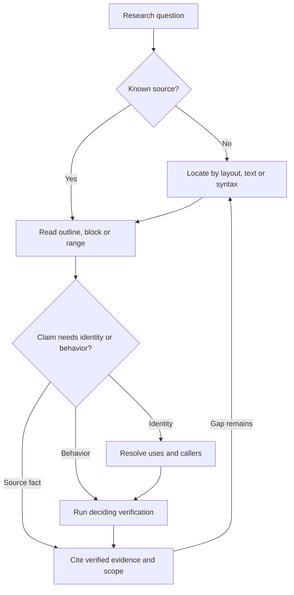

# Core tool contracts: audit and source patch

Date: 2026-11-13. Scope: all 17 research tools in `@octocodeai/octocode-core` 21.2.0, their shared instructions and changed field notes, checked against the Rust engine.

## Executive summary

**A source patch is prepared and checked for applicability; it is not applied to the sibling core checkout.** The sandbox rejected the attempted source write with `writing outside of the project; rejected by user approval settings`. The patch contains 20 core source/test files. The Octocode application source and generated contracts have not been changed by this audit.

All 17 tools received source review, including optional graph, clone and classification tools. Sixteen tool descriptions were revised; `ghGetHistoryItem` was retained. Description text fell from **11,686 to 11,131 UTF-8 bytes (4.75%)** while adding corrections. All-tools instructions changed from **3,995 to 3,998 characters**, within the existing 4,096-character contract budget, and now connect evidence dimensions to valid research/read workflows.

The 34 published input schemas (17 tools, classification off/on) retain identical structure after removing presentation keywords. Tool annotations and the enforcement fingerprint are unchanged: `4d68d0638c13b0a9b860de4697cbacb9a99b63350e21f291c10b87e8778cdbac`.

Confidence: high for the cited source-level guidance corrections and schema equivalence; agent task-success, latency and token-cost improvements remain unmeasured.

## Key findings

Who: agents using MCP discovery or CLI schemas. When: selecting a tool, filling selectors, recovering paused work, or judging completeness. Where and why are listed below. How much: measured surfaces and tool text appear in the following section. Severity reflects potential effect on the agent's decision, not a confirmed runtime fault.

Core paths are relative to `../octocode-mcp-host/packages/octocode-core/src/toolContract/`; native paths are relative to `packages/octocode-native/crates/`.

| Severity | Trigger / incorrect guidance | Core owner | Implementation evidence and correction |
|---|---|---|---|
| Medium | `graphBuild` enabled but `graphQuery` disabled | `instructions.ts`; `../__tests__/instructions.test.ts` | Extended the existing enabled-set regression to single-tool and one-tool-disabled profiles. It failed on the original instructions with hidden `graphQuery`; the optional block now avoids naming that disabled tool. |
| Medium | Repeated names mixed with string mentions | `tools/lspSearch.ts` | `engine/src/lsp/resolver/syntax.rs:153`: occurrence indexes matching identifiers, falling back to string mentions only if none match. For `foo("foo", foo)`, the last identifier is occurrence 1. Deeper caller/callee rows can repeat a symbol under different `via` parents (`runtime/src/tools/lsp_search/walk/bfs.rs:297`). |
| Medium | Paused build originally requested with `refresh:true` | `tools/graphBuild.ts` | `runtime/src/tools/ast_graph/store/tools.rs:364` emits `next.expandScan` with `refresh:false`. Blindly reusing original options can discard progress. Use the emitted continuation; manual retries preserve scope/options and disable refresh. |
| Medium | Omitted/latest package version assumed stable | `tools/artifactSearch.ts`; `tools/securityCheck.ts` | `runtime/src/providers/artifact/crates.rs:88` and `maven.rs:213` permit fallbacks beyond stable releases. Say registry-selected release; retain exact-version routing for the version actually in use. |
| Medium | Partial materialization assumed to have one recovery call | `tools/ghStructure.ts`; `outputGitHubData.ts` | `runtime/src/tools/gh_structure/materialize.rs:12,75` writes the selected scope independently of listing pages. `listing.rs:378` emits `continueMaterialize` only when resumable. Read `location.coverage`/`location.skipped`; complete permitted-text coverage can coexist with non-text or withheld skips. |
| Medium | Deep graph findings treated as stronger proof or broader absence | `tools/graphQuery.ts` | `runtime/src/tools/ast_graph/store/detect/dead_code.rs:286` boosts only the strongest finding per subject. `detect/mentions.rs:17` prunes directories. Qualify text coverage and retain semantic verification, dynamic-behavior gaps and distinct weight meanings. |
| Low | File-wide filters follow the query's regex/case settings | `tools/localSearch.ts` | `engine/src/search/text_search/file_terms.rs:15` uses literal smart-case terms independently. Field notes now state that behavior. |
| Low | Exact-first symbol filtering applied to the whole term list | `tools/astSearch.ts` | `runtime/src/tools/ast_search/symbols/names.rs:65` settles exact-first matching separately for each term. |
| Low | Compact reads always transform; fallback note attached only to symbols | `tools/_read.ts`; both reader descriptions | `runtime/src/tools/local_fetch/tests/compact_literals.rs:10` exercises unchanged/YAML fallbacks. Transformation is qualified; both readers explain `viewFallback`. |
| Low | Search/list triggers omit known-repo and repository-scoped distinctions | `tools/ghSearchRepo.ts`; `tools/ghSearchHistory.ts` | `runtime/src/tools/gh_search_repo.rs:225` implements known-repo lookup. `gh_search_history/query.rs:58` requires repository scope for the simple PR listing path. |
| Low | Checkout assumed complete despite sparse scope or omissions | `tools/ghCloneRepo.ts` | `runtime/src/tools/gh_clone_repo.rs:179` retains selected paths, skipped files and symlink disclosures. Description now directs the agent to those facts. |
| Low | Unmeasured universal speed claims; inaccurate metadata ownership | `tools/astSearch.ts`; `structureSearch.ts`; `artifactSearch.ts` | Use the architectural fact that symbol filtering needs no LSP server. Remove the generic fastest claim. `runtime/src/tools/artifact_search/summary.rs:48` retains requested custom registry metadata in summary. |

Independent review also corrected graph-home wording: `runtime/src/tools/ast_graph/store/tools.rs:23,29` permits configured graph storage as well as its environment equivalent. Host permissions govern writes; a prompt is not guaranteed.

## Analysis and measurements

The sizes below are deterministic projections from separately compiled baseline/candidate source. They use the existing surface test's full LSP-server label set. They include serialized `tools/list` definitions plus instructions; they are not live wire captures or token counts. Profile names follow the existing surface tests.

| Projected surface | Before bytes | After bytes | Change |
|---|---:|---:|---:|
| default (13 tools) | 53,197 | 53,184 | -13 |
| classification (14 tools) | 66,532 | 66,411 | -121 |
| all (17 tools) | 79,887 | 79,561 | -326 |

The modest total reduction reflects validation structure and necessary field notes remaining in the contract. Size alone is not a reliability or speed result. No field, default, constraint, operation, tool, annotation or evidence continuation was removed.

| Tool | Description bytes before | After | Decision preserved or corrected |
|---|---:|---:|---|
| `localSearch` | 976 | 787 | Shorter routing/count notes; literal smart-case file filters. |
| `localFetch` | 495 | 475 | Direct reads; fallback view explained for every representation. |
| `structureSearch` | 411 | 376 | Concise file routing; removed unmeasured speed superlative. |
| `astSearch` | 509 | 537 | Shape versus identity; per-term exact-first matching; no unmeasured speed claim. |
| `lspSearch` | 1,054 | 1,049 | Matching identifiers/string fallback; depth and deeper-walk parent rows. |
| `ghSearchRepo` | 307 | 309 | Known-repository inspection now included in trigger. |
| `ghSearchCode` | 690 | 653 | Indexed paths versus requested-ref content; index caveats retained. |
| `ghStructure` | 416 | 407 | Correct coverage path; conditional materialization continuation. |
| `ghGetFileContent` | 509 | 533 | Read/outline routing; shared fallback-view explanation. |
| `ghSearchHistory` | 614 | 625 | Repository scope required for optimized PR listing. |
| `ghGetHistoryItem` | 505 | 505 | Retained: patch legend and section continuations already useful. |
| `ghCloneRepo` | 287 | 348 | Sparse scope, omitted files and symlinks qualify completeness. |
| `artifactSearch` | 590 | 601 | Registry-selected releases; summary metadata described accurately. |
| `securityCheck` | 567 | 547 | Registry-selected release; OSV privacy and verdict distinctions retained. |
| `graphBuild` | 681 | 610 | Checkpoint-safe resume; configured graph home; host permission semantics. |
| `graphQuery` | 1,399 | 1,201 | Strongest-finding corroboration; selected-text scope; weight meanings retained. |
| `clasify` | 1,676 | 1,568 | Shorter input routes; uncertainty, sections and billing rules retained. |

### Research workflows

Shared instructions preserve the route, research loop, result assembly, proof and completion layers. The revised loop names scope/ref/version/config, input/dependency/error/test/trust dimensions, forward data flow and reverse symbol users. It keeps independent batching, dependent-call order, evidence pagination, stale-snapshot recovery and rival explanations.

| Evidence need | Route / valid selector |
|---|---|
| Layout or half-known path | `structureSearch` → known path |
| Text, spelling, counts | `localSearch` → deciding read |
| Calls, nesting or declarations as syntax | `astSearch` → deciding source span |
| One known declaration | `localFetch {path, matchString:[...], block:true}` |
| File outline | `localFetch {path, view:"symbols"}` |
| Dense selected context | `localFetch {path, ranges:[...], view:"compact"}` |
| Exact quote | `localFetch {path, ranges:[...], view:"content"}` |
| Identity, users or callers | Search hit → `lspSearch` with path/name/line |
| Why / when / who | `ghSearchHistory` → `ghGetHistoryItem` |
| Large evidence exact tools cannot narrow | `clasify` → captured deciding source → identity or execution checks |

`compact + matchString` and `symbols + ranges` remain invalid. A transformed view is not an exact source quote. Small display windows never authorize evidence loss.

### Coordination and verification

| Work | Owner | State |
|---|---|---|
| Five local tools | `audit_local_contracts` | Source review complete |
| Seven GitHub tools | `audit_github_contracts` | Source review complete |
| Classification, packages, security and graphs | `audit_other_contracts` | Source review complete |
| Shared instructions, staging, integration and gates | Root | Staged core gates passed; patch prepared |
| Adversarial review of all 17 descriptions and changed notes | `independent_contract_review` | Review complete; both concrete findings corrected |
| Apply to core, regenerate, rebuild and exercise live consumers | Root | Blocked by sibling write restriction |

The default repository coordination database did not exist, so there were no discoverable repository peers to contact through that interface. Built-in subagents performed the parallel review. Only the root ran builds and suites; no agent edited another lane's files.

Verification results:

| Check | Result |
|---|---|
| Baseline and final candidate core compilation | Passed (`tsc`, exit 0) |
| Core type checking | Passed (`tsgo --noEmit`, exit 0) |
| Type-aware source lint | Passed (`oxlint` with the unchanged core lint config, exit 0) |
| Source formatting | Passed (all source TypeScript; final output-note file rechecked) |
| Complete core suite | **110 files, 1,575 tests passed** |
| Checks after final permitted-text coverage wording | **5 files, 104 tests passed** |
| Published input-schema equivalence | **34 variants identical except presentation** |
| Enforcement fingerprint / tool annotations | Identical |
| Instruction subsets and existing size ceilings | Passed |
| Patch applicability against current core | Passed (`git apply --check`) |
| Repository documentation checks | Passed (`dev docs:verify`) |
| Regeneration, native rebuild and live candidate MCP/CLI calls | **Blocked; not run** |

The extended enabled-set test failed before the instruction fix with `expected ['graphQuery'] to deeply equal []`. The first full candidate run also caught removal of a required flattened-schema `rankBy`/`direction` note. That removal was reverted before the successful full run. The final output coverage qualifier was then checked by 104 focused tests and the candidate rebuilt. Validation used isolated core source copies; dependencies and temporary compiler-config routing are not in the patch.

[Test evidence](2026-11-13-core-tool-contracts-tests.txt) · [check record](2026-11-13-core-tool-contracts-checks.json). Patch SHA-256: `d10cf3e52dccba90d817b0536873ab3ea7e306518098ddd184d49ea4b4c41b26`.

## Recommendations and next steps

The ready-to-apply change is [the source patch](2026-11-13-core-tool-contracts.patch). `git apply --check` succeeded against the current sibling checkout. Regeneration was intentionally not attempted against unchanged core source.

Once core is writable, apply the patch in `/Users/bgaryy/code/octocode-mcp-host`, then run the owning core build. In this checkout run `node skills-dev/octocode-dev/scripts/dev.mjs contracts:regen`, rebuild the host native binary and affected consumers, restart MCP and exercise `config --json`, `schema` and actual tool calls. Presentation edits preserve the fingerprint but still need regeneration/rebuild to reach the embedded CLI/MCP presentation.

Remaining limits: no live replay of the candidate MCP/CLI instructions, no exhaustive native runtime/provider parity audit, no comparative cold-model evaluation and no measured token/latency/cost improvement. The schema/description review does not establish those outcomes. Broad graph/LSP search pages from reviewers remain unread; deciding findings use scoped source reads. Existing unrelated working-tree changes were preserved.

Evidence: [measurements](2026-11-13-core-tool-contracts-measurements.json), [baseline projections](2026-11-13-core-tool-contracts-before.json), [candidate projections](2026-11-13-core-tool-contracts-after.json). The full successful suite and final focused checks are in the linked test evidence above.

Primary sources checked for applicable contract and provider facts:

- [MCP tool definitions, schemas and error responsibilities](https://modelcontextprotocol.io/specification/2025-11-25/server/tools).
- [GitHub legacy code-search index limits](https://docs.github.com/en/search-github/searching-on-github/searching-code): default branch, fork eligibility, file limit, inactivity and archived repositories.
- [GitHub REST search limits and incomplete results](https://docs.github.com/en/rest/search/search).
