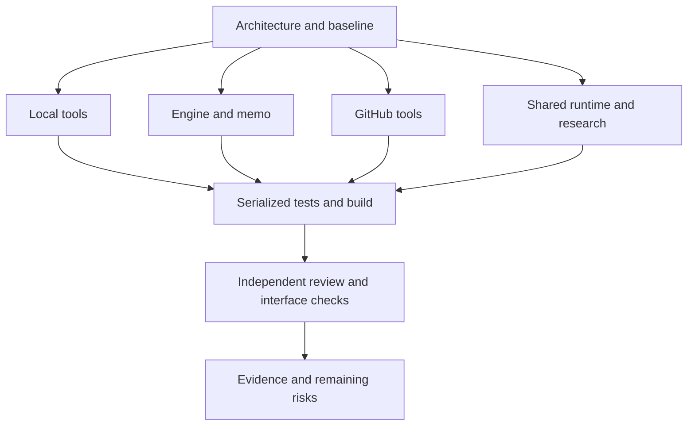

# Runtime efficiency and cache audit

Date: 2026-11-13 (user timezone). Status: implementation and independent source review complete; executable verification blocked/in progress. Scope: local search/fetch/structure, AST/LSP/graph, shared caches, and all six public GitHub tools.

## Executive summary

The audit identified eight defects addressed by this round's production changes, plus an expired-entry decoding defect corrected concurrently by another session. Thirteen regression tests were added, including independent coverage of that concurrent correction. Regression execution, build completion and production performance improvements are not established yet. Do not interpret source review or baseline live calls as a passing test suite.

Existing architecture already reuses substantial work: pooled HTTP/LSP clients, scoped conditional provider answers, shared parsed documents, proven scan manifests, page-oriented reads and graph extraction checkpoints. The corrections target unnecessary work, inaccurate memory accounting/admission, and cache lifetime/freshness errors; they introduce no new runtime quotas or evidence truncation.

The shared working tree contains extensive changes from other sessions. This report attributes concurrent changes separately and does not claim that unrelated edits were validated.

## Key findings

All rows below are source-confirmed. Expected work reduction is a code-level conclusion; performance and regression numbers require execution.

| ID | Priority | What / where | When / who is affected | Why / how corrected | Expected effect and confidence |
|---|---|---|---|---|---|
| E1 | High | Non-atomic shared-budget growth: `crates/io/src/memo.rs`, `memo/budget.rs` | Concurrent charges to different memos sharing one budget | Replace check-then-add with atomic checked admission under the existing memo lock | Only one competing charge can consume the remaining capacity; high source confidence, runtime test pending |
| E2 | High | Retention result could remain true after self-eviction: `crates/io/src/memo.rs` | Insertions while live reservations consume the budget; callers publishing continuations | Recheck key and inserted Arc identity after reclamation without changing recency | Avoid declaring an already-evicted value retained; high source confidence, runtime test pending |
| E3 | High | Refused replacement could leave a superseded provider answer: `crates/runtime/src/providers/saved_answers.rs` | New response body or metadata cannot be retained on disk | Remove this request's scoped sealed mapping on either publication failure; preserve unrelated shared bodies | Avoid serving the superseded saved answer after a failed replacement; high source confidence, runtime test pending |
| E4 | Medium | Shared provider body deleted by one answer: `crates/runtime/src/providers/saved_answers.rs` | Forget, replace or move one answer into held memory while other requests/credentials share its content | Retire scoped answer metadata; let the body's existing retention/budget/cache-clear policy reclaim it | Avoid unnecessary refetches; metadata continues to enforce access identity; high source confidence |
| E5 | Medium | Arbitrary source JSON interpreted as search metadata: `crates/github/src/transport/execute.rs` | Raw/pinned JSON content containing `incomplete_results:true` | Inspect that provider field only for search/code-search endpoints; retain universal SSO-partial exclusion | Avoid unnecessary JSON parsing and prevent false cache exclusion; high source confidence |
| E6 | Medium | LSP config changes hidden by equal size/mtime: `crates/engine/src/lsp/project_config.rs` | Unix editor/build-tool replacement of a watched config while restoring mtime | Reuse canonical SourceStamp; distinguish missing/unknown metadata; compare without temporary stamp vectors | Detect tested replacement identity; filesystem reproducer executed, Rust test pending; cross-platform limitations remain |
| E7 | Medium | Fetch retention discarded source line offsets: `crates/runtime/src/tools/source_view/retained.rs`, `source_view/extraction/lines.rs` | Raw range/match continuation rendering | Preserve the existing Arc and charge actual vector capacity in both retained owners | Avoid rebuilding the whole index per page; no additional source-text reference; high source confidence |
| E8 | Medium | Whole query copied for every regex term: `crates/runtime/src/tools/local_search/executor.rs`, `pattern.rs` | Multi-pattern regex queries, including large term lists or query context | Validate borrowed expressions through the existing validation logic | Eliminate per-term whole-query serde roundtrips; per-term regex validation remains; high source confidence |
| E9 | Medium | Expired disk bodies decoded before rejection: `crates/runtime/src/cache/disk/read.rs` | Reading expired retained data | Concurrent session moved expiry checking before full body read/decode; this round added independent counting-codec coverage | Avoid full expired-body decoding/allocation; a buffered prefix may still be read; source-reviewed, test pending |

How much: no defensible production CPU percentage, RSS reduction, throughput gain or latency speedup is available for these changes. E1/E2/E3/E6 are correctness invariants; E4/E5/E7/E8/E9 remove identifiable unnecessary work. Runtime verification is required before release acceptance.

## Analysis

### Coverage and existing reuse

| Area | Inspected flow / existing mechanism | Costs and limits that remain |
|---|---|---|
| localSearch | Query validation → engine scan → proven packed manifest → page-frame decode → output checks | Proof validation walks watched inputs; selected source bytes are revalidated. E8 removes query-copy overhead, not scan or regex work. |
| localFetch | Source read/digest → SCANNED source reuse → retained extraction/view → page rendering | Small-file continuations still reread/hash source for freshness. E7 does not make total work proportional only to the returned page. |
| Large fetches | Stable-handle/digest proofs and retained checkpoints; subsequent windows seek from checkpoints | Failed stamp proofs require revalidation; evidence must remain complete and snapshot-consistent. |
| structureSearch | Proven walked listings; detail rows counted lazily; adaptive line-count workers | Sorting by line count inherently reads every candidate. Existing worker limit is unchanged. |
| AST/declarations | Worker-local parser reuse; digest/analysis/path-keyed shared declaration documents; proof-validated AST continuations | Hashing and metadata checks remain. Concurrent parse misses can repeat work; practical impact was not measured. |
| LSP | Pooled servers, single-flight starts, busy-entry-aware eviction, idle expiry, cached scope fingerprints | Child server memory is additional to retained cache accounting. Failed-start retention is being changed by another session. |
| Graph | Namespaced extraction artifacts, checksums, source digests and checkpoints | Reviewed cache boundaries, not every graph algorithm or full language battery. |
| Shared caches | Global estimated byte budget, expiration sweep, scoped disk stores, reserved capacity | Retained-state weights are estimates and not an RSS ceiling. Live borrowed Arcs, transient buffers, allocators and child processes can exceed retained-cache accounting. |
| HTTP | Runtime-aware reqwest client reuse, shared saved-answer storage, freshness/conditional requests | Network latency and provider/rate limits remain separate from CPU or allocation costs. |
| CLI serving | LRU-retained runtimes keyed by cwd/environment; shared LSP pool; single-flight runtime construction | A thin client timing excludes most serving work. Do not interpret client RSS as server RSS. |
| CPU sharing | `crates/engine/src/cpu.rs` sizes fan-outs from cores divided by active calls | A share is sampled when fan-out starts; earlier fan-outs do not shrink, and separate processes are not coordinated. This is not a strict host-wide CPU ceiling. |

### GitHub tools: source review and live baseline

All six public tools were called against both `sharkdp/bat` and `sharkdp/fd`. Required continuations were exhausted for the explicitly selected scopes. These calls used the already-running MCP build, not a rebuilt version containing this round's fixes.

| Tool | Source path reviewed | Selected live scope |
|---|---|---|
| ghSearchRepo | Repository get/search/owner-list request and shared cache path | Get repository metadata for both repositories |
| ghStructure | Ref resolution, tree/list traversal, materialization and locking | Tree restricted to Cargo.toml |
| ghGetFileContent | Resolved-ref memo, content read, shared source-view pipeline | Cargo.toml lines 1–8 |
| ghSearchCode | Provider page, adaptive snippet reads and shared cache | Cargo.toml path + `name` keyword; path fields; one result each |
| ghSearchHistory | REST lists versus indexed search, row shaping and retained evidence | Cargo.toml commits from 2026-11-01T00:00:00Z through 2026-11-12T23:59:59Z; one bat/two fd commits |
| ghGetHistoryItem | Commit summaries and requested collection/window loading | bat `8cf33bdde9a6e4c11d0f866415b1fc867df0cd40`; fd `24d90b28d25438af2a8f2e7f7e46d03d6828da94` |

Uncontrolled elapsed MCP samples, measured by the GitHub lane for the complete two-row tool call:

| Selected call | Initial sample | Repeat sample |
|---|---:|---:|
| Code search | 9,467 ms | 122 ms |
| Commit summaries | 8,048 ms | 240 ms |
| History search | 2,434 ms | Not measured |
| Repository get | Not measured | 365 ms |
| Selected tree | Not measured | 348 ms |
| File lines 1–8 | Not measured | 506 ms |

The repeated code/item calls disclosed reused-answer observation metadata. These numbers show observed baseline behavior only. They are neither cold-cache benchmarks nor this patch's speedups; request counts, CPU and RSS were not measured. Initial timing capture for repo/tree/file was invalid and deliberately omitted. A date-only history query was rejected; corrected RFC3339 timestamps succeeded.

The coordinator also directly called localSearch, localFetch, structureSearch and astSearch on one known source/manifest scope; all selected scopes completed without required continuations. LSP execution was not added on the overloaded host.

## Execution plan

| Task | Owner | Dependencies | State | Acceptance |
|---|---|---|---|---|
| Local tools and runtime cache audit | local_efficiency | Architecture review | reported; source-reviewed | Root-cause reproductions, preserved evidence and continuations, regression tests |
| Engine search/AST/LSP and memo audit | engine_efficiency | Architecture review | reported; source-reviewed | Confirmed costs, cache/lifetime invariants, regression tests |
| GitHub tools and transport audit | github_efficiency | Architecture review | reported; source-reviewed | All six tool families traced, freshness/isolation/request reuse verified |
| Shared runtime review and upstream research | coordinator | Architecture review | source review complete | Version-applicable primary sources and independently checked findings |
| Focused tests and host build | coordinator | Fixes ready; shared build available | blocked/running | Serialized tests/build; exact exit status and blockers |
| Independent review and interface checks | independent reviewer/coordinator | Built fixes | source review accepted; runtime pending | Reproduce claims against integrated result; distinguish unverified scope |

Workspace strategy: one shared checkout; directory ownership is disjoint. Coordinator owns shared integration and this report. Agents do not run heavy jobs without a grant. States: pending, running, blocked, reported, verified, failed. A report from an implementer is not independent verification.

## Measurement conditions

- Host: Darwin ARM64, 12 logical CPUs (`uname -a`, `getconf _NPROCESSORS_ONLN`).
- Initial 1-minute load: 32.55; 5-minute: 36.09; 15-minute: 43.05 (`uptime`).
- Initial free disk: 150 GiB (`df -h .`).
- `ps` and memory-pressure `sysctl` access are denied by the execution sandbox. Process attribution, CPU profiles and total host memory pressure remain unknown. `vm_stat` was readable and showed substantial compressed memory and increasing swapout counters; those are whole-host counters, not attributable to Octocode.
- Subsequent 1-minute load samples ranged above 60 and reached 95.18 on 12 CPUs. No causal attribution to Octocode is established.
- Toolchain: Rust 1.99.1, edition 2024, Darwin ARM64. Locked reqwest: 0.13.5. Existing profiling/release binaries predate these changes and were not used for patch performance claims.
- Comparable production wall-clock/CPU/RSS claims require an optimized build and an adequately controlled host. Deterministic operation counts can establish avoided work without claiming end-to-end speedup.

## Research sources

- [Rust Performance Book: profiling](https://nnethercote.github.io/perf-book/profiling.html): measure hot paths before optimizing.
- [reqwest 0.13.5 Client](https://docs.rs/reqwest/0.13.5/reqwest/struct.Client.html): reuse pooled clients; this is the locked patch.
- [GitHub REST best practices](https://docs.github.com/en/rest/using-the-rest-api/best-practices-for-using-the-rest-api): authenticated conditional requests, stable cacheable requests and provider pagination.
- [Rust Arc](https://doc.rust-lang.org/std/sync/struct.Arc.html): shared allocation versus deep value cloning; APIs must remain compatible with the pinned toolchain.
- [Tree-sitter 0.27 Parser::reset](https://docs.rs/tree-sitter/0.27.0/tree_sitter/struct.Parser.html#method.reset): reset interrupted parser state before parsing a different source. Existing parser reuse already performs this.
- [Rust atomic integer documentation](https://doc.rust-lang.org/beta/std/sync/atomic/type.AtomicUsize.html): atomic integer type; the implementation reuses `try_update`, which already exists elsewhere in this checkout under the pinned compiler.

## Verification evidence

| Check | Result |
|---|---|
| Targeted rustfmt on all 14 touched Rust files | Passed centrally, exit 0; includes the current external additions in shared test files |
| `git diff --check` | Passed at integration checkpoints |
| `node skills-dev/octocode-dev/scripts/dev.mjs docs:verify` | Passed centrally, exit 0 (`Documentation verification passed.`) |
| Unix same-size/restored-mtime replacement filesystem reproducer | Executed: same length and mtime; different inode and content; old FileStamp considered equal |
| Six GitHub tools × two public repositories | Selected live baseline scopes succeeded, required pages exhausted |
| Direct localSearch/localFetch/structureSearch/astSearch calls | Selected scopes succeeded against the existing MCP build |
| Initial `cargo dev-test -- concurrent_charges_on_distinct_memos_cannot_exceed_the_shared_budget` | Exit 101 before tests: sccache could not execute rustc (`Operation not permitted`) |
| Wrapper-disabled single-job retry of that filter | Waited on shared debug build lock; bounded probe exited 142; no assertions executed |
| Wrapper-disabled single-job saved-answer filter | Began compiling io and engine, then bounded probe exited 142; no assertions executed |
| Central `RUSTC_WRAPPER= CARGO_BUILD_JOBS=1 cargo dev-test --no-run` | In progress/waiting on shared build lock at this checkpoint |
| Rust regression assertion results | Not executed; no red/green claim |
| Completed host rebuild and new-binary CLI/MCP checks | Not yet available |
| Optimized before/after CPU, instruction, allocation and RSS profiles | Not executed; unavailable host conditions and process-counter access |

New regression names (all require execution):

- `concurrent_charges_on_distinct_memos_cannot_exceed_the_shared_budget`
- `an_insert_evicted_by_live_reservations_reports_that_it_was_not_kept`
- `a_same_size_config_replacement_restoring_mtime_invalidates_the_server`
- `forgetting_an_answer_keeps_other_answers_with_the_same_body`
- `replacing_an_answer_keeps_other_answers_with_the_previous_body`
- `a_sensitive_replacement_keeps_other_answers_with_the_previous_body`
- `a_refused_replacement_body_retires_only_its_previous_answer`
- `a_refused_replacement_metadata_retires_only_its_previous_answer`
- `a_pinned_raw_json_file_with_a_search_named_field_is_kept`
- `a_saml_partial_pinned_read_is_never_kept`
- `selection_pages_reuse_the_scanned_source_line_index`
- `expired_entries_are_rejected_before_decoding_their_values`
- `pattern_lists_report_the_first_invalid_entry`

Existing offset-shape coverage was strengthened with a retained-weight lower bound. The regex regression covers two engines, three views and three invalid-list shapes; this is not a separate test count per matrix cell.

Independent review accepted the final memory admission/reclamation, LSP identity, line-index accounting, regex error equivalence, endpoint-aware partial detection and both replacement-refusal paths. It found E2, E3 and E9 while reviewing, and those findings were routed to the owning lane. No additional concrete defect remained in the reviewed changes. This is source acceptance only; runtime verification remains pending.

## Recommendations

1. Complete serialized compilation and the focused regressions before accepting the changes for release. Source review cannot establish type correctness or integration behavior.
2. Rebuild the host native binary and affected interface, then exercise config, schema and real changed CLI/MCP calls with complete continuation walks.
3. On a controlled optimized build, use the existing `dev profile` first/repeat/page phases to measure instructions, peak footprint and retained allocations. Include the serving process and language-server children. Keep query/corpus/output/cache state fixed.
4. Preserve freshness/security/evidence invariants while optimizing. Avoid replacing verified scans with metadata-only identity shortcuts or adding guessed evidence caps to reduce resource usage.

## Next steps, remaining risks and limitations

- Source review covers the primary flows listed above, not every nested branch of every tool. Full language, GitHub provider and interface suites have not run in this round.
- SourceStamp strengthens Unix identity checking; it is not universal content proof on all platforms/filesystems. Windows same-size/restored-mtime behavior is not fixed or tested by the Unix regression.
- Content-addressed provider bodies can remain after one request is forgotten. They remain governed by existing idle retention, byte eviction and explicit cache clear; metadata enforces which credential/request can reach them. This avoids unsafe per-reference deletion without introducing a second reference inventory.
- Conservative charging of the same shared index in two stores can cause earlier eviction under pressure; it does not allocate two indexes.
- Possible repeated parsing on simultaneous declaration-cache misses, potentially quadratic materialization skipped-path membership, and the len/mtime-only `hashed_source` post-search check require profiling/reproduction. They are hypotheses, not confirmed runtime defects or measured bottlenecks.
- Concurrent LSP failed-start-cache and disk-reader changes belong to other sessions. This report does not claim their full implementation/test coverage.
- Automatic staging changes the index while work proceeds. Review both staged and unstaged changes; no commits or stash operations were made.

Acceptance remains open until the applicable executable checks complete or the final handoff explicitly records their blockers. No production speedup or complete absence of regressions is claimed.
