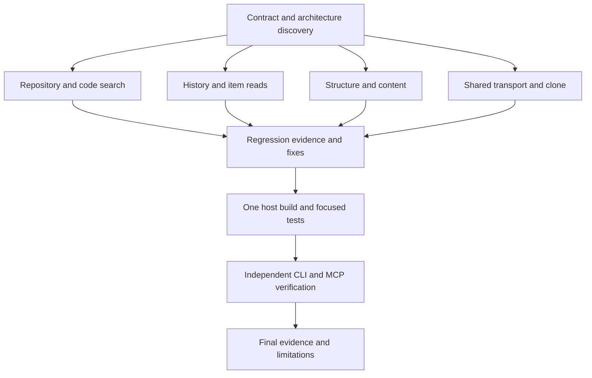

# GitHub tools audit — 2026-11-13

## Executive summary

All seven GitHub tools received contract and implementation review. Four investigative agents and a separate independent reviewer worked in disjoint areas. Fourteen grouped defects were fixed in source, with regression cases added. Runtime acceptance is incomplete: shared Cargo contention blocks completed compilation/test runs, and the execution sandbox refuses loopback listeners needed by HTTP mocks. These changes are not release-certified.

Scope: `ghSearchRepo`, `ghSearchCode`, `ghStructure`, `ghGetFileContent`, `ghSearchHistory`, `ghGetHistoryItem`, `ghCloneRepo`, and the shared GitHub transport, authentication, saved answers, and response continuation paths.

The working tree contained pre-existing changes in GitHub content acquisition, retry decoding, runtime error handling, graph code and skills. They are preserved and are not attributed to this audit.

## Execution graph and ownership



| Lane | Owner | Writable scope | State |
|---|---|---|---|
| Search | `github_search` | Runtime `gh_search_repo/`, `gh_search_code/` | Fixes implemented; execution pending |
| History | `github_history` | Runtime `gh_search_history/`, `gh_get_history_item/` | Fixes implemented; execution pending |
| Content | `github_content` | Runtime `gh_structure/`, `gh_get_file_content/` | Fixes implemented; execution pending |
| Transport | `github_transport_review` | Assigned GitHub retry/deadline expressions | Fixes implemented; execution pending |
| Review | `github_independent_review` | Read-only integration review | Four additional gaps found, fixed and rereviewed |
| Integration | Coordinator | Shared cache, Link parsing, I/O parser, clone review, report | Source checks complete; Cargo and HTTP acceptance blocked |

Dependencies: source diagnosis and reproducer/regression preparation precede each fix. History and language defects had observed failing MCP calls before implementation. New unit and HTTP regressions could not be executed before fixing because of the environment blockers; they are not claimed to have failed or passed. One coordinator owns Cargo work on the shared `target/`. No agent commits, stashes, publishes, or stops another session's processes.

## Verification environment

- Connected Octocode MCP can access public GitHub repositories. Local CLI `auth status` reports unauthenticated in the execution sandbox.
- Rust toolchain from the native package: `rustc 1.99.1`, `cargo 1.99.1`.
- Host process and memory inspection are denied by the sandbox. Observed load averages exceeded 48; native compilation is limited to one job.
- The configured `sccache` wrapper is denied by the sandbox; verification uses an empty process-local `RUSTC_WRAPPER`.
- Shared Cargo lock contention repeatedly queued regression runs. One interrupted run reached compilation of the workspace crates; no completed Rust run is claimed.
- A direct loopback integration probe failed with `listen EPERM: operation not permitted 127.0.0.1`. Its temporary home was removed. HTTP mock and hermetic transport execution require a different execution environment.

## Key findings

Each record identifies what, where, when, affected caller, why, remedy, and measured impact or its unknown status. Severity reflects the observed failure mode; confidence is high for the source diagnosis, while runtime verification remains pending.

| ID / severity | What, affected caller and trigger | Root cause / source | Implemented remedy | Verification and impact |
|---|---|---|---|---|
| S1 / medium | Repository-search agents received a false ignored-language warning for valid `language:"ts"`. | `gh_search_repo/language.rs`: equal totals or primary-language metadata were treated as proof that a qualifier was ignored. | Canonical mismatches use the existing optional count probe; equal totals disclose ambiguity involving aliases or other repository languages. No allowlist or definitive ignored-filter inference. | Reproduced on Vite and vite-plugin-react, with Cargo as a negative control. Single- and mixed-language alias regressions added; request/latency impact unmeasured. |
| S2 / medium | GHES absence claims omitted the searchable-prefix restriction. | `gh_search_code/page_facts.rs`: disclosed eligible file size but not the content prefix. | Server-only `coverage.reason` states that only the first 500 KB is searched and points to exact file reads. | Primary documentation verified; deployment-branch regression added. No live GHES access. |
| S3 / high | Requested code-content rows could appear resolved without a readable source continuation when commit resolution failed. | `gh_search_code/code_output.rs`, `leads.rs`: recovery required a populated plan/SHA. | Every requested unresolved keyword-content row gets `lineResolved:false` and a required file read. Unknown commits are not fabricated. | Unit regression validates emitted reads. If the historical index commit is unknown, its original snapshot remains unrecoverable and explicitly disclosed. |
| H1 / high | Following history links for a directory returned empty patches. | `gh_search_history/leads.rs`: a literal path was passed as an exact include glob; metacharacters also changed meaning. | Reuse the existing literal-glob escape function; include both the exact path and descendants. | Vite directory handoff matched 0/8 files, Cargo 0/6 before the fix. Receiver-dialect regression added. |
| H2 / medium | Reaction-ranked history results omitted the deciding count, including explicit field requests. | `gh_search_history/rows.rs`, `shape/detail.rs`: provider `reactions.total_count` was not mapped/projected. | Preserve provider counts, including zero and unknown, and show them for sorting or explicit selection. | Live failures on Vite issues and Cargo PRs; issue/PR, zero/unknown/default regression added. Current loose output schema admits the field. |
| H3 / high | A patch-only `matchString` silently removed independently requested discussion and reviews. | `gh_get_history_item/pull_request/load.rs`, `pr_sections.rs`: the patch matcher also selected discussion bodies. | Preserve discussion collections through provider loading and shaping; match patches only. | Vite PR 24082 lost 2 reviews and 1 review comment; Cargo PR 17718 lost 4 reviews and 3 review comments. Section and secret-redaction regressions added. |
| C1 / high | Timeout/cancellation could become a tree fallback or partial success. | `gh_structure/traverse.rs`, `traverse/contents.rs`: terminal failures were excluded from propagation. | Propagate timeout and cancellation through recursive-tree and Contents traversal. | Listener-free terminal-budget regression and HTTP child-cancellation regression added. |
| C2 / high | A transient tag-list failure could change ordering between continuation pages. | `gh_structure/refs.rs`: one page used upstream tag order, later pages retried semantic ordering. | Return the typed failure instead of issuing an incompatible-order continuation. | Deterministic mock regression added. A failed call now requires retry rather than returning a misleading prefix. |
| C3 / high | Resumed materialization forgot earlier oversized/unreadable/security skips and could claim completeness. | `gh_structure/materialize/writer.rs`, `materialize/snapshot.rs`: only successful file identities persisted. | v4 persists typed skips, restores only the prior selected prefix, and removes resolved skips after successful writes. | Listener-free persistence test and rate-limited-resume HTTP regression added. No skipped evidence is relabeled complete. |
| C4 / high | Missing, edited or newly initialized snapshots could trust a saved offset and omit earlier files. | `gh_structure/materialize.rs`, `materialize/snapshot.rs`: no validation of the prior successful prefix. | Verify recorded identities and restart from the first missing/modified prefix file, with a warning. | Listener-free missing/edited-prefix regression added; independent review confirmed the deciding spans. Local verification cost is unmeasured. |
| T1 / high | Saved answers could ignore `no-cache`, retain `no-store` replacements, or serve stale validation-required content. | `transport/saved.rs`, `execute.rs`: immutable/window reuse preceded directives; 304 and partial/caller-owned early returns bypassed eviction. | Honor directives across repeated fields and quoted values; preserve replacement headers; evict before partial early returns; prevent forbidden rate-limit fallback and expired pinned `must-revalidate` reuse. | Pure cache-policy and HTTP replacement/rate-limit regressions added. This can increase origin requests where caching is forbidden. |
| T2 / high | Provider waits beyond a day were shortened; removing that clamp could overflow deadline arithmetic. | `transport/attempts/failure.rs`, `attempts.rs`, `graphql.rs`, `budget/key_state/admission.rs`, `transport.rs`, `io/retry.rs`. | Preserve full integer seconds/milliseconds; saturate extreme fractional durations; compare waits with remaining caller time rather than adding unchecked Instants. | REST/GraphQL and listener-free regressions cover 172800 seconds and `u64::MAX`. No waiting for those durations is needed. |
| T3 / medium | Temporary or explicitly cache-controlled redirects could become saved permanent rename routes. | `transport/attempts.rs`: all followed repository routes were stored synthetically. | Follow current redirects, but persist only 301/308 routes without explicit cache policy. | Regression includes 302/307 and cache-controlled 301/308. Explicitly controlled redirects may cost an extra roundtrip on later reads. |
| T4 / high | Repeated `Link` fields could hide the next/last page; relation lists and quoted commas were fragile. | `transport/response.rs`: only the first header and a substring relation were inspected. | Read every header, parse relation tokens, and share quote/URI-aware list splitting with cache directives. | Listener-free repeated-field/relation-list regression added. Existing comparable next/last terminal handling remains. |

## Analysis and live coverage

The main systemic risk was loss of evidence before the shared response pager could preserve it: collection filters, unresolved reads, forgotten skip state, and missing provider continuations. The fixes belong to their producers. Response-size targets were not lowered, evidence was not clipped, and no guessed result cap was introduced.

Contract → validation/dispatch → tool → provider/cache → shared response → CLI/MCP paths were reviewed. Schemas/descriptions remain owned by sibling core, and launchers remain thin. `ghGetFileContent` and `ghCloneRepo` required no source change from this audit; this is not proof that they handle every possible input.

Live observations below use the existing connected MCP binary before the new source changes were rebuilt. They establish baseline behavior and failure reproductions, not post-fix acceptance.

| Tool | Exercised scope | Complete walks / explicit limits |
|---|---|---|
| `ghSearchRepo` | Search, get, owner list, sort and language filters; Vite and Cargo. | Vite search: 18 repositories / 9 pages; Cargo: 4 / 2. Response pages followed before tool pages. |
| `ghSearchCode` | Keyword/path discovery and exact-file recovery on both repositories. | Vite `createServer` folder: 7 unique files / 7 pages at limit 1, terminating. Cargo `Workspace` search total 856: later pages unread. |
| `ghStructure` | Shallow/deep listing, size sorting, tags, languages and materialization source review. | Shallow Vite tree: 5 entries / 3 pages. Size sort: 14 entries / 7 pages, stable SHA and descending order. Cargo tags: only first 3 pages read. |
| `ghGetFileContent` | Ranges, disjoint gaps, symbols, directory rejection and pinned recovery. | Cargo README lines 1–14 reconstructed across 3 pages, Unicode preserved, stable SHA. Other large file scopes were not fully walked. |
| `ghSearchHistory` | Issue, PR and commit search, filters, fields, sort and emitted detail leads. | Defects reproduced on two repositories. Broad search pages beyond samples remain unread. |
| `ghGetHistoryItem` | PR sections, issue body/comments, commit files/patches, parent/head compare. | Vite PR 24082 selected patch: 2593 + 5414 = 8007 characters, terminating. Selected parent/head README comparison completed. Unselected sections are not claimed complete. |
| `ghCloneRepo` | Pinning, path validation, sparse patterns, clean reuse, dirty preservation, isolated Git and streaming listing source review. | CLI with memory storage explicitly refused before clone work: `persistentStorageDisabled`, exit 5. Live clone/reuse/dirty/concurrency checks were not executed. MCP clone was not exposed in this session. |

Provider limits are not universal completeness guarantees. Existing handling was checked against GitHub documentation for the search 1000-result window, recursive tree truncation, Contents directory limits, PR commit/file caps, commit file pages and comparison file limits. Real GHES, revoked private access, large-repository stress, cross-platform execution and exhaustive provider-failure combinations remain unverified.

## Verification ledger

| Check | Result | Scope / limitation |
|---|---|---|
| Connected MCP public GitHub probes | Passed for the selected baseline walks and observed failures above | Vite/Cargo; no claim about unvisited pages or rebuilt code. |
| Independent adversarial source review | Completed | Four additional gaps fixed and rereviewed; no remaining concrete regression found in the deciding spans. Not runtime acceptance. |
| Explicit-file `rustfmt` | Passed | Changed Rust files and extracted test modules only; no `cargo fmt --all`. |
| `git diff HEAD --check` | Passed | Audit-owned source and report paths. |
| All seven `tool-inventory.mjs` calls | Passed | No unclassified field-effect paths reported. Textual zero-hit candidates are not execution proof; shared metadata/classification paths were reviewed separately. |
| `node .../check-file-length.mjs` | Failed | Latest repository-wide run: 4101 files, 275 over-limit paths, empty grandfather baseline. The shared tree continued changing. New audit test modules are under 400 lines; audit changes do not grow the touched pre-existing over-limit files beyond HEAD. No baseline weakened. |
| `node .../dev.mjs docs:verify` | Passed on final run | An initial run found three ignored-log links in the separate native audit; the final run returned exit 0 after concurrent tree changes. No unrelated report was edited by this audit. |
| Rust regression compilation/tests | Blocked / incomplete | Attempts spanning more than 20 minutes did not finish under shared Cargo contention. Sandboxed `sccache` was disabled process-locally for retry. The final queued job was stopped by its task ID; no passing test count claimed. |
| HTTP mock execution | Unavailable | Actual loopback bind refused with EPERM. |
| Host binary build / fresh MCP retest / clippy | Pending | Must follow completed compilation; current connected server still serves its pre-fix binary. |
| Performance / cold-warm benchmarking | Not executed | No latency, memory or efficiency score claimed. |

Regression filters prepared include:

```text
coverage_discloses_the_enterprise_server_content_prefix
unresolved_code_rows_keep_required_reads_without_inventing_commits
equal_counts_do_not_prove_a_language_alias_was_ignored
reaction_rankings_and_picked_fields_keep_the_provider_count
history_path_handoffs_preserve_literal_files_and_directory_descendants
patch_matches_do_not_filter_requested_discussion_sections
a_match_string_inside_a_secret_matches_nothing
stopped_tree_reads_preserve_timeout_and_cancellation
cancelled_child_directory_does_not_return_partial_success
recorded_materialize_skips_survive_resume_and_resolve_after_a_write
materialize_resume_restarts_at_the_first_unverified_prefix_file
resumed_materialization_keeps_prior_skips_and_incomplete_coverage
tag_listing_failure_never_emits_an_incompatible_order_cursor
explicit_cache_directives_override_immutable_and_window_reuse
cache_policy_keeps_repeated_fields_and_quoted_directive_values
no_cache_searches_without_validators_always_reach_the_origin
no_store_replacements_and_confirmations_forget_the_saved_answer
validation_required_answers_are_not_served_on_rate_limits
redirects_requiring_origin_rechecks_do_not_save_a_rename_route
pagination_reads_every_link_header_and_relation_token
retry_after_large_durations_saturate_without_panicking
provider_retry_after_preserves_declared_delays_without_a_day_cap
an_extreme_provider_wait_is_refused_without_overflow_or_network
tests::limits::retry_after::
```

## Recommendations and next steps

1. **Complete acceptance before release.** On a host allowing loopback, run the focused regressions using the repository `cargo dev-test` selection, then affected GitHub runtime tests and the [tool checks](../../../octocode-benchmark/CHECKS.md) sanity and end-to-end checklists for all seven tools. Require terminal continuation walks on both CLI and a newly started MCP session, including tiny windows, Unicode, mixed batches and nested patches/sections.
2. **Build and lint the host only.** Run native `build:dev`, rebuild any affected interface, exercise `config --json`, schemas and changed calls, then run the Rust lint ratchet. Avoid cross-platform/release builds for this development task.
3. **Repair owner-side documentation.** Sibling core `src/toolContract/outputHistory.ts` should explicitly document `reactionCount` and correct stale descriptions about omitted zero comment counts, label clipping and summary dates. The existing loose schema permits the native behavior, but authored contract documentation is not fully aligned. This sibling checkout is outside the allowed write roots; no generated copy was edited.
4. **Resolve repository file-length failures in their owning sessions.** The repository-wide size gate still fails. The documentation gate now passes. Do not relax either gate.
5. **Measure tradeoffs after correctness.** Cache directives can increase requests; failed tag enumeration now refuses rather than returning another order; prefix verification hashes local files on resume. Record requests, cold/warm time and complete evidence coverage on the same pinned binary before optimizing.

The v4 materialization layout intentionally replaces the v3 namespace rather than adding compatibility logic. A resumed old selection can reconstruct a missing prefix instead of falsely declaring it present. Old output cleanup and migration behavior have not been stress-tested.

Shared transport changes also affect GitHub consumers in package/security workflows. Their end-to-end regressions and real classification-provider integration were not executed. No provider inference calls were made by this audit.

## Sources

- [GitHub REST best practices](https://docs.github.com/en/rest/using-the-rest-api/best-practices-for-using-the-rest-api): conditional requests, rate limits, pagination and permanent versus temporary redirects.
- [GitHub Enterprise Server code search](https://docs.github.com/en/enterprise-server@3.22/search-github/searching-on-github/searching-code): default branch and searchable prefix limits.
- [Linguist TypeScript aliases at the inspected commit](https://github.com/github-linguist/linguist/blob/d456527fe93355baa28c3c29d542c97282b61bc7/lib/linguist/languages.yml#L8439-L8443): `ts` is an alias.
- [Repository search by language](https://docs.github.com/en/search-github/searching-on-github/searching-for-repositories#search-by-language): does not guarantee equivalence between the qualifier and the REST primary-language label.
- [HTTP caching, RFC 9111](https://www.rfc-editor.org/rfc/rfc9111.html): cache directives, successful revalidation and storage restrictions.
- [Git trees API](https://docs.github.com/en/rest/git/trees): recursive-tree limits and subtree acquisition.
- [Repository contents API](https://docs.github.com/en/rest/repos/contents): directory and file representations and size limits.
- [Pull requests API](https://docs.github.com/en/rest/pulls/pulls), [commits API](https://docs.github.com/en/rest/commits/commits), [search API](https://docs.github.com/en/rest/search/search): endpoint-specific terminal limits.
