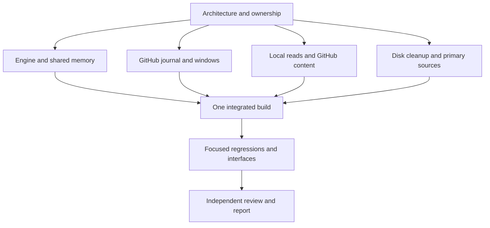

# Performance and cache audit — 13 November 2026

## Executive summary

The audit covers shared cache storage and cleanup, local search/fetch/structure/AST/LSP paths, and all six GitHub research tools. Confirmed defects include cache invalidation errors, retained metadata without retirement, unnecessary whole-file allocations, blocking work on an async worker, and provider work amplified beyond the requested page.

Implementation is complete for the findings listed below. The host build, local CLI/MCP probes, focused regressions and LSP tests pass. HTTP-mock execution is sandbox-blocked; final lint and an incremental host rebuild remain pending. This report does not claim a production speedup, an RSS reduction, exhaustive operation coverage, or a passing test that has not run.

The tree already contained extensive edits from other sessions. This audit preserves those changes; a repository-wide diff includes work outside this audit.

## Key findings and implemented changes

| Priority | Where / who | Trigger and root cause | Change / intended outcome | Verification evidence |
|---|---|---|---|---|
| High | `runtime/src/cache/disk.rs`, new `runtime/src/cache/disk/read.rs`; coordinator | A stale disk hit loaded and decoded its entire body before checking its header's age. | Inspect the bounded header first; expired bodies never reach their codec. | Counting-codec regression passed. |
| High | `runtime/src/cache/disk/capacity.rs`; coordinator | A reader of an older invalid entry could unlink a healthy replacement published at the same path. | Reopen and revalidate the current path under the existing publication lock before deleting it. | Replacement-during-read regression passed. |
| Medium | `runtime/src/cache/disk/capacity/turn.rs`; coordinator | Every distinct store directory permanently retained a path and leaked a process-local turn. | Retain a shared turn only while a holder or waiter owns a ticket; release and remove under the registry mutex. | Lifetime regressions and strengthened arrival-after-release retest passed; independently retested. |
| High | `runtime/src/runtime/maintenance.rs`; local lane | The tmp-only startup gate skipped provider answers stored outside tmp, and snapshot age could change before its cleanup lock was acquired. | Detect existing owned stores independently of tmp; recheck materialization age while locked. | Both maintenance regressions passed. |
| Medium | `runtime/src/cache/disk/capacity.rs`; coordinator | Partial stale sweeps restarted directory enumeration on the next write. A live prefix could be reread repeatedly while reclaiming a backlog. | Finish a due expiration pass and advance its scan time; preserve oldest-first byte eviction and conservative accounting. | One-pass backlog and scan-count regression passed. |
| Medium | `io/src/memo.rs`; engine/shared-memory lane | Several removal paths destroyed retained values while holding the memo mutex. | Detach and account under lock, destroy after unlocking, extending the existing batch-expiry pattern. | Nine-path destructor regression passed; 22 memo tests passed. |
| High | `engine/src/lsp/managed.rs`; engine lane | Size/mtime reuse could accept an equal-size replaced executable with preserved mtime; first verification allocated the whole executable. | Check settled Unix change-time/inode identity and stream hashing; non-Unix fallback rehashes. | Replacement and repeat-verification regressions passed within 56 LSP tests. |
| Medium | LSP pool and managed-binary memo; engine lane | Failed-start keys and verified executable paths had no retirement bound. | Use LRU bounds derived from the existing pool capacity and embedded manifest working set. | Occupancy and recency regressions passed. |
| Medium | `runtime/src/tools/local_fetch/acquire.rs`, `runtime/src/tools/local_fetch/executor.rs`; local lane | Whole-source allocation preceded binary rejection, although rejection needed only a sample. | Reserve the whole source after the sample passes binary admission. | Sparse binary sample-capacity regression passed. |
| High | `github/src/transport/evidence.rs`; GitHub lane | `forget()` removed new journal data but left saved continuation answers replayable. | Remove saved replay eligibility too. | Invalidated saved-answer regression passed. |
| Medium | Same journal; GitHub lane | Recording unique requests and finding saved answers repeatedly searched growing vectors. | Indexed membership and replay lookup; preserve ordered latest responses and shared body allocations. | Ordering, replacement and invalidation regressions passed. |
| Medium | `runtime/src/tools/gh_get_file_content.rs`; local lane | Plain content shaping ran synchronously on a Tokio worker; only ranked shaping used the blocking worker. | Use the existing carried blocking boundary for both paths. | Regression compiled; execution blocked by mock-server port permission. |
| Medium | `runtime/src/tools/gh_structure/materialize/snapshot.rs`; local lane | Hash verification and exact comparisons allocated entire local materialized files. | Stream hashing and exact chunk comparisons, checking length and trailing bytes. | All five integrity cases passed. |
| Medium | `runtime/src/tools/gh_get_history_item/window.rs`; GitHub lane | A filtered read with a known total scheduled and retained all provider batches before checking whether the page was covered. | Bound each wave by the existing request concurrency, continuing later waves as needed. | Scheduling-bound test passed; HTTP continuation test blocked by port permission. |

All paths above are relative to `packages/octocode-native/crates/`. Findings apply whenever the listed trigger occurs; their production frequency and wall-time cost remain unknown. Priorities combine correctness and plausible resource impact, rather than measured fleet incidence.

## Analysis: stale data and high cache occupancy

| Layer | Current algorithm | Scaling and tradeoff |
|---|---|---|
| In-memory memo lookup | Hash/LRU lookup checks the requested entry's deadline. | Expected constant-time lookup; no full live-entry expiration scan. |
| Cached local scan validation | `engine/src/stamp/proof.rs::Proof::holds` checks watched source/rule/directory identities before reuse. | O(W) validation work for W watched entries, plus page shaping; an O(1) memo lookup does not make the complete tool call O(1). |
| Memory expiration | Ordered `BTreeSet` deadline index. | Deadline changes cost O(log N); retiring E expired entries costs O(E log N), excluding destruction. |
| Global memory pressure | Compare the oldest entry across M registered memos for each victim. | O(KM) memo-head checks for K victims. A redesign requires evidence that M materially affects pressure latency. |
| Disk hit | Open a bounded regular file, inspect header, decode a live body. | A live read still pays file I/O and decoding. Stale reads inspect a small header and perform locked cleanup. |
| Due disk expiration | One directory pass; source age remains enforced independently on every read. | O(N) traversal plus unlink cost; expiration-only maintenance retains O(1) auxiliary metadata. Finite-budget reconciliation can collect O(N) metadata. A longer cleanup burst replaces repeated partial passes. |
| Disk byte pressure | Collect live metadata, sort oldest first, evict with existing headroom. | O(N log N) time and O(N) metadata memory during pressure; ordinary writes reuse conservative capacity accounting between reconciliations. |
| Process-local store turns | One registry entry per active directory. | Expected constant-time key lookup; idle directories leave no retained turn. |
| GitHub journal | Ordered response vector plus request indices. | Expected O(1) saved lookup and membership; expected O(N) accumulation of N unique requests. Ordered replacement/removal can still cost O(N). |
| GitHub filtered history | Bounded ordered waves. | Speculative work is bounded by existing concurrency per wave; later evidence remains reachable. |

The old mixed-directory cleanup worst case was conditional: if L live entries precede E stale entries in repeated enumeration, removing a share S at a time can inspect the live prefix at least `L × ceil(E/S)` times. This is a source-derived complexity argument, not an observed production benchmark.

Disk maintenance runs when due at persistent-runtime startup; it is not a recurring background disk sweeper. The one-pass change deliberately trades a larger individual cleanup burst for less repeated total work. Filesystem calls and an in-progress sort cannot be interrupted instantly. A production tail-latency study should measure maximum lock hold and reuse-write refusal rates with realistic live/stale mixtures.

## Memory versus disk

| Property | Memory-only state | Persistent disk state |
|---|---|---|
| Authority | Retained values live in the runtime. | Disk is authoritative; a second permanent memory copy is not retained. |
| Hit cost | Share an `Arc`; update use/deadline state. | Read and decode the entry again. |
| Lifetime | Ends with the process/runtime or eviction. | Can resume across CLI processes, subject to expiry and byte eviction. |
| Bounds | Shared retained-weight budget; LSP operational caches also have owner-derived entry bounds. | Per-directory byte budget; not one aggregate disk ceiling for all stores. |
| After eviction | Other callers may still hold an `Arc`; allocator pages can remain resident. | Removed files release their names; hard links or open handles can retain underlying data. |
| Best fit | Repeated operations within a long-lived session. | Cross-process continuation and validated provider reuse. |

The shared memory budget is derived from host RAM divided by eight, clamped to 512 MiB–2 GiB (`engine/src/memory.rs`). It counts retained weights and reservations, not total process RSS. Request buffers, caller-held values, allocator overhead, language servers and other processes remain outside that interpretation. No measured RSS saving is claimed for deferred binary allocation: reserved capacity and committed pages differ.

Explicit cache clearing drains the runtime and clears shared process memos, the six retained-state store directories, captures, materializations and current graph extraction checkpoints. Published graphs, clone outputs, credentials, installed servers and rate-limit coordination are preserved by policy. Independent MCP processes require restart; a clear in one process cannot drain those runtimes.

Provider answers that cannot safely be persisted remain memory-only even in persistent mode. Temporary decoded values and caller-held `Arc`s still consume memory while a disk-backed request runs.

## Tool coverage and observed smoke calls

| Tool | Audited path and limitation |
|---|---|
| `localSearch` | Manifest freshness proofs, seek-backed stored frames, ranking/replay boundaries. Non-seek layouts can decode the retained result as a whole. |
| `localFetch` | Whole-source versus sample acquisition, binary rejection, common source-view work. Allocation regression added. |
| `structureSearch` | Ranked/listing memos, directory/source/ignore proofs, optional line-count work. Freshness validation still visits watched metadata. |
| `astSearch` | Parser and continuation paths; held-result regrouping remains a profiling candidate, not a demonstrated defect. |
| `lspSearch` | Pool failed-start state, managed executable verification and operational cache lifetimes. Full external-server matrix not exercised. |
| `ghSearchRepo` | Provider cache, decoding and projection; owner listings can require additional pages. |
| `ghSearchCode` | Search cache and per-commit source acquisition; paths-only avoids content reads. |
| `ghGetFileContent` | Ref resolution, immutable content, shared shaping, blocking boundary. |
| `ghStructure` | Ref/tree cache, listing reconstruction and materialization integrity. |
| `ghSearchHistory` | Provider page reuse and shaped output; one live continuation checked. |
| `ghGetHistoryItem` | Collection windows, filtered provider batching and response continuation. |

Connected MCP smoke calls used `vitejs/vite` and `rust-lang/rustlings`. Each timing is a two-query batch measured by the reviewer; cache/process state was not isolated. Repeats used the same semantic provider workload, with changed reasoning text and, for four tools, changed response-size targets. They were not byte-identical requests or controlled paired benchmarks. [Exact recorded inputs](2026-11-13-performance-evidence/github-smoke-inputs.json). The connected server was not rebuilt by this audit.

| GitHub tool | Initial batch, ms | Repeat workload, ms |
|---|---:|---:|
| `ghSearchRepo` | 10,928 | 389 |
| `ghGetFileContent` | 11,331 | 604 |
| `ghStructure` | 1,636 | 1,422 |
| `ghSearchCode` | 3,057 | 3,185 |
| `ghSearchHistory` | 2,641 | 165 |
| `ghGetHistoryItem` | 1,649 | 1,390 |

These observations include MCP, network and severe host contention. They are smoke evidence only: no causal cache speedup, throughput comparison, CPU reduction or rebuilt-binary improvement follows from them. The Vite code query returned empty and the Rustlings query returned usable data. Remaining search/history pages were intentionally unread; no completeness claim is made.

Observed source identities for the sampled file reads: Vite `61622b8df68b7a8e657caa6f98d9b70069643abf`; Rustlings `f7b9b3c5882a1a43275130b95142d94f847526f5`.

## Execution graph and verification

| Owner | Scope | State |
|---|---|---|
| Coordinator | Disk cleanup, integration, sole heavy job, report | Final lint/build verification |
| Engine/shared-memory agent | LSP operational caches, executable hashes, memo destruction | Source-reviewed; focused tests passed |
| GitHub agent | Journal replay and history waves | Journal and scheduling tests passed; HTTP continuation blocked |
| Local agent | Binary allocation, GitHub content, maintenance | Allocation/integrity/maintenance tests passed; HTTP shaping blocked |
| GitHub reviewer | All six tool paths and live smoke calls | Completed read-only review |
| Cache researcher | Complexity, storage tradeoffs, primary sources | Completed read-only review |
| Independent reviewer | Integrated source and adversarial assessment | Completed source review; test-isolation finding fixed |
| Fresh independent retester | Nine critical cleanup/maintenance assertions | 9/9 passed on identified artifact |

The host exposed 12 CPUs; observed load averages initially reached approximately 35–90, later falling below seven. Process and memory-pressure inspection were sandbox-denied. One Cargo job at a time used the shared target and one build job; no other session's process was stopped.

The first verification attempt failed because the sandbox blocked `sccache`. With `RUSTC_WRAPPER=` it waited on another session's target lock, then could not resolve the newly added engine `lru` dependency. The next invocation progressed through engine, runtime, GitHub and CLI compilation but encountered a test path error and stale cross-crate symbols during concurrent edits; the test path is corrected and a fresh run is queued. The failed attempt is not a passing baseline or an executed failing regression.

| Check | Status |
|---|---|
| Targeted formatting of the implementation/regression files, including maintenance | Passed, exit 0 |
| `git diff --check` | Passed |
| `node skills-dev/octocode-dev/scripts/dev.mjs docs:verify` | Passed, exit 0 |
| First integrated cache-test compilation | Failed: one snapshot test path fixed; cross-crate symbols changed concurrently and are present in current source. No cache tests executed. |
| Earlier compiled GitHub journal test binary | Passed: 3/3, including both new regressions. |
| Earlier compiled IO memo binary | Baseline only: 19/21 passed; two retained-budget regressions failed. It predates the destructor regression and current budget fixes, so it is not verification of current source. |
| Fresh canonical focused regression run | 322 passed, 50 blocked by mock-server bind permissions, one ignored helper; exit 101. |
| Engine LSP regressions | 56 passed, zero failed; exit 0. |
| Strengthened store-turn retest | Passed, one exact test; exit 0. |
| Independent critical-cache retest | 9/9 exact tests passed on an identified runtime test artifact. |
| Host build | Passed and staged the host binary; final incremental rebuild queued after lint. |
| `dev check-outputs` | Passed, exit 0. |
| Rebuilt CLI/MCP probes | Four local tools passed on both interfaces; stdio MCP exited 0. |
| Config and schema probes | Config JSON and localFetch/ghGetFileContent query schemas parsed successfully; exit 0. |
| Clippy | Type-complexity and two style diagnostics fixed; final rerun running. |

Raw evidence (local generated logs): focused tests (`2026-11-13-performance-evidence/focused-tests.log`), 56 LSP tests (`2026-11-13-performance-evidence/engine-tests.log`), older IO baseline (`2026-11-13-performance-evidence/baseline-io-tests.log`), and initial compilation diagnostics (`2026-11-13-performance-evidence/initial-compilation.log`).

Every one of the 50 blocked cases failed at wiremock server creation with `PermissionDenied: Operation not permitted` while binding an OS port. They did not reach their behavioral assertions. The ignored `disk_writer_process` is a child-process helper invoked by a passing parent test. The earlier IO baseline failures both pass in the current 22-test memo run.

A host-wide `vm_stat` sample showed 1,046,177 physical pages occupied by the compressor with 16 KiB pages, approximately 15.96 GiB. This is an aggregate host observation, not Octocode memory attribution; cumulative swap counters do not establish a current swap rate.

The local boundary probe used a pinned host binary, SHA-256 `0dcc2ae87c2c7a110eafb809d61cb007b099b9d538760e23067acd38fa6a2e0d`, a temporary seven-line Rust fixture with Unicode, and memory-mode storage. Exact fetched content and search counts agreed across CLI and a fresh stdio MCP session; symbol and path responses were inspected. All selected evidence fit with no remaining pages. The temporary server and fixture were removed. Recorded results (local generated logs `2026-11-13-performance-evidence/boundary-smoke.log` and `contract-smoke.log`): `localFetch`, `localSearch`, `astSearch` and `structureSearch` each exited 0 on the CLI and passed the boundary comparison over MCP (protocol `2025-11-25`), and the MCP process exited 0; `config --json` and the `localFetch` and `ghGetFileContent` query schemas each exited 0 with a JSON object root.

The independent cache retest used runtime test artifact SHA-256 `32567cb7836a76e31cb12d088d16f572d9fad20a09c551f329994e145128facd`. Its own pin was unchanged across all nine checks and removed afterward. Source freshness was not independently established by that retester; this identifies precisely what was executed.

## Recommendations and next steps

1. Complete focused Rust regressions, affected crate linting, a host binary build, and fresh CLI/MCP probes before treating the changes as verified.
2. On an uncongested host, measure release-mode cold/repeat/page latency, allocator/peak memory and CPU for large text, binary refusal, materialization, high-occupancy expiry and filtered history. Hold corpus, ref, process lifetime and optimization constant.
3. Instrument disk cleanup duration and bytes/entries retired, plus global memo count M during pressure. Use those results to decide whether a persistent expiry index or global eviction heap is justified.
4. Preserve authenticated provider validation and exact credential/origin partitions. Increase cache retention only when the owning policy and freshness semantics support it.

Lower-confidence profiling candidates remain: AST page regrouping, global O(KM) victim selection, and persisted GitHub owner-route growth. Their production impact is unknown; no speculative architecture rewrite was introduced.

## Primary sources

- [Tokio `spawn_blocking` 1.53.3](https://docs.rs/tokio/1.53.3/tokio/task/fn.spawn_blocking.html): blocking/CPU work requires an appropriate execution boundary; started blocking tasks cannot be aborted automatically.
- [Tokio filesystem guidance](https://docs.rs/tokio/latest/tokio/fs/): batch blocking filesystem work rather than scheduling tiny operations independently.
- [LRU 0.19.0](https://docs.rs/crate/lru/0.19.0): lookup/update/eviction semantics. The workspace already pins this version.
- [GitHub REST best practices](https://docs.github.com/en/rest/using-the-rest-api/best-practices-for-using-the-rest-api): authenticated conditional requests, stable request representations and rate-limit handling. Correctly authorized 304 responses avoid primary-rate-limit charges.
- [RFC 9111](https://www.rfc-editor.org/rfc/rfc9111.html): cache freshness, validation, `no-store`, `no-cache` and authenticated/private response handling.
- [Rust Windows metadata API](https://doc.rust-lang.org/std/os/windows/fs/trait.MetadataExt.html): platform limitations affecting stable file-identity proofs.

Confidence is high for inspected mechanisms and intended invariants; quantitative production impact remains unknown until comparable measurements and final regression execution are available.
