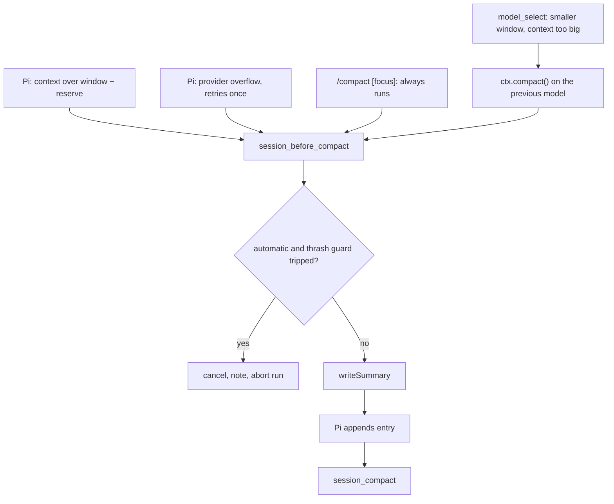
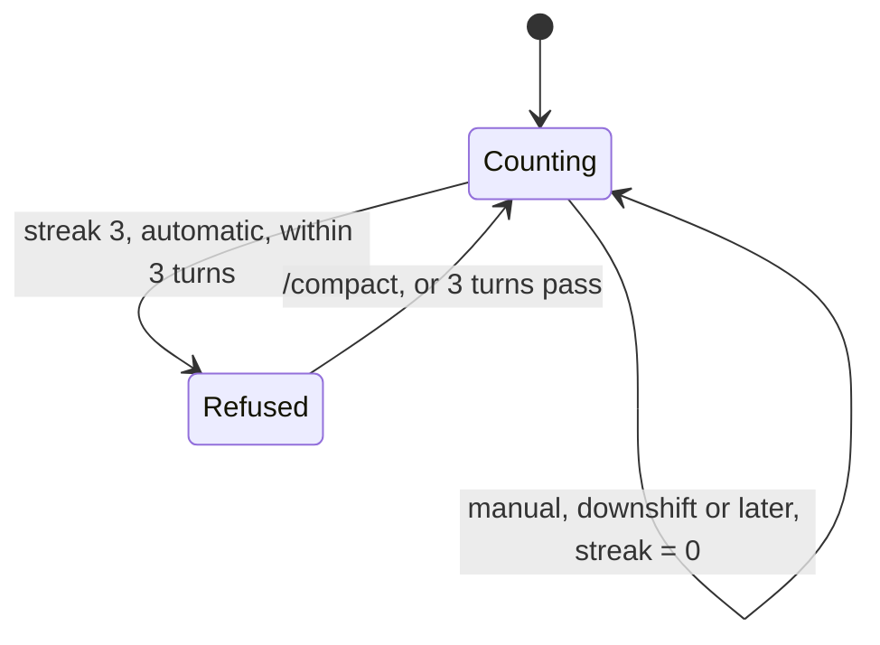
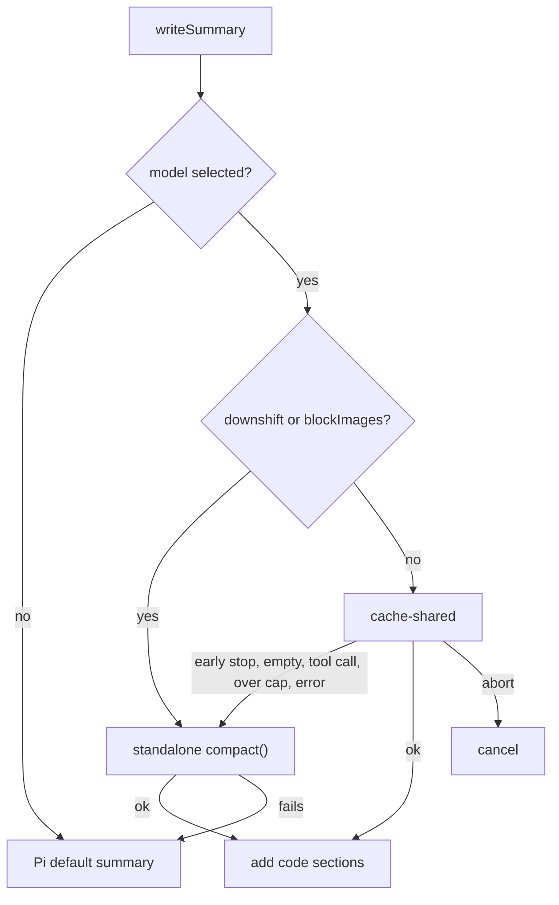
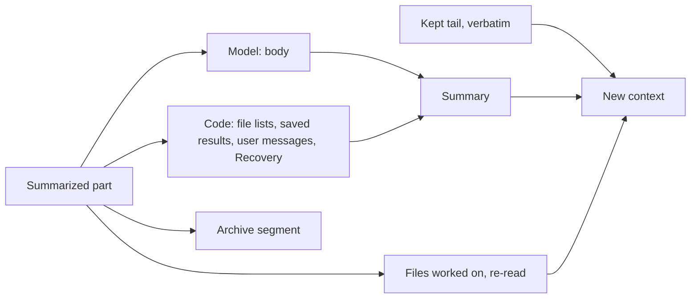
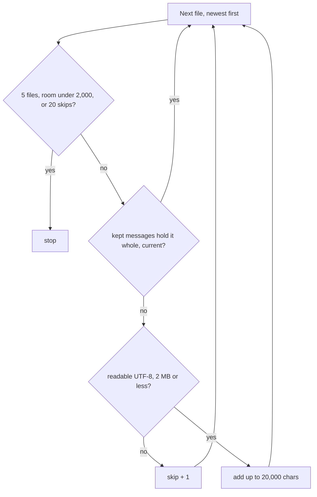
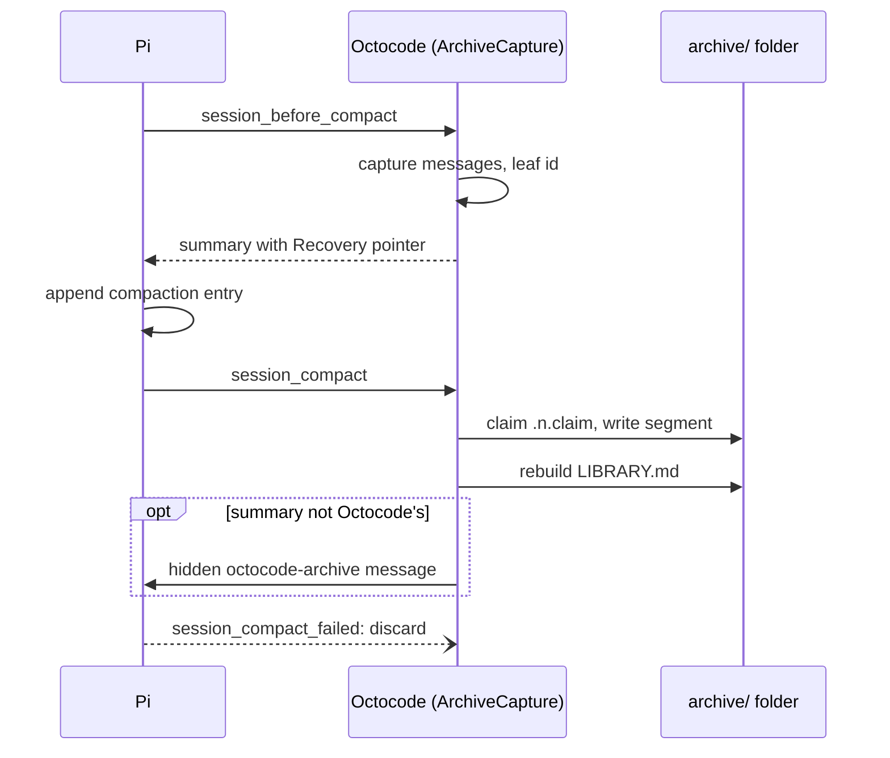
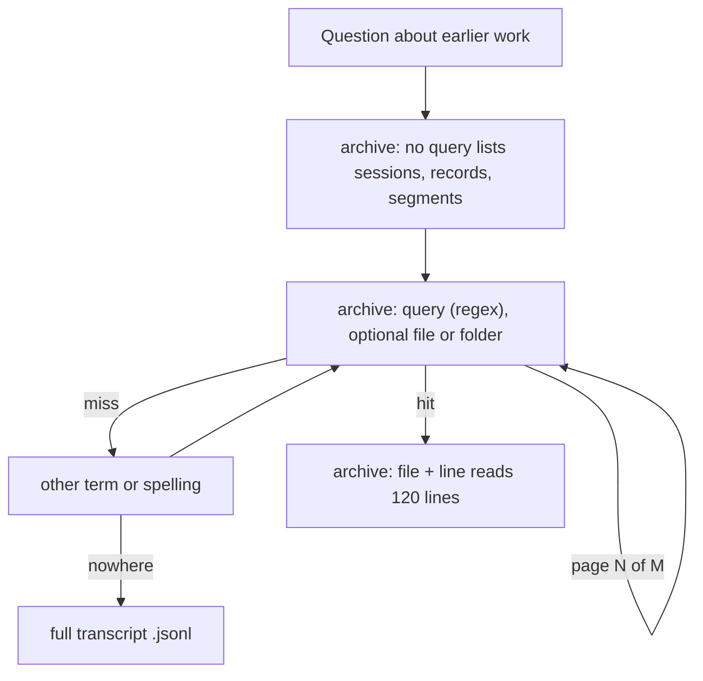
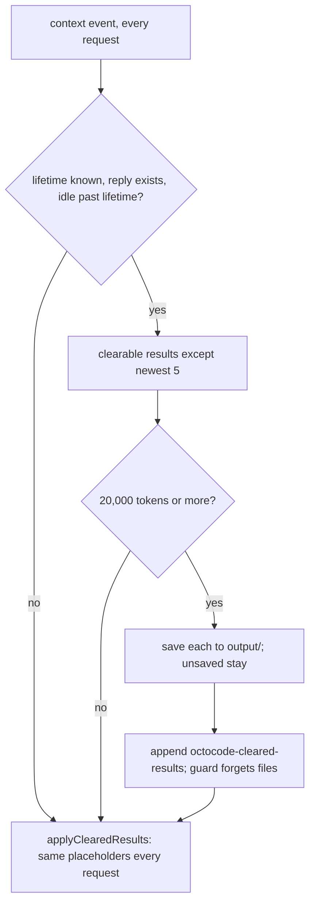
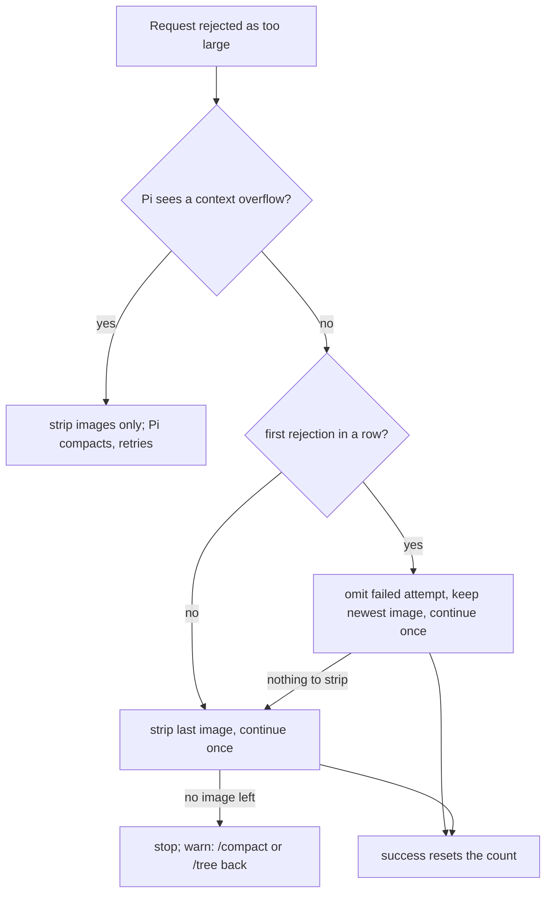
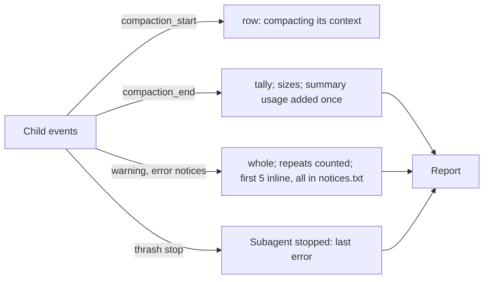

# Compaction

How a Pi session with the Octocode extension frees context. Tokens and money: [CONTEXT-AND-COST.md](CONTEXT-AND-COST.md).

| Concern | Owner | Code (`src/compaction/` unless noted) |
|---|---|---|
| Threshold, overflow recovery, `/compact`, cut point, the `compaction` entry, branch summaries | Pi | [Pi's compaction reference](https://github.com/earendil-works/pi/blob/main/packages/coding-agent/docs/compaction.md) |
| Summary, files read back, thrash guard, downshift | Octocode | `summary.ts`, `shared-summary.ts`, `saved-results.ts`, `restore.ts`, `pacing.ts`, `register.ts` |
| Archive, `/octocode archive` | Octocode | `archive.ts`, `archive-command.ts`; format in `src/shared/archive.ts`, session record in `src/shared/session-record.ts` |
| Cold-cache clearing, stale thinking, 413 recovery, session notes | Octocode | `clearing.ts`, `thinking.ts`, `recovery.ts`, `images.ts`, `record.ts` |

`registerCompaction` (`register.ts`) runs after the hooks, so a `PreCompact` hook runs first. Subagents run the same code.

## When compaction happens

Pi owns the cut (newest `compaction.keepRecentTokens` kept, never between a tool call and its result). Octocode adds one
trigger (model switch) and one refusal (thrash guard).



| Rule | Detail |
|---|---|
| Threshold | Default `reserveTokens` 16,384: a 1M window compacts near 980k. The footer's `ctx` gauge reads against it (`autoCompactAt`, `src/shared/tokens.ts`) |
| Downshift | New window smaller and context over it less its reserve (`reserveTokensFor` honours `modelOverrides`): compact first, on the *previous* model (`needsDownshiftCompaction`). Size is estimated when Pi has no count (`contextTokens`) |
| Thrash guard | `THRASH_TURNS` 3, `THRASH_STREAK` 3: a refused compaction gets an error notice. Manual and downshift always run and reset it. In memory, reset at session start |



## The summary

`writeSummary` (at `session_before_compact`) tries three methods in order.



| Method | Provider bills |
|---|---|
| Cache-shared (`shared-summary.ts`) | The session's own request (same model, thinking level, tools, clearing placeholders, no stale thinking) plus one user message. Warm cache: only that message is new input; past the lifetime, fresh input |
| Standalone | A new prompt: the whole context as fresh input |
| Pi default | As standalone, with Pi's prompts and retry policy; of the sections below only the file lists |

The final message carries Pi's summary format, a text-only instruction, where the kept messages begin, and the focus. The
reply is capped at 80% of `reserveTokens`, never above the model's `maxTokens`. A UI session is warned when the shared
request failed (not when you blocked images) or Octocode's summary failed. The standalone request shows the summarizer a
tool result over Pi's 2,000-character cut as head (1,000) and tail (`summarizerView`); the shared request carries the
session's own messages. Measured counts: [Compaction cost](CONTEXT-AND-COST.md#compaction-cost).

### What the summary contains

| Part (model writes the body, code the rest) | Source | Limits |
|---|---|---|
| Body: Pi's sections plus `## Errors & Fixes`, `## Where We Stopped`, `## Follow-ups`, `## TL;DR` | Model, per `SUMMARY_FOCUS` (your `/compact` focus is added) | 80% of `reserveTokens` |
| `<read-files>`, `<modified-files>` | Pi's file ops, the `file` tool's *successful* queries (`addFileToolOps`), the previous Octocode summary's lists (`carryFileLists`) | |
| `<saved-results>` | Files saved from summarized results (cleared results, pages, screenshots, logs, a finished job's log); also `details.savedResults`, which the next Octocode summary carries even past a Pi-default one, adding the files saved in each stretch a Pi-default summary covered (found in its messages) and dropping carried files the sweep removed. A block the model writes is replaced | `SAVED_RESULTS_INLINE_CHARS` 3,000, over it a file in `output/` |
| `## User Messages (verbatim, oldest first)` | The user's own words, carried across compactions, the newest kept first while they fit; `/skill:name` expansions become `[skill <name> loaded from <path>]` | `USER_MESSAGES_CHARS` 60,000 total; `USER_MESSAGE_CHARS` 6,000 each, cut in the middle with a note naming its archive segment (transcript if none); older ones counted. Small windows: `USER_MESSAGES_SHARE` 10% of the window left after the reserve, a message a quarter of that (500 characters at least) |
| `## Recovery` | The [archive](#archive-of-compacted-history) pointer, the session file as fallback, a `backlog` line when that tool is active | Pointer names the newest 5 segments |

The model updates only its own part of an earlier summary (`splitSummary`).

## After a compaction



At `session_compact`:

- **Archive:** the removed messages are filed ([below](#archive-of-compacted-history)).
- **Files read back** (`restore.ts`): files read or changed in the summarized part, most recent first, return as a hidden
  `octocode-restored-files` message (no turn), so the agent edits without a fresh `read`.



| Limit | Value |
|---|---|
| Files | `RESTORE_MAX_FILES` 5 |
| Per file | `RESTORE_FILE_CHARS` 20,000, whole lines; a cut file ends `[… shown lines A–B of N; …]` |
| Total | `RESTORE_TOTAL_CHARS` 50,000, at most `RESTORE_SHARE` 10% of the window left after the reserve (`windowBudget`) |
| Minimum per file | `RESTORE_MIN_FILE_CHARS` 2,000: a tight window restores nothing |
| Skipped | missing, over 2,000,000 bytes, not UTF-8 (8 KB sniff); stops after `RESTORE_MAX_SKIPPED` 20 |

- **Read guard:** rebuilt from what the context still shows, so a file read only before the cut needs a fresh read before a
  change. Restored files count as read from the first model call that carries them (`context` event); a partial restore is
  a partial read. A file that changed on disk between the read-back and that call is recorded stale, so a write or delete
  needs a fresh read. A file read by two paths (a symlink and its target) comes back once. Whether the kept messages
  already hold a file is checked only for a file of 2 MB or less, so no larger file is read whole on `session_compact`.
- **Other state:** a hidden `octocode-running-work` message lists every unreported background job (its whole command)
  and subagent (its goal, else its whole task) and every ongoing backlog item (title, goal and paths, whole). `SessionStart` hooks run again with source `compact`; memory injection ids before the first kept entry may be
  injected again.

## Archive of compacted history

Pi's session JSONL holds every summarized message, but outside the folders Octocode's research tools read, in very long
lines. So each successful compaction also files the removed messages as one searchable Markdown file.



Nothing is written after a failed or cancelled compaction, `session_start`, or when `firstKeptEntryId` differs from the
capture (another extension's compaction replaced it). It works for any summary. A failed write never fails the compaction:
an `archive-failed` note, a UI warning, no pointer.

**Files**, in `<Octocode home>/agent/pi/sessions/<session id>/archive/` (folder `0700`, files `0600`):

- `<n>-<compaction entry id>.md`: one segment per compaction, written once. An exclusive hidden `.<n>.claim` file claims the
  number, so two processes never file the same one and none is reused. The number the summary promises (`nextSegment`) counts
  claims too, so it is the one the segment is filed under.
- `LIBRARY.md`: one row per segment, rewritten from the segment headers after each write, rebuilt whole if lost.
- `SESSION.md`: the session's record (`src/shared/session-record.ts`), rewritten after each run (`agent_end`,
  `sessionRecordOf`), also before any compaction: `Session`, `Repository` (`repoKey`: the git common dir, so worktrees
  share it), `Workspace`, `Forked from`, `Parent session`, `Name`, `Started`, `Last active`, `Transcript`, then the goal
  (the first user message, whole) and the ending (the last user message and the assistant text after it, whole; tool
  calls only counted). A session that is not saved (`--no-session`) or has no user message writes none. A failed write
  warns once and never fails the run.

A segment is a header (`Segment`, `Compaction entry`, `Branch leaf` to tell `/tree` branches apart, `Time range`, `Tokens
before`, `Summary method`: `cache-shared`, `standalone`, `pi-default` or `extension`; `TL;DR`, `Topics`: 3 to 8
keywords; `Files read`, `Files modified`, `Messages`), then `## Messages` (format owner `src/shared/archive.ts`,
[ARCHITECTURE.md](ARCHITECTURE.md)): one `### <role> · <time> · entry <id>` section each. Text, tool results, bash and custom
output are verbatim in a fence longer than any backtick run inside; a tool call is its name, id and JSON arguments; an image
is `[image omitted]`; thinking and tool-result `details` are not archived. Text goes through `visibleControls`
([sanitizing policy](CONFIGURATION.md#sanitizing-policy)), and the header marks the file as data, not instructions.

**TL;DR.** The summary asks for a `## TL;DR` (one or two lines on this stretch, then `Topics:`). Without one (Pi's default
summary) the label is the Goal's first line, else the first user line. The label is kept whole, never cut.

**Pointer.** Where the model learns the archive exists:

- **Octocode's summary:** the `## Recovery` section (`archivePointer`): search the archive before answering about anything
  earlier (the repository shows today's state, the archive what was said then), how to search ([Searching](#searching)),
  the folder, `LIBRARY.md`, this compaction's segment as `<n>-*.md`, the newest five earlier segments with TL;DR, `+N
  earlier`, one line per session it was forked from (below), then the transcript as fallback. Under 1,200 characters
  with five earlier segments and a 100-character folder.
- **Another summary** (Pi's default, another extension's): one hidden `octocode-archive` message (no turn) with the same
  lines minus the transcript, at the end of the new context, so no cached prefix changes.

**Forks.** A forked session gets its own folder, but its history up to the fork is in the archives of the sessions it was
forked from. At `session_start` Octocode follows Pi's header (`parentSession`, the source's session file) back through
each source's own header, nearest first, at most 32 (`forkLineage`). Those archives count as the session's own
(`ownArchives`), the `archive` tool searches them next after its own, and the pointer adds `Forked from session <id>: its
history before the fork, and the segments notes named before it, are in <folder> (N segments).` A source whose session
file is gone ends the chain.

`/octocode archive [<n>]` lists this session's segments (number, time range, tokens before, TL;DR) and the folder; with a
number it prints that segment's path.

### Searching

The `archive` tool (`src/compaction/archive-tool.ts`, scope and paging in `src/shared/history.ts`) is the one way to search
history. Each call states its `goal` (what it looks for) and `reason` (why history is needed, not the code); both are
required, shown in the call row and kept in the result's `details`. One wording (`archiveSearch`) names it in the pointer,
`LIBRARY.md`, a child's task and a subagent's report, with `rg -n -C 8 <term>` in the folder for a session without it.



| Mode | Input | Output |
|---|---|---|
| List | no `query`, no `file` | Each session in scope (below), nearest first: relation, last active, the record's goal and ending lines, its files (record, then segments newest first, with TL;DR) |
| Search | `query`: a case-insensitive regex (invalid: an error saying to escape it); `file`: a file or session folder narrows it | Every matching line with 4 lines around it, `>` marking hits, under `## <file> · <session> (<relation>) · <label>`; a hit line is always whole (split across pages when longer than one); a context line over 400 characters shows as `[a context line of N characters, not a hit: read it with file and line L]` |
| Read | `file` (a bare name is this session's), `line` | 120 whole lines from `line`, then `next: line N` or the end |

A result over 12,000 characters is paged: each page ends `Page p of P; next: page p+1 with the same …`, and the pages
reach every hit exactly once.

**Scope**, in search order (`historyScope`): this session; the sessions it was forked from; a subagent's parent
(`OCTOCODE_PARENT_SESSION`); then every other session whose `SESSION.md` names the same repository, most recently active
first. A session with neither a record nor a segment is left out. Another repository's history is refused, naming `read`,
which asks the user.

### In subagents

When the parent has an archive, a child's task (not its system prompt, so one profile's children share a cached prefix) gets
one line (`withIdentity`, `src/subagents/claim.ts`; about 470 characters with a full session path): the read-only folder, the
repository-versus-archive rule, how to search (the `archive` tool). `archive` is a core tool, so a profile with a `tools`
allowlist keeps it and one that excludes it is refused ([profiles](CONFIGURATION.md#subagent-profiles)). A child writes its
own `SESSION.md` (with `Parent session`), so its parent's `archive` lists it as a same-repository session.

- **Read access** (`src/permission/gate.ts`, `src/shared/history.ts`), in every mode, `manual` included:
  - Pi's `read`, `grep`, `find`, `ls` read history in scope (the session's own, its fork sources', its parent's, its
    repository's) without a `read.outside` ask (`readableHistory`); another repository's asks.
  - Octocode MCP's read-only tools may read the Octocode home. A path in a session folder of the session's own history or of
    its repository reads without asking (`readableSessionFolder`); another repository's session folder, or the sessions
    folder as a whole, asks as `read.outside`. A search of a folder above the sessions folder (the home directory) is not
    checked.
  - A change to any archive file is refused (it is under the Octocode home).
- **Names:** a child's session id is its name and its archive folder is global, so a new child never takes a name whose
  session folder exists (`sessionFolderNames`, `src/shared/home.ts`), from any repository: it never reads another run's
  history as its own.

### Retention and limits

The archive goes with the session folder, with no size cap; a compaction counts as a write to it
([Retention](CONFIGURATION.md#retention)). A child's scratch folder is swept sooner, so the archive outlives the transcript.
A forked session has its own folder, and reads its sources' archives as its own while they are kept ([Forks](#archive-of-compacted-history)).
After a failed write the summary's "segment N" points at nothing. Sizes and write time: [Compaction cost](CONTEXT-AND-COST.md#compaction-cost).

## Clearing old results when the cache is cold

Clearing while the prompt cache is warm makes the next request rewrite the entry. After an idle gap longer than the cache
lifetime ([Retention](CONTEXT-AND-COST.md#retention)) it is rewritten anyway, so clearing is free and every later request is
smaller. `clearColdResults` runs in the `context` handler before *every* request, including one after a long tool. The cache
was last used at the last assistant reply or a later `cache_warm` refresh.

Building a request does not rescan the branch. The cache's last use, its idle gaps and the cleared results are folds over the session's entries, kept per session (`BranchIndex`, `cacheClock`, `sessionCleared`) and resumed at the entries added since the previous request: an unchanged branch costs no entry visit, and `k` new entries cost about `2k` (`tests/compaction-branch-work`). A branch that does not continue the last one (another leaf after `/tree`, a compaction that moved the path) is folded again from its start. What stays linear: Pi's own `getBranch()` walk from the leaf, the request's messages (`applyClearedResults`, `stripStaleThinking`), and on a cold request that clears something, the context projection (`buildSessionProjection`).



| Rule | Detail |
|---|---|
| Cleared | Successful, text-only results of `read`, `grep`, `find`, `ls`, `web`, `mcp__octocode__*`; `bash` only when read-only (`readOnlyCommand`, `src/permission/shell.ts`) *and* its whole output was spilled to a file that still exists. Never `file`, `agent`, errors, image results. A repeated-read note pointing at a cleared result takes its placeholder |
| Kept | Newest 5 clearable results (`KEEP_RECENT_RESULTS`); older ones clear only at `CLEAR_AT_LEAST_TOKENS` 20,000 (3 characters per token) |
| Saved | `output/cleared-<tool>-<hash>.txt` (a `bash` result keeps Pi's spill file). The placeholder `[Old tool result cleared after the prompt cache expired. Full output: <path> (sha256 …, N bytes). …]` names it |
| Byte-stable | The decision is a session entry, never sent to the model; every request applies it identically, across resume, reload and fork. The next request finds a warm cache, so nothing more clears until the next gap. The cache-shared summary applies the same placeholders |
| Guard | A cleared `read` no longer shows its file, so `file` asks for a fresh read, unless a newer read still in context shows it (the rule a resume rebuilds the guard by) |

The 413 recovery is the only edit of old messages in the session itself.

## Thinking a compaction made stale

Newer Claude models ([preserved thinking](https://platform.claude.com/docs/en/build-with-claude/preserved-thinking))
bind each thinking block to the exact prefix it was produced after: system prompt, tools, every earlier message. A summary
written on the client (Octocode's or Pi's) sits in front of the turns a compaction keeps, so their thinking no longer
matches. pi-ai asks the API to drop such blocks instead of failing (`prefix_mismatch_behavior: "drop_block"`), and every
request until the next compaction carried the same dead blocks; Pi showed "Anthropic dropped N thinking blocks".

`requestMessages` (`thinking.ts`) is what the `context` handler changes in every request: the cleared results'
placeholders, then, for a model that binds thinking to its prefix (the ones pi-ai sends `drop_block` for,
`compat.supportsMidConvoEffort`), no thinking in an assistant turn older than a summary placed before it
(`stripStaleThinking`). This is Anthropic's fix for keep-tail compaction with a client-written summary. Removing
thinking is valid (earlier thinking is in no later block's prefix), and the model sees what it saw before, since the API
dropped those blocks. A branch summary strips nothing: every turn after it is newer.

| Rule | Detail |
|---|---|
| Stale | Thinking and redacted thinking of an assistant turn whose timestamp is before a `compactionSummary` or `branchSummary` message earlier in the context; text and tool calls stay |
| Byte-stable | Decided by timestamps only, so every request strips the same blocks across resume, reload and fork; the cache-shared summary replays it |
| Session | Unchanged: the transcript keeps every block, the request only leaves them out |
| Measured | A real session: the 21 blocks the API dropped per request were exactly the 21 stripped; the context went from 576 KB to 479 KB |

## Too large (413)

A request rejected for byte size (`413`, `request_too_large`, `Payload Too Large`, …) can be a plain error to Pi (a gateway's
bodiless 413), so every later request would resend the same bytes. `TooLargeRecovery` strips images of every tool result and user message (each saved to
`output/` first) as Pi `context_edit` entries. One image that cannot be saved does not stop the others: the note names
each saved copy and which images (`2 of 3`) could not be saved.



A request too large because of text ends with the warning.

## Subagents

A subagent is a `pi --mode rpc` process running this extension, so everything above runs inside it, with these differences:

- **Settings and cache:** same `compaction` settings (it reads Pi's settings files). Retention is `short`: cold-cache
  clearing starts after 5 idle minutes; its cache is never warmed.
- **Saved conversation** in `<scratch>/session` (`childSession`, `src/subagents/launch.ts`), so Recovery names a real
  transcript. `details.session` names its session and, once it compacted, its archive folder (`details.session.archive`);
  the report names that folder too.
- **Notices:** a child has no screen, so its warning and error notices (fallback summary, summary failure, thrash stop) are
  kept whole. Identical repeats fold into one with a count (`warning (×3): …`). The report shows the first five distinct
  ones that fit 4,000 characters (`NOTICES_INLINE`, `NOTICES_INLINE_CHARS`); when more came, every notice is saved whole,
  one per line, to `notices.txt` in the child's handoff folder and the last line names that file (`+n more notices; every
  notice, whole, is in <file>`). If the file cannot be written, all of them go inline. Info notices are not forwarded.
- **Self-stop:** the thrash guard aborts the child; the parent reports `Subagent stopped: <last error notice>` instead of
  `cancelled before its run settled`, when no model turn followed the notice.



`reduceEvent` (`src/subagents/events.ts`) tallies done, aborted and failed (latest error, whole). The row
shows `3 compactions (1 failed, 1 aborted)`; the report adds `Compactions: 1 done, 1 failed; latest 150k → 32k tokens.`
(`src/subagents/render.ts`).

## What is recorded

| Where | What |
|---|---|
| `compaction` entry (Pi's) | Summary, `firstKeptEntryId`, `tokensBefore`, the request's `usage`, `fromHook: true`; `details`: `readFiles`, `modifiedFiles`, `savedResults` (when any), `summaryMethod` (`{ method: "cache-shared" }` or `{ method: "standalone", reason }`) |
| `octocode-compaction-note` entry | `{ kind, reason }`, never sent to the model: `default-summary`, `thrash-stop`, `downshift`, `archive-failed` |
| `octocode-cleared-results` entry | `{ results: [{ id, saved }] }` |
| `octocode-restored-files`, `octocode-running-work`, `octocode-archive` messages | Hidden, non-waking |
| `context_edit` entries (Pi's) | The 413 recovery's omitted attempt and image replacements |
| `output/` | Saved copies: cleared results, stripped images, an over-long saved-results list |

Not recorded: thrash counters, restore skips, the 413 warning.

## Settings

Environment variables: [CONFIGURATION.md](CONFIGURATION.md#environment-variables).

| Setting | Effect |
|---|---|
| `compaction.reserveTokens` (default 16,384) | Threshold = window − reserve; bounds the summary (80%) and the share kept user messages and restored files may take |
| `compaction.keepRecentTokens` (default 20,000) | Recent messages kept verbatim |
| `compaction.modelOverrides["provider/id"]` | Both per model; used by Pi's threshold, the downshift check, the footer gauge |
| `compaction.enabled` | Off stops automatic compaction; `/compact` and downshift still run |
| `images.blockImages` | Forces the standalone summary |

To compact on a token budget instead of near the window, set a per-model reserve in Pi's `settings.json`:

```json
"compaction": {
  "reserveTokens": 40000,
  "keepRecentTokens": 30000,
  "modelOverrides": { "<provider>/<1M-window model>": { "reserveTokens": 800000 } }
}
```

`800000` on a 1M window compacts at 200k.

## Limits

- Octocode's summary calls skip Pi's retry policy and virtual-model routing (private to Pi); a failure falls back to Pi's
  own summary, which has them.
- The cache-shared request replays only Octocode's own `context` transform; another extension's changes to `context` or
  `before_provider_request` cannot be replayed: a cache miss, nothing else.
- A split turn's prefix gets Pi's turn-prefix prompt, without the handoff sections, only in the standalone fallback.
- User messages and `<saved-results>` sit outside the summary cap (13,107 tokens by default).
- Only a cold cache clears results, so a session that never idles that long summarizes more often.

## Tests

Under `tests/`: `compaction-shared-summary`, `compaction-summary`, `compaction`, `compaction-saved-results`;
`compaction-restore`, `compaction-clearing`, `compaction-branch-work` (entry visits, by a `type` that counts its reads), `compaction-thinking`, `compaction-images`, `compaction-policy`, `compaction-pacing`; `archive`,
`compaction-archive`, `history`, `archive-tool` (scope, read access, paging, the tool, session record, fork lineage); `subagent-events`, `subagent-child-record`; `e2e` › `compaction` (a real Pi session with a scripted
provider, through the fallback chain).
