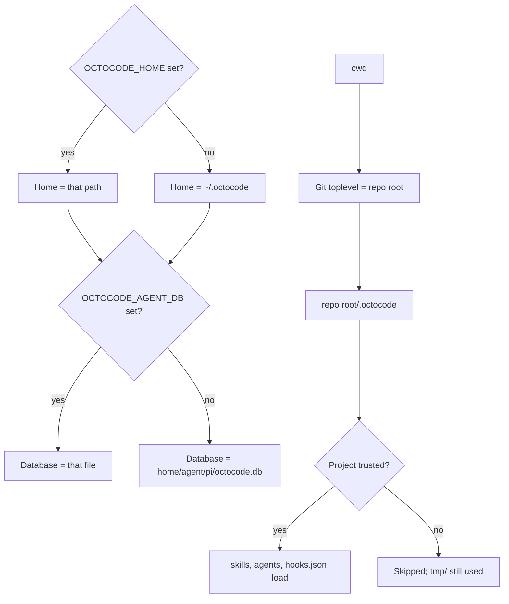
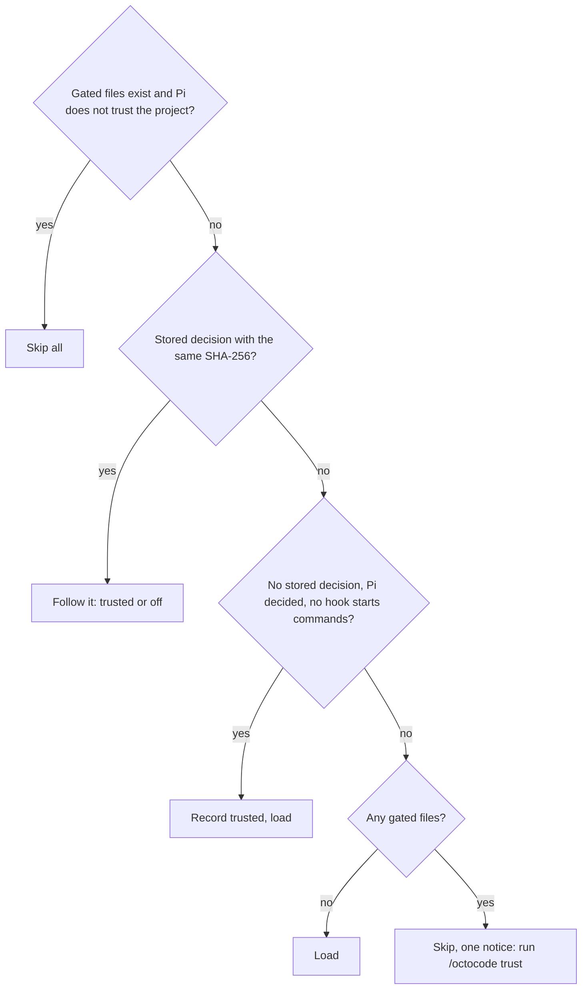
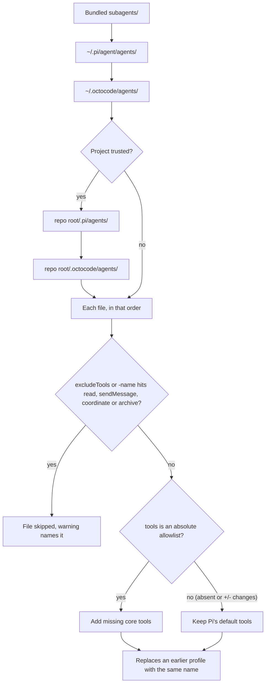
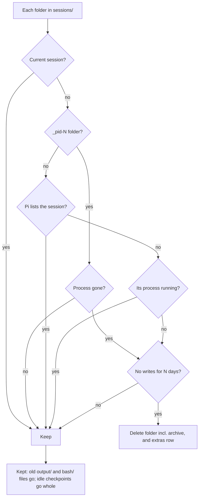

# Configuration

File locations, trust, hooks, profiles, MCP, retention and every environment variable. Overview: [README](../README.md); behavior: [FEATURES.md](FEATURES.md).

## Where files go

`.octocode` is the one place Octocode reads its config and saves things, at two levels; workspace paths resolve from the repository root, so a subfolder session reads the same files. The extension reads the process environment only (no `.env`, no `@octocodeai/config`; it repeats that package's `OCTOCODE_HOME` rule). The Octocode MCP server loads its own settings ([Octocode configuration](../../../docs/CONFIGURATION.md)).



| Path | Holds |
|---|---|
| `<home>/` (`OCTOCODE_HOME`, default `~/.octocode`) | `skills/`, `agents/`, `hooks.json` (user config) and all state below |
| `<repo root>/.octocode/` | `skills/`, `agents/`, `hooks.json` (trusted projects only); `tmp/` scratch (ignores itself); `backlog.md`, `backlog.html` from `/octocode backlog export` and `html` |
| `<repo root>/.octocode/tmp/agents/<name>/` | A subagent's scratch: hand-off files, `session/` (its conversation), an owner record |
| `agent/pi/octocode.db` | Session index, backlog, memories, team tables |
| `agent/pi/sessions/<session id>/` | `output/` (full text of oversized `web`, `browser`, bash and MCP results, console logs, `downloads/`), `bash/` (job logs), `checkpoints/`, `archive/` ([COMPACTION.md](COMPACTION.md#archive-of-compacted-history)) |
| `agent/pi/sessions/_pid-<pid>/` | The same folders for output written before a session id is known |
| `agent/pi/models-dev.json`, `pi-trust.json` | Cached models.dev catalog; [trust](#trust) decisions |
| `pi-browser/`, `pi-browser-profile/`, `pi-team/shots/`, `pi-worktrees/` | Temporary Chrome profiles and the persistent one `webLive` uses; subagent screenshots; isolated worktrees |
| `pi-api/`, `agents-communication/` | [API](API.md) instance records and socket; `communication.sqlite` and `active-databases/<pid>.json` of `octocode-agents-communication` |

Session folders are private (`0700`, files `0600`) and readable by the Octocode MCP tools, even when `OCTOCODE_HOME` is outside the home directory. Pi only reads the agents-communication files, to refuse edits to paths other agents hold ([Team](FEATURES.md#team)); `communication.sqlite` takes no environment override. An API socket path over about 100 bytes moves to `$TMPDIR` (else `/tmp`): `octocode-<uid>-XXXXXX/<id>.sock`, mode `0700`.

## Environment variables

Switches read `1`, `true`, `on`, `yes` as on and `0`, `false`, `off`, `no` as off (any case); anything else keeps the default.

| Variable | Default | Effect |
|---|---|---|
| `OCTOCODE_HOME` | `~/.octocode` | The Octocode home |
| `OCTOCODE_AGENT_DB` | `<home>/agent/pi/octocode.db` | Agent database path |
| `PI_CACHE_RETENTION` | `long` interactive; `short` headless and subagents | Pi's prompt-cache retention; an exported value wins, in subagents too ([Retention](CONTEXT-AND-COST.md#retention)) |
| `OCTOCODE_CLEANUP_DAYS` | `30` | Days swept session state is kept; `0` turns the sweep off ([Retention](#retention)) |
| `OCTOCODE_MODELS_DEV` | on | `0`: no models.dev requests; purposes and `/octocode models` use Pi's models only. On: the public catalog `https://models.dev/api.json` is fetched at most daily, used stale offline, retried an hour after a failure |
| `OCTOCODE_MEMORY_AUTO` | on | `0`: no memory injection in this process (`/octocode memory auto off` turns it off everywhere) |
| `OCTOCODE_EXTRA_SKILLS` | on | `0`: skip the extra skill directories ([Skills](FEATURES.md#skills)) |
| `TAVILY_API_KEY`, `SERPER_API_KEY`, `EXA_API_KEY`, `BRAVE_API_KEY` | unset | Web search providers, tried in this order; each passes to the next on failure or no results, keyless pages last ([`web`](FEATURES.md#web)) |
| `OCTOCODE_CHROME_PORT` | unset | `browser` uses its own tab in an open Chrome on this remote-debugging port. Unset: it never attaches and launches headless Chrome. A non-port value (1–65535) is an error |
| `HTTP_PROXY`, `HTTPS_PROXY`, `NO_PROXY` (or lowercase) | unset | The browser's filtering proxy chains to an `http://` upstream (HTTPS requests use `HTTPS_PROXY`, else `HTTP_PROXY`); another scheme or a malformed value is an error, never a direct connection. `NO_PROXY` takes `*` or hosts and domain suffixes, each with an optional port |
| `OCTOCODE_API` | off | `1` serves the [External API](API.md) on a Unix socket (loopback HTTP on Windows) |
| `OCTOCODE_API_HTTP` | unset | Serve the API over loopback HTTP on this port (`0` = any free), with or without `OCTOCODE_API`. A non-port value (0–65535) leaves the API off and says why |
| `OCTOCODE_MCP` | on | `0`: do not start the Octocode MCP server (set for profiles with `mcp: false`) |
| `OCTOCODE_SUBAGENT_LINGER_SECONDS` | `0` (off) | Seconds a finished background subagent stays reachable and resumes on a message ([Lingering](FEATURES.md#background-subagents)) |
| `OCTOCODE_MAX_SUBAGENTS` | `3` | Subagents running at once, foreground and background (positive integer) |
| `OCTOCODE_HOOKS` | off | `1` runs Claude Code / Codex command hooks ([Hooks](#hooks)) |
| `OCTOCODE_PERMISSION` | `full` | Start [permission mode](FEATURES.md#permissions): `manual`, `workspace`, `full`. Set it for print and CI runs, where an ask is denied |
| `OCTOCODE_NOTIFY` | `unfocused` | When to signal a finished answer or open dialog: `unfocused` (terminal in the background), `always`, `off` |
| `OCTOCODE_NOTIFY_METHOD` | from the terminal | `osc9`, `osc777`, `osc99` or `bel`. Unset: OSC 99 for Kitty, OSC 9 for iTerm2, OSC 777 for Ghostty and WezTerm, else the bell; wrapped for tmux |

Pi's compaction settings are in [COMPACTION.md](COMPACTION.md#settings). `web` asks for pages in the system language (`LANG`, `LC_ALL`), then English; Chrome launched by `browser` follows the system language and time zone. Pi's `PI_CODING_AGENT_DIR` moves `~/.pi/agent` (Pi's `mcp.json` and profiles). `bash` commands get `PI_SESSION_ID`, `PI_SESSION_FILE`, `PI_PROVIDER`, `PI_MODEL` and `PI_REASONING_LEVEL` for the current session, as in Pi's own bash; they are never inherited from the parent.

Octocode sets these itself; do not set them. The parent sets, for a subagent:

| Variable | Value |
|---|---|
| `OCTOCODE_SUBAGENT` | `1`: the child cannot spawn subagents and skips the extra skills |
| `OCTOCODE_AGENT_ID`, `_ROLE`, `_GOAL`, `_SCRATCH`, `_COLLABORATE` | The child's identity and scratch folder |
| `OCTOCODE_PARENT_PID`, `_ID`, `_SESSION` | The parent's pid and start time (the child exits when it is gone), agent id and session id |
| `OCTOCODE_TEAM_WORKSPACE`, `OCTOCODE_TRUST_ROOT` | An isolated child's team scope and parent repository ([Trust](#trust)) |
| `OCTOCODE_PERMISSION_GRANTS`, `OCTOCODE_PERMISSION_RELAY` | The grants the user gave the parent; `1` when the parent can ask a person and relays the child's dialogs ([Permissions in subagents](FEATURES.md#permissions-in-subagents)) |
| `OCTOCODE_PERMISSION_NONCE_FILE` | Owner-only file in the session's `output/` holding the child's relay secret |
| `OCTOCODE_BROWSER_VISIBLE` | `1` for a `visibleBrowser` profile |

## Trust

Project hooks (`.claude/settings.json`, `.claude/settings.local.json`, `.codex/hooks.json`, `.octocode/hooks.json`), subagent profiles (`.pi/agents`, `.octocode/agents`) and skills (`.claude/skills`, `.octocode/skills`) can start commands or steer the agent, so they load only after an explicit trust decision. Project MCP files (`.pi/mcp.json`) are gated by Pi's own trust.

Pi's trust is not enough: it asks only for projects with Pi resources (`.pi/settings.json`, `.pi/extensions`, `.agents/skills`, …). `/octocode trust` lists exactly what would run (every hook command in full; agent and skill files), asks, and reloads; it asks again if the files change meanwhile.



- **Storage.** One decision per repository root (any subfolder, through symlinks) in `<home>/pi-trust.json` (`0600`), with a SHA-256 of the gated files (not of the scripts their commands run). Any change, such as a pulled hook file, needs `/octocode trust` again, also in a Pi-trusted project. `/octocode trust off` withdraws it.
- **Not trusted.** Startup skips the files with one notice and no dialog. A project Pi was told not to trust (`--no-approve`, a declined prompt) never loads them.
- **Subagents.** They follow the parent's decision. An isolated (worktree) subagent follows the one for the parent's repository (`OCTOCODE_TRUST_ROOT`) only while its gated files are byte-for-byte those it covered; otherwise they stay off.

Trust decides what project config loads; the [permission mode](FEATURES.md#permissions) decides which actions run unasked. Neither is a sandbox.

## Hooks

Off by default: hooks run arbitrary commands. Start Pi with `OCTOCODE_HOOKS=1`, then put Claude Code / Codex-style hooks in `~/.claude/settings.json`, `~/.codex/hooks.json` or `~/.octocode/hooks.json` (all projects), or the same project files listed under [Trust](#trust) (trusted projects only). One format; existing Claude Code hooks work unchanged. `/hooks` shows what loaded and which files exist (✓); `/reload` after editing. Events: [Hooks in FEATURES.md](FEATURES.md#hooks-opt-in).

```json
{
  "hooks": {
    "PreToolUse": [{ "matcher": "Bash", "hooks": [{ "type": "command", "command": "./scripts/check-bash.sh", "timeout": 30 }] }],
    "PostToolUse": [{ "matcher": "Edit|Write", "hooks": [{ "type": "command", "command": "yarn lint --quiet" }] }]
  }
}
```

- **Entry.** Only `type: "command"` runs. The hook gets the event as JSON on stdin and `CLAUDE_PROJECT_DIR` (the repository root). `timeout` is in seconds (default 60, at most 600).
- **`failClosed`.** A `PreToolUse` or `PreMessageSend` hook that fails (timeout, crash, invalid JSON) lets the call go ahead; `"failClosed": true` next to `command` denies it (`/hooks` marks it `[failClosed]`).
- **Message hooks** get `session_id`, `transcript_path`, `cwd`, `hook_event_name` and `message: {channel, direction, from, to, text, id?, replyTo?}`. A matcher is `internal`, `external` or a direction such as `external.outbound`; empty matches all. Gates name the event in `hookSpecificOutput.hookEventName` and use `permissionDecision` and `permissionDecisionReason`. Where they fire: [API.md](API.md#message-hooks). Claude Code and Codex have no equivalent events.

## Subagent profiles

Markdown files with frontmatter. Bundled ones live in `subagents/`; add yours in the directories in the diagram (project ones in trusted projects only). A malformed profile is skipped with a warning; the rest load.



```markdown
---
name: migrator
description: Applies a database migration and verifies it
tools: read,edit,write,bash
model: medium
---

Instructions for the subagent…
```

| Field | Meaning |
|---|---|
| `name`, `description` | `name` defaults to the file name |
| `tools` | Pi's `--tools`: a comma-separated allowlist of names or `*` patterns, or ordered `+name` / `-name` changes to the default tools; not mixable. `+`/`-` entries take exact names (patterns: `excludeTools`) and keep every tool they don't name; an allowlist replaces the whole selection, extension tools included, so it also gets the core tools |
| `excludeTools` | Names and `*` patterns the child must not have; overrides `tools`. Excluding `file` also excludes native `edit` and `write` |
| `model` | A model or a purpose: see **Model** |
| `permissions` | Classes needed beyond the workspace ones (list or comma-separated); only `browser.control`, `net.private` and `upload.outside` can be declared (`webHeadless`, `webLive` declare `browser.control`). Others are ignored and reported on load. What starting such a profile asks: [Profile grants](FEATURES.md#permissions-in-subagents) |
| `visibleBrowser` | `true`: visible Chrome on the persistent profile (sets `OCTOCODE_BROWSER_VISIBLE=1`, as `webLive` does) |
| `mcp` | `false`: no Pi built-in MCP and no `octocode` server (sets `OCTOCODE_MCP=0`), so no MCP schemas are paid for |
| `hooks` | `true`: the child runs the user's command [hooks](FEATURES.md#hooks-opt-in); otherwise none |

`mcp`, `visibleBrowser` and `hooks` take YAML booleans only (`mcp: false`, not `"false"` or `no`); anything else makes the profile malformed.

**Core tools.** Every subagent keeps `read`, `sendMessage` and `coordinate`, its way to the parent, and `archive`, its way to the parent's history (read-only). Pi drops extension tools a `--tools` allowlist does not name, so `tools: edit,bash` runs as `edit,bash,read,sendMessage,coordinate,archive`. An `excludeTools` pattern that matches a core tool (`*` or `send*` count) or `-read` in `tools` skips the file. `sendMessage` writes only to the agent database, so a profile without `file`, `edit`, `write` and `bash` stays read-only. Bundled profiles and prompt rule: [Profiles](FEATURES.md#profiles), [Prompt](FEATURES.md#prompt).

**Model.** `provider/id` or a bare id (resolved among the parent's usable models, its provider first), with Pi's optional `:<thinking>` suffix (`claude-sonnet-5-5:high`); or a purpose, `small` or `medium` (`small:high`), resolved among your own models so no profile hard-codes a vendor ([Model routing](FEATURES.md#model-routing)). Override a bundled profile by name in `~/.octocode/agents/`; drop `model` to use the parent's.

A subagent is a `pi --mode rpc` process ([Subagents](FEATURES.md#subagents)) with a fresh run identity; other user settings stay inherited. Its scratch folder is kept 7 days ([Retention](#retention)).

## MCP

Octocode runs on this extension's own MCP client (`McpClient`, `StdioTransport` from `@earendil-works/pi-mcp`), not Pi's built-in one ([why](ARCHITECTURE.md#mcp-client)). `session_start` starts one stdio server, `octocode`.

- **Server.** The installed `octocode-mcp`, or `npx -y` of the `octocode-mcp` range in `package.json` (in this monorepo `dev setup` resolves it to `packages/octocode-mcp`). `cwd` and `WORKSPACE_ROOT` are the working directory; `ALLOWED_PATHS` is that directory plus the Octocode home. GitHub tokens (`GITHUB_TOKEN`, …) pass through the process environment. `OCTOCODE_MCP=0` starts nothing. A failure shows the server's stderr ([sanitized](#sanitizing-policy)): whole up to 2,000 characters; a longer stderr shows its last 2,000 under a `[server stderr: last 2000 of N characters; whole: <file>]` line, and the whole is saved to `output/mcp-stderr-*.txt`.
- **Tools.** Each listed tool registers as `mcp__octocode__<tool>` with its name, description and schema from `tools/list`, so the set follows the server's version and settings (`clasify` only with a classification key and successful provider ping). All are `direct`: present from the first request, no `tool_search` step. The `file` guard counts only Pi's `read`.
- **Results.** `tools/call` times out at 60 s and aborts with the turn. `structuredContent` is kept when the tool declares an `outputSchema`; `isError` becomes an error result. A text part or message over its budget, or an oversized image, is saved whole to the session's `output/`; the model gets a preview plus the path ([budgets](CONTEXT-AND-COST.md#spilled-outputs)).
- **Startup.** `before_agent_start` waits at most 10 s for the connection (no setting); a failure ends it at once. The server's `initialize` instructions join the `octocode` prompt section whole, under `# Octocode MCP server instructions`, and stay for the session. If the server cannot start, one warning shows (with a UI), the prompt carries no Octocode routing, and the next prompt retries once. A slow server's tools join when it is up.
- **Lifecycle.** The server closes, process tree included, on `session_shutdown` and when the working directory changes (the new one gets its own). If it dies, the next tool call restarts it once; then calls error with the cause until `/octocode mcp restart`. `notifications/tools/list_changed` re-lists: new tools register, withdrawn ones hide. `/octocode mcp` shows state, name, version, tool count and pid.
- **Overrides.** A server named `octocode` in Pi's `mcp.json` takes precedence (the way to override or disable it): the extension starts no client and registers no tools. A trusted project's entry with a transport replaces the global one; without `command`, `url` or `type` it overrides only `enabled`, `exposure` and `toolExposure` of an existing global server, never its environment or credentials.

Other servers use Pi's MCP (`~/.pi/agent/mcp.json`, `.pi/mcp.json`, `pi mcp add`, `/mcp`; [Pi's MCP docs](https://github.com/earendil-works/pi/blob/main/packages/coding-agent/docs/mcp.md)). `pi --no-extensions` also turns off Pi's MCP; add `-e builtin:mcp -e builtin:tool-search` to keep it.

### Sanitizing policy

The one statement of the policy (`src/shared/sanitize.ts`); other pages link here. Text from anyone but the user is untrusted: escape sequences could retitle the terminal, write links, move the cursor or reorder text, and invisible characters could hide an instruction.

- **Text the model reads** (MCP, `browser`, `web`, API, team, `coordinate`, `backlog`, subagent, hook and job output, permission denials, any other untrusted text) goes through `visibleControls`. Nothing is dropped: each control, bidi, invisible, line or paragraph separator character becomes a visible escape such as `\u{200d}`, and a lone CR becomes `\r`. CRLF, tabs, newlines and a ZWJ joining two emoji pass unchanged. A job report first drops color sequences (`ESC[…m`); its log keeps them.
- **Text only a terminal or UI draws** (dialogs, panel rows, labels) goes through `sanitizeTerminalText`: sequences and characters are removed, CR and CRLF become LF.

Bidi formatting characters (U+061C, U+200E–200F, U+202A–202E, U+2066–206F) and these invisible ones (`INVISIBLE` in the source) are covered: Unicode tags, zero-width space and non-joiner, word joiner and invisible operators, soft hyphen, combining grapheme joiner, Khmer inherent vowels, Mongolian free variation selectors and vowel separator, braille blank, Hangul fillers, BOM, a ZWJ joining no emoji, and a variation selector unless it follows a character it modifies. `visibleControls` is not injective: a literal `\u{200d}` reads like an escaped ZWJ.

## Retention

A sweep runs at most every 6 hours, off the start path, and never touches the current session or Pi's own session files. `OCTOCODE_CLEANUP_DAYS` (default 30; `0` turns the sweep off) is N below. "Pi lists the session" covers Pi's default sessions dir and every `--session-dir` a session ran from; if any listing fails, nothing is removed.



| What | Removed when |
|---|---|
| A session's folder (archive included) and extras row, when Pi no longer lists the session (deleted, ephemeral, a subagent's) | N days after last write, unless its process runs |
| A `_pid-<pid>` folder | N days after last write, once that process is gone |
| `output/` and `bash/` files in a kept session | N days after written; a running job's record and log stay |
| A kept session's `archive/` | With the session's folder; a compaction counts as a write |
| A kept session's `checkpoints/` | Whole, N days after the last write (a rewind then finds nothing); never the current session's or one whose process runs |
| Subagent screenshots, `pi-team/shots/` | N days after written; saving keeps the newest 30 |
| A subagent's scratch `<repo root>/.octocode/tmp/agents/<name>/` | 7 days after last write, at the next session start in that repository, unless the Pi process that started it runs. Not governed by `OCTOCODE_CLEANUP_DAYS` |
| Git snapshot refs (`refs/octocode/snapshots/*`, [Snapshots](FEATURES.md#snapshots)) | 7 days after taken, at the next session start |
| Resolved team messages | 1 day; unread messages and open questions stay until resolved |
| Backlog items, notes and memories | Never automatically; delete on `/backlog`, `/memory` or the `memory` tool's `delete` |

`/sessions` → Forget Octocode data removes one session's folder and extras row at once. It refuses the current session, a session open in another Pi process, and an id that does not name a session folder (`Refusing to forget "<title>": its id does not name a session folder.`).
