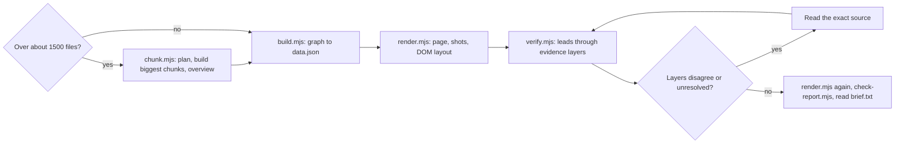

# Octocode Graph View

Turn a section of a repository into one HTML page and a brief of a few hundred tokens, then test the graph's own claims with independent layers. A graph lists hundreds of findings; this skill says which have a second witness, and which edges are not what they seem.

## Evidence layers

Graph (leads), AST (is the edge a parsed import or path), usage (are imported names used, also in Rust child modules), clasify (named facts), image review and DOM layout (render checks), OCR (label read-back), git history (churn, hotspots), LSP (resolved references and call hierarchy). Each fails differently and a verdict needs two agreeing layers. Per-layer questions, costs and failure modes: [layers](references/layers.md).

## Rules

- Leads come from the graph, never a fixed list: upward imports (overlay), cycle edges, heaviest imports into hubs, ranked file findings, top hubs. Questions are generated per lead: edges ask type-only vs runtime use of the named module; files name their owning types and free functions.
- Verdicts: `corroborated` (usage and clasify agree on runtime use, or graph and clasify agree on a file), `dismissed` (both say type-only: soft dependency), `unused` (imported names never used: stale import), `conflict` (usage and clasify disagree), `not-supported`, `unconfirmed` (no parsed import or path at the line), `reexport`, `unresolved`. Clasify 0.3-0.7 is unsure; the generic file question counts only at 0.85 or 0.15.
- A verdict is a triage, not proof. Read the exact source of every `corroborated`, `unused` and `conflict` lead and run a Hypothesis test (see [evidence](references/evidence.md)) before a defect claim; confirm identity with `lspSearch`.
- `super::` and `self::` edges are confirmed by syntax only, not by resolving the target. Importer counts (fan-in) are the graph's own numbers; a grep-based count can rank hubs differently, so quote them as graph counts. A cycle the graph does not flag as runtime is not evidence of a runtime problem. The graph's detectors leave `use` edges within one Rust module tree (`tree.rs` and `tree/child.rs`) out of hub, cycle, placement and single-point-of-failure findings; a cycle it still reports is between sibling modules.
- The SECTION line counts every scanned file (docs, manifests, tests); the health line counts production source files. `data.json` holds every ranked finding (`insights.issues`); the brief shows the top six.
- Separate declared architecture (docs, manifests), observed structure (imports) and runtime behavior (spawn, FFI, HTTP, DB, MCP). Import edges alone never prove a runtime flow.
- Read `brief.txt` (scope, top hubs, strongest insights, one line per lead; about 600 tokens), not `report.html`. Open `brief-full.txt` only for terms, findings and why-text. Keep about 15-40 files on screen.
- Run Octocode through the local launcher `node packages/octocode/out/octocode.js` in the checkout; scripts do this themselves (`OCTOCODE_CLI` overrides, else `octocode` on PATH).

## Workflow

0. **PREFLIGHT** — run `node <skill-folder>/scripts/preflight.mjs`; it lists each layer as ok or MISSING with a `To enable` line. Tell the user every missing layer and how to enable it (OCR: install Ollama, then `ollama pull glm-ocr`; ask before pulling). Never skip a missing layer silently; name it in the report.
1. **CHUNK** (large repos) — one graph snapshot has a file budget (`scopeTooBroad` when mapping exceeds it; seen on the 4,261-file monorepo: 3,098 of 3,426 files fit, budget 536,870,912 bytes and 5,000,000 items). `node <skill-folder>/scripts/chunk.mjs <root> --out <output>/octocode-graph-view/<slug> [--chunk-files 1500] [--build 3] [--only a,b] [--area <path>]` plans directories under the budget (files sitting directly in a split directory get a `-loose` chunk of their own; groups under 10 files stay uncovered and the overview says how many), builds the largest chunks (or `--only` slugs) with `build.mjs`, renders each built chunk, and writes `overview/data.json`: chunks as nodes, links from declared manifest dependencies plus observed workspace-package imports, and a link from each built node to its report. `--area` plans and builds only that path. Chunks are separate snapshots, so file-level edges between chunks do not exist; excluding bulky directories does not fit the whole repo into one snapshot either (the budget counts source correspondence, not files). Render and verify the overview or any chunk like a section.
2. **BUILD** — `node <skill-folder>/scripts/build.mjs <section> --out <dir> [--max-files 30] [--hub-files 8] [--symbols 10] [--jobs 8] [--calls graph|both] [--exclude <dir>[,<dir>]]`. Use `--calls both` only with a warm language server: function edges are then cross-checked and labelled graph, lsp or both. Each engine misses calls the other finds (callers of one trait method: graph 50, LSP 37, union 70; LSP call hierarchy skips calls inside closures, the graph misses some `&dyn Trait` receivers), so take the union before claiming a caller count or absence. A section that changes during ingest is graphed from a frozen copy; exclude build output such as `target/`.
3. **MODEL** (optional) — for layers, runtime edges, flows or findings, trace with `octocode-research`, then write `model.json` beside `data.json` against [model.json](scheme/model.json). Load [modeling](references/modeling.md).
4. **RENDER** — `node <skill-folder>/scripts/render.mjs --data <dir>/data.json --shot files,functions` writes `report.html`, `brief.txt`, `shot-*.png` and `measure-*.json`. Overlay problems print to stderr; treat each as a model bug.
5. **VERIFY** — `node <skill-folder>/scripts/verify.mjs --data <dir>/data.json [--layers ast,clasify,ocr,history] [--leads 8] [--questions q.json]`. Unavailable layers are skipped and reported in `verify.json`; history reads the whole log unless `--history-limit N` is given (then `quality.truncated` says so). Add `lsp` only when a language server is warm.
6. **DELIVER** — run `render.mjs` again so the page embeds the evidence, run `node <skill-folder>/scripts/check-report.mjs --data <dir>/data.json` (screenshots the finished page, OCRs the panel, compares it with the data), read `brief.txt`, report per [output.md](output.md).

Standalone OCR: `node <skill-folder>/scripts/ocr.mjs <image> [--expect expected.json]`.

## Gates

- Ollama with `glm-ocr`: ask before `ollama pull glm-ocr` (2.7 GB; `glm-ocr:q8_0` is 1.8 GB). Clasify must list a model.
- The page loads d3 from cdnjs; say so when an offline artifact is needed.
- PNGs with an alpha channel make the OCR model return garbage; `ocr.mjs` converts to JPEG and retries a looping prediction with a repeat penalty, twice.
- Snapshots are pruned by newer ingests: query the graph by scope name (for example `--graph packages-octocode-native-crates`), never by a stored snapshot id. Rust build scripts run project code, so never enable `rustContext.buildScripts` without asking.
- The CLI keeps a warm `octocode serve` daemon per binary, workspace and call identity (idle exit after 10 minutes). A changed environment variable or working directory reuses it; a rebuilt binary or another workspace starts a cold language server (20 s to 2 min), so keep one launcher per session.
- Known graph gaps, reproduced on a minimal crate: receiver-type linking misses a trait type that arrives through `use super::*` or a generic bound (`fn m<X: T>(c: &X)`); closures, multi-line signatures, `&impl` and qualified paths link. Use `--calls both` before quoting caller counts.
- Do not write into source directories or commit. Never name a skill file `template.html` under `assets/`: the shared build overwrites it.

## Resources

| When | Read | Why |
|---|---|---|
| Which layers can run here | [preflight.mjs](scripts/preflight.mjs), [hints.mjs](scripts/hints.mjs) | Layer state and how to enable each missing one |
| A repo is over the snapshot budget | [chunk.mjs](scripts/chunk.mjs) | Chunk plan, overview links |
| Section to `data.json` | [build.mjs](scripts/build.mjs), [lib.mjs](scripts/lib.mjs) | Ingest, selection, insights; CLI, Chrome and crop helpers |
| `data.json` to page, brief, shots | [render.mjs](scripts/render.mjs), [graph-view.html](assets/graph-view.html), [model.mjs](scripts/model.mjs), [insights.mjs](scripts/insights.mjs) | Fixed template, overlay validation, key insights |
| Leads and evidence layers | [verify.mjs](scripts/verify.mjs), [ocr.mjs](scripts/ocr.mjs) | Orchestration of the layers and OCR |
| Which claims are tested and how a verdict is decided | [leads.mjs](scripts/leads.mjs), [verdict.mjs](scripts/verdict.mjs), [history.mjs](scripts/history.mjs) | Pure modules with unit tests: lead selection, verdict rules, git-log analysis |
| Checking the finished page | [check-report.mjs](scripts/check-report.mjs) | Screenshot and OCR round trip |
| Where an imported name is used | [usage.mjs](scripts/usage.mjs) | Own-file and Rust child-module usage counts |
| How source names a target | [names.mjs](scripts/names.mjs) | File stem, or the Cargo package name for a Rust crate root (`octocode_contract_types::X`) |
| Cropping or flattening a PNG without external tools | [png.mjs](scripts/png.mjs) | Pure-JS crop, scale and alpha flatten used by verify, OCR and check-report |
| Writing `model.json` | [modeling](references/modeling.md), [model schema](scheme/model.json) | Layers, runtime edges, flows, findings |
| Choosing or reading an evidence layer | [layers](references/layers.md) | Question, cost and failure mode per layer |
| A finding needs proof | [evidence](references/evidence.md) | Claim-to-proof matching |
| Checking the scripts | [graph-view.test.mjs](scripts/graph-view.test.mjs) | `node --test` |
| Naming a handoff or report shape | [protocol catalog](references/protocol-catalog.md#catalog) | BLUF, Handoff packet |

## Related skills

- Use `octocode-architect` for dependency, layering or refactor decisions; this skill maps and tests claims, it does not refactor.
- Use `octocode-chrome-devtools` when the render needs a live browser session.
- Use `octocode-research` when a lead needs source proof.

## Output

Follow [output.md](output.md).
