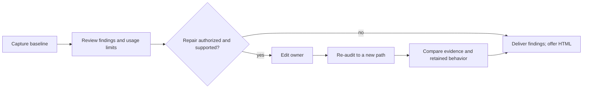

# Context audit

Inventory configured context, compare it with observed usage, and identify what to investigate or cut. File size estimates do not prove what a model received or its billed cost. The script uses Node without external dependencies.



The baseline is the first run's `context-audit.json`. Default runs use fresh directories. An explicit existing `--out` overwrites its report, so use a different path (or copy the baseline) for comparisons.

## Run
[scripts/context-audit.mjs](scripts/context-audit.mjs) does the whole audit:
```bash
node <skill>/scripts/context-audit.mjs --workspace <repo> --no-probe
```
- `--days` bounds the transcript window (by file mtime); `--all-projects` mines every Claude Code project, not only this workspace.
- `--no-probe` skips spawning stdio MCP servers (use when a server has side effects on start).
- MCP pagination follows every page within the probe deadline. A timeout, invalid page or repeated cursor marks the server unmeasured; the report never prices a partial tool list.
- Default output is `context-audit.json` in a fresh dated directory under `<workspace>/.octocode/octocode-context-audit/`; `--out DIR` changes the destination and `--json` prints the report.
- After delivering findings, offer HTML. If requested initially, use `--html`; if accepted later, use `--render <saved-context-audit.json>` to render the same snapshot without probing again.

## What it collects
| Area | Source | Flags |
|---|---|---|
| Instructions | root and nested `AGENTS.md`/`CLAUDE.md`/`GEMINI.md`/rules, `<home>/.claude/CLAUDE.md`, the project memory index | file > 8K chars, always-loaded total > 20K, memory index > 10K; nested repos and agent worktrees are listed, not counted |
| Skills | `<home>/.claude/skills`, `.claude/skills`, `.agents/skills` | broken links, one name from different sources, description > 1,024 chars, descriptions total > 12K |
| MCP | `<home>/.claude.json` (user + project), `.mcp.json`, `<home>/.cursor/mcp.json`; stdio servers answer `initialize` + `tools/list` | server that fails to start (without exposing stderr), instructions > 4K, tool description > 1K, tool schema > 8K, server total > 60K |
| Usage | `<home>/.claude/projects/<workspace>/*.jsonl` | Claude servers or tools never called, skills never invoked, tools with ≥20% error rate over ≥5 calls, raw grep/cat/find shell calls outnumbering research-tool calls; malformed lines or read failures flag incomplete coverage and suppress absence-based judgments |

Budgets are review points (≈ 4 chars per token), not failures. Cursor/other-client servers are measured but not judged by Claude transcripts.

## Act on the report
1. `high` covers a stdio server that cannot start, an instruction file over 2.5× its budget, the always-loaded total over budget, an MCP server over its total budget, and a server nobody calls.
2. Move reference detail out of always-loaded files into linked docs or skills; keep rules the agent must follow every turn.
3. Remove broken skill links and duplicate installs; keep one canonical source.
4. For unused or error-prone tools, check routing text and schemas with `octocode-agentic-prompts` before deleting — zero calls in a short window is a candidate, not proof.

## Resources

| When | Read or run | Why |
|---|---|---|
| Audit configured context | [context-audit.mjs](scripts/context-audit.mjs) | Inventory and usage evidence; `--help` owns flags |
| Change a collector, budget or output mode | `node --test <skill>/scripts/tests/*.test.mjs` | Collector, budget, saved-snapshot rendering, artifact preservation and HTML escaping regressions |

## Related skills

Use `octocode-agentic-prompts` when findings require prompt or routing edits; use `octocode-skills` when skill structure or installation needs repair.

## Output
Follow [output.md](output.md): a BLUF reply with each `high` finding in 5W2H, and one saved report.
