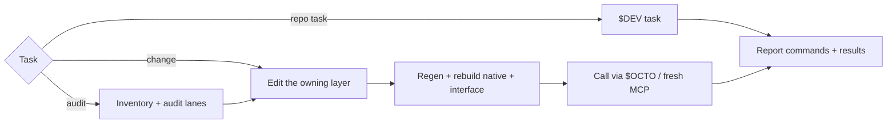

# Octocode Dev

tools: `node skills-dev/octocode-dev/scripts/dev.mjs <task>` (`$DEV`) · `yarn workspace <pkg> <script>` · `node packages/octocode/out/octocode.js` (`$OCTO`) · [MCP/CLI tool usage](references/octocode-usage.md)
output: working-tree edits; audit reports in `<repo>/.octocode/octocode-dev/`; none for plain task runs

A plain task run reports its exit code. [Resources](#resources) names the trigger that loads each `references/` or `docs/` page.

Paths: `<repo>` is the monorepo root. `CORE` is `../octocode-mcp-host/packages/octocode-core`. Bare `docs/` paths are this skill's docs. Route open native design to `rust-best-practices` and doc rewrites to `octocode-documentation`.

## Hard rules

Working and change rules live in `<repo>/AGENTS.md`; follow its core/native flows and the [contract pipeline](docs/DEVELOPMENT.md#contract-pipeline). Native changes rebuild the host binary and affected launcher, then exercise `$OCTO config --json`, `schema` and the changed tool.

Local checks use the [host-only build rule](../../AGENTS.md#setup-run-develop): `build:dev`, or native `build` for release-mode behavior, plus affected launchers. `--all`, `build:all` and `build:publish` require requested release or cross-platform scope.

`verify` and `check-outputs` check the host binary. Use `check-outputs --all` to check every staged platform before a release.

## Task runner

Root `package.json` has no scripts. Run every repo task with `$DEV`. Extra arguments pass through; `$DEV --help` lists all tasks.

| Need | Command |
|---|---|
| Fast local build (native host only) | `$DEV build:dev` |
| Release-mode build (native host only, slow) | `$DEV build` |
| Tests / lint / typecheck | `$DEV test` · `$DEV lint` · `$DEV typecheck` (`:ci` variants skip benchmark and native; `test:ci` also runs skill checks) |
| Fix formatting that lint checks | `$DEV format` (each workspace `format`: prettier `--write`) |
| Every tool end to end (CLI + MCP, hermetic, after `build:dev`) | `$DEV test:tools [tool,...]` |
| Full repo contract before handoff | `$DEV verify` |
| Docs links, catalog, config keys | `$DEV docs:verify` |
| Workspace scripts present / outputs built | `$DEV health:check` · `$DEV check-outputs` |
| Disk cleanup | `$DEV clean:cache` (stale native copies, deps stay warm; `build:dev` and `test:rust` run it first when native `target/debug` is over 50 GiB) · `$DEV clean` (all build outputs) |
| One range per external dependency | `$DEV deps:dedupe` (`--fix` rewrites) |
| Local dev resolutions | `$DEV setup` then `yarn install` |
| Publish guard | `$DEV prepublish` (`--fix`, `--dry-run`); CI build: `$DEV build:ci` |
| Opt-in Rust quality tools (pinned in `packages/octocode-native/dev-tools.json`; never CI) | `$DEV rust:tools` · `$DEV fuzz:smoke` · `$DEV fuzz` · `$DEV miri` · `$DEV llvm-lines` ([DEVELOPMENT.md](docs/DEVELOPMENT.md#rust-dev-tools)) |
| One package | `yarn workspace <pkg> <script>` |

When a script flag or path rule is unclear, read [the script guide](scripts/README.md). Scripts:

| When | Script |
|---|---|
| `run <script>`, `verify`, `check`, `report`, `check-outputs`; after editing it run `node --test skills-dev/octocode-dev/scripts/workspace-health.test.mjs` | `scripts/workspace-health.mjs` |
| Debugging the `docs:verify` gate | `scripts/docs-verify.mjs` |
| Changing standalone skill test discovery (`skills:check`, `test:ci`); verify with `node --test skills-dev/octocode-dev/scripts/skill-tests.test.mjs` | `scripts/lib/skill-tests.mjs` |
| A tool contract changed; check tool-call examples in every skill and doc against live schemas | `scripts/check-research-guidance.mjs [--json] [--self-test]` |
| A field renamed or removed, or `docs:verify` names a prose field path the contract lacks; verify with `node --test skills-dev/octocode-dev/scripts/check-vocabulary.test.mjs` | `scripts/check-vocabulary.mjs [--json]` |
| Debugging the `deps:dedupe` gate | `scripts/dedupe-deps.mjs` |
| Local resolutions on (`setup`) / off before publish | `scripts/dev-setup.mjs` / `scripts/prepublish.mjs` |
| Starting a tool audit | `scripts/tool-inventory.mjs [tool] [--json]` |
| A file over 400 lines, or a stale or missing file-length baseline entry (`$DEV lint`, `verify`, CI) | `scripts/check-file-length.mjs [--write]` |
| An oxlint violation, or a stale or missing oxlint baseline entry (`$DEV lint`, `verify`, CI) | `scripts/oxlint-baseline.mjs [--write]` |

## Audit a tool end to end

1. Map: run `scripts/tool-inventory.mjs <tool>`. Locate every layer with `references/surface-map.md`.
2. Work the lanes in order; load each reference only while you work it: [contract](references/contract-audit.md) → [implementation](references/implementation-audit.md) → [output](references/output-audit.md).
3. When a finding is confirmed, fix the owning layer and verify with `references/fix-and-verify.md`.
4. Write one report from `assets/audit-report.md`. Each finding is a 5W2H record (`path:line`, severity, evidence, fix; `unknown` in a slot nobody verified) with its verification command and result. The path is in [the output format](output.md).

A multi-tool audit may run one subagent per tool, each with a Task contract: objective (audit that tool), inputs (the tool name, this skill path, the report template), output (that tool's report, BLUF), Definition of Done (one 5W2H record per finding with its verification command and result).

## Resources

| When | Read | Why |
|---|---|---|
| Locating every layer of a tool | [surface-map.md](references/surface-map.md) | Owners from core contract to CLI and MCP |
| A schema, description, instruction or limit (then surface-map) | [contract-audit.md](references/contract-audit.md) | Contract lane of an audit |
| Native behavior or data flow | [implementation-audit.md](references/implementation-audit.md) | Implementation lane |
| Output, pagination, `next.*` pages, `hints.*` | [output-audit.md](references/output-audit.md) | Output lane |
| Before editing and before reporting done | [fix-and-verify.md](references/fix-and-verify.md) | Owning-layer fix and its verification |
| A setting or credential | [ADDING_CONFIG.md](docs/ADDING_CONFIG.md) | Config key lifecycle |
| Package layout, environment variables, ownership | [DEVELOPMENT.md](docs/DEVELOPMENT.md) | Repository map and contract pipeline |
| Publish or release order | [RELEASE.md](docs/RELEASE.md) | Release workflow |
| Scraping scripts or a new vendor | [SCRAPING_MAINTENANCE.md](docs/SCRAPING_MAINTENANCE.md) | Scraping maintenance |
| Acceptance bar for anything a tool returns | [TOOL_QUALITY.md](docs/TOOL_QUALITY.md), `<repo>/docs/TOOL_DATA_CONTRACT.md` | Tool output quality |
| Audit report | [audit-report.md](assets/audit-report.md) | Report template |

## Definition of Done

Every check holds:

- The owning layer changed. Generated outputs were regenerated, not edited. New fields are covered.
- Runtime or contract changes: affected builds exit 0 and the changed path runs through `$OCTO` or MCP. Documentation-only changes: `$DEV docs:verify`; skill changes: `$DEV skills:check`.
- Focused tests pass. Before a handoff that spans packages, `$DEV verify` and `$DEV docs:verify` pass.
- Reply BLUF with claim–evidence: the exact commands and results. Name anything not verified.

## Output

Follow [the output format](output.md).

## Related skills

Use `octocode-research` for code evidence, `rust-best-practices` for open Rust design choices, `octocode-graph-dev` for code graph engine changes and their language battery, and `octocode-documentation` for prose beyond a factual correction.
