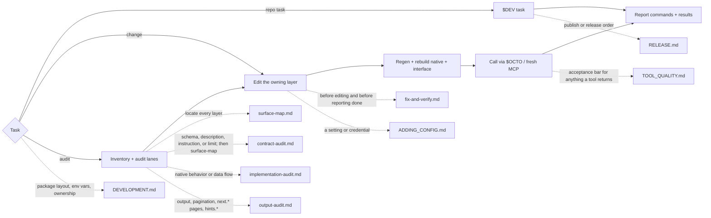

# Octocode Dev

tools: `node skills-dev/octocode-dev/scripts/dev.mjs <task>` (`$DEV`) · `yarn workspace <pkg> <script>` · `node packages/octocode/out/octocode.js` (`$OCTO`) · [MCP/CLI tool usage](references/octocode-usage.md)
output: working-tree edits; audit reports in `<repo>/.octocode/octocode-dev/`; none for plain task runs

A plain task run reports its exit code. Dotted edges name the trigger that loads a `references/` or `docs/` page. The tool-output acceptance bar also reads `<repo>/docs/TOOL_DATA_CONTRACT.md`.

Paths: `<repo>` is the monorepo root. `CORE` is `../octocode-mcp-host/packages/octocode-core`. Bare `docs/` paths are this skill's docs. Route open native design to `rust-best-practices` and doc rewrites to `octocode-documentation`.

## Hard rules

The working, contract and change rules live in `<repo>/AGENTS.md`; its two flows draw the contract pipeline and the native-change steps ([contract pipeline](docs/DEVELOPMENT.md#contract-pipeline)). Commands for the native-change flow (native, engine, or CLI change): `yarn workspace @octocodeai/octocode-native build:dev` → `yarn workspace octocode build:dev` (or `octocode-mcp`) → `$OCTO config --json && $OCTO schema` → call the changed tool.

For local checks and tests, follow the [host-only build rule](../../AGENTS.md#setup-run-develop): on macOS, build only the current Mac architecture. Use native `build:dev`, or native `build` when testing release-mode behavior, then rebuild affected launchers. Run `--all`, `build:all` or `build:publish` only for explicitly requested release or cross-platform work.

`verify` and `check-outputs` check the host binary. Use `check-outputs --all` to check every staged platform before a release.

## Task runner

Root `package.json` keeps only `contracts:regen`. Run every other repo task with `$DEV`. Extra arguments pass through; `$DEV --help` lists all tasks.

| Need | Command |
|---|---|
| Fast local build (native host only) | `$DEV build:dev` |
| Release-mode build (native host only, slow) | `$DEV build` |
| Tests / lint / typecheck | `$DEV test` · `$DEV lint` · `$DEV typecheck` (`:ci` variants skip benchmark) |
| Fix formatting that lint checks | `$DEV format` (each workspace `format`: prettier `--write`) |
| Every tool end to end (CLI + MCP, hermetic, after `build:dev`) | `$DEV test:tools [tool,...]` |
| Full repo contract before handoff | `$DEV verify` |
| Docs links, catalog, config keys | `$DEV docs:verify` |
| Workspace scripts present / outputs built | `$DEV health:check` · `$DEV check-outputs` |
| Disk cleanup | `$DEV clean:cache` (stale native copies, deps stay warm) · `$DEV clean` (all build outputs) |
| One range per external dependency | `$DEV deps:dedupe` (`--fix` rewrites) |
| Local dev resolutions | `$DEV setup` then `yarn install` |
| Publish guard | `$DEV prepublish` (`--fix`, `--dry-run`); CI build: `$DEV build:ci` |
| Opt-in Rust quality tools (pinned in `packages/octocode-native/dev-tools.json`; never CI) | `$DEV rust:tools` · `$DEV fuzz:smoke` · `$DEV fuzz` · `$DEV miri` · `$DEV llvm-lines` ([DEVELOPMENT.md](docs/DEVELOPMENT.md#rust-dev-tools)) |
| One package | `yarn workspace <pkg> <script>` |

When a script flag or path rule is unclear, read [the script guide](scripts/README.md). Scripts:

| When | Script |
|---|---|
| `run <script>`, `verify`, `check`, `report`, `check-outputs`; after editing it run `node --test skills-dev/octocode-dev/scripts/workspace-health.test.mjs` | `scripts/workspace-health.mjs` |
| Debugging the `docs:verify` gate | `scripts/docs-verify.mjs` |
| A tool contract changed; check `octocode-research` examples against live schemas | `scripts/check-research-guidance.mjs [--json] [--self-test]` |
| Dedupe flags beyond `deps:dedupe` | `scripts/dedupe-deps.mjs` |
| Local resolutions on (`setup`) / off before publish | `scripts/dev-setup.mjs` / `scripts/prepublish.mjs` |
| Starting a tool audit | `scripts/tool-inventory.mjs [tool] [--json]` |
| A file over 400 lines, or a stale or missing file-length baseline entry (`$DEV lint`, `verify`, CI) | `scripts/check-file-length.mjs [--write]` |
| An oxlint violation, or a stale or missing oxlint baseline entry (`$DEV lint`, `verify`, CI) | `scripts/oxlint-baseline.mjs [--write]` |

## Audit a tool end to end

1. Map: run `scripts/tool-inventory.mjs <tool>`. Locate every layer with `references/surface-map.md`.
2. Work the lanes in order; load each reference only while you work it: [contract](references/contract-audit.md) → [implementation](references/implementation-audit.md) → [output](references/output-audit.md).
3. When a finding is confirmed, fix the owning layer and verify with `references/fix-and-verify.md`.
4. Write one report from `assets/audit-report.md`. Each finding is a 5W2H record (`path:line`, severity, evidence, fix; `unknown` in a slot nobody verified) with its verification command and result. The path is in [the output format](output.md).

A multi-tool audit may run one subagent per tool, each with a Task contract: objective (audit that tool), inputs (the tool name, this skill path, the report template), output (that tool's report, BLUF), Definition of Done (one 5W2H record per finding with its verification command and result).

## Definition of Done

Every check holds:

- The owning layer changed. Generated outputs were regenerated, not edited. New fields are covered.
- `$DEV build:dev` (or the package build) exited 0. The changed path ran through `$OCTO` or MCP.
- Focused tests pass. Before a handoff that spans packages, `$DEV verify` and `$DEV docs:verify` pass.
- Reply BLUF with claim–evidence: the exact commands and results. Name anything not verified.

## Output

Follow [the output format](output.md).
