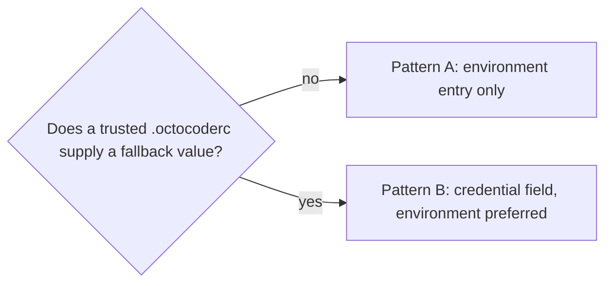

# Adding configuration to Octocode

How to add settings and credentials without TypeScript/Rust drift. User-facing settings: `<repo>/docs/CONFIGURATION.md`. Credential flows: `<repo>/docs/AUTHENTICATION.md`. Package layout and build commands: [DEVELOPMENT.md](DEVELOPMENT.md).

## Architecture

`packages/octocode-config/config-contract.json` is the only declaration of field policy: file paths and sections, input/resolved types, defaults, one environment variable per setting, enums, URL/path semantics, unknown keys, dotenv trust (`all`, `home`, `never`), credential exclusion from `ResolvedConfig`, removed names, and descriptions. The TypeScript generator validates it against `config-contract.schema.json` (Ajv); both build paths consume it:

```text
packages/octocode-config/config-contract.json
                 │
                 ├─ TypeScript generator
                 │    ├─ src/config/contract.generated.ts
                 │    │    types · defaults · field metadata · env policy
                 │    └─ <repo>/docs/generated/CONFIG_SETTINGS.md
                 │
                 └─ Rust build.rs
                      └─ $OUT_DIR/config_contract.rs
                           structs · defaults · field metadata · env policy

contract metadata → generic Rust resolver/validator (the only resolver)
contract metadata → TypeScript .env policy and editor metadata
```

- Interpreters hold language mechanics only (reading JS objects or `serde_json::Value`, parsing env strings, diagnostics), no per-setting field lists.
- Never edit generated files; never add a setting directly to Rust config structs, `resolver.rs` or `validation.rs` (field logic there brings back drift); never copy a default or range into docs (the generated reference owns them).
- `@octocodeai/config` owns this policy. Its `.` entry uses only Node builtins; Ajv is a build/test dependency. TypeScript surfaces never resolve settings themselves: the native runtime does, and `octocode config` shows the result.
- The `./schema` and `./mcp` subpaths re-export `@octocodeai/octocode-core`, and the tool-contract generator reads core ([contract pipeline](DEVELOPMENT.md#contract-pipeline)). `src/home.ts`, `src/dotenv.ts`, and `src/config` never import core: core owns tool contracts, config owns configuration and environment policy.

## Source precedence and file policy

For ordinary settings, highest priority wins:

```text
process environment / MCP client env block
  → workspace .octocode/.env
  → home .octocode/.env
  → workspace .octocode/.octocoderc
  → home .octocode/.octocoderc
  → generated default
```

- Resolution is per field: the first valid value wins; invalid or missing/blank values fall through.
- A workspace `.octocoderc` field whose environment binding is protected (`dotenv` other than `all`) is ignored with a `workspace_config_protected` warning, the same boundary as the workspace `.env`. Details: `<repo>/docs/CONFIGURATION.md#how-settings-override-each-other`.
- CLI and MCP load both `.env` files. Node helpers load the supplied workspace by default; an explicit `trusted:false` opts out. Native executable LSP-project trust is separate.

| Dotenv policy | Meaning |
|---|---|
| omitted or `all` | Loads from workspace or global Octocode `.env`. |
| `home` | May load from the trusted home `.env`, never a project `.env`. |
| `never` | Shell/CI/MCP environment only; never loaded from either `.env` file. |

## What is a setting

A setting is something a user chooses: a credential, an endpoint, a feature switch, a tool list, a scope, a storage mode, a model or a presentation format. Internal limits (timeouts, retries, waits, page sizes, cache sizes and TTLs, concurrency, spend caps, memory caps) are code constants, never settings: no `.env` or `.octocoderc` can change them. The contract has no number field type. A limit lives in one of two places:

- **`RuntimeLimits::DEFAULT`** (`packages/octocode-native/crates/runtime/src/execution/limits.rs`) when several surfaces share it or tests vary it through `ToolRuntime::with_limits`.
- **A named constant next to its single use** otherwise (for example `PREPARED_MIN_BYTES` in `crates/runtime/src/tools/local_fetch/executor.rs`, `IDLE_EXIT` in `crates/cli/src/cli/serve.rs`). Its doc comment gives the rationale. When it bounds evidence, the response discloses the cut (a warning, a `*Clipped` flag or a continuation), never a silent gap.

Docs link to the constant instead of copying its value.

To retire a setting, delete its field and add its path and variable to `removed.settings` / `removed.environment` with the reason (the fixed value or the replacement). A reason that states a `RuntimeLimits` value is pinned by `limits::tests::removed_limit_settings_state_the_default_values`: change the limit and the reason together. A removed name is reported once as `removed_setting` and ignored, never a load failure, and `config set` refuses it.

## Add a normal setting

One edit in `config-contract.json` plus regeneration. Hypothetical example: `output.compact`, with `OCTOCODE_OUTPUT_COMPACT` and default `false`:

```json
{
  "sections": {
    "output": {
      "title": "Output",
      "file": true,
      "resolved": true,
      "fields": {
        "compact": {
          "type": "boolean",
          "default": false,
          "description": "Render compact text content.",
          "env": { "name": "OCTOCODE_OUTPUT_COMPACT" }
        }
      }
    }
  }
}
```

- Enum defaults are the first value in `values`. Runtime-surface defaults are the first surface.

`generate:config-contract` (§ Generated artifacts and checks) produces `RequiredOutputConfig.compact: boolean`, the default, env precedence and parsing, validation, unknown-key recognition, Rust `OutputConfig.compact` with resolution/validation metadata, and the settings-reference row and example. Test only the setting's effect that the generic interpreter does not guarantee (for example a downstream feature gate); no language-parity tests that restate the declaration.

### Supported field shapes

| `type` | Resolved representation | Relevant properties |
|---|---|---|
| `boolean` | boolean / Rust `bool` | `default` |
| `string` | string or optional string | `default` |
| `url` | HTTP(S) URL string | `default` |
| `path` | absolute/home path string | `default` |
| `stringArray` | string array or nullable array | `default`, optional `itemFormat: "path"` |
| `enum` | generated literal union / Rust string | `values`, optional `typeName`, `enumStyle` |

A `null` input means “unset; use the next source.” A `null` generated default becomes an optional string or nullable array where appropriate.

### Environment binding

Each setting has at most one `env` binding, `{ "name": "OCTOCODE_…" }`, and no aliases. Every variable must be in the contract, or source labeling, protection, docs and the resolver cannot derive it. An invalid environment value is skipped with a warning, and the next source applies.

| Optional property | Effect |
|---|---|
| `dotenv` | `all` (default), `home`, or `never`; see the Dotenv policy table. |
| `normalize: "trim"` | Trims a string. |
| `normalize: "lower"` | Trims and lowercases. |
| `workspaceNarrowsTo: "<value>"` | On a `dotenv: "home"` binding: a workspace `.env` or `.octocoderc` may still set this one narrowing value (as `storage.mode: memory`). |

### Add a new section

Declare the section and its fields in the same contract. `file` controls whether `.octocoderc` accepts it; `resolved` controls whether it appears in generated `ResolvedConfig` types.

```json
"cache": {
  "title": "Cache",
  "file": true,
  "resolved": true,
  "fields": { }
}
```

- Nested sections use dotted names (`parent.child`). Declare parent sections too, even with an empty `fields` object.
- `typeName` keeps a public TypeScript name when automatic PascalCase is unsuitable; `rustTypeName` does the same for Rust structs. These are compatibility metadata, not field policy.

## Add credentials and protected environment keys

Credential values never appear in `ResolvedConfig`, logs, inspection output, or generated diagnostics. Consumers read them from `effective_env` in Rust or `process.env` in TypeScript.



### Pattern A: credential without a `.octocoderc` field

Declare an environment entry, not a resolved config field:

```json
"environment": {
  "MY_SERVICE_API_KEY": {
    "dotenv": "all",
    "description": "My Service API credential"
  }
}
```

- Use `never` only for a deliberate process-only policy, such as bootstrap settings; it adds the name to the generated protected-key sets. Do not use `all` for protected infrastructure: a trusted project's `.env` can override it.

Read it without copying it into a loggable structure:

```rust
let key = config.env_value("MY_SERVICE_API_KEY")
    .filter(|value| !value.trim().is_empty());
```

```ts
const key = process.env.MY_SERVICE_API_KEY?.trim() || undefined;
```

Add `configSource: true` only if the variable changes resolved configuration source labeling. Authentication-only variables usually do not.

### GitHub token priority

GitHub tokens are Pattern A entries with `tokenPriority`; lower numbers win. The generator derives `ENV_TOKEN_VARS`, token-source types, and protected-key sets from these declarations. Do not add a token array elsewhere.

```json
"GH_TOKEN": { "dotenv": "all", "tokenPriority": 0 },
"GITHUB_TOKEN": { "dotenv": "all", "tokenPriority": 1 }
```

Source beats name order: process → workspace `.octocode/.env` → global `.env`, so a workspace `GITHUB_TOKEN` beats a global `GH_TOKEN`. `tokenPriority` breaks ties within one source.

### Pattern B: environment preferred, trusted `.octocoderc` fallback

- Mark each secret field `credential: true` (allowed on `string`, `url`, and `path`). Without it, the secret enters `ResolvedConfig`, and inspection or point lookup can expose it.
- Set its `dotenv` policy deliberately from the Dotenv policy table; never rely on an undocumented trust assumption.
- Credential fields stay out of `ResolvedConfig` even in a `resolved: true` section, so sections may mix them with ordinary settings; an all-credential section may be `resolved: false`.

```json
"myService": {
  "title": "My Service",
  "file": true,
  "resolved": false,
  "fields": {
    "key": {
      "type": "string",
      "default": null,
      "credential": true,
      "description": "My Service API key fallback.",
      "env": { "name": "MY_SERVICE_API_KEY", "dotenv": "all", "normalize": "trim" }
    }
  }
}
```

- The generic Rust credential adapter applies environment-first file fallback into `effective_env`.
- The generated input type and generic validators recognize credential fields in `.octocoderc`; generated resolved types exclude them.
- Reference: the `classification` section is `resolved: true`. `classification.api` (`dotenv: "all"`) and `classification.apiHost` (`dotenv: "home"`) are credential fields and never enter `ResolvedConfig`; `classification.model` resolves normally.

Pattern B tests must prove:

1. process environment wins over `.octocoderc`;
2. `.octocoderc` fills an absent value, and a workspace `.octocoderc` beats the home one;
3. workspace `.env` wins over global;
4. missing/blank file values fall back, while the explicit process classification opt-out stays disabled;
5. `Debug`, diagnostics, inspection JSON and `get_config_value` do not contain the secret.

Test the applicable process env, home/project `.env` and workspace/home `.octocoderc` precedence (see `packages/octocode-native/crates/runtime/src/config/layering_tests.rs`).

After you build CLI/MCP, run `yarn workspace @octocodeai/config test:tokens:acceptance` to verify outgoing credential selection with synthetic keys and a loopback provider.

## Read resolved configuration

Settings are read in native code from the resolved config:

```rust
let graphql = config.resolved.github.graphql_enabled;
let format = &config.resolved.output.format;
let classification_key = config.env_value("OCTOCODE_CLASSIFICATION_API");
```

Rust resolved structs are generated at build time. `crates/runtime/build.rs` reads `config-contract.json` through a manifest-relative path, so native-only builds do not depend on a prior TypeScript generation or the working directory. It does not re-validate the meta-schema (the TypeScript generator does); its renderer fails closed on missing or mistyped fields.

## Generated artifacts and checks

| Kind | Files |
|---|---|
| Source | `packages/octocode-config/config-contract.json` (policy); `packages/octocode-config/config-contract.schema.json` (meta-schema) |
| Generated | `packages/octocode-config/src/config/contract.generated.ts`; `<repo>/docs/generated/CONFIG_SETTINGS.md`; Rust `$OUT_DIR/config_contract.rs` (build output, never commit it) |

```bash
yarn workspace @octocodeai/config generate:config-contract
yarn workspace @octocodeai/config check:config-contract
yarn workspace @octocodeai/config lint
yarn workspace @octocodeai/config test
yarn workspace @octocodeai/config build

cargo check --manifest-path packages/octocode-native/crates/runtime/Cargo.toml
cargo test --manifest-path packages/octocode-native/crates/runtime/Cargo.toml --lib config::
```

A compile-only test misses CLI/MCP loading, redaction, and interface wiring.
