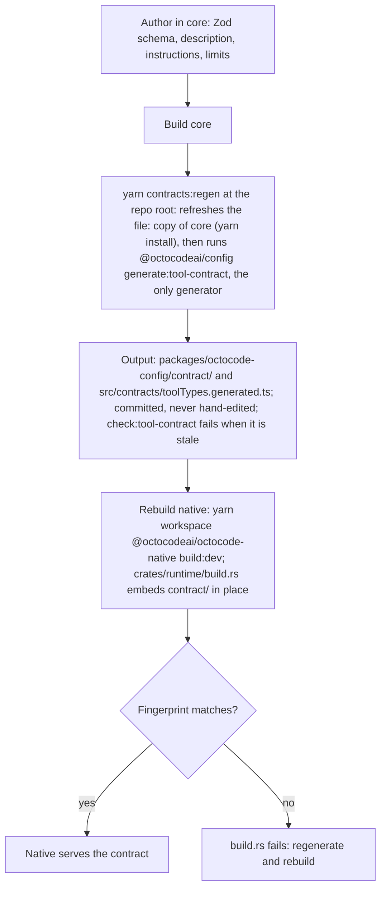

# Developing Octocode

This page owns the native crate map, the contract pipeline, build commands, development-only environment variables, and ownership rules. Repository-wide agent rules are in `<repo>/AGENTS.md`. The tool concept is in `<repo>/docs/OCTOCODE_PROTOCOL.md`.

Other dev docs: [ADDING_CONFIG.md](ADDING_CONFIG.md) (new settings), [TOOL_QUALITY.md](TOOL_QUALITY.md) (acceptance criteria), [RELEASE.md](RELEASE.md) (release gates), [scripts/README.md](../scripts/README.md) (root automation), and the [benchmark package](../../../packages/octocode-benchmark/README.md) (its results stay local in `packages/octocode-benchmark/results/`).

## Runtime flow

```text
octocode CLI launcher ─┐
octocode-mcp (stdio) ──┴──▶ octocode-native (Rust ToolRuntime: validate → execute → secure → shape)
                               ├──▶ embedded contract from @octocodeai/config (generated from octocode-core)
                               └──▶ configuration resolved in Rust, same rules as @octocodeai/config

octocode-mcp-vscode ──▶ editor MCP setup and GitHub sign-in/token sync
```

`octocode-native` is the one owner of public tool validation, providers, security, batching, pagination, response shaping, and cancellation. Interfaces register, delegate, render, or offer interactive selection.

## Native crates

The package map is in `<repo>/AGENTS.md`. Native Cargo crates under `packages/octocode-native/crates/`:

| Crate dir | Cargo name | Owns |
|---|---|---|
| `runtime` | `octocode-native` | Tool catalog, validation, config resolution, GitHub auth, providers, security, response shaping, pagination, `clasify`; `build.rs` embeds `packages/octocode-config/contract/` |
| `engine` | `octocode-engine` | Primitives: text search, tree-sitter AST, LSP client pool, minification, secret scanning, code graph |
| `github` | `octocode-github` | GitHub REST/GraphQL transport, bounded provider operations, credential traits |
| `cli` | `octocode-cli` | The native `octocode` binary: tool commands, `schema`, `config`, `auth`, `graph`, `skill`, `install` |
| `runtime-napi` | `octocode-runtime-napi` | N-API adapter the MCP server loads in-process |

## Concept to code

Where each part of [the protocol](../../../docs/OCTOCODE_PROTOCOL.md) lives. Native paths are under `packages/octocode-native/`.

| Concept | Where |
|---|---|
| Contracts, descriptions, instructions, budgets | core `src/toolContract/` (`instructions.ts`, `descriptions.ts`, `publishedSchema.ts`, `validation/`, `outputSchemas.ts`, `limits.ts`) → `packages/octocode-config/contract/` |
| MCP startup, fingerprint gate, registration | `packages/octocode-mcp/src/native/index.ts` |
| CLI dispatch and exit codes | `crates/cli/src/cli/mod.rs` |
| Validation and row isolation | `crates/runtime/src/contracts/` (`validate.rs`, `mod.rs`) |
| Gate, dispatch, row shaping | `crates/runtime/src/runtime/engine.rs`, `domain_dispatch.rs` |
| Minimal output, next-step filtering | `crates/runtime/src/response/rows.rs` |
| Continuation compaction and brief inheritance | `crates/runtime/src/response/continuations.rs` |
| Page and lead split (`next` and `hints`) | `crates/runtime/src/response/channels.rs` |
| Rendering and response paging | `crates/runtime/src/response/render.rs`, `stage.rs`, `pager.rs` |
| Snapshot identity | `crates/runtime/src/tools/local_search/cursor.rs`; response tokens in `crates/runtime/src/response/pager.rs` |
| Path sandbox and directory pruning | `crates/runtime/src/policy/path.rs`, `policy/prune.rs` |
| Secret scanning and redaction | `crates/engine/src/security/`, `crates/runtime/src/security/content.rs` |
| Search and ranking | `crates/engine/src/search/` (`text_search.rs`, `relevance.rs`) |
| Minification | `crates/engine/src/minify/` |
| AST and rewrite | `crates/engine/src/structural/`, `crates/runtime/src/tools/ast_*` |
| LSP | `crates/engine/src/lsp/`, `crates/runtime/src/tools/lsp_search/` |
| Dependency graph | `crates/engine/src/graph/`, `crates/runtime/src/tools/ast_graph/` |
| GitHub client, rate-limit breaker, cache | `crates/github/src/` (`budget.rs`), `crates/runtime/src/runtime/github.rs`, `github_cache.rs` |
| `clasify` and context selection | `crates/runtime/src/tools/clasify/`, `tools/judgment/` (evaluator, cache, transport), `tools/selection.rs`, `providers/classification/` |
| Internal limits (timeouts, retries, page size, caches) | `crates/runtime/src/execution/limits.rs` |
| End-to-end harness | `packages/octocode-benchmark/local/e2e/harness/` |

## Contract pipeline



Regeneration needs `cargo install cargo-typify --version 0.8.0 --locked`. `tool_types.rs` holds only the generated types native source names and what they reach: after a native edit that starts or stops naming one, regenerate (`check:tool-contract` fails until then). Until native is rebuilt, the MCP server refuses to start and CLI `schema` refuses to describe tools. `OCTOCODE_ALLOW_CONTRACT_DRIFT=1` downgrades that to a warning outside production. Release order: [RELEASE.md](RELEASE.md).

### Adding a tool field

1. Add it in core and regenerate as above.
2. Declare and implement it in `crates/runtime/src/contracts/field-effect-coverage.json`.
3. A public limit change trips the `public_response_and_tree_limits_are_pinned` test by design. Update it deliberately.
4. Check the result against [TOOL_QUALITY.md](TOOL_QUALITY.md), then update `<repo>/docs/OCTOCODE_TOOLS.md`.

A new configuration setting follows [ADDING_CONFIG.md](ADDING_CONFIG.md).

## Build, test, lint

Run from the repo root. Repo-wide tasks run through `node skills-dev/octocode-dev/scripts/dev.mjs <task>`; the task table is in [SKILL.md](../SKILL.md#task-runner).

- `yarn workspace @octocodeai/octocode-native build:all`: release native binaries for all platforms (clears old binaries first). Root `yarn build:native:all` runs it.
- `yarn workspace @octocodeai/octocode-native check:target <platform>`: type-check one other platform (cargo-zigbuild or cargo-xwin) without linking; the fast loop for `cfg(windows)`/`cfg(target_os)` code. Details: [PUBLISHING.md](../../../packages/octocode-native/docs/PUBLISHING.md#build).
- `yarn contracts:regen`: regenerate the tool contract from core.

| Package | Test | Lint / format |
|---|---|---|
| native | `test` (scripts + vitest + `test:rust`), `test:rust` alone (nextest), `coverage:rust`, `check:features` | `lint` (clippy `-D warnings`), `fmt:rust`, `fmt:rust:check`, `deny`, `shear` |
| config | `test`, `check:tool-contract`, `check:config-contract` | `lint` |
| mcp, octocode, vscode | `test` | `lint` (eslint, prettier included), `format` (eslint `--fix`) |
| chrome-devtools, claude-plugin, codex-plugin | `test` | `lint` (prettier `--check`), `format` (prettier `--write`) |
| agents-communication, benchmark, mcp-cli, pi-extension | `test` | `lint` |

`$DEV format` runs every workspace `format` script.

### Tool health

`$DEV test:tools` (`packages/octocode-benchmark/local/e2e/harness/tool-health.mjs`) is the quick end-to-end alarm for every tool in the contract. It first runs the driver's self-test (`harness/tool-health/driver.test.mjs`), then runs each tool through the built CLI (`--json`) and the MCP stdio server and checks:

- **happy**: the primary operation exits 0, returns rows with the key fields, and validates against the contract `outputSchema`;
- **continuation**: walking the `next.*` page lead to its end gives non-empty pages, every row exactly once, and exactly the unpaged rows; `walks` cover a tool's other page channels (PR patch windows);
- **explore**: every seed is explored by `harness/tool-health/driver.mjs`. Every `next.*` and `hints.*` lead runs once, and every response must validate against its tool's `outputSchema`. A lead must be accepted and satisfy its key family's predicates (`harness/lead-predicates.mjs`, shared with `lead-replay`). A lead that cycles back to a query on its own path, or repeats another lead of the same response, fails;
- **facts**: hint and warning sentences of 30+ characters must not repeat tool descriptions or server instructions, and must not repeat in every call of a tool across different query shapes;
- **empty**: exit 1 with a hint or lead on both surfaces;
- **invalid**: a typed contract `errorCode`, exit 2;
- **parity**: the CLI and MCP evidence, page leads, status class and explored query graph match (`hints` are surface guidance and leads to CLI-only tools are excluded, since MCP omits those tools);
- **latency**: every call fits the tool's budget; all timings are recorded;
- **extra**: tool-specific checks, such as clone auth and the clone's local follow-up leads.


It is hermetic: a temp `OCTOCODE_HOME`/`HOME`, no user token, fixtures in `packages/octocode-benchmark/local/e2e/fixtures/tool-health/` (or a per-tool temp copy with extra files), and a loopback mock (`harness/tool-health/mock-server.mjs`) for GitHub REST (`GITHUB_API_URL`), git smart HTTP, an npm registry (`registryUrl` with `OCTOCODE_ALLOW_PRIVATE_REGISTRY`) and the classification provider (`OCTOCODE_CLASSIFICATION_API_HOST`). Every proxy variable points at a dead loopback port, so a request that would leave the machine fails the run. Each tool and surface gets its own fake GitHub token and its own MCP server. The runtime paces GitHub searches per token, so all tools run in parallel; a run takes about 15 s. `--deep` adds seeds for more operations and allows more leads per seed (about 25 s). A contract tool without a case fails the run. Cases live in `harness/tool-health/cases.mjs`.

Run it after `build:dev`. CI runs it in the `e2e` job after its own `build:dev`. To run some tools only, pass their names: `$DEV test:tools ghSearchCode,localFetch` (add `--deep` for the wider exploration).

Each tool prints one line, `PASS`/`FAIL`/`SKIP`, with its total and slowest-call time, call count and checks. A `FAIL` line names the first failing check, for example `FAIL ghSearchCode … — empty.hint.mcp: …`; every failing check is listed at the end. A check name is `<phase>.<what>[.<surface>]`, with phase happy, continuation, walk, explore, facts, empty, invalid, parity, latency or extra. A `SKIP` line states its reason, such as a missing TypeScript language server. Every check, its detail, the explored lead keys and per-call timings are in `packages/octocode-benchmark/local/e2e/results/tool-health.json`. The run exits non-zero on any `FAIL`.

### Cargo builds

- `build:dev` (debug native + TypeScript, no clean or lint) is the default local build; use `build` only for release or performance artifacts. Check exit codes, not output paths.
- Rust integration tests are one binary per crate: `tests/main.rs` declares each `tests/*.rs` as a `mod`.
- Don't commit local lld or sccache Cargo configuration.
- One build lane uses the repo's warm `target/`. Parallel lanes share at most three Cargo target directories in total, each in a scratch directory (never `target/<name>`), deleted when done. Cargo's lock serializes builds in one directory, and the same `--features` keeps compiled units shared.
- Reset a bloated `target/` with `dev.mjs clean:cache` (stale native copies) or `dev.mjs clean` (all build outputs). Most of the bloat is `target/debug/incremental`: Cargo keeps one session per crate hash and never removes one when features or the toolchain change; `clean:cache` drops them with our crates and keeps dependencies warm.
- After a `rust-toolchain.toml` bump, the old toolchain's dependency builds stay in `target/` (about 29 GiB on the 1.99.1 bump). `cargo sweep --toolchains <new-toolchain> .` (cargo-sweep) removes them, `target/platforms/` included, then `clean:cache` drops the stale incremental sessions.

### Rust dev tools

Install the prebuilt binaries once: `cargo binstall cargo-nextest cargo-deny cargo-shear cargo-llvm-cov cargo-hack cargo-mutants bacon` (or `brew install` the same names). rustup installs `llvm-tools` from `rust-toolchain.toml`. Scripts are in `packages/octocode-native`; run them with `yarn workspace @octocodeai/octocode-native <script>`.

| Tool | Script or command | Config | When |
|---|---|---|---|
| cargo-nextest | `test:rust` | `.config/nextest.toml` (CI sets `NEXTEST_PROFILE=ci`) | every change; CI |
| cargo-shear | `shear`: unused or misplaced dependencies, unlinked files, a doctest under `doctest = false` | `[package.metadata.cargo-shear]` | `verify`; CI |
| cargo-deny | `deny` | `deny.toml` | `verify`; CI |
| cargo-llvm-cov | `coverage:rust [--html \| --lcov --output-path lcov.info \| --summary-only]` | runs the `test:rust` selections in `target/llvm-cov-target` (about 17 GiB; delete it when done) | before and after test work |
| cargo-hack | `check:features`: every crate with each feature alone and with none (about 4 min warm) | | after changing `[features]` or `#[cfg(feature)]` code |
| cargo-mutants | `cargo mutants --in-diff <diff>` or `-f <file>` | `.cargo/mutants.toml` | occasionally, on changed code |
| bacon | `bacon`, `bacon clippy`, `bacon test`, `bacon test-engine` | `bacon.toml` | edit loop |

`scripts/test-rust-selections.cjs` reads the package and feature selections from `test:rust`; `coverage:rust` uses it, and a script test keeps the `bacon.toml` test jobs equal to them. Library crates set `doctest = false`: nextest runs no doctests, and `shear` fails if one appears.

## Development environment variables

These are not user settings and are not read from `.octocoderc`. User settings are in `<repo>/docs/CONFIGURATION.md`.

| Variable | Read by | Effect |
|---|---|---|
| `OCTOCODE_NATIVE_BIN` | `octocode` launcher | Absolute path to a native `octocode` binary used instead of the platform package. Ignored when `NODE_ENV=production`; the bundled CLI honors it only with `NODE_ENV` `development` or `test` |
| `OCTOCODE_NATIVE_BINDING` | `octocode-mcp` | Path to a candidate `.node` addon. Ignored when `NODE_ENV=production`; the bundled `dist` honors it only with `NODE_ENV` `development` or `test` |
| `OCTOCODE_ALLOW_CONTRACT_DRIFT` | `octocode-mcp`, CLI `schema` | `1` turns the fingerprint mismatch into a stderr warning; same `NODE_ENV` limits |
| `XDG_CONFIG_HOME` | native `octocode install` (Linux) | Locates IDE config directories (default `~/.config`); never moves the Octocode home |

## Ownership rules

- `crates/engine` exposes primitives, not tool policy.
- `crates/cli/src/cli/skill/` owns skill commands and filesystem behavior. Its build script embeds public `skills/` through the same staging filter used by the Node package; Node is needed at build time, not for native skill commands.
- Each doc topic has one owner; see `<repo>/docs/README.md`. Per-package invariants are in each package `ARCHITECTURE.md`.
