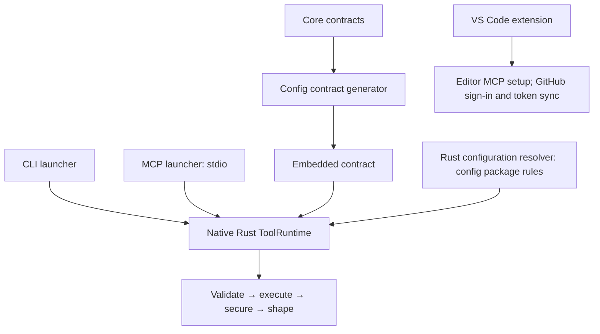
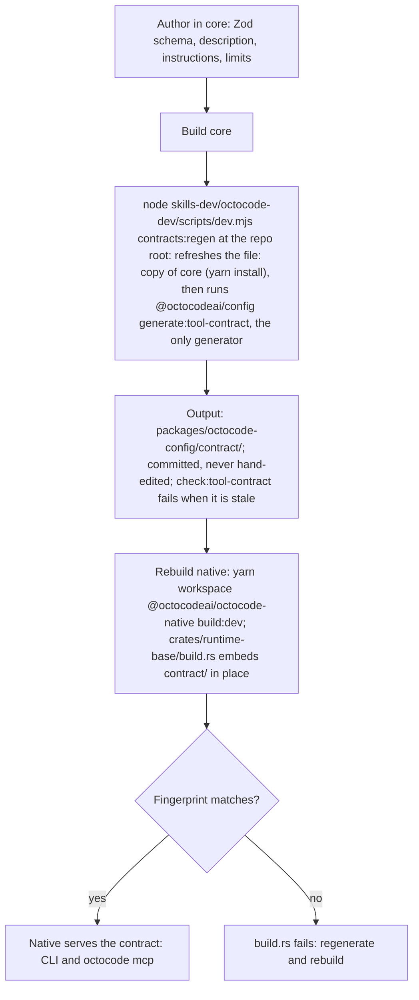

# Developing Octocode

This page owns the native crate map, the contract pipeline, build commands, development-only environment variables, and ownership rules. Repository-wide agent rules are in `<repo>/AGENTS.md`. The tool concept is in `<repo>/docs/OCTOCODE_PROTOCOL.md`.

Other dev docs: [ADDING_CONFIG.md](ADDING_CONFIG.md) (new settings), [TOOL_QUALITY.md](TOOL_QUALITY.md) (acceptance criteria), [RELEASE.md](RELEASE.md) (release gates), [scripts/README.md](../scripts/README.md) (root automation), and the [benchmark](../../../packages/octocode-benchmark/README.md) (behavioral docs; stored results stay local, indexed in `packages/octocode-benchmark/results/README.md`).

## Runtime flow



`octocode-native` is the one owner of public tool validation, providers, security, batching, pagination, response shaping, and cancellation. Interfaces register, delegate, render, or offer interactive selection.

## Native crates

The package map is in `<repo>/AGENTS.md`. Native Cargo crates under `packages/octocode-native/crates/`:

| Crate dir | Cargo name | Owns |
|---|---|---|
| `runtime` | `octocode-native` | The facade: tool catalog, admission and dispatch, the build identity (`build.rs`), and the tests that cross a tool seam |
| `runtime-base` | `octocode-runtime-base` | The layers below the tools: identifiers, validation, config resolution, GitHub auth, providers, security, response shaping, pagination; `build.rs` embeds `packages/octocode-config/contract/`; the tools' test fixtures (`test_support`, feature `test-support`) |
| `tools-shared` | `octocode-tools-shared` | Modules two or more tools use (walks, judgment, selection, leads, source view and capture), layered by `SHARED_LAYERS` in `crates/runtime/src/tools/module_boundaries/tool_edges.rs` |
| `tool-*` | `octocode-tool-*` | One crate per tool family: `tool-graph` (`ast_graph`), `tool-lsp`, `tool-github` (`gh_*`), `tool-local` (`local_search`, `structure_search`, `local_fetch`), `tool-ast`, `tool-packages` (`security_check`, `artifact_search`, the `artifact` providers), `tool-clasify`; a tool imports no other tool |
| `test-support` | `octocode-test-support` | Test fixtures no release build links: `mock_http` (wiremock) and the engine's conformance grammar; a dev-dependency only |
| `engine` | `octocode-engine` | Primitives: text search, tree-sitter AST, LSP client pool, minification, secret scanning, code graph |
| `io` | `octocode-io` | Shared low-level I/O, HTTP and resource primitives; no tool or provider policy |
| `contract-types` | `octocode-contract-types` | Generated tool wire types from the config contract; no hand-written schema or tool logic |
| `contract-base` | `octocode-contract-base` | The generated wire types the crates below `contract-types` name (`octocode_contract_base::…`); `contract-types` re-exports them |
| `github` | `octocode-github` | GitHub REST/GraphQL transport, bounded provider operations, credential traits |
| `cli` | `octocode-cli` | The native `octocode` binary: tool commands, `schema`, `config`, `auth`, `graph`, `skill`, `install`, and the stdio MCP server (`mcp`, on rmcp) |

## Concept to code

Where each part of [the protocol](../../../docs/OCTOCODE_PROTOCOL.md) lives. Native paths are under `packages/octocode-native/`.

| Concept | Where |
|---|---|
| Contracts, descriptions, instructions, budgets | core `src/toolContract/` (`tools/<tool>.ts`, `instructions.ts`, `published*.ts`, `output*.ts`, `limits.ts`) → `packages/octocode-config/contract/` |
| MCP server: startup, tool listing from the embedded presentation, call dispatch | `crates/cli/src/cli/mcp_server.rs`, `mcp_server/` (`listing.rs`, `handler.rs`) |
| MCP launcher: runs `octocode mcp` | `packages/octocode-mcp/src/index.ts` |
| CLI dispatch and exit codes | `crates/cli/src/cli.rs` |
| Validation and row isolation | `crates/runtime-base/src/contracts.rs`, `contracts/validate.rs` |
| Gate, dispatch, row shaping | `crates/runtime/src/runtime/engine.rs`, `domain_dispatch.rs` |
| Minimal output, next-step filtering | `crates/runtime-base/src/response/rows.rs` |
| Continuation compaction and brief inheritance | `crates/runtime-base/src/response/continuations.rs` |
| Page and lead split (`next` and `hints`) | `crates/runtime-base/src/response/result.rs` (follow-up calls), `notices.rs` (static notices) |
| Rendering and response paging | `crates/runtime-base/src/response/stage.rs`, `pager.rs` |
| Snapshot identity | `crates/tool-local/src/local_search/cursor.rs`; response tokens in `crates/runtime-base/src/response/pager.rs` |
| Path sandbox and directory pruning | `crates/runtime-base/src/policy/path.rs`, `policy/prune.rs` |
| Secret scanning and redaction | `crates/engine/src/security/`, `crates/runtime-base/src/security/content.rs` |
| Search (walk-order streaming and whole-scope scans) | `crates/engine/src/search/` (`text_search.rs`, `text_search/stream.rs`) |
| Minification | `crates/engine/src/minify/` |
| AST and rewrite | `crates/engine/src/structural/`, `crates/tool-ast/src/ast_search/`, `crates/tools-shared/src/ast_rule/` |
| LSP | `crates/engine/src/lsp/`, `crates/tool-lsp/src/lsp_search/` |
| Dependency graph | `crates/engine/src/graph/`, `crates/tool-graph/src/ast_graph/` |
| GitHub client and rate-limit breaker | `crates/github/src/` (`budget.rs`), `crates/runtime/src/runtime/github.rs` |
| `clasify` and context selection | `crates/tool-clasify/src/clasify/`, `crates/tools-shared/src/judgment/` (evaluator, transport), `crates/tools-shared/src/selection.rs`, `crates/runtime-base/src/providers/classification/` |
| Internal limits (timeouts, retries, page size, retained work) | `crates/runtime-base/src/execution/limits.rs` |
| Loopback providers and the answer recorder | `skills-dev/octocode-dev/scripts/providers/` |

## Contract pipeline



Regeneration needs `cargo install cargo-typify --version 0.8.0 --locked`. `tool_types.rs` holds only the generated types native source names and what they reach, one type per shape: typify's per-position copies of one shape merge into one type, and a name native source uses stays that type's name. After a native edit that starts or stops naming one, regenerate (`check:tool-contract` fails until then). The binary embeds the contract it serves (CLI and `octocode mcp` alike), so a stale contract fails the native build and there is no runtime override. Release order: [RELEASE.md](RELEASE.md).

### Adding a tool field

1. Add it in core and regenerate as above.
2. Implement it, then declare its effect in `crates/runtime-base/src/contracts/field-effect-coverage.json`, or confirm it inherits its nearest declared ancestor's effect (a path with no entry inherits). `$DEV test:dev -- field_effect_coverage::` fails on an unresolved path or a stale key.
3. A public limit lives in core and reaches native as the contract's `limits`: change it there and regenerate (`check:tool-contract` fails on a stale copy). Tests assert the invariant the limit protects, never its value.
4. Check the result against [TOOL_QUALITY.md](TOOL_QUALITY.md), then update `<repo>/docs/OCTOCODE_TOOLS.md`.

A new configuration setting follows [ADDING_CONFIG.md](ADDING_CONFIG.md).

## Build, test, lint

Run from the repo root. Repo-wide tasks run through `node skills-dev/octocode-dev/scripts/dev.mjs <task>`; the task table is in [SKILL.md](../SKILL.md#task-runner).

- `yarn workspace @octocodeai/octocode-native build:all`: release native binaries for all platforms (clears old binaries first). `$DEV build:publish` runs it.
- `yarn workspace @octocodeai/octocode-native check:target <platform>`: type-check one other platform (cargo-zigbuild or cargo-xwin) without linking; the fast loop for `cfg(windows)`/`cfg(target_os)` code. Details: [PUBLISHING.md](../../../packages/octocode-native/docs/PUBLISHING.md#build).
- `node skills-dev/octocode-dev/scripts/dev.mjs contracts:regen`: regenerate the tool contract from core.

| Package | Test | Lint / format |
|---|---|---|
| native | `test` (`test:scripts` + `test:node` + `test:rust`), `test:rust` alone (libtest, and nextest for the child-process tests), `coverage:rust`, `check:features`, `mutants` | `lint` (`lint:oxlint`, then `lint:own`: clippy `-D warnings`), `fmt:rust`, `fmt:rust:check`, `deny`, `shear` |
| config | `test`, `test:coverage`, `check:tool-contract`, `check:config-contract` | `lint` (`lint:own`: config contract check; then `lint:oxlint`; `build` checks the tool contract) |
| mcp, octocode, vscode | `test`, `test:coverage` (the floors: `verify:own` and `test:ci` run it) | `lint` (`lint:own`: prettier `--check` and the package's checks; then `lint:oxlint`), `format` (prettier `--write`) |
| chrome-devtools, claude-plugin, codex-plugin | `test` | `lint` (`lint:own`: prettier `--check` and the package's checks; then `lint:oxlint`), `format` (prettier `--write`) |
| agents-communication | `test` | `lint` (`lint:own`: catalog and generated-types checks; then `lint:oxlint`) |
| mcp-cli | `test`, `test:coverage` | `lint` (`lint:oxlint` only; no `lint:own`) |

`$DEV format` runs every workspace `format` script. Every workspace `typecheck` is `tsgo --noEmit` (`@typescript/native-preview`, pinned at the root); native's Rust types are checked by its clippy `lint`.

### Lint and typecheck rules

- **oxlint**: the root `.oxlintrc.json` is the only lint config. Each workspace splits its lint in three scripts: `lint:oxlint` runs `yarn run -T oxlint -c ../../.oxlintrc.json .`, `lint:own` holds every other check (prettier, manifest and generator `--check`, Python and shell syntax, clippy; absent in mcp-cli, which has none), and `lint` runs both, so `yarn workspace <pkg> lint` alone is the package's full lint. `verify` follows the same split: `verify:own` is the gate without oxlint and `verify` adds `lint:oxlint` (workspace-health requires `verify:own` beside `verify`). Repo-wide tasks run oxlint once, in the baseline pass below, over the directories the workspaces' `lint:oxlint` scripts cover (the packages, and `skills/` for the shared skills workspace); they run only each workspace's `lint:own` and `verify:own`. The config's `options` turn on type-aware rules and deny warnings, so every rule is an error. Beyond the correctness and suspicious categories it sets `typescript/no-explicit-any`, `typescript/consistent-type-imports`, `typescript/no-floating-promises`, `import/no-cycle` and `no-console` (off for tests, `bin/`, `scripts/`, `tools/` and build files). Generated files (`*.generated.*`) are ignored.
- **oxlint baseline**: violations that predate a rule are recorded in `.oxlintrc.baseline.json` (the root config `extends` it): one override per file that switches a rule off. The baseline only shrinks. `node skills-dev/octocode-dev/scripts/oxlint-baseline.mjs` fails on a stale entry (a rule the file no longer violates) and on a violation without one; `--write` removes stale entries but never adds one. Fix new violations in the code. Core (`../octocode-mcp-host/packages/octocode-core`) lints with copies of both files; this repo's are canonical, and `$DEV verify` runs `core-lint-sync.mjs`, which fails when core's `scripts/oxlint-baseline.mjs` is not byte-identical or its `.oxlintrc.json` rules differ (its `$schema`, `ignorePatterns` and overrides scoped to `packages/...` are layout-specific), and skips without the sibling checkout.
- **TypeScript**: every project extends the root `tsconfig.base.json` (`strict`, `verbatimModuleSyntax`, `isolatedModules`). Typecheck with `tsgo --noEmit`; declarations are still emitted by `tsc` (TypeScript 6) in the packages that publish them.

`$DEV lint`, `lint:ci` and `verify` run the oxlint baseline first (their one oxlint run), then each workspace's `lint:own` (`lint`, `lint:ci`) or `verify:own` (`verify`); CI runs `lint:ci` and `typecheck:ci`.

### Local static checks

| Command | What runs | When |
|---|---|---|
| `$DEV check` | The oxlint baseline, rustfmt, `lint:rust`, every other workspace's `lint:own`, and every typecheck, with workspaces in parallel. No build, no tests | Before handing over a change, with a focused test (`$DEV test:dev -- <filter>`) |
| `$DEV lint:rust` | Plain clippy, then the ratchet below | After a Rust edit, when `check` is more than you need |
| `$DEV verify` | Builds, every test, `deny`, `shear`, docs | Cross-package handoff |

**Clippy ratchet** (`scripts/rust-lint.mjs`, local only; CI and `cargo clippy` keep `-D warnings` on `clippy.toml`). It adds production-only lints and bans, passed on the command line and through a config generated under `target/rust-lint/`, so `Cargo.toml` and plain clippy do not change. Bans and their reasons are in `packages/octocode-native/clippy-ratchet.toml`: fixed durations and sleeps, `Vec::truncate`, child processes, HTTP client construction, unbounded `fs::read`, non-atomic `fs::write`. Findings that predate a rule are in `clippy-baseline.json`, counted per crate because refactors keep moving code between files. A crate that grows fails and names the files; one that shrinks is stale until `--write`. A site that must stay says why: `#[expect(clippy::disallowed_methods, reason = "...")]`. Tests are not judged by the ratchet.

**Evaluated on 2026-11-05, not adopted** (counts are production findings; reviewed against ruff, uv, oxc and rust-analyzer at their 2026-11-05 heads):

| Check | Findings | Why not |
|---|---|---|
| Clippy `pedantic` + `nursery` wholesale | About 8,000 | Style. Lints worth having are picked into the ratchet |
| `indexing_slicing` | 2,231 | No real bug in the sample; panics are contained per row. `string_slice` covers the Unicode class |
| `arithmetic_side_effects`, `as_conversions` | 2,147, 784 | Noise. `cast_possible_truncation` has 2 production hits and is in the ratchet |
| `significant_drop_in_scrutinee`, `significant_drop_tightening` | 7, 32 | All 7 read: no held lock across a blocking body; edition 2024 fixed the `else` case. `await_holding_lock` is already on through `clippy::all`, 0 hits |
| `iter_over_hash_type` | 11 | 5 read: results are sorted or keyed, order never reaches output |
| `large_futures` | 29 | Largest 26 KB, no stack risk shown |
| `let_underscore_must_use`, `map_err_ignore`, `filetype_is_file` | 117, 255, 26 | Deliberate in the sample |
| `cargo-audit` | 1 beyond `deny` | RUSTSEC-2026-0383 `webpki-root-certs`: in `Cargo.lock`, not in the graph of any shipped target, which `deny` prunes correctly |
| `cargo-machete` | 2 | Both false: `include!`d generated code; `shear` has them listed with reasons |
| `ast-grep` rules | 28 literal `.take(N)`, 3 `.lock().unwrap()` | 0.8 s and precise, but no bug in the sample; the source-scan tests hold the rest. Use `astSearch` for one-off audits |
| Ruff, shellcheck in a gate | 14, 3 | One real bug (a duplicate dict key in `pep440/oracle.py`) over 51 mostly benchmark scripts: run once by hand with `uvx ruff check --select F,B`, `uvx --from shellcheck-py shellcheck` |
| `semgrep` | Not run | `ast-grep` answers the same patterns without its install or metrics |

**Rules that stay tests:** `module_boundaries` resolves `use` paths and layers, and `no_error_code_is_spelled_as_a_string` reads JSON strings: clippy sees neither. Bans on a named call are the lint's job.

### Tool checks and recorded answers

Sanity and end-to-end checks of the built CLI and MCP server are behavioral: an agent makes the calls and
judges each answer by reading it, through the checklists in [tool checks](../../../packages/octocode-benchmark/CHECKS.md)
(sanity after a build, end to end before a release). No harness script runs them. Package tests stay the
regression net: native `cargo` tests with mocked providers and the packages' unit tests.

The native mocks replay real provider answers from `test-utils/provider-answers`. `$DEV answers:record [id,...]`
re-records them live through the built CLI ([recorder](../scripts/providers/record.mjs), cases in
`recorded-plan.mjs`); it refuses a recording that holds the token or a private repository, loses a field path
when trimmed, or makes the tool ask anything else.

### Cargo builds

- `build:dev` (debug native + TypeScript, no clean or lint) is the default local build; use `build` only for release or performance artifacts. Check exit codes, not output paths.
- Judge speed and memory only on native `build` or `--profile profiling`. `build:dev` keeps Octocode's own crates at opt-level 0, which overstated their instruction counts by 1.4–9× in the 2026-11-04 audit.
- Rust integration tests are one binary per crate: `tests/main.rs` declares each `tests/*.rs` as a `mod`.
- Don't commit local lld or sccache Cargo configuration.
- Use the repository’s shared `target/` and one build owner, per the [working rules](../../../AGENTS.md#working-rules). Other lanes run focused checks and reuse matching artifacts; do not create private targets or clean a concurrent build.
- At most two Rust builds run on the machine at once (owner's decision, 2026-11-17: five concurrent builds drove the load to 59–172 on 12 cores and 32 GB). `packages/octocode-native/scripts/build-slot.cjs` enforces it with two slots in `os.tmpdir()/octocode-build-slots/`, which every session and isolated copy shares: `build:dev` and `build` (per platform job), `test:rust`, `coverage:rust`, `$DEV test:dev`, `lint:rust` (and `check`), `lint:own`, `check:features`, `mutants`, `fuzz`, `miri` and `llvm-lines` hold one for their whole run. A waiting job prints who holds each slot about once a minute; a slot whose process died is reclaimed; a wrapper started by another wrapper reuses its slot. `OCTOCODE_BUILD_SLOTS` overrides the count. A bare `cargo build`, `test`, `clippy` or `nextest` takes no slot: run any other cargo build as `node scripts/build-slot.cjs -- cargo …` in `packages/octocode-native`.
- `test:rust`, `coverage:rust` and each test binary of `$DEV test:dev` (through `scripts/test-watchdog.cjs`) run with a private `TMPDIR`, `/tmp/octocode-rust-test-XXXXXX` (`scripts/test-tmpdir.cjs`), removed when the run ends, so a test killed by nextest's timeout or the watchdog leaves nothing in the system temp dir. That root is a backstop, not a cleanup: a test removes what it creates (an RAII `tempfile` dir or the crate's `test_support` temp dir, never a path built by hand under `temp_dir()`), and a test that starts a warm server owns its socket namespace and stops it (`persistent_cli`). It lives in `/tmp` because a serve test's socket path, 52 bytes past `TMPDIR`, would not fit macOS's 104-byte `sockaddr_un` under the per-user temp dir.
- Most of the `target/` bloat was incremental `.rcgu.o` objects: since rustc 1.88 their names carry a random per-run segment and `split-debuginfo = "unpacked"` keeps them, so every rebuild left a new set ([rust-lang/rust#161824](https://github.com/rust-lang/rust/issues/161824); on 2026-11-13, 731k of 737k `target/debug/deps` entries, 307 GiB). `[profile.dev] incremental = false` stops it; never set `CARGO_INCREMENTAL=1`. The rest is one copy of our crates per package, feature and toolchain selection, which Cargo never removes (78 copies of `octocode_native` the same day).
- `build:dev`, `test:rust` and `lint:rust` record the units each run used (from Cargo's JSON messages) in `target/.keep/`; the build and test runs also delete stale `.rcgu.o` of the units they recompiled and print `deps: N entries`. At the end of a round the build owner runs `$DEV prune:rust` (`--dry-run` previews): it refuses while any cargo, rustc or nextest process runs, then deletes `deps/`, `.fingerprint/` and `build/` entries no keep record of the last 7 days lists, `incremental/` dirs, `target/rust-lint/{debug,tmp}`, and files copied into `target/<profile>/`. It leaves profile dirs no record names and everything outside `target/`, such as the staged `npm/<platform>/octocode`. `$DEV clean:cache` (every copy of our crates, dependencies stay warm) and `$DEV clean` (all build outputs) remain the full resets, after coordinating with other sessions.
- Benchmark campaigns keep a `build/` snapshot so a resumed run uses the same build. Remove it only when the campaign is final; `fingerprint.txt` records which build ran.
- After a `rust-toolchain.toml` bump, the old toolchain's dependency builds stay in `target/` (about 29 GiB on the 1.99.1 bump). `cargo sweep --toolchains <new-toolchain> .` (cargo-sweep) removes them, `target/platforms/` included; `prune:rust` also drops them from the profile dirs a keep record names once each selection has run on the new toolchain.

### Rust dev tools

Every tool's version, and the dated nightly the opt-in tools use, is pinned in `packages/octocode-native/dev-tools.json`. `$DEV rust:tools` compares it with what is installed and prints `cargo install --locked <tool>@<version>` (or the `rustup` command) for anything missing or different; no task or build installs anything. CI installs the tools it gates on at these same pins: each workflow reads them with `rust-quality.mjs pins <tool...>`. Prebuilt binaries (`cargo binstall <tool>@<version>`, or `brew install`) are fine at the pinned version. rustup installs `llvm-tools` from `rust-toolchain.toml`. Scripts are in `packages/octocode-native`; run them with `yarn workspace @octocodeai/octocode-native <script>`.

| Tool | Script or command | Config | When |
|---|---|---|---|
| cargo-nextest | `test:rust`, for the tests that start real child processes (`PROCESS_TESTS` in `scripts/rust-tests.cjs`) | `.config/nextest.toml` (CI sets `NEXTEST_PROFILE=ci`) | every change; CI |
| cargo-shear | `shear`: unused or misplaced dependencies, unlinked files, a doctest under `doctest = false` | `[package.metadata.cargo-shear]` | `verify`; CI |
| cargo-deny | `deny` | `deny.toml` | `verify`; CI |
| cargo-llvm-cov | `coverage:rust [--html \| --lcov --output-path lcov.info \| --summary-only]` | runs the `test:rust` selections in `target/llvm-cov-target` (about 17 GiB; delete it when done) | before and after test work |
| cargo-hack | `check:features`: every crate with each feature alone and with none (about 4 min warm) | | after changing `[features]` or `#[cfg(feature)]` code |
| cargo-mutants | `$DEV mutants --in-diff <diff>` or `-f <file>` | `.cargo/mutants.toml` | manually, on changed code; it copies the tree and builds it, so never per commit |
| samply | `$DEV profile` | `[profile.profiling]` | finding where a flow's CPU goes |
| bacon | `bacon`, `bacon clippy`, `bacon test` | `bacon.toml` | edit loop |
| cargo-fuzz (nightly) | `$DEV fuzz:smoke` (60 s per target), `$DEV fuzz` (600 s); `[--seconds N] [--target-dir D] [target...]` | `fuzz/` workspace; bounds in `dev-tools.json` | after changing code a target covers; never CI |
| Miri (nightly) | `$DEV miri`: the selected tests, deadline 1500 s | `miri` in `dev-tools.json` | after changing `unsafe`, offset or concurrency code they cover |
| cargo-llvm-lines | `$DEV llvm-lines [package] [--timings]` | builds in `target/llvm-lines` (delete when done) | investigating compile time or binary size; not a gate |

`scripts/rust-tests.cjs` holds the package and feature selections and runs them for `test:rust` and `coverage:rust`; a script test keeps the `bacon.toml` test jobs and the `cargo dev-test` alias equal to them. `test:rust` runs one build (`cargo test --no-run`, whose JSON messages name every test executable), then two runs at once: libtest over every test but `PROCESS_TESTS`, its binaries side by side, slowest first, each under the watchdog (`scripts/test-binaries.cjs`), and nextest over `PROCESS_TESTS` (one process per test); the script says why. A test that shares a process keeps no process-global state: a hook is thread-local or a guard that restores it on drop, a test forgets only what its own calls kept (its own temp workspace is its own store key), and time it asserts on is a frozen or injected clock or a count of work, never the wall clock. `$DEV test:dev [--crate <name>]... [--lib] -- <filter>` runs the same build, then only the named crates' test binaries (every crate without `--crate`; only unit-test binaries with `--lib`), side by side, in a build slot; `scripts/test-watchdog.cjs` fails a test still unfinished 10 minutes after libtest's slow-test line. The `cargo dev-test` alias stays for direct use and `bacon`, and runs the binaries one after another. `bacon` jobs run cargo directly, outside the slots. Library crates set `doctest = false`: nextest runs no doctests, and `shear` fails if one appears.

#### Fuzzing, Miri and IR size

- **Fuzz workspace**: `packages/octocode-native/fuzz` has its own `[workspace]` and `Cargo.lock` (the main workspace `exclude`s it), `publish = false`, and the only `libfuzzer-sys` dependency. Builds go to `fuzz/target` (or `--target-dir`). `utf8_offsets` compiles the engine's `text/utf8_offsets.rs` by path and checks every conversion against a naive oracle under both line rules. Only `fuzz/seeds/<target>` is committed; libFuzzer grows `fuzz/corpus/` and writes crashes to `fuzz/artifacts/` (both gitignored). A crash becomes a deterministic test in the crate it exercises (for example `text/utf8_offsets/tests/fuzz_regressions.rs`), never a committed input.
- **Miri**: interprets only the selections in `dev-tools.json`: the `KeyedFlight` thread tests (its `ManuallyDrop` release, eight scheduler seeds) and the `LineIndex` offset tests. Out of reach, recorded there under `unsupported`: the tokio IO driver (`kqueue` on macOS), FFI (libc, Windows, N-API), C libraries (tree-sitter, PCRE2), wall-clock assertions, and the proptests and naive-scan checkpoint test, too slow to interpret (the fuzz target covers them). A test whose loop only needs to be shorter shrinks it under `cfg!(miri)` instead of being skipped. A warm run takes about 30 s.
- **cargo-llvm-lines**: `--timings` first records `cargo build --timings` for the same package and features. Baseline (engine lib, `--all-features`, 2026-10-23): 788,653 IR lines in 31,986 copies; 43% are `core`/`alloc`/`std` generics, 20% engine code, 10% `oxc_parser`; the largest engine items are serde `Deserialize` visitors of `RawRule`, instantiated once per deserializer. Look there before changing profiles.
- **Evaluated, not adopted** (2026-10-23): Dylint `non_local_effect_before_unhandled_error` found its calibration positives and stayed quiet on the negatives, but on engine, github and io it reported one false positive (an error recorded and returned as `None`) and gave up on two functions at its work limit, so a separate `rustc-dev` nightly and `--ignore-rust-version` were not worth it. Shuttle schedules only its own primitives: `KeyedFlight` uses std and tokio locks and thread parking, so Shuttle missed a reintroduced drop-order race in 40,000 schedules; Miri caught it in the first wave and real threads within 5,000 waves. It would need a test-only facade over those primitives.

## Profiling a tool flow

One command, macOS and Linux:

```bash
node scripts/build-slot.cjs -- cargo build --locked --profile profiling -p octocode-cli   # in packages/octocode-native; --build skips the slot
$DEV profile localSearch '{"path":"crates","matchString":["fn "]}' --cwd packages/octocode-native --phase repeat
samply load .octocode/octocode-dev/profile/<run>/profile.json.gz   # the flamegraph
```

`--phase` picks what is measured: `first` (a fresh MCP server's first call), `repeat`, `page:N`, or `one` (a whole one-shot CLI process). It prints min-of-3 retired instructions and peak footprint measured without a sampler, then samples a server looping that phase, and writes `top.md` (self and inclusive shares by CPU time, for the loop only) beside `counters.json` under `.octocode/octocode-dev/profile/`. Wall time is noise on a shared machine: trust instructions. The Linux paths (`perf stat`, `heaptrack`) have not been run yet.

A plain CLI tool call is a thin client of the shared warm `octocode serve` process (`crates/cli/src/cli/serve.rs`). `time -l` on it shows near-zero CPU and about 12 MB RSS, and a repeated CLI call measures that server's memory, not the disk caches, so separate CLI processes are not separate runs. Measure through `$DEV profile` or a fresh `octocode mcp` process. `OCTOCODE_STORAGE_MODE=memory` runs in-process but refuses any answer that needs a continuation (`executionFailed`), so it cannot measure large answers.

`--heap` adds what the server still holds after the flow: `malloc_history` on macOS, `heaptrack` on Linux. It shows retained memory, not a transient peak; peak footprint is in the counters. `dhat` is not wired in because it needs a global allocator in the product.

## Development environment variables

These are not user settings and are not read from `.octocoderc`. User settings are in `<repo>/docs/CONFIGURATION.md`.

| Variable | Read by | Effect |
|---|---|---|
| `OCTOCODE_NATIVE_BIN` | `octocode` and `octocode-mcp` launchers | Absolute path to a native `octocode` binary used instead of the platform package. Ignored when `NODE_ENV=production`; the bundled launchers honor it only with `NODE_ENV` `development` or `test`. An installed `octocode` whose postinstall made its bin the native binary never reads it: run `node <package>/out/octocode.js` |
| `XDG_CONFIG_HOME` | native `octocode install` (Linux) | Locates IDE config directories (default `~/.config`); never moves the Octocode home |

## Ownership rules

- `crates/engine` exposes primitives, not tool policy.
- `crates/cli/src/cli/skill/` owns skill commands and filesystem behavior. Its build script embeds public `skills/` through the same staging filter used by the Node package; Node is needed at build time, not for native skill commands.
- Each doc topic has one owner; see `<repo>/docs/README.md`. Per-package invariants are in each package `ARCHITECTURE.md`.
