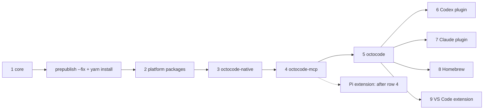

# Release checklist

Publishing is owner-triggered. It never runs from CI or an agent session. Contract pipeline and build commands: [DEVELOPMENT.md](DEVELOPMENT.md#contract-pipeline). Native platform packages: `<repo>/packages/octocode-native/docs/PUBLISHING.md`.

## What ships, where

One release line ships in lockstep at one version `<v>` (rows 2–5). Core keeps its own version and publishes first; the plugins and Homebrew follow once their pinned versions exist. `<p>` is each of `darwin-arm64`, `darwin-x64`, `linux-arm64-gnu`, `linux-x64-gnu`, `linux-x64-musl`, `win32-arm64-msvc`, `win32-x64-msvc`.

| # | Artifact | What it is | Channel | Build | Publish (from that directory) | Check after |
|---|---|---|---|---|---|---|
| 1 | `@octocodeai/octocode-core` | Tool contracts (Zod), descriptions, instructions | npm | in `octocode-mcp-host` | `npm publish` in `octocode-mcp-host/packages/octocode-core`, at the version pinned in `packages/octocode-config/package.json` | `npm view @octocodeai/octocode-core@<core> version` |
| 2 | `@octocodeai/octocode-native-<p>` ×7 | **The native binary**: `octocode` CLI, `octocode-native.<p>.node` addon | npm | `yarn workspace @octocodeai/octocode-native build:all` | `packages/octocode-native/npm/<p>`: `npm publish` | `npm view @octocodeai/octocode-native-<p>@<v> version` |
| 3 | `@octocodeai/octocode-native` | Platform selector (`optionalDependencies` pin each platform package exactly), Node runtime loader, `octocode-native` bin | npm | none (JS) | `packages/octocode-native`: `npm publish` | `npx -y @octocodeai/octocode-native@<v> --version` → `octocode <v>` |
| 4 | `octocode-mcp` | stdio MCP server (bundles `@octocodeai/config`; depends on core + native) | npm | `yarn workspace octocode-mcp build` | `packages/octocode-mcp`: `npm publish` | `npm view octocode-mcp dist-tags.latest` → `<v>` (`octocode install` writes `octocode-mcp@latest`) |
| 5 | `octocode` | Node CLI launcher (bundles the config development guard; forwards every command to native; ships the same skills) | npm | `yarn workspace octocode build` | `packages/octocode`: `npm publish` | `npx -y octocode@<v> --version` → `octocode <v>` |
| 6 | `@octocodeai/codex-plugin` | Codex plugin (pins `octocode-mcp@<v>`) | npm + git | runs in `prepack` | `packages/octocode-codex-plugin`: `npm publish`; then set `.agents/plugins/marketplace.json` to the plugin version and push this repo. Details: `packages/octocode-codex-plugin/ARCHITECTURE.md` | `npm view @octocodeai/codex-plugin version` |
| 7 | `@octocodeai/claude-plugin` | Claude Code plugin (pins `octocode-mcp@<v>`) | npm + git | runs in `prepack` | `packages/octocode-claude-plugin`: `npm publish --access public`; then publish `.claude-plugin/marketplace.json` with the same version. Details: `packages/octocode-claude-plugin/ARCHITECTURE.md` | `npm view @octocodeai/claude-plugin version` |
| 8 | Homebrew `bgauryy/octocode/octocode` | **The native binary** for macOS and Linux, no Node (downloads the row-2 tarballs) | git: tap repo `bgauryy/homebrew-octocode` | `node skills-dev/octocode-dev/scripts/dev.mjs brew:formula` renders `packages/octocode-native/homebrew/octocode.rb` (sha256 of the registry bytes; refuses when the host platform's published binary does not report `octocode <v>`) | copy it to `Formula/octocode.rb` in the tap repo; `brew audit --strict --online bgauryy/octocode/octocode`; push the tap | `brew install bgauryy/octocode/octocode && brew test bgauryy/octocode/octocode` |
| 9 | VS Code extension `bgauryy.octocode-mcp-vscode` | Editor extension; writes `octocode-mcp@latest` into MCP configs | VS Code Marketplace | `vscode:prepublish` builds | `packages/octocode-vscode`: `yarn run publish` (`vsce publish`, publisher `bgauryy`) | `npx -y @vscode/vsce@3.9.2 show bgauryy.octocode-mcp-vscode` |



Each row depends on the rows above it existing on npm.

Row 8 has not shipped yet: the tap still serves the old Node-based 2.0.0 formula, so user docs do not offer `brew install` until it does.

**Own cadence, not part of the lockstep release:**

| Package | Channel | Note |
|---|---|---|
| `@octocodeai/pi-extension` | npm | Own version; depends on `octocode-mcp` at a floor (`^<v>`, in `package.json` and `src/mcp/octocode.ts`), so it never runs an older server. Publish it after row 4: `node skills-dev/octocode-dev/scripts/prepublish.mjs --package @octocodeai/pi-extension` fails until `npm view octocode-mcp@<workspace version> version` succeeds. Raise the floor when the extension needs a newer server |
| `@octocodeai/octocode-agents-communication` | npm | Own version |
| `@octocodeai/octocode-chrome-devtools` | npm | Own version; bundles `@octocodeai/config` and `octocode-mcp-cli`. Check with `yarn workspace @octocodeai/octocode-chrome-devtools verify` |

**Never published** (private, bundled into rows 4–5 or dev-only): `@octocodeai/config`, `octocode-mcp-cli`, `@octocodeai/octocode-benchmark`.

### Before row 2

1. **Version:** every lockstep package, the platform pins in `packages/octocode-native/package.json` and `packages/octocode/package.json`, the `@octocodeai/octocode-native` dependency in `packages/octocode-mcp/package.json`, `workspace.package.version` in `packages/octocode-native/Cargo.toml`, `packages/octocode-mcp/manifest.json` and `server.json`. Then `yarn install`.
2. **Registry, not local resolutions:** `node skills-dev/octocode-dev/scripts/prepublish.mjs --fix`, `yarn install`, then `yarn workspace @octocodeai/config check:core-contract-sync:published`.
3. **Build after the bump:** `yarn workspace @octocodeai/octocode-native build:all`. Each staged `packages/octocode-native/npm/<p>/octocode --version` must print `<v>`; a binary built before the bump reports the old version, and npm never lets you replace a published version.
4. **Commit**, so the published `gitHead` names a real commit.

Then smoke-test from a clean temp dir (`npx -y octocode-mcp@<v>`, `npx -y octocode@<v> schema`), and as a project dependency, which is what exposes a bin collision or a binary that cannot describe itself:

```bash
dir=$(mktemp -d) && cd "$dir" && npm init -y >/dev/null
npm install octocode@<v>
readlink node_modules/.bin/octocode                         # → ../octocode/out/octocode.js
node_modules/.bin/octocode --version                        # → octocode <v>
node_modules/.bin/octocode schema localSearch --view query  # exit 0
bin=$(find node_modules/@octocodeai -path '*octocode-native-*' -name octocode -type f)
"$bin" --version                                            # → octocode <v>
"$bin" schema localSearch --view query                      # exit 0, no Node involved
npx -y @octocodeai/octocode-native@<v> --version            # → octocode <v>
npm view octocode-mcp dist-tags.latest                      # → <v>
```

Run `node skills-dev/octocode-dev/scripts/dev.mjs setup` to restore the dev resolutions.

- **No `prepublishOnly` gates.** Run the gates below yourself before `npm publish`; nothing blocks a publish automatically.
- **Config is never published.** `@octocodeai/config` is a private workspace package bundled by MCP and the launcher. MCP declares `@octocodeai/octocode-core` as an external runtime dependency. The launcher bundles only config's development-override guard and the shared native launch scripts; it does not import core or tool contracts.

## Gates (all must be green)

| Gate | Command | What it proves |
|---|---|---|
| Full verify | `yarn workspace @octocodeai/octocode-native verify` | fmt, clippy, tests, loader/ABI checks, contract freshness |
| Contract freshness (dev) | `yarn workspace @octocodeai/config check:tool-contract` | `packages/octocode-config/contract/` (embedded by native) is exactly what the resolved core generates |
| Contract sync (published) | `yarn workspace @octocodeai/config check:core-contract-sync:published` | Embedded contracts match the **npm-published** core at the pinned version. Run before publishing native |
| Docs links and catalog | `node skills-dev/octocode-dev/scripts/dev.mjs docs:verify` (repo root) | Doc links, workflow references, tool catalog and counts, and config keys match source |
| Launcher e2e | `yarn workspace octocode exec vitest run tests/e2e/launcher.e2e.test.ts` after `build:dev` (local; not in CI) | The built npm launcher drives the real native binary end-to-end |

## Failure playbook

| Failure | Action |
|---|---|
| `Generated tool contract is stale` | Core changed since the last regen. Run `yarn contracts:regen` (repo root) and re-verify. |
| `contract-sync: FINGERPRINT MISMATCH` in `--published` mode | Publish the matching core first (step 1), or align the pinned core version. Never publish native around this gate. |
