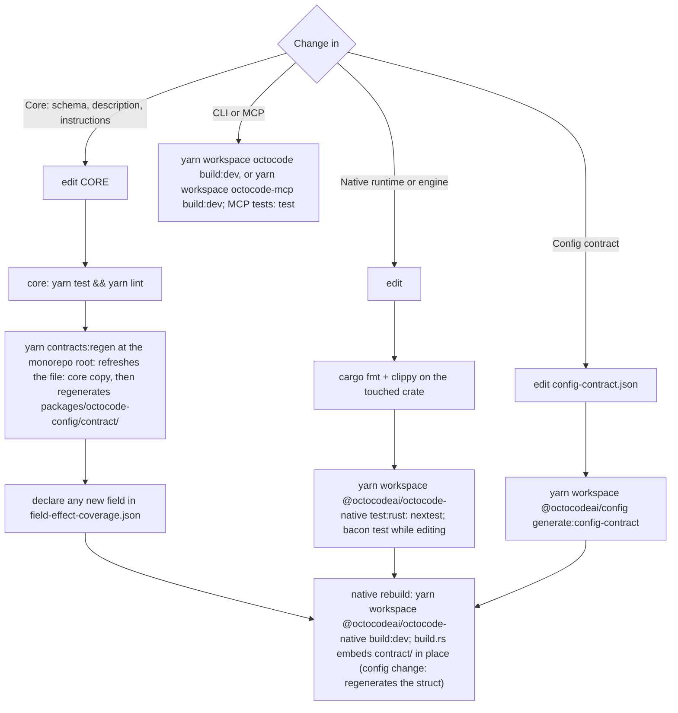

# Fix and verify

Load before editing and before reporting done. Changes cross two repos and a generated embed; the wrong order ships a stale contract that tests still pass on.

## Before editing

- Baseline the affected package tests/lint and save the output to scratch; attribute every later failure against it.
- `git status` the files you will touch — another session may own in-flight edits there.

## Landing order

Every branch except CLI or MCP ends at the native rebuild. `<repo>/AGENTS.md` draws the core and native-change flows.

Provenance records the core package version; release order is in `docs/RELEASE.md` (owned by the human).

## Verify through the real path

1. `yarn workspace @octocodeai/config check:tool-contract` — `contract/` matches core.
2. `$OCTO schema <tool> --view query` shows the changed contract.
3. Re-run the reproducing call from the finding via CLI; it now passes.
4. Re-run via a restarted host server or a fresh stdio MCP session.
5. Execute required `next.*` and response continuations to termination. Check affected typed `related[]` calls as fresh requests; `hints[]` contains prose.
6. Re-run `scripts/tool-inventory.mjs <tool>`; the fixed field is no longer flagged.
7. Package tests + lint green vs baseline.

Claim–evidence: record each check as passed / failed / skipped / unavailable with its command and scope.
